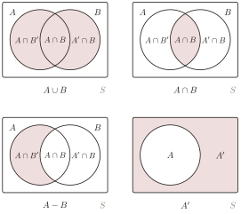
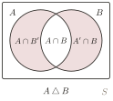
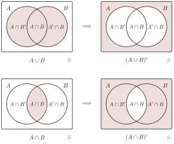
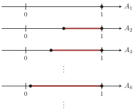
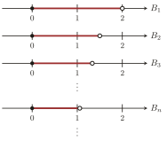
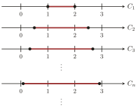
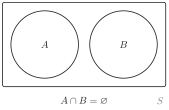
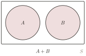

[上一篇](/lecture-notes/random-experiments-sample-space-events/)將事件定義為樣本空間的子集合。既然事件本質上就是集合，討論事件之間的關係時，自然可以透過集合的運算來描述；本篇便由此引入各種集合算子及其基本性質。

## 聯集、交集、差集與餘集

兩個集合之間的常見運算有下列四種。

Definition 1.7 (Set Operations)

若 $A,B\subseteq S$，則

(1) **聯集 ($A\cup B$, union)**
{: .topic-paren-item}

$$
A\cup B=\lbrace\,x\mid x\in A\text{ 或 }x\in B\,\rbrace
$$

(2) **交集 ($A\cap B$, intersection)**
{: .topic-paren-item}

$$
A\cap B=\lbrace\,x\mid x\in A\text{ 且 }x\in B\,\rbrace
$$

(3) **差集 ($A-B$, difference)**
{: .topic-paren-item}

$$
A-B=\lbrace\,x\mid x\in A\text{ 但 }x\notin B\,\rbrace
$$

(4) **餘集 ($A^{\prime}$, complement)**
{: .topic-paren-item}

$$
A^{\prime}=\lbrace\,x\mid x\in S\text{ 但 }x\notin A\,\rbrace
$$

集合與集合間的關係時常能夠用**文氏圖 (Venn diagram)** (或譯為溫氏圖) 來協助理解，例如上述四種關係所表示的範圍，即可由下圖的暗紅色區塊來理解。文氏圖多用於說明二或三個集合彼此間的交互情形；四個集合以上時已不容易看出背後的直覺，但其交互情形仍可由二或三個集合的結果代數推廣得到。

<figure class="topic-figure topic-figure--wide">
  
  <figcaption>Fig. 1.1. 聯集、交集、差集與餘集在樣本空間 $S$ 中所對應的範圍。</figcaption>
</figure>

**聯集 (union)** 又稱併集或並集，本系列一律用聯集。聯集對應到邏輯學中「或 (or)」與四則運算中「加 (addition)」的概念，是將兩個集合中的元素放在一起所構成的新集合。就事件而言，聯集表示兩事件發生其一即可，兩者皆發生亦可。

**交集**對應到邏輯學中「且 (and)」與四則運算中「乘 (multiplication)」的概念，是兩個集合中均有的元素所構成的新集合。就事件而言，交集表示兩事件皆發生才可。部分寫法將 $A\cap B$ 簡寫為 $AB$，與「乘」的概念相呼應。

**差集 (difference)** 又稱相對餘集 (relative complement)，本系列一律用差集；差集在集合論中的標準記法為 $A\backslash B$，本系列以 $A-B$ 為主要記號。差集對應到「減」的概念，就事件而言表示 $A$ 發生但 $B$ 沒有發生，由定義亦可寫為

$$
A-B=A\cap B^{\prime}
$$

**餘集 (complement)** 又稱補集或絕對餘集，本系列一律用餘集；部分教科書把餘集記為 $A^{c}$ 或 $\overline{A}$，本系列固定以 $A^{\prime}$ 為主要記號。餘集對應到邏輯學中「否 (not)」的概念，就事件而言表示 $A$ 沒有發生。當樣本空間 (或稱**宇集 (universal set)**) $S$ 已知時，樣本空間與 $A$ 的差集就是 $A$ 的餘集，亦即

$$
S-A=A^{\prime}
$$

Example 1.2 (Continued)

若投擲一顆骰子一次，且令 $A$ 表示其點數大於等於 $4$ 點之事件、$B$ 表示其點數小於等於 $3$ 點之事件、$C$ 表示其點數恰巧為 $5$ 點之事件。

沿用上一篇 Example 1.2 的結果，可知 $S=\lbrace1,2,3,4,5,6\rbrace$、$A=\lbrace4,5,6\rbrace$、$B=\lbrace1,2,3\rbrace$ 與 $C=\lbrace5\rbrace$，故由 [Definition 1.7](#definition-set-operations) 可得

$$
\begin{gathered}
A^{\prime}=B,\qquad A\cap C=\lbrace5\rbrace,\qquad B\cap C=\varnothing\\[0.4em]
A\cap B=A\cap A^{\prime}=\varnothing\\[0.4em]
A\cup B=A\cup A^{\prime}=\lbrace1,2,3,4,5,6\rbrace=S
\end{gathered}
$$

$$
\begin{gathered}
A^{\prime}=B,\qquad A\cap C=\lbrace5\rbrace,\\[0.4em]
B\cap C=\varnothing,\qquad A\cap B=A\cap A^{\prime}=\varnothing,\\[0.4em]
A\cup B=A\cup A^{\prime}=\lbrace1,2,3,4,5,6\rbrace=S
\end{gathered}
$$

Note

本例中 $A^{\prime}=B$ 源於題目對事件 $B$ 的特定設定；相對地，$A\cap A^{\prime}=\varnothing$ 與 $A\cup A^{\prime}=S$ 對任意事件 $A\subseteq S$ 恆成立，可直接由 [Definition 1.7](#definition-set-operations) 驗證。

## 集合運算的基本性質

前述的集合運算有一些附帶的性質，我們列在下方。

Theorem 1.1 (Set Identities)

若 $A,B,C\subseteq S$，則有下列性質。

(1) **交換律 (commutativity property)**
{: .topic-paren-item}

$$
A\cup B=B\cup A,\qquad A\cap B=B\cap A
$$

$$
\begin{gathered}
A\cup B=B\cup A,\\[0.4em]
A\cap B=B\cap A
\end{gathered}
$$

(2) **結合律 (associativity property)**
{: .topic-paren-item}

$$
\begin{gathered}
A\cup(B\cup C)=(A\cup B)\cup C,\\[0.4em]
A\cap(B\cap C)=(A\cap B)\cap C
\end{gathered}
$$

(3) **分配律 (distributive property)**
{: .topic-paren-item}

$$
\begin{gathered}
A\cap(B\cup C)=(A\cap B)\cup(A\cap C),\\[0.4em]
A\cup(B\cap C)=(A\cup B)\cap(A\cup C)
\end{gathered}
$$

(4) **單位元素 (identity element)**
{: .topic-paren-item}

$$
A\cap S=A,\qquad A\cup\varnothing=A
$$

$$
\begin{gathered}
A\cap S=A,\\[0.4em]
A\cup\varnothing=A
\end{gathered}
$$

(5) **支配律 (domination law)**
{: .topic-paren-item}

$$
A\cup S=S,\qquad A\cap\varnothing=\varnothing
$$

$$
\begin{gathered}
A\cup S=S,\\[0.4em]
A\cap\varnothing=\varnothing
\end{gathered}
$$

(6) **冪等律 (idempotent law)**
{: .topic-paren-item}

$$
A\cup A=A,\qquad A\cap A=A
$$

$$
\begin{gathered}
A\cup A=A,\\[0.4em]
A\cap A=A
\end{gathered}
$$

(7) **對合律 (involution law)**
{: .topic-paren-item}

$$
(A^{\prime})^{\prime}=A
$$

上述性質皆可由 [Definition 1.7](#definition-set-operations) 直接驗證，以下補充幾點說明。

在 (4) 中，$S$ 與 $\varnothing$ 分別為交集 $\cap$ 與聯集 $\cup$ 的單位元素，任一集合與其運算後仍得原集合 (如同實數乘法中的單位元素 $1$)；反之，若改配另一算子，則如 (5) 的支配律所示，運算結果將由 $S$ 或 $\varnothing$ 主導。

至於 (7) 的對合律，可由 $S-A=A^{\prime}$ 推得 $S-A^{\prime}=A$，說明 $A^{\prime}$ 的餘集即 $A$ 本身，故

$$
(A^{\prime})^{\prime}=A
$$

這與邏輯學中「否」連作兩次即還原原命題的對合性質一致。

差集並不具有交換律，亦即 $A-B$ 在一般狀況下與 $B-A$ 並不相同。由此，我們可以定義一個特殊的集合關係，即**對稱差集 (symmetric difference)**，其定義為

$$
\begin{aligned}
A\mathbin{\triangle}B
&=(A-B)\cup(B-A)\\[0.4em]
&=(A\cap B^{\prime})\cup(A^{\prime}\cap B)\\[0.4em]
&=(A\cup B)-(A\cap B)
\end{aligned}
$$

我們可以用下圖來表示其所指示的範圍。

<figure class="topic-figure topic-figure--medium">
  
  <figcaption>Fig. 1.2. 對稱差集 $A\mathbin{\triangle}B$ 是 $A$ 與 $B$ 之中恰有一個發生所對應的範圍。</figcaption>
</figure>

## 狄摩根律

英國數學家狄摩根 (Augustus DeMorgan, 1806-1871) 進一步提出集合論與邏輯學中常用的**狄摩根律 (DeMorgan’s law)**，又稱**對偶律 (DeMorgan’s duality law)**，廣泛應用於邏輯學的**布林算子 (Boolean operators)** 與電腦科學中。

Theorem 1.2 (DeMorgan’s Law)

若 $A,B\subseteq S$，則

(1) 聯集的餘集:
{: .topic-paren-item}

$$
(A\cup B)^{\prime}=A^{\prime}\cap B^{\prime}
$$

(2) 交集的餘集:
{: .topic-paren-item}

$$
(A\cap B)^{\prime}=A^{\prime}\cup B^{\prime}
$$

**Proof.**

狄摩根律包含兩個部分，在此僅證明 (1) 的情況，(2) 的情況可由 (1) 之邏輯證明。

先證明由左至右的包含關係。若 $x\in(A\cup B)^{\prime}$，則 $x\notin A$ 且 $x\notin B$，亦即 $x\in A^{\prime}\cap B^{\prime}$ 成立，此即

$$
(A\cup B)^{\prime}\subseteq A^{\prime}\cap B^{\prime}
$$

再證明由右至左的包含關係。若 $x\in A^{\prime}\cap B^{\prime}$ 成立，則 $x\in A^{\prime}$ 且 $x\in B^{\prime}$，故 $x\notin A\cup B$，亦即 $x\in(A\cup B)^{\prime}$，此即

$$
A^{\prime}\cap B^{\prime}\subseteq(A\cup B)^{\prime}
$$

兩個方向的包含關係同時成立，故

$$
(A\cup B)^{\prime}=A^{\prime}\cap B^{\prime}
$$

原式得證。 $\square$

Note

上述證明利用了**集合相等 (set equality)** 的定義，即兩集合元素完全相同，寫為

$$
A=B\qquad\Longleftrightarrow\ \forall\,x,\ x\in A\Leftrightarrow x\in B
$$

證明兩集合相等時，通常須分別驗證 $A\subseteq B$ 與 $B\subseteq A$。

部分教科書以 $\subset$ 表示一般的包含關係 (允許兩側集合相等)，也有文獻將 $\subset$ 等同於嚴格包含記號 $\subsetneq$，要求左側集合不得與右側相等。為免混淆，本系列凡允許兩側集合相等時，一律記為 $\subseteq$。

狄摩根律亦能用文氏圖來理解，如以下二組對照圖中的暗紅色部分所示。

<figure class="topic-figure topic-figure--wide">
  
  <figcaption>Fig. 1.3. $A\cup B$ 與 $A\cap B$ 各自取餘集後的範圍。</figcaption>
</figure>

前文提過，$A\cup B$ 表示「兩事件至少發生其一」，其反面為「兩者皆不發生」而非「有其一不發生即可」，故餘集為 $A^{\prime}\cap B^{\prime}$；$A\cap B$ 的餘集亦同理可得。釐清這層否定關係，對日後理解數理統計中**假說檢定 (hypothesis testing)** 的邏輯相當有幫助。

狄摩根律亦可推廣至 $n$ 個集合，寫為

$$
\left(\bigcup_{i=1}^{n}A_i\right)^{\prime}
=\bigcap_{i=1}^{n}A_i^{\prime},\qquad
\left(\bigcap_{i=1}^{n}A_i\right)^{\prime}
=\bigcup_{i=1}^{n}A_i^{\prime}
$$

$$
\begin{gathered}
\left(\bigcup_{i=1}^{n}A_i\right)^{\prime}
=\bigcap_{i=1}^{n}A_i^{\prime},\\[0.6em]
\left(\bigcap_{i=1}^{n}A_i\right)^{\prime}
=\bigcup_{i=1}^{n}A_i^{\prime}
\end{gathered}
$$

## 有限聯交集與可數聯交集

廣義狄摩根律中的 $\bigcup_{i=1}^{n}$ 與 $\bigcap_{i=1}^{n}$，分別是聯集與交集針對有限多個集合的推廣，定義為

$$
\begin{gathered}
\bigcup_{i=1}^{n}A_i=\lbrace\,x\mid x\in A_i,\ \exists\,i\in\lbrace1,\ldots,n\rbrace\,\rbrace\\[1.0em]
\bigcap_{i=1}^{n}A_i=\lbrace\,x\mid x\in A_i,\ \forall\,i\in\lbrace1,\ldots,n\rbrace\,\rbrace
\end{gathered}
$$

當然，此處若有無窮多個集合，則可將有限聯集與有限交集推廣成**可數聯集 (countable union)** 與**可數交集 (countable intersection)**，定義為

$$
\begin{gathered}
\bigcup_{i=1}^{\infty}A_i=\lbrace\,x\mid x\in A_i,\ \exists\,i\in\mathbb{N}\,\rbrace\\[1.0em]
\bigcap_{i=1}^{\infty}A_i=\lbrace\,x\mid x\in A_i,\ \forall\,i\in\mathbb{N}\,\rbrace
\end{gathered}
$$

$$
\begin{gathered}
\bigcup_{i=1}^{\infty}A_i=\lbrace\,x\mid x\in A_i,\ \exists\,i\in\mathbb{N}\,\rbrace\\[0.6em]
\bigcap_{i=1}^{\infty}A_i=\lbrace\,x\mid x\in A_i,\ \forall\,i\in\mathbb{N}\,\rbrace
\end{gathered}
$$

如果搭配前述的集合算子及性質，我們將能利用這些工具處理各種集合關係。下面便是一些簡單的例子，能讓讀者了解這些工具的應用。

Example 1.3 (Finite Unions and Intersections)

設 $S=(0,1]$，並對每一個正整數 $i$ 定義

$$
A_i=\left[\frac{1}{i},1\right]
$$

試求 $\bigcup_{i=1}^{k}A_i$ 與 $\bigcap_{i=1}^{k}A_i$。

所求為

$$
\bigcup_{i=1}^{k}A_i=\left[\frac{1}{k},1\right],\qquad
\bigcap_{i=1}^{k}A_i=[1,1]=\lbrace1\rbrace
$$

$$
\begin{gathered}
\bigcup_{i=1}^{k}A_i=\left[\frac{1}{k},1\right],\\[0.6em]
\bigcap_{i=1}^{k}A_i=[1,1]=\lbrace1\rbrace
\end{gathered}
$$

Note

將 $A_1,A_2,\ldots,A_k$ 繪於數線，即可看出有限聯集與有限交集的結果。

<figure id="fig-set-sequence-a" class="topic-figure">
  
  <figcaption>Fig. 1.4. 集合序列 $\lbrace A_i\rbrace$ 的前幾項與一般項 $A_k$，其左端點隨 $i$ 增大而越來越靠近 $0$。</figcaption>
</figure>

在此**集合序列 (sequence of sets)** 中，區間左端點 $\frac{1}{i}$ 隨 $i$ 增大而遞減，故前 $k$ 項的有限聯集由最小的左端點 (即 $i=k$ 處) 決定；有限交集則由所有區間共同包含的點所構成，圖中僅單點 $1$ 同時屬於每一項。

Example 1.4 (Finite Unions and Intersections)

設集合序列 $\lbrace B_k\rbrace$ 與 $\lbrace C_k\rbrace$ 分別定義為

$$
B_k=\left[0,1+\frac{1}{k}\right),\qquad
C_k=\left[\frac{1}{k},3-\frac{1}{k}\right]
$$

$$
\begin{gathered}
B_k=\left[0,1+\frac{1}{k}\right),\\[0.6em]
C_k=\left[\frac{1}{k},3-\frac{1}{k}\right]
\end{gathered}
$$

求 $B_k$ 與 $C_k$ 序列之有限聯集與有限交集的結果。

所求為

$$
\begin{gathered}
\bigcup_{k=1}^{n}B_k=[0,2),\qquad
\bigcap_{k=1}^{n}B_k=\left[0,1+\frac{1}{n}\right)\\[0.6em]
\bigcup_{k=1}^{n}C_k=\left[\frac{1}{n},3-\frac{1}{n}\right],\qquad
\bigcap_{k=1}^{n}C_k=[1,2]
\end{gathered}
$$

$$
\begin{gathered}
\bigcup_{k=1}^{n}B_k=[0,2),\\[0.6em]
\bigcap_{k=1}^{n}B_k=\left[0,1+\frac{1}{n}\right)\\[0.6em]
\bigcup_{k=1}^{n}C_k=\left[\frac{1}{n},3-\frac{1}{n}\right],\\[0.6em]
\bigcap_{k=1}^{n}C_k=[1,2]
\end{gathered}
$$

Note

同樣將 $B_1,B_2,\ldots,B_n$ 繪製如下。

<figure id="fig-set-sequence-b" class="topic-figure">
  
  <figcaption>Fig. 1.5. 集合序列 $\lbrace B_k\rbrace$ 的前幾項與一般項 $B_n$，其上界隨 $k$ 增大而越來越靠近 $1$。</figcaption>
</figure>

在此序列中，區間上界隨 $k$ 增大而遞減，故計算有限交集時，上界取最小者 (即 $k=n$ 處) 即可。

序列 $C_1,C_2,\ldots,C_n$ 則兩端同時向外擴張，隨 $k$ 增大而下界遞減、上界遞增。

<figure id="fig-set-sequence-c" class="topic-figure">
  
  <figcaption>Fig. 1.6. 集合序列 $\lbrace C_k\rbrace$ 的前幾項與一般項 $C_n$，其下界越來越靠近 $0$，上界則越來越靠近 $3$。</figcaption>
</figure>

對照數線圖形，即可清楚判讀各序列有限聯集與有限交集的端點位置。

## 單調集合序列與極限

上述三個序列皆屬於**單調集合序列 (monotone sequence of sets)**，其可數聯集或可數交集可直接定義為該集合序列的**極限 (limit)**，相關定義如下。

Definition 1.8 (Monotone Sequences of Sets and Their Limits)

(1) 若集合序列 $\lbrace A_i\rbrace_{i=1}^{\infty}$ 滿足
{: .topic-paren-item}

$$
A_1\subseteq A_2\subseteq\cdots
$$

則稱 $\lbrace A_i\rbrace_{i=1}^{\infty}$ 為**非遞減集合序列 (non-decreasing sequence of sets)**，記為 $A_i\ \cancel{\downarrow}$，並定義該集合序列之極限為
{: .topic-paren-cont}

$$
\lim_{n\to\infty}A_n=\bigcup_{i=1}^{\infty}A_i
$$

(2) 若集合序列 $\lbrace A_i\rbrace_{i=1}^{\infty}$ 滿足
{: .topic-paren-item}

$$
A_1\supseteq A_2\supseteq\cdots
$$

則稱 $\lbrace A_i\rbrace_{i=1}^{\infty}$ 為**非遞增集合序列 (non-increasing sequence of sets)**，記為 $A_i\ \cancel{\uparrow}$，並定義該集合序列之極限為
{: .topic-paren-cont}

$$
\lim_{n\to\infty}A_n=\bigcap_{i=1}^{\infty}A_i
$$

其中非遞減與非遞增集合序列合稱為**單調集合序列**。

非遞減集合序列又簡稱為非遞減序列，非遞增集合序列又簡稱為非遞增序列。部分教科書以 $\subset$ 與 $\supset$ 書寫上述兩個條件，而這兩個記號在某些情境中不允許兩側集合相等，故上述定義有時亦被稱作**遞增序列 (increasing sequence)** 與**遞減序列 (decreasing sequence)**。此外，亦有教科書將 $A_i\ \cancel{\downarrow}$ 記為 $\lbrace A_i\rbrace_{i=1}^{\infty}\in\cancel{\downarrow}$，並將 $A_i\ \cancel{\uparrow}$ 記為 $\lbrace A_i\rbrace_{i=1}^{\infty}\in\cancel{\uparrow}$。

Example 1.3 (Continued)

沿用 [Example 1.3](#example-finite-unions-intersections) 的集合序列 $\lbrace A_i\rbrace$。試求 $\lim\limits_{i\to\infty}A_i$ 與 $A_i$ 之可數交集。

$\lbrace A_i\rbrace_{i=1}^{\infty}$ 是非遞減序列，故知道其極限為

$$
\lim_{i\to\infty}A_i=\bigcup_{i=1}^{\infty}A_i=(0,1]=S,\qquad
\bigcap_{i=1}^{\infty}A_i=[1,1]=\lbrace1\rbrace
$$

$$
\begin{gathered}
\lim_{i\to\infty}A_i=\bigcup_{i=1}^{\infty}A_i=(0,1]=S,\\[0.6em]
\bigcap_{i=1}^{\infty}A_i=[1,1]=\lbrace1\rbrace
\end{gathered}
$$

Note

再對照 [Fig. 1.4](#fig-set-sequence-a) 中的非遞減序列 $\lbrace A_i\rbrace$。各區間的左端點 $\frac{1}{i}$ 隨 $i$ 增大而逼近 $0$，但對任意正整數 $i$ 皆不包含 $0$；因此取可數聯集 (即此非遞減序列的極限) 時，左端點 $0$ 不屬於任何一個 $A_i$，區間左端遂由閉轉開而得 $(0,1]$。至於交集方面，有限交集 $\bigcap_{i=1}^{k}A_i=\lbrace1\rbrace$ 已與 $k$ 無關，故可數交集仍為單點集合 $\lbrace1\rbrace$。

Example 1.4 (Continued)

沿用 [Example 1.4](#example-finite-unions-intersections-b-c) 的兩個集合序列 $\lbrace B_k\rbrace$ 與 $\lbrace C_k\rbrace$。試求 $\lim\limits_{k\to\infty}B_k$ 與 $\lim\limits_{k\to\infty}C_k$。

$\lbrace B_k\rbrace_{k=1}^{\infty}$ 與 $\lbrace C_k\rbrace_{k=1}^{\infty}$ 分別是非遞增與非遞減序列，故知道其極限分別為

$$
\lim_{k\to\infty}B_k=\bigcap_{i=1}^{\infty}B_i=[0,1],\qquad
\lim_{k\to\infty}C_k=\bigcup_{i=1}^{\infty}C_i=(0,3)
$$

$$
\begin{gathered}
\lim_{k\to\infty}B_k=\bigcap_{i=1}^{\infty}B_i=[0,1],\\[0.6em]
\lim_{k\to\infty}C_k=\bigcup_{i=1}^{\infty}C_i=(0,3)
\end{gathered}
$$

Note

再對照 [Fig. 1.5](#fig-set-sequence-b) 中的非遞增序列 $\lbrace B_k\rbrace$。雖然區間上界 $1+\frac{1}{k}$ 隨 $k$ 增大而遞減，且每個 $B_k$ 的右端皆為開區間，但對任意正整數 $k$ 而言，端點 $1$ 始終屬於 $B_k$；因此取可數交集時，$1$ 仍保留在極限集合中，使右端轉為閉區間而得 $[0,1]$。[Fig. 1.6](#fig-set-sequence-c) 中的非遞減序列 $\lbrace C_k\rbrace$ 亦同，兩端皆不含極限點 $0$ 與 $3$，故可數聯集為開區間 $(0,3)$。

由此可見，單調集合序列的極限須依元素是否屬於可數聯集或可數交集判定，未必等於對有限聯集或有限交集直接維持原本開閉型態而代入極限端點的結果。

## 互斥與加集

在定義完各種事件的關係後，我們要探討一個特殊的事件關係，即為**互斥 (disjoint 或 mutually exclusive)**。

Definition 1.9 (Disjoint Events)

若 $A$ 與 $B$ 為樣本空間 $S$ 中的事件，且

$$
A\cap B=\varnothing
$$

則稱此二事件**互斥**，或稱此二事件為**互斥事件 (disjoint events 或 mutually exclusive events)**。

兩事件互斥的直覺是「二者必定不會同時發生」，由其定義即可看出這個直覺，表示該二個事件並沒有共同之處，其直覺亦能以文氏圖表示為「沒有重疊的兩個集合」，如下圖。

<figure class="topic-figure topic-figure--medium">
  
  <figcaption>Fig. 1.7. 互斥事件 $A$ 與 $B$ 在樣本空間 $S$ 中沒有任何重疊的部分。</figcaption>
</figure>

初學者常將互斥與本章稍後介紹的[**獨立 (independent)**](/lecture-notes/independence-and-conditional-independence/#definition-117)混淆。互斥純粹描述集合之間有無交集，獨立則須透過**機率函數 (probability function)** 定義，兩者屬於不同層次的關係，不可混為一談。

互斥關係亦可推廣至三個以上的事件；若一組事件中任意兩個事件彼此皆互斥，則稱這組事件**成對互斥 (pairwise disjoint)**。

在互斥的前提之下，我們可以額外定義一種集合算子，是聯集的特例。

Definition 1.10 (Addition of Sets)

給定集合 $A$ 與 $B$，若 $A$ 與 $B$ 互斥 (即 $A\cap B=\varnothing$)，則定義其**加集**為

$$
A+B\equiv A\cup B
$$

$A+B$ 的範圍，我們可以如下表示。

<figure class="topic-figure topic-figure--medium">
  
  <figcaption>Fig. 1.8. 兩個互斥事件的加集 $A+B$ 所對應的範圍。</figcaption>
</figure>

加集是聯集的一種特例，也是對稱差集的一種特例。我們可以像前面一樣，將加集推廣至**有限加集 (finite addition)** 與**可數加集 (countable addition)**，即若 $A_1,A_2,\ldots\subseteq S$ 且 $A_i\cap A_j=\varnothing$ 對所有 $i\neq j$ 成立，則

$$
\begin{gathered}
\sum_{i=1}^{n}A_i=\lbrace\,x\mid x\in A_i,\ \exists!\,i\in\lbrace1,\ldots,n\rbrace\,\rbrace\\[1.0em]
\sum_{i=1}^{\infty}A_i=\lbrace\,x\mid x\in A_i,\ \exists!\,i\in\mathbb{N}\,\rbrace
\end{gathered}
$$

其中符號 $\exists!$ 表「唯一存在」，表示在其標註範圍內，存在且恰只有一個這樣的元素，使得前面的條件成立。這個特殊的集合在後續的章節中將發揮很大的功用。

## 本篇小結

事件是集合，因此事件之間的關係可由集合運算表示。

| 關係 | 記號 | 事件解釋 |
| :---: | :---: | :---: |
| 聯集 | $A\cup B$ | $A$ 或 $B$ 至少有一個發生 |
| 交集 | $A\cap B$ | $A$ 與 $B$ 同時發生 |
| 差集 | $A-B$ | $A$ 發生但 $B$ 不發生 |
| 餘集 | $A^{\prime}$ | $A$ 不發生 |
| 對稱差集 | $A\mathbin{\triangle}B$ | $A$ 與 $B$ 恰有一個發生 |
| 互斥 | $A\cap B=\varnothing$ | $A$ 與 $B$ 不可能同時發生 |
| 加集 | $A+B$ | 互斥前提下的聯集 |

有限與可數聯交集把這些運算推廣到多個事件；單調集合序列則以可數聯集或可數交集定義極限。有了集合及事件的基本關係後，我們便可進入機率的世界，[下一篇](/lecture-notes/probability-assignment-classical-geometric/)將依序介紹古典機率、幾何機率、客觀機率與主觀機率。

## 參考文獻與延伸閱讀

- 黃文璋，2010，《機率論》，二版，華泰文化。
- Sheldon Ross. 2019. *A First Course in Probability*. 10th ed. Pearson.
- Joseph K. Blitzstein and Jessica Hwang. 2019. *Introduction to Probability*. 2nd ed. Chapman and Hall/CRC.
- Emanuel Parzen. 1960. *Modern Probability Theory and Its Applications*. Wiley.
