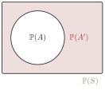
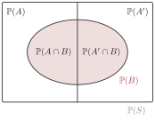
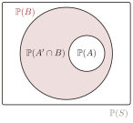
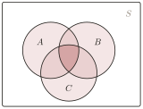
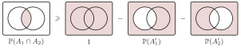

[上一篇](/lecture-notes/event-families-sigma-fields/)整理了域、$\sigma$-域與機率空間。藉由機率公理，我們能夠衍生出一些相當有用的機率等式與不等式，下面就從單一事件所構成的基本性質開始說明。

## 虛無事件的機率

Theorem 1.3 (Null Event)

令 $(S,\mathcal{F},\mathbb{P})$ 為一機率空間，則

$$
\mathbb{P}(\varnothing)=0
$$

**Proof.**

令 $A_1=S$，$A_2=A_3=\cdots=\varnothing$，則 $A_i\in\mathcal{F}$ 對所有 $i\in\mathbb{N}$ 成立，$A_i\cap A_j=\varnothing$ 對所有 $i\neq j$ 成立，且

$$
\bigcup_{i=1}^{\infty}A_i=S\cup\varnothing\cup\varnothing\cup\cdots=S
$$

由可數可加性 (Axiom 3) 可知

$$
\mathbb{P}(S)=\mathbb{P}\left(\bigcup_{i=1}^{\infty}A_i\right)=\sum_{i=1}^{\infty}\mathbb{P}(A_i)=\mathbb{P}(S)+\mathbb{P}(\varnothing)+\mathbb{P}(\varnothing)+\cdots
$$

$$
\begin{aligned}
\mathbb{P}(S)&=\mathbb{P}\left(\bigcup_{i=1}^{\infty}A_i\right)=\sum_{i=1}^{\infty}\mathbb{P}(A_i)\\[0.4em]
&=\mathbb{P}(S)+\mathbb{P}(\varnothing)+\mathbb{P}(\varnothing)+\cdots
\end{aligned}
$$

兩邊消去 $\mathbb{P}(S)$，可得 $\sum_{i=2}^{\infty}\mathbb{P}(\varnothing)=0$；又由 Axiom 1 知 $\mathbb{P}(\varnothing)\geqslant 0$，故

$$
\mathbb{P}(\varnothing)=0
$$

原式得證。 $\square$

Note

如[隨機實驗、樣本空間與事件](/lecture-notes/random-experiments-sample-space-events/#事件與事件的發生)所述，虛無事件 (null event) $\varnothing$ 屬於任何樣本空間 $S$ 上的任意 $\sigma$-域 $\mathcal{F}$。由於實驗的任何樣本點皆不會落入空集合中，$\varnothing$ 代表「不可能發生的事件」，其機率為 $0$ 與直觀相符。

Example 1.10 (Odd and Even Faces)

若投擲一公正骰子，令 $A$ 表出現點數為偶數點之事件、$B$ 表出現點數為奇數點之事件，試回答下列問題:

(1) 分別求出 $\mathbb{P}(A)$ 與 $\mathbb{P}(B)$。
{: .topic-paren-item}

(2) 若 $C$ 表示出現點數既為奇數又為偶數之事件，試求 $\mathbb{P}(C)$。
{: .topic-paren-item}

以下依序求解。

**(1)** 樣本空間為 $S=\lbrace1,2,3,4,5,6\rbrace$，由題意知 $A=\lbrace2,4,6\rbrace$，$B=\lbrace1,3,5\rbrace$，且骰子公正，故依[古典機率之定義](/lecture-notes/probability-assignment-classical-geometric/#definition-classical-probability)可知

$$
\mathbb{P}(A)=\frac{\mathrm{n}(A)}{\mathrm{n}(S)}=\frac{3}{6}=\frac{1}{2},\qquad
\mathbb{P}(B)=\frac{\mathrm{n}(B)}{\mathrm{n}(S)}=\frac{3}{6}=\frac{1}{2}
$$

$$
\begin{gathered}
\mathbb{P}(A)=\frac{\mathrm{n}(A)}{\mathrm{n}(S)}=\frac{3}{6}=\frac{1}{2},\\[0.4em]
\mathbb{P}(B)=\frac{\mathrm{n}(B)}{\mathrm{n}(S)}=\frac{3}{6}=\frac{1}{2}
\end{gathered}
$$

**(2)** 依題意知 $C=A\cap B=\lbrace\,\rbrace=\varnothing$，故

$$
\mathbb{P}(C)=\mathbb{P}(\varnothing)=0
$$

Note

(1) [Example 1.10](#example-odd-even-faces) (1) 套用了古典機率的定義。如前篇[機率空間的定義](/lecture-notes/event-families-sigma-fields/#機率空間)所述，公理化機率系統僅規範機率測度應具備的基本性質，並不限定機率的計算方式；只要古典機率滿足三大公理，兩者便完全相容。
{: .topic-paren-item}

(2) [Example 1.10](#example-odd-even-faces) (2) 顯示不可能發生的事件機率必為 $0$，但反之並不成立，亦即「$\mathbb{P}(\varnothing)=0$，但滿足 $\mathbb{P}(E)=0$ 的事件 $E$ 未必為空集合 $\varnothing$」。此一區別在下一章介紹連續型[隨機變數](/lecture-notes/random-variables-and-pmf/#def-random-variable)時將更為清晰；在離散情境中亦可設想一枚魔術表演專用硬幣，雖有正反兩面，但不論如何投擲皆正面朝上，此時**丟出反面**的機率雖為 $0$，對應的事件卻是單點集合 $\lbrace\mathrm{T}\rbrace$ 而非空集合 $\varnothing$。
{: .topic-paren-item}

從 [Theorem 1.3](#theorem-null-event) 可以發現，**不可能發生的事件機率一定為 $0$**。除了符合我們的直覺以外，這個定理還能引導出可數可加性的一個比較弱的版本，也就是**有限可加性 (finite additivity)**。

## 有限可加性

Theorem 1.4 (Finite Additivity)

令 $(S,\mathcal{F},\mathbb{P})$ 為一機率空間，若 $A_1,\ldots,A_n\in\mathcal{F}$，且 $A_i\cap A_j=\varnothing$ 對所有 $i\neq j$ 成立，則

$$
\mathbb{P}\left(\bigcup_{i=1}^{n}A_i\right)=\sum_{i=1}^{n}\mathbb{P}(A_i)
$$

**Proof.**

對所有 $k>n$ 令 $A_k=\varnothing$，即 $A_{n+1}=A_{n+2}=\cdots=\varnothing$，如此一來仍有 $A_i\cap A_j=\varnothing$ 對所有 $i\neq j$ 成立，且

$$
\bigcup_{i=1}^{\infty}A_i=\bigcup_{i=1}^{n}A_i\cup\varnothing\cup\varnothing\cup\cdots=\bigcup_{i=1}^{n}A_i
$$

由可數可加性與 $\mathbb{P}(\varnothing)=0$ 可知

$$
\mathbb{P}\left(\bigcup_{i=1}^{n}A_i\right)=\sum_{i=1}^{\infty}\mathbb{P}(A_i)=\sum_{i=1}^{n}\mathbb{P}(A_i)+\sum_{i=n+1}^{\infty}\mathbb{P}(\varnothing)=\sum_{i=1}^{n}\mathbb{P}(A_i)
$$

$$
\begin{aligned}
\mathbb{P}\left(\bigcup_{i=1}^{n}A_i\right)&=\sum_{i=1}^{\infty}\mathbb{P}(A_i)\\[0.4em]
&=\sum_{i=1}^{n}\mathbb{P}(A_i)+\sum_{i=n+1}^{\infty}\mathbb{P}(\varnothing)\\[0.4em]
&=\sum_{i=1}^{n}\mathbb{P}(A_i)
\end{aligned}
$$

原式得證。 $\square$

有限可加性又稱**可加性 (additivity)**；處理有限個成對互斥事件的聯集時，可直接將各事件機率相加，無須再構造無窮多個空集合。

相較於可數可加性，有限可加性常稱為較**弱 (weak)** 的性質，因為由上述證明可見，可數可加性可直接推出有限可加性。

此外，如果一隨機實驗的結果只有有限多種 (即 $S$ 有限)，則任一佈於 $S$ 上的域 $\mathcal{F}$ 也會是有限的；此時，機率公理中的 Axiom 3 即使只滿足有限可加性，也足夠應付所有的狀況。

## 機率的範圍與餘事件公式

Theorem 1.5 (Basic Equations)

令 $(S,\mathcal{F},\mathbb{P})$ 為一機率空間，$A\in\mathcal{F}$ 為一事件，則

(1) **機率的範圍**:
{: .topic-paren-item}

$$
\mathbb{P}(A)\leqslant 1
$$

(2) **餘事件公式**:
{: .topic-paren-item}

$$
\mathbb{P}(A^{\prime})=1-\mathbb{P}(A)
$$

**Proof.**

**(1)** 由 $A\cup A^{\prime}=S$ 且 $A\cap A^{\prime}=\varnothing$，再由 Axiom 2 與有限可加性可知

$$
\mathbb{P}(S)=\mathbb{P}(A\cup A^{\prime})=\mathbb{P}(A)+\mathbb{P}(A^{\prime})=1
$$

又由 Axiom 1 可知 $\mathbb{P}(A^{\prime})\geqslant 0$，故

$$
\mathbb{P}(A)=1-\mathbb{P}(A^{\prime})\leqslant 1
$$

**(2)** 由 (1) 之證明可知 $\mathbb{P}(A)=1-\mathbb{P}(A^{\prime})$，移項即得

$$
\mathbb{P}(A^{\prime})=1-\mathbb{P}(A)
$$

原式得證。 $\square$

Note

[Theorem 1.5](#theorem-basic-equations) (1) 確立了機率的上界為 $1$。機率公理的非負性 (Axiom 1) 僅規定機率不小於 $0$，並未將 $\mathbb{P}(A)\leqslant 1$ 列入公理；這是因為公理系統講求精簡，凡能由既有公理推得的性質，皆歸入定理而不另列為公理。

至於 (2) 的餘事件公式則可由下方文氏圖直觀理解，在後續計算複雜事件的機率時相當實用。

<figure class="topic-figure">
  
  <figcaption>Fig. 1.9. 樣本空間的機率被分為 $\mathbb{P}(A)$ 與 $\mathbb{P}(A^{\prime})$ 兩部分。</figcaption>
</figure>

至此可見，上述機率的基本性質皆由三大機率公理結合集合運算推導而得；整套機率論便是由這些基礎性質逐步推演建立。

接下來，我們將探討兩個事件間的機率關係。一如前面使用集合算子，來討論集合與集合間 (事件與事件間) 的關係，我們同樣可以在機率函數上，探討不同事件間的關係。

## 全機率定理與加法原理

Theorem 1.6 (Law of Total Probability and Addition Rule)

令 $(S,\mathcal{F},\mathbb{P})$ 為一機率空間，$A,B\in\mathcal{F}$ 為二事件，則

(1) **全機率定理 (the law of total probability)**:
{: .topic-paren-item}

$$
\mathbb{P}(B-A)=\mathbb{P}(B\cap A^{\prime})=\mathbb{P}(B)-\mathbb{P}(A\cap B)
$$

$$
\begin{aligned}
\mathbb{P}(B-A)&=\mathbb{P}(B\cap A^{\prime})\\[0.4em]
&=\mathbb{P}(B)-\mathbb{P}(A\cap B)
\end{aligned}
$$

(2) **加法原理 (addition rule)**:
{: .topic-paren-item}

$$
\mathbb{P}(A\cup B)=\mathbb{P}(A)+\mathbb{P}(B)-\mathbb{P}(A\cap B)
$$

**Proof.**

**(1)** 由 $B=B\cap S$ 與 $S=A\cup A^{\prime}$ 兩式，依分配律可知

$$
B=B\cap(A\cup A^{\prime})=(B\cap A)\cup(B\cap A^{\prime})
$$

又由於 $A\cap A^{\prime}=\varnothing$，所以

$$
(B\cap A)\cap(B\cap A^{\prime})=B\cap(A\cap A^{\prime})=\varnothing
$$

由有限可加性可知

$$
\mathbb{P}(B)=\mathbb{P}\big((B\cap A)\cup(B\cap A^{\prime})\big)=\mathbb{P}(B\cap A)+\mathbb{P}(B\cap A^{\prime})
$$

$$
\begin{aligned}
\mathbb{P}(B)&=\mathbb{P}\big((B\cap A)\cup(B\cap A^{\prime})\big)\\[0.4em]
&=\mathbb{P}(B\cap A)+\mathbb{P}(B\cap A^{\prime})
\end{aligned}
$$

移項即得

$$
\mathbb{P}(B\cap A^{\prime})=\mathbb{P}(B-A)=\mathbb{P}(B)-\mathbb{P}(B\cap A)
$$

移項即得

$$
\begin{aligned}
\mathbb{P}(B\cap A^{\prime})&=\mathbb{P}(B-A)\\[0.4em]
&=\mathbb{P}(B)-\mathbb{P}(B\cap A)
\end{aligned}
$$

**(2)** 由 $A\cup B=(A\cap B^{\prime})\cup(A\cap B)\cup(A^{\prime}\cap B)$，且三者滿足兩兩互斥關係，可得

$$
(A\cap B^{\prime})\cap(A\cap B)=(A\cap B)\cap(A^{\prime}\cap B)=(A\cap B^{\prime})\cap(A^{\prime}\cap B)=\varnothing
$$

$$
\begin{aligned}
&(A\cap B^{\prime})\cap(A\cap B)\\[0.4em]
&=(A\cap B)\cap(A^{\prime}\cap B)\\[0.4em]
&=(A\cap B^{\prime})\cap(A^{\prime}\cap B)=\varnothing
\end{aligned}
$$

由有限可加性可知

$$
\begin{aligned}
\mathbb{P}(A\cup B)&=\mathbb{P}(A\cap B^{\prime})+\mathbb{P}(A\cap B)+\mathbb{P}(A^{\prime}\cap B)\\[0.4em]
&=\Big[\mathbb{P}(A\cap B^{\prime})+\mathbb{P}(A\cap B)\Big]+\Big[\mathbb{P}(A^{\prime}\cap B)+\mathbb{P}(A\cap B)\Big]\\[0.4em]
&\qquad-\mathbb{P}(A\cap B)\\[0.4em]
&=\mathbb{P}(A)+\mathbb{P}(B)-\mathbb{P}(A\cap B)
\end{aligned}
$$

$$
\begin{aligned}
\mathbb{P}(A\cup B)&=\mathbb{P}(A\cap B^{\prime})+\mathbb{P}(A\cap B)\\[0.4em]
&\qquad+\mathbb{P}(A^{\prime}\cap B)\\[0.4em]
&=\Big[\mathbb{P}(A\cap B^{\prime})+\mathbb{P}(A\cap B)\Big]\\[0.4em]
&\qquad+\Big[\mathbb{P}(A^{\prime}\cap B)+\mathbb{P}(A\cap B)\Big]\\[0.4em]
&\qquad-\mathbb{P}(A\cap B)\\[0.4em]
&=\mathbb{P}(A)+\mathbb{P}(B)-\mathbb{P}(A\cap B)
\end{aligned}
$$

其中最後一步由 (1) 可知。 $\square$

Note

(1) 全機率定理常改寫為 $\mathbb{P}(B)=\mathbb{P}(A\cap B)+\mathbb{P}(A^{\prime}\cap B)$ 的形式，亦即將事件 $B$ 拆分為「包含 $A$」與「不包含 $A$」兩個互斥部分。這隱含「任一事件皆可依樣本空間的一組**分割 (partition)** (各組間互不重疊且合起來不遺漏的分類方式) 切分為互斥區塊」的直覺，分割的正式定義將於後文詳述，概念如下圖所示。
{: .topic-paren-item}

<figure class="topic-figure">
  
  <figcaption>Fig. 1.10. $B$ 的機率被 $A$ 與 $A^{\prime}$ 切成 $\mathbb{P}(A\cap B)$ 與 $\mathbb{P}(A^{\prime}\cap B)$ 兩部分。</figcaption>
</figure>

(2) 加法原理除了可如上由全機率定理推得外，亦可對照[聯集與交集的文氏圖](/lecture-notes/event-set-operations/#聯集交集差集與餘集)由下圖直觀理解。計算 $\mathbb{P}(A\cup B)$ 時，將 $\mathbb{P}(A)$ 與 $\mathbb{P}(B)$ 直接相加會使重疊區域 $A\cap B$ 的機率重複計入，扣除一次 $\mathbb{P}(A\cap B)$ 即得聯集機率。
{: .topic-paren-item}

<figure class="topic-figure">
  
  <figcaption>Fig. 1.11. $\mathbb{P}(A\cup B)=\mathbb{P}(A)+\mathbb{P}(B)-\mathbb{P}(A\cap B)$ 的圖解。</figcaption>
</figure>

加法原理與全機率定理都有其應用上的特例，我們首先從加法原理開始。

注意到，當 $A$ 與 $B$ 互斥 (即 $A\cap B=\varnothing$) 時，由 [Theorem 1.3](#theorem-null-event) 得到 $\mathbb{P}(A\cup B)=\mathbb{P}(A)+\mathbb{P}(B)$，因為交集部分的機率為 $0$。

此情形恰對應[加集](/lecture-notes/event-set-operations/#互斥與加集)與有限可加性的前提，即 $A\cup B=A+B$，由此可得

$$
\mathbb{P}(A\cup B)=\mathbb{P}(A+B)=\mathbb{P}(A)+\mathbb{P}(B)
$$

這也是前面介紹機率空間時提到的線性特例。

全機率定理則在 $A$ 是 $B$ 的一個子集 (亦即 $A\subseteq B$) 時，有較特殊的結果，即

$$
\mathbb{P}(B-A)=\mathbb{P}(B)-\mathbb{P}(A)
$$

其理由是，當 $A\subseteq B$ 時，$A\cap B=A$。證明此特例並不困難，讀者應可自行將全機率定理中的 $A\cap B$ 改寫為 $A$ 得到，我們僅以圖形說明此結果。

<figure class="topic-figure">
  
  <figcaption>Fig. 1.12. 當 $A\subseteq B$ 時，自 $B$ 之中扣除 $A$ 後，剩下的機率為 $\mathbb{P}(A^{\prime}\cap B)$。</figcaption>
</figure>

上圖可以發現 $A\cap B$ 就是 $A$ 本身，故 $\mathbb{P}(A^{\prime}\cap B)$ 可用 $\mathbb{P}(B)$ 直接扣除 $\mathbb{P}(A)$ 得到。這個結果只是全機率定理的一個小特例，但是我們卻可以從這裡來驗證一個非常直觀的結果，即機率的**單調性 (monotonicity)**。

## 單調性

Theorem 1.7 (Monotonicity)

令 $(S,\mathcal{F},\mathbb{P})$ 為一機率空間，$A,B\in\mathcal{F}$ 且 $A\subseteq B$，則

$$
\mathbb{P}(A)\leqslant\mathbb{P}(B)
$$

**Proof.**

由於 $A\subseteq B$，故 $B=(B-A)\cup A=(B-A)+A$，由有限可加性可知

$$
\mathbb{P}(B)=\mathbb{P}(B-A)+\mathbb{P}(A)
$$

又由 Axiom 1 可知 $\mathbb{P}(B-A)\geqslant 0$，故 $\mathbb{P}(B)\geqslant\mathbb{P}(A)$，即

$$
\mathbb{P}(A)\leqslant\mathbb{P}(B)
$$

原式得證。 $\square$

Note

單調性的直觀意義是**包含範圍較小的事件，其機率也較小 (或相等)**。須留意任意兩個集合未必能直接比較大小，唯有具備包含關係 $A\subseteq B$ 時，方能套用單調性比較機率。

此外，單調性還有一個直接的推論。由 $(A\cap B)\subseteq A$ 與 $(A\cap B)\subseteq B$ 皆成立，可推知

$$
\mathbb{P}(A\cap B)\leqslant\mathbb{P}(A),\qquad
\mathbb{P}(A\cap B)\leqslant\mathbb{P}(B)
$$

這兩種情況的直觀意義是，**對 $A$ (或 $B$) 加上更多限制 (使之與 $B$ 或 $A$ 取交集)，只會讓機率變小，至多維持不變**。

加法原理與全機率定理皆可推廣至三個以上集合的狀況，其中全機率定理的推廣版本是**貝氏定理 (Bayes’ rule)** 的基礎，將在稍後的文章有詳盡的敘述。

## 廣義加法原理與排容原理

Theorem 1.8 (Generalized Addition Rule)

令 $(S,\mathcal{F},\mathbb{P})$ 為一機率空間，$A_1,\ldots,A_n\in\mathcal{F}$，且令

$$
\begin{gathered}
S_1=\sum_{i=1}^{n}\mathbb{P}(A_i),\qquad
S_2=\underset{i<j}{\sum\sum}\mathbb{P}(A_i\cap A_j),\\[0.4em]
S_3=\underset{i<j<k}{\sum\sum\sum}\mathbb{P}(A_i\cap A_j\cap A_k),\qquad
\ldots,\qquad
S_n=\mathbb{P}\left(\bigcap_{i=1}^{n}A_i\right)
\end{gathered}
$$

$$
\begin{gathered}
S_1=\sum_{i=1}^{n}\mathbb{P}(A_i),\\[0.4em]
S_2=\underset{i<j}{\sum\sum}\mathbb{P}(A_i\cap A_j),\\[0.4em]
S_3=\underset{i<j<k}{\sum\sum\sum}\mathbb{P}(A_i\cap A_j\cap A_k),\\[0.4em]
\ldots,\qquad
S_n=\mathbb{P}\left(\bigcap_{i=1}^{n}A_i\right)
\end{gathered}
$$

一般而言，$S_k$ 是所有「$k$ 個事件交集的機率」之總和。則

(1) 當 $n$ 為奇數:
{: .topic-paren-item}

$$
\mathbb{P}\left(\bigcup_{i=1}^{n}A_i\right)=S_1-S_2+S_3-\cdots-S_{n-1}+S_n
$$

$$
\begin{aligned}
&\mathbb{P}\left(\bigcup_{i=1}^{n}A_i\right)\\[0.4em]
&=S_1-S_2+S_3-\cdots-S_{n-1}+S_n
\end{aligned}
$$

(2) 當 $n$ 為偶數:
{: .topic-paren-item}

$$
\mathbb{P}\left(\bigcup_{i=1}^{n}A_i\right)=S_1-S_2+S_3-\cdots+S_{n-1}-S_n
$$

$$
\begin{aligned}
&\mathbb{P}\left(\bigcup_{i=1}^{n}A_i\right)\\[0.4em]
&=S_1-S_2+S_3-\cdots+S_{n-1}-S_n
\end{aligned}
$$

**Proof.**

詳細證明見黃文璋 (2010)，《機率論》，二版，頁 39。 $\square$

Note

理解此定理時，不妨先以 $n=3$ 對照下方三事件的文氏圖。其核心精神仍在於「扣除重複計算的交集機率」，只是涉及三個以上事件時，兩兩交集逐一扣除後會將三者共同交集多扣一次，故須再將其加回。

<figure class="topic-figure">
  
  <figcaption>Fig. 1.13. 三事件的情況中，兩兩交集先被扣除，而三者共同交集需要再加回來。</figcaption>
</figure>

廣義加法原理即為**組合數學 (combinatorics)** 中**排容原理 (inclusion-exclusion principle)** 的機率版本。廣義而言，組合數學亦常歸入**離散數學 (discrete mathematics)** (兩者細部差異此處不贅)，主要探討可數或離散結構中的數學問題，諸如著名的**地圖著色問題**、**渡河問題**，以及臺灣高中數學教授的排列組合皆屬其重要範疇。

在部分機率論專書中，廣義加法原理時常以

$$
\mathbb{P}\left(\bigcup_{i=1}^{n}A_i\right)=\sum_{k=1}^{n}(-1)^{k-1}S_k
$$

的形式出現，並且被稱作**龐加萊 (Poincaré) 公式**。這個版本的寫法與 [Theorem 1.8](#theorem-generalized-addition) 完全相同，但較為簡潔，且對所有 $n\in\mathbb{N}$ 都成立，不需要考慮 $n$ 為奇數或偶數。

經由加法原理，我們可以得到兩個著名的不等式，即**布爾不等式 (Boole’s inequality)** 及**邦佛洛尼不等式 (Bonferroni’s inequality)**，以下就將兩個不等式分開討論。

## 布爾不等式

Theorem 1.9 (Boole’s Inequality)

令 $(S,\mathcal{F},\mathbb{P})$ 為一機率空間，$A_1,\ldots,A_n\in\mathcal{F}$，則

(1) 兩事件的情況:
{: .topic-paren-item}

$$
\mathbb{P}(A_1\cup A_2)\leqslant\mathbb{P}(A_1)+\mathbb{P}(A_2)
$$

(2) 推廣至 $n$ 個事件:
{: .topic-paren-item}

$$
\mathbb{P}\left(\bigcup_{i=1}^{n}A_i\right)\leqslant\sum_{i=1}^{n}\mathbb{P}(A_i)
$$

**Proof.**

**(1)** 由加法原理知

$$
\mathbb{P}(A_1\cup A_2)=\mathbb{P}(A_1)+\mathbb{P}(A_2)-\mathbb{P}(A_1\cap A_2)
$$

又 $\mathbb{P}(A_1\cap A_2)\geqslant 0$，故

**Proof.**

**(1)** 由加法原理知

$$
\begin{aligned}
\mathbb{P}(A_1\cup A_2)&=\mathbb{P}(A_1)+\mathbb{P}(A_2)\\[0.4em]
&\qquad-\mathbb{P}(A_1\cap A_2)
\end{aligned}
$$

又 $\mathbb{P}(A_1\cap A_2)\geqslant 0$，故

$$
\mathbb{P}(A_1\cup A_2)\leqslant\mathbb{P}(A_1)+\mathbb{P}(A_2)
$$

**(2)** 當 $n=1$ 時，不等式兩側皆為 $\mathbb{P}(A_1)$ 之值，原式顯然成立；而當 $n=2$ 時，由 (1) 的結果亦知原式成立。又令 $n=k$ 時原式成立，即

$$
\mathbb{P}\left(\bigcup_{i=1}^{k}A_i\right)\leqslant\sum_{i=1}^{k}\mathbb{P}(A_i)
$$

則當 $n=k+1$ 時，由 (1) 可知

$$
\begin{aligned}
\mathbb{P}\left(\bigcup_{i=1}^{k+1}A_i\right)&=\mathbb{P}\left(\Big(\bigcup_{i=1}^{k}A_i\Big)\cup A_{k+1}\right)\\[0.4em]
&\leqslant\mathbb{P}\left(\bigcup_{i=1}^{k}A_i\right)+\mathbb{P}(A_{k+1})\\[0.4em]
&\leqslant\sum_{i=1}^{k}\mathbb{P}(A_i)+\mathbb{P}(A_{k+1})=\sum_{i=1}^{k+1}\mathbb{P}(A_i)
\end{aligned}
$$

$$
\begin{aligned}
\mathbb{P}\left(\bigcup_{i=1}^{k+1}A_i\right)&=\mathbb{P}\left(\Big(\bigcup_{i=1}^{k}A_i\Big)\cup A_{k+1}\right)\\[0.4em]
&\leqslant\mathbb{P}\left(\bigcup_{i=1}^{k}A_i\right)+\mathbb{P}(A_{k+1})\\[0.4em]
&\leqslant\sum_{i=1}^{k}\mathbb{P}(A_i)+\mathbb{P}(A_{k+1})\\[0.4em]
&=\sum_{i=1}^{k+1}\mathbb{P}(A_i)
\end{aligned}
$$

由數學歸納法與 (1) 可知，原式對所有 $n\in\mathbb{N}$ 皆成立。 $\square$

Note

將布爾不等式與加法原理對照可見，右側上界僅將各事件機率相加而未扣除交集部分的機率，因此恆不小於左側的聯集機率，圖解如下。

<figure class="topic-figure">
  
  <figcaption>Fig. 1.14. 布爾不等式 $\mathbb{P}(A_1\cup A_2)\leqslant\mathbb{P}(A_1)+\mathbb{P}(A_2)$ 的圖解，右側未扣除交集項。</figcaption>
</figure>

當這組事件成對互斥時，交集機率為 $0$，不等式兩側等號成立，恰退化回加集與有限可加性的結果。

## 邦佛洛尼不等式

Theorem 1.10 (Bonferroni’s Inequality)

令 $(S,\mathcal{F},\mathbb{P})$ 為一機率空間，$A_1,\ldots,A_n\in\mathcal{F}$，則

(1) 兩事件的情況:
{: .topic-paren-item}

$$
\mathbb{P}(A_1\cap A_2)\geqslant\mathbb{P}(A_1)+\mathbb{P}(A_2)-1
$$

(2) 推廣至 $n$ 個事件:
{: .topic-paren-item}

$$
\mathbb{P}\left(\bigcap_{i=1}^{n}A_i\right)\geqslant\sum_{i=1}^{n}\mathbb{P}(A_i)-(n-1)
$$

**Proof.**

**(1)** 由加法原理知

$$
\mathbb{P}(A_1\cup A_2)=\mathbb{P}(A_1)+\mathbb{P}(A_2)-\mathbb{P}(A_1\cap A_2)
$$

移項可得

**Proof.**

**(1)** 由加法原理知

$$
\begin{aligned}
\mathbb{P}(A_1\cup A_2)&=\mathbb{P}(A_1)+\mathbb{P}(A_2)\\[0.4em]
&\qquad-\mathbb{P}(A_1\cap A_2)
\end{aligned}
$$

移項可得

$$
\mathbb{P}(A_1\cap A_2)=\mathbb{P}(A_1)+\mathbb{P}(A_2)-\mathbb{P}(A_1\cup A_2)
$$

$$
\begin{aligned}
\mathbb{P}(A_1\cap A_2)&=\mathbb{P}(A_1)+\mathbb{P}(A_2)\\[0.4em]
&\qquad-\mathbb{P}(A_1\cup A_2)
\end{aligned}
$$

又由 $\mathbb{P}(A_1\cup A_2)\leqslant 1$，故

$$
\mathbb{P}(A_1\cap A_2)\geqslant\mathbb{P}(A_1)+\mathbb{P}(A_2)-1
$$

**(2)** 當 $n=1$ 時，不等式兩側皆為 $\mathbb{P}(A_1)$ 之值，原式顯然成立；而當 $n=2$ 時，由 (1) 的結果亦知原式成立。又令 $n=k$ 時原式成立，即

$$
\mathbb{P}\left(\bigcap_{i=1}^{k}A_i\right)\geqslant\sum_{i=1}^{k}\mathbb{P}(A_i)-(k-1)
$$

則當 $n=k+1$ 時，由 (1) 可知

$$
\begin{aligned}
\mathbb{P}\left(\bigcap_{i=1}^{k+1}A_i\right)&=\mathbb{P}\left(\Big(\bigcap_{i=1}^{k}A_i\Big)\cap A_{k+1}\right)\\[0.4em]
&\geqslant\mathbb{P}\left(\bigcap_{i=1}^{k}A_i\right)+\mathbb{P}(A_{k+1})-1\\[0.4em]
&\geqslant\sum_{i=1}^{k}\mathbb{P}(A_i)-(k-1)+\mathbb{P}(A_{k+1})-1\\[0.4em]
&=\sum_{i=1}^{k+1}\mathbb{P}(A_i)-\big[(k+1)-1\big]
\end{aligned}
$$

$$
\begin{aligned}
\mathbb{P}&\left(\bigcap_{i=1}^{k+1}A_i\right)=\mathbb{P}\left(\Big(\bigcap_{i=1}^{k}A_i\Big)\cap A_{k+1}\right)\\[0.4em]
&\geqslant\mathbb{P}\left(\bigcap_{i=1}^{k}A_i\right)+\mathbb{P}(A_{k+1})-1\\[0.4em]
&\geqslant\sum_{i=1}^{k}\mathbb{P}(A_i)-(k-1)+\mathbb{P}(A_{k+1})-1\\[0.4em]
&=\sum_{i=1}^{k+1}\mathbb{P}(A_i)-\big[(k+1)-1\big]
\end{aligned}
$$

由數學歸納法與 (1) 可知，原式對所有 $n\in\mathbb{N}$ 皆成立。 $\square$

Note

將每個 $\mathbb{P}(A_i)$ 改寫為 $1-\mathbb{P}(A_i^{\prime})$，邦佛洛尼不等式的右式常改寫為 $1-\sum_{i=1}^{n}\mathbb{P}(A_i^{\prime})$。以 $n=2$ (即 [Theorem 1.10](#theorem-bonferroni) (1)) 為例，由下圖可見右側自 $1$ 依序減去 $\mathbb{P}(A_1^{\prime})$ 與 $\mathbb{P}(A_2^{\prime})$ 時，重疊區域 $\mathbb{P}(A_1^{\prime}\cap A_2^{\prime})$ 被重複扣除，因此所得下界恆不大於左側的 $\mathbb{P}(A_1\cap A_2)$ (甚至可能小於 $0$)。

<figure class="topic-figure">
  
  <figcaption>Fig. 1.15. 邦佛洛尼不等式改寫形式 $\mathbb{P}(A_1\cap A_2)\geqslant 1-\mathbb{P}(A_1^{\prime})-\mathbb{P}(A_2^{\prime})$ 的圖解，其中 $\mathbb{P}(A_1^{\prime}\cap A_2^{\prime})$ 被重複扣除。</figcaption>
</figure>

當 $A_1$ 與 $A_2$ 沒有同時不發生的部分 (亦即 $A_1\cup A_2=S$，聯集已填滿整個樣本空間) 時，有 $\mathbb{P}(A_1^{\prime}\cap A_2^{\prime})=0$ 成立，故不等式兩側等號成立；此條件亦與將布爾不等式套用於餘事件時的等號條件相呼應。

## 兩不等式的等價性

布爾不等式與邦佛洛尼不等式皆源自加法原理，分別從聯集與交集出發給出機率界限。這兩條不等式彼此**等價 (equivalent)**，以下利用狄摩根律證明。

**Proof.**

令 $(S,\mathcal{F},\mathbb{P})$ 為一機率空間，不失一般性假設 $A_1,\ldots,A_n\in\mathcal{F}$ 且布爾不等式成立，即

$$
\mathbb{P}\left(\bigcup_{i=1}^{n}A_i\right)\leqslant\sum_{i=1}^{n}\mathbb{P}(A_i)
$$

此式成立，若且唯若

$$
\begin{aligned}
\mathbb{P}\left(\bigcap_{i=1}^{n}A_i^{\prime}\right)&=\mathbb{P}\left(\Big(\bigcup_{i=1}^{n}A_i\Big)^{\prime}\right)\\[0.4em]
&=1-\mathbb{P}\left(\bigcup_{i=1}^{n}A_i\right)\\[0.4em]
&\geqslant 1-\sum_{i=1}^{n}\mathbb{P}(A_i)\\[0.4em]
&=1-\sum_{i=1}^{n}\big(1-\mathbb{P}(A_i^{\prime})\big)\\[0.4em]
&=1-\Big(n-\sum_{i=1}^{n}\mathbb{P}(A_i^{\prime})\Big)\\[0.4em]
&=\sum_{i=1}^{n}\mathbb{P}(A_i^{\prime})-(n-1)
\end{aligned}
$$

其中，由 $A_1,\ldots,A_n\in\mathcal{F}$ 知道 $A_1^{\prime},\ldots,A_n^{\prime}\in\mathcal{F}$，且

$$
\mathbb{P}\left(\bigcap_{i=1}^{n}A_i^{\prime}\right)\geqslant\sum_{i=1}^{n}\mathbb{P}(A_i^{\prime})-(n-1)
$$

即邦佛洛尼不等式。故可知道布爾不等式成立，若且唯若邦佛洛尼不等式成立，二者為等價不等式。 $\square$

上述證明中的**不失一般性 (without loss of generality，或簡稱 WLOG)** 為數學證明常用語，表示所作設定足以代表一般情形，而非僅限於特例。

Example 1.11 (Union Covering the Sample Space)

If the sample space is $S=C_1\cup C_2$ and if $\mathbb{P}(C_1)=0.8$ and $\mathbb{P}(C_2)=0.5$, find $\mathbb{P}(C_1\cap C_2)$.

由加法原理知

$$
\mathbb{P}(C_1\cup C_2)=\mathbb{P}(C_1)+\mathbb{P}(C_2)-\mathbb{P}(C_1\cap C_2)
$$

$$
\begin{aligned}
\mathbb{P}(C_1\cup C_2)&=\mathbb{P}(C_1)+\mathbb{P}(C_2)\\[0.4em]
&\qquad-\mathbb{P}(C_1\cap C_2)
\end{aligned}
$$

又由 Axiom 2 知 $\mathbb{P}(S)=\mathbb{P}(C_1\cup C_2)=1$ 成立，故

$$
1=\mathbb{P}(C_1)+\mathbb{P}(C_2)-\mathbb{P}(C_1\cap C_2)=0.8+0.5-\mathbb{P}(C_1\cap C_2)
$$

$$
\begin{aligned}
1&=\mathbb{P}(C_1)+\mathbb{P}(C_2)-\mathbb{P}(C_1\cap C_2)\\[0.4em]
&=0.8+0.5-\mathbb{P}(C_1\cap C_2)
\end{aligned}
$$

移項可得

$$
\mathbb{P}(C_1\cap C_2)=0.8+0.5-1=0.3
$$

Example 1.12 (Disjoint Complements and a Lower Bound)

(1) Let $A$ and $B$ be two disjoint events. Find the condition under which their complements $A^{\prime}$ and $B^{\prime}$ are also disjoint.
{: .topic-paren-item}

(2) Let $A_1,A_2,A_3$ be events with $\mathbb{P}(A_i)=\frac{1}{4+i}$ for $i=1,2,3$. Find a lower bound for $\mathbb{P}(A_1^{\prime}\cap A_2^{\prime}\cap A_3^{\prime})$.
{: .topic-paren-item}

以下依序求解。

**(1)** 由 $A$ 與 $B$ 互斥可知 $A\cap B=\varnothing$。又 $A^{\prime}$ 與 $B^{\prime}$ 互斥，即要求

$$
A^{\prime}\cap B^{\prime}=(A\cup B)^{\prime}=\varnothing
$$

故所求條件為

$$
A\cup B=S
$$

**(2)** 將邦佛洛尼不等式的改寫形式套用於 $A_1^{\prime},A_2^{\prime},A_3^{\prime}$，可知

$$
\begin{aligned}
\mathbb{P}(A_1^{\prime}\cap A_2^{\prime}\cap A_3^{\prime})&\geqslant 1-\sum_{i=1}^{3}\mathbb{P}\big((A_i^{\prime})^{\prime}\big)=1-\sum_{i=1}^{3}\mathbb{P}(A_i)\\[0.4em]
&=1-\frac{1}{5}-\frac{1}{6}-\frac{1}{7}=\frac{103}{210}
\end{aligned}
$$

$$
\begin{aligned}
\mathbb{P}(A_1^{\prime}\cap A_2^{\prime}\cap A_3^{\prime})&\geqslant 1-\sum_{i=1}^{3}\mathbb{P}\big((A_i^{\prime})^{\prime}\big)\\[0.4em]
&=1-\sum_{i=1}^{3}\mathbb{P}(A_i)\\[0.4em]
&=1-\frac{1}{5}-\frac{1}{6}-\frac{1}{7}\\[0.4em]
&=\frac{103}{210}
\end{aligned}
$$

## 單調事件序列的機率極限

Theorem 1.11 (Limits along Monotone Sequences)

令 $(S,\mathcal{F},\mathbb{P})$ 為一機率空間，$A_1,A_2,\ldots\in\mathcal{F}$。

(1) 若 $\lbrace A_i\rbrace$ 為非遞減序列，則
{: .topic-paren-item}

$$
\lim_{n\to\infty}\mathbb{P}(A_n)=\mathbb{P}\left(\lim_{n\to\infty}A_n\right)=\mathbb{P}\left(\bigcup_{i=1}^{\infty}A_i\right)
$$

$$
\begin{aligned}
\lim_{n\to\infty}\mathbb{P}(A_n)&=\mathbb{P}\left(\lim_{n\to\infty}A_n\right)\\[0.4em]
&=\mathbb{P}\left(\bigcup_{i=1}^{\infty}A_i\right)
\end{aligned}
$$

(2) 若 $\lbrace A_i\rbrace$ 為非遞增序列，則
{: .topic-paren-item}

$$
\lim_{n\to\infty}\mathbb{P}(A_n)=\mathbb{P}\left(\lim_{n\to\infty}A_n\right)=\mathbb{P}\left(\bigcap_{i=1}^{\infty}A_i\right)
$$

$$
\begin{aligned}
\lim_{n\to\infty}\mathbb{P}(A_n)&=\mathbb{P}\left(\lim_{n\to\infty}A_n\right)\\[0.4em]
&=\mathbb{P}\left(\bigcap_{i=1}^{\infty}A_i\right)
\end{aligned}
$$

**Proof.**

**(1)** 由於 $\lbrace A_i\rbrace$ 非遞減，故依[單調集合序列的定義](/lecture-notes/event-set-operations/#單調集合序列與極限)可知

$$
\lim_{n\to\infty}A_n=\bigcup_{i=1}^{\infty}A_i
$$

另外定義 $\lbrace B_i\rbrace$，滿足

$$
B_1=A_1,\qquad B_k=A_k-A_{k-1},\quad k\geqslant 2
$$

則 $\lbrace B_i\rbrace$ 兩兩為互斥事件，且

$$
\begin{gathered}
A_k=\bigcup_{i=1}^{k}B_i\\[0.4em]
\mathbb{P}(B_i)=\mathbb{P}(A_i)-\mathbb{P}(A_{i-1}),\quad i\geqslant 2
\end{gathered}
$$

此外，又因 $\lbrace A_i\rbrace$ 非遞減，可知

$$
\bigcup_{i=1}^{k}A_i=A_k=\bigcup_{i=1}^{k}B_i
$$

由此可得

$$
\bigcup_{i=1}^{\infty}A_i=\lim_{n\to\infty}A_n=\bigcup_{i=1}^{\infty}B_i=\sum_{i=1}^{\infty}B_i
$$

注意此處之 $\lbrace B_i\rbrace$ 兩兩為互斥事件，由可數可加性可知

$$
\begin{aligned}
\mathbb{P}\left(\lim_{n\to\infty}A_n\right)&=\mathbb{P}\left(\bigcup_{i=1}^{\infty}B_i\right)=\sum_{i=1}^{\infty}\mathbb{P}(B_i)=\lim_{n\to\infty}\sum_{i=1}^{n}\mathbb{P}(B_i)\\[0.4em]
&=\mathbb{P}(A_1)+\lim_{n\to\infty}\sum_{i=2}^{n}\Big[\mathbb{P}(A_i)-\mathbb{P}(A_{i-1})\Big]=\lim_{n\to\infty}\mathbb{P}(A_n)
\end{aligned}
$$

$$
\begin{aligned}
&\mathbb{P}\left(\lim_{n\to\infty}A_n\right)=\mathbb{P}\left(\bigcup_{i=1}^{\infty}B_i\right)\\[0.4em]
&=\sum_{i=1}^{\infty}\mathbb{P}(B_i)=\lim_{n\to\infty}\sum_{i=1}^{n}\mathbb{P}(B_i)\\[0.4em]
&=\mathbb{P}(A_1)+\lim_{n\to\infty}\sum_{i=2}^{n}\Big[\mathbb{P}(A_i)-\mathbb{P}(A_{i-1})\Big]\\[0.4em]
&=\lim_{n\to\infty}\mathbb{P}(A_n)
\end{aligned}
$$

原式得證。

**(2)** 由於 $\lbrace A_i\rbrace$ 非遞增，故依單調集合序列的定義可知

$$
\lim_{n\to\infty}A_n=\bigcap_{i=1}^{\infty}A_i
$$

此外，$\lbrace A_i^{\prime}\rbrace$ 為非遞減序列。由狄摩根律與非遞減序列的定義可知

$$
\left(\lim_{n\to\infty}A_n\right)^{\prime}=\left(\bigcap_{i=1}^{\infty}A_i\right)^{\prime}=\bigcup_{i=1}^{\infty}A_i^{\prime}=\lim_{n\to\infty}A_n^{\prime}
$$

$$
\begin{aligned}
\left(\lim_{n\to\infty}A_n\right)^{\prime}&=\left(\bigcap_{i=1}^{\infty}A_i\right)^{\prime}\\[0.4em]
&=\bigcup_{i=1}^{\infty}A_i^{\prime}=\lim_{n\to\infty}A_n^{\prime}
\end{aligned}
$$

故合併 (1) 的結果，我們有

$$
\begin{aligned}
\mathbb{P}\left(\lim_{n\to\infty}A_n\right)&=1-\mathbb{P}\left(\Big(\lim_{n\to\infty}A_n\Big)^{\prime}\right)=1-\mathbb{P}\left(\lim_{n\to\infty}A_n^{\prime}\right)\\[0.4em]
&=1-\lim_{n\to\infty}\mathbb{P}(A_n^{\prime})=\lim_{n\to\infty}\Big(1-\mathbb{P}(A_n^{\prime})\Big)=\lim_{n\to\infty}\mathbb{P}(A_n)
\end{aligned}
$$

$$
\begin{aligned}
\mathbb{P}\left(\lim_{n\to\infty}A_n\right)&=1-\mathbb{P}\left(\Big(\lim_{n\to\infty}A_n\Big)^{\prime}\right)\\[0.4em]
&=1-\mathbb{P}\left(\lim_{n\to\infty}A_n^{\prime}\right)\\[0.4em]
&=1-\lim_{n\to\infty}\mathbb{P}(A_n^{\prime})\\[0.4em]
&=\lim_{n\to\infty}\Big(1-\mathbb{P}(A_n^{\prime})\Big)\\[0.4em]
&=\lim_{n\to\infty}\mathbb{P}(A_n)
\end{aligned}
$$

原式得證。 $\square$

## 本篇小結

本篇由三大公理出發，依序推得下列結果:

| 結果 | 內容 |
| :---: | :---: |
| [Theorem 1.3](#theorem-null-event) | $\mathbb{P}(\varnothing)=0$ |
| [Theorem 1.4](#theorem-finite-additivity) | 有限可加性 |
| [Theorem 1.5](#theorem-basic-equations) | $\mathbb{P}(A)\leqslant 1$ 與餘事件公式 |
| [Theorem 1.6](#theorem-total-and-addition) | 全機率定理與加法原理 |
| [Theorem 1.7](#theorem-monotonicity) | 單調性 |
| [Theorem 1.8](#theorem-generalized-addition) | 廣義加法原理 (排容原理) |
| [Theorem 1.9](#theorem-boole) 與 [Theorem 1.10](#theorem-bonferroni) | 布爾與邦佛洛尼不等式 (等價) |
| [Theorem 1.11](#theorem-continuity) | 單調事件序列的機率極限 |

加法原理與全機率定理皆可推廣至三個以上的集合彼此間的狀況，其中全機率定理的推廣版本是貝氏定理的基礎。[下一篇](/lecture-notes/conditional-probability-information/)要談條件機率與乘法原理，便從「已知某事件發生」如何改變機率談起。

## 參考文獻與延伸閱讀

- 黃文璋，2010，《機率論》，二版，華泰文化。
- Sheldon Ross. 2019. *A First Course in Probability*. 10th ed. Pearson.
- Emanuel Parzen. 1960. *Modern Probability Theory and Its Applications*. Wiley.
- Alan Hájek. 2019. “Interpretations of Probability.” In *The Stanford Encyclopedia of Philosophy*, Fall 2019 ed., edited by Edward N. Zalta.
