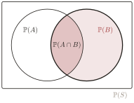
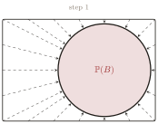
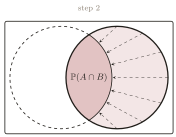

[上一篇](/lecture-notes/probability-rules-from-axioms/)整理了由機率公理推出的各種運算規則。這些規則都是在同一個機率空間中評估事件的機率。然而，機率與統計重視的是「資訊的變化」。

舉例而言，若蘋果公司 (Apple Inc.) 宣布發表新款的 iPhone，消息一出，該公司下週股價上揚的機率，應較平常為高，其原因便是「將發表新款 iPhone」這個資訊流入。

若從機率的角度解釋此現象，此即「樣本空間改變」，精確地說，應是「樣本空間**縮小** (或**修正**) 至**將發表新款 iPhone 的事件**中」，在此事件確定發生下，未來一週股價上揚的機率，未必與原先相同。接下來就來介紹此類「已知某事件發生」下的機率。

## 條件機率

Definition 1.19

令 $(S,\mathcal{F},\mathbb{P})$ 為機率空間，$A,B\in\mathcal{F}$，且 $\mathbb{P}(B)>0$，定義 **$A$ 在給定 $B$ 發生下的條件機率 (conditional probability)** 為

$$
\mathbb{P}(A\mid B)=\frac{\mathbb{P}(A\cap B)}{\mathbb{P}(B)}
$$

條件機率的意義在於「在已經確定 $B$ 發生的條件下，尋找 $A$ 發生的機率」，故需要將樣本空間縮小到事件 $B$ 上，讀者可藉下圖理解這句話的意涵。

<figure class="topic-figure topic-figure--medium">
  
  <figcaption>Fig. 1.16. 條件機率將樣本空間縮小到 $B$，$\mathbb{P}(A\mid B)$ 即 $\mathbb{P}(A\cap B)$ 在 $\mathbb{P}(B)$ 中所佔的比例。</figcaption>
</figure>

值得留意的是，**在已知 $B$ 發生的前提下事件 $A$ 發生，實際發生的事件即為交集 $A\cap B$**；因為既然以 $B$ 發生為前提，此時觀察到 $A$ 發生便代表 $A$ 與 $B$ 同時發生。

Note

一般非條件機率的樣本空間即為 $S$ 本身，相當於已知確定事件 $S$ 必然發生的情形；因此非條件機率 $\mathbb{P}(A)$ 亦可寫為 $\mathbb{P}(A\mid S)$，視為給定 $S$ 發生之下事件 $A$ 的條件機率。

Example 1.13 (Net Worth and Online Trading)

The president of a securities firm is studying the characteristics of stock market investors. A survey shows that $50\%$ of all investors have a net worth exceeding one million dollars, $40\%$ trade through an online trading system, and $35\%$ do both. Let $W$ be the event that an investor’s net worth exceeds one million dollars, and let $T$ be the event that an investor trades through the online trading system. Find $\mathbb{P}(W\cup T)$ and $\mathbb{P}(W^{\prime}\mid T^{\prime})$.

已知 $\mathbb{P}(W)=0.5$、$\mathbb{P}(T)=0.4$、$\mathbb{P}(W\cap T)=0.35$，由[加法原理](/lecture-notes/probability-rules-from-axioms/#theorem-total-and-addition)得

$$
\mathbb{P}(W\cup T)=\mathbb{P}(W)+\mathbb{P}(T)-\mathbb{P}(W\cap T)=0.5+0.4-0.35=0.55
$$

$$
\begin{aligned}
\mathbb{P}(W\cup T)&=\mathbb{P}(W)+\mathbb{P}(T)-\mathbb{P}(W\cap T)\\[0.4em]
&=0.5+0.4-0.35=0.55
\end{aligned}
$$

又 $\mathbb{P}(T^{\prime})=1-\mathbb{P}(T)=0.6$，再配合[狄摩根律](/lecture-notes/event-set-operations/#theorem-de-morgan)可知

$$
\mathbb{P}(W^{\prime}\cap T^{\prime})=\mathbb{P}\big((W\cup T)^{\prime}\big)=1-\mathbb{P}(W\cup T)=0.45
$$

$$
\begin{aligned}
\mathbb{P}(W^{\prime}\cap T^{\prime})&=\mathbb{P}\big((W\cup T)^{\prime}\big)\\[0.4em]
&=1-\mathbb{P}(W\cup T)=0.45
\end{aligned}
$$

故所求為

$$
\mathbb{P}(W^{\prime}\mid T^{\prime})=\frac{\mathbb{P}(W^{\prime}\cap T^{\prime})}{\mathbb{P}(T^{\prime})}=\frac{0.45}{0.6}=0.75
$$

$$
\begin{aligned}
\mathbb{P}(W^{\prime}\mid T^{\prime})&=\frac{\mathbb{P}(W^{\prime}\cap T^{\prime})}{\mathbb{P}(T^{\prime})}\\[0.4em]
&=\frac{0.45}{0.6}=0.75
\end{aligned}
$$

Example 1.14 (Unions and a Conditional Probability)

(1) Let $A$ and $B$ be events with $\mathbb{P}(A\cup B)=0.76$ and $\mathbb{P}(A\cup B^{\prime})=0.87$. Find $\mathbb{P}(A)$.
{: .topic-paren-item}

(2) Let $A$ and $B$ be events with $\mathbb{P}(A)=\frac{1}{3}$, $\mathbb{P}(B)=\frac{1}{2}$, and $\mathbb{P}(A\cap B)=\frac{1}{5}$. Find $\mathbb{P}(A\mid B^{\prime})$.
{: .topic-paren-item}

以下依序求解。

**(1)** 由[加法原理](/lecture-notes/probability-rules-from-axioms/#theorem-total-and-addition)可知

$$
\begin{gathered}
\mathbb{P}(A\cup B)=\mathbb{P}(A)+\mathbb{P}(B)-\mathbb{P}(A\cap B)=0.76\\[0.4em]
\mathbb{P}(A\cup B^{\prime})=\mathbb{P}(A)+\mathbb{P}(B^{\prime})-\mathbb{P}(A\cap B^{\prime})=0.87
\end{gathered}
$$

$$
\begin{aligned}
\mathbb{P}(A\cup B)&=\mathbb{P}(A)+\mathbb{P}(B)-\mathbb{P}(A\cap B)\\[0.4em]
&=0.76
\end{aligned}
$$

$$
\begin{aligned}
\mathbb{P}(A\cup B^{\prime})&=\mathbb{P}(A)+\mathbb{P}(B^{\prime})-\mathbb{P}(A\cap B^{\prime})\\[0.4em]
&=0.87
\end{aligned}
$$

兩式相加，並由[全機率定理](/lecture-notes/probability-rules-from-axioms/#theorem-total-and-addition)知 $\mathbb{P}(A\cap B)+\mathbb{P}(A\cap B^{\prime})=\mathbb{P}(A)$，故

$$
\begin{aligned}
\mathbb{P}(A\cup B)+\mathbb{P}(A\cup B^{\prime})&=2\,\mathbb{P}(A)+\big[\mathbb{P}(B)+1-\mathbb{P}(B)\big]\\[0.4em]
&\qquad-\big[\mathbb{P}(A\cap B)+\mathbb{P}(A\cap B^{\prime})\big]\\[0.4em]
&=2\,\mathbb{P}(A)+1-\mathbb{P}(A)=\mathbb{P}(A)+1=1.63
\end{aligned}
$$

$$
\begin{aligned}
\mathbb{P}(A\cup B)+\mathbb{P}(A\cup B^{\prime})&=2\,\mathbb{P}(A)+\big[\mathbb{P}(B)+1-\mathbb{P}(B)\big]\\[0.4em]
&\qquad-\big[\mathbb{P}(A\cap B)+\mathbb{P}(A\cap B^{\prime})\big]\\[0.4em]
&=2\,\mathbb{P}(A)+1-\mathbb{P}(A)\\[0.4em]
&=\mathbb{P}(A)+1=1.63
\end{aligned}
$$

移項可得

$$
\mathbb{P}(A)=0.63
$$

**(2)** 由[全機率定理](/lecture-notes/probability-rules-from-axioms/#theorem-total-and-addition)可知

$$
\mathbb{P}(A\cap B^{\prime})=\mathbb{P}(A)-\mathbb{P}(A\cap B)=\frac{1}{3}-\frac{1}{5}=\frac{2}{15}
$$

$$
\begin{aligned}
\mathbb{P}(A\cap B^{\prime})&=\mathbb{P}(A)-\mathbb{P}(A\cap B)\\[0.4em]
&=\frac{1}{3}-\frac{1}{5}=\frac{2}{15}
\end{aligned}
$$

又 $\mathbb{P}(B^{\prime})=1-\frac{1}{2}=\frac{1}{2}$，故所求為

$$
\mathbb{P}(A\mid B^{\prime})=\frac{\mathbb{P}(A\cap B^{\prime})}{\mathbb{P}(B^{\prime})}=\frac{2/15}{1/2}=\frac{4}{15}
$$

$$
\begin{aligned}
\mathbb{P}(A\mid B^{\prime})&=\frac{\mathbb{P}(A\cap B^{\prime})}{\mathbb{P}(B^{\prime})}\\[0.4em]
&=\frac{2/15}{1/2}=\frac{4}{15}
\end{aligned}
$$

## 條件機率為機率測度

Theorem 1.12 (Conditional Probability Measure)

令 $(S,\mathcal{F},\mathbb{P})$ 為一機率空間，$B\in\mathcal{F}$ 且 $\mathbb{P}(B)>0$，則 $\mathbb{P}(\,\cdot\,\mid B)$ 為一機率測度。

**Proof.**

我們由驗證 $\mathbb{P}(\,\cdot\,\mid B)$ 符合機率三大公理驗證其為機率測度。

**(1)** 由 $\mathbb{P}(A\cap B)\geqslant 0$ 與 $\mathbb{P}(B)>0$ 可知，對所有 $A\in\mathcal{F}$ 皆有

$$
\mathbb{P}(A\mid B)=\frac{\mathbb{P}(A\cap B)}{\mathbb{P}(B)}\geqslant 0
$$

**(2)** 由 $S\cap B=B$ 可知

$$
\mathbb{P}(S\mid B)=\frac{\mathbb{P}(S\cap B)}{\mathbb{P}(B)}=\frac{\mathbb{P}(B)}{\mathbb{P}(B)}=1
$$

**(3)** 若 $A_1,A_2,\ldots\in\mathcal{F}$，且 $A_i\cap A_j=\varnothing$ 對所有 $i\neq j$ 成立，則 $A_1\cap B,A_2\cap B,\ldots$ 亦兩兩互斥，故

$$
\begin{aligned}
\mathbb{P}\left(\bigcup_{i=1}^{\infty}A_i\,\middle|\,B\right)&=\frac{\mathbb{P}\Big(\big(\bigcup_{i=1}^{\infty}A_i\big)\cap B\Big)}{\mathbb{P}(B)}=\frac{\mathbb{P}\Big(\bigcup_{i=1}^{\infty}(A_i\cap B)\Big)}{\mathbb{P}(B)}\\[0.45em]
&=\frac{\sum_{i=1}^{\infty}\mathbb{P}(A_i\cap B)}{\mathbb{P}(B)}=\sum_{i=1}^{\infty}\frac{\mathbb{P}(A_i\cap B)}{\mathbb{P}(B)}=\sum_{i=1}^{\infty}\mathbb{P}(A_i\mid B)
\end{aligned}
$$

$$
\begin{aligned}
\mathbb{P}\left(\bigcup_{i=1}^{\infty}A_i\,\middle|\,B\right)&=\frac{\mathbb{P}\Big(\big(\bigcup_{i=1}^{\infty}A_i\big)\cap B\Big)}{\mathbb{P}(B)}\\[0.45em]
&=\frac{\mathbb{P}\Big(\bigcup_{i=1}^{\infty}(A_i\cap B)\Big)}{\mathbb{P}(B)}\\[0.45em]
&=\frac{\sum_{i=1}^{\infty}\mathbb{P}(A_i\cap B)}{\mathbb{P}(B)}\\[0.45em]
&=\sum_{i=1}^{\infty}\frac{\mathbb{P}(A_i\cap B)}{\mathbb{P}(B)}\\[0.45em]
&=\sum_{i=1}^{\infty}\mathbb{P}(A_i\mid B)
\end{aligned}
$$

故 $\mathbb{P}(\,\cdot\,\mid B)$ 滿足機率三大公理。 $\square$

## 乘法原理

Theorem 1.13 (Multiplication Rule)

令 $(S,\mathcal{F},\mathbb{P})$ 為一機率空間，$A,B\in\mathcal{F}$，且 $\mathbb{P}(B)>0$，則

$$
\mathbb{P}(A\cap B)=\mathbb{P}(A\mid B)\,\mathbb{P}(B)
$$

此性質稱為**乘法原理 (multiplication rule)**。

乘法原理由條件機率的定義移項即得，常用於已知條件機率時求交集機率。

從比例的角度來看，**條件機率 $\mathbb{P}(A\mid B)$ 即為 $\mathbb{P}(A\cap B)$ 在 $\mathbb{P}(B)$ 中所佔的比例**，兩階段的計算流程可由下方示意圖理解。

<figure class="topic-figure">
  

    
    $\Longrightarrow$
    $\Downarrow$
    
  

  <figcaption>Fig. 1.17. 乘法原理的兩階段流程，其中 step 1 先將樣本空間縮小至事件 $B$ 上，對應於 $\mathbb{P}(S)$ 乘以 $\mathbb{P}(B)$；step 2 再於 $B$ 中尋找事件 $A$ 的部分，對應於 $\mathbb{P}(B)$ 再乘以 $\mathbb{P}(A\mid B)$。</figcaption>
</figure>

換言之，乘法原理是**利用條件層層篩選**以求得交集機率。**篩選路徑並不唯一**，亦可先由 $A$ 出發、再於 $A$ 中篩選出 $B$，寫為

$$
\mathbb{P}(A\cap B)=\mathbb{P}(B\mid A)\,\mathbb{P}(A),\qquad \mathbb{P}(A)>0
$$

將此層層篩選的想法推廣至三個以上的事件時，即得下列定理。

## 廣義乘法原理

Theorem 1.14 (General Multiplication Rule)

令 $(S,\mathcal{F},\mathbb{P})$ 為一機率空間，$A_1,\ldots,A_n\in\mathcal{F}$，且滿足 $\mathbb{P}\left(\bigcap_{i=1}^{n-1}A_i\right)>0$ 時，則有

$$
\begin{aligned}
\mathbb{P}\left(\bigcap_{i=1}^{n}A_i\right)&=\mathbb{P}(A_1)\,\mathbb{P}(A_2\mid A_1)\,\mathbb{P}(A_3\mid A_1\cap A_2)\cdots\mathbb{P}\left(A_n\,\middle|\,\bigcap_{i=1}^{n-1}A_i\right)\\[0.45em]
&=\mathbb{P}(A_1)\times\prod_{k=2}^{n}\mathbb{P}\left(A_k\,\middle|\,\bigcap_{i=1}^{k-1}A_i\right)
\end{aligned}
$$

$$
\begin{aligned}
\mathbb{P}\left(\bigcap_{i=1}^{n}A_i\right)&=\mathbb{P}(A_1)\,\mathbb{P}(A_2\mid A_1)\,\mathbb{P}(A_3\mid A_1\cap A_2)\\[0.4em]
&\qquad\cdots\mathbb{P}\left(A_n\,\middle|\,\bigcap_{i=1}^{n-1}A_i\right)\\[0.4em]
&=\mathbb{P}(A_1)\times\prod_{k=2}^{n}\mathbb{P}\left(A_k\,\middle|\,\bigcap_{i=1}^{k-1}A_i\right)
\end{aligned}
$$

此性質稱為**廣義乘法原理 (general multiplication rule)**。

此定理的證明並不困難，讀者應可由乘法原理對事件個數逐步遞推得到，故在此省略。

Example 1.15 (No Kings in Five Cards)

自一副 $52$ 張撲克牌中抽取五張牌，求其中沒有任何 King 的機率。

**[法一]** 令 $N$ 表示五張牌中沒有 King 的事件，則所求為

$$
\mathbb{P}(N)=\frac{\binom{4}{0}\binom{48}{5}}{\binom{52}{5}}\fallingdotseq 0.6588
$$

**[法二]** 令 $N_i$ 表示第 $i$ 張牌不為 King 之事件，$i=1,2,3,4,5$，則 $N=\bigcap_{i=1}^{5}N_i$ 表示五張牌中沒有任何 King 之事件，由[廣義乘法原理](#theorem-general-multiplication-rule)可知所求為

$$
\begin{aligned}
\mathbb{P}(N)&=\mathbb{P}(N_1)\times\prod_{i=2}^{5}\mathbb{P}\left(N_i\,\middle|\,\bigcap_{m=1}^{i-1}N_m\right)\\[0.4em]
&=\mathbb{P}(N_1)\times\mathbb{P}(N_2\mid N_1)\times\mathbb{P}(N_3\mid N_1\cap N_2)\\[0.4em]
&\qquad\times\mathbb{P}(N_4\mid N_1\cap N_2\cap N_3)\times\mathbb{P}(N_5\mid N_1\cap N_2\cap N_3\cap N_4)\\[0.4em]
&=\frac{48}{52}\times\frac{47}{51}\times\frac{46}{50}\times\frac{45}{49}\times\frac{44}{48}\fallingdotseq 0.6588
\end{aligned}
$$

$$
\begin{aligned}
\mathbb{P}(N)&=\mathbb{P}(N_1)\times\prod_{i=2}^{5}\mathbb{P}\left(N_i\,\middle|\,\bigcap_{m=1}^{i-1}N_m\right)\\[0.4em]
&=\mathbb{P}(N_1)\times\mathbb{P}(N_2\mid N_1)\\[0.4em]
&\qquad\times\mathbb{P}(N_3\mid N_1\cap N_2)\\[0.4em]
&\qquad\times\mathbb{P}(N_4\mid N_1\cap N_2\cap N_3)\\[0.4em]
&\qquad\times\mathbb{P}(N_5\mid N_1\cap N_2\cap N_3\cap N_4)\\[0.4em]
&=\frac{48}{52}\times\frac{47}{51}\times\frac{46}{50}\times\frac{45}{49}\times\frac{44}{48}\\[0.4em]
&\fallingdotseq 0.6588
\end{aligned}
$$

Note

在 [Example 1.15](#example-no-king-five-cards) 中，除直接以組合數計算外，亦可將「一次抽取五張牌」視為「取後不放回地依序抽取五張牌」。如此每次抽牌時未抽到 King 的條件機率皆一目了然，由廣義乘法原理相乘即得所求。

Example 1.16 (Watering the Plant)

Before leaving on vacation, you ask a neighbor to water an ailing plant for you. The plant dies with probability $0.8$ if it goes unwatered, and with probability $0.15$ if it is watered. There is a $90\%$ chance that your neighbor remembers to water it.

(1) What is the probability that the plant is still alive when you come back?
{: .topic-paren-item}

(2) Given that the plant is dead when you come back, what is the probability that your neighbor forgot to water it?
{: .topic-paren-item}

以下依序求解。

**(1)** 令 $A$ 表示鄰居有澆水之事件，$B$ 表示植物死亡之事件，則依題目設定可知

$$
\mathbb{P}(A)=0.9,\qquad \mathbb{P}(B\mid A^{\prime})=0.8,\qquad \mathbb{P}(B\mid A)=0.15
$$

$$
\begin{gathered}
\mathbb{P}(A)=0.9,\qquad \mathbb{P}(B\mid A^{\prime})=0.8,\\[0.4em]
\mathbb{P}(B\mid A)=0.15
\end{gathered}
$$

由[全機率定理](/lecture-notes/probability-rules-from-axioms/#theorem-total-and-addition)與乘法原理可知

$$
\begin{aligned}
\mathbb{P}(B)&=\mathbb{P}(B\mid A)\,\mathbb{P}(A)+\mathbb{P}(B\mid A^{\prime})\,\mathbb{P}(A^{\prime})\\[0.4em]
&=0.15\times 0.9+0.8\times 0.1=0.215
\end{aligned}
$$

$$
\begin{aligned}
\mathbb{P}(B)&=\mathbb{P}(B\mid A)\,\mathbb{P}(A)\\[0.4em]
&\qquad+\mathbb{P}(B\mid A^{\prime})\,\mathbb{P}(A^{\prime})\\[0.4em]
&=0.15\times 0.9+0.8\times 0.1\\[0.4em]
&=0.215
\end{aligned}
$$

故所求為

$$
\mathbb{P}(B^{\prime})=1-\mathbb{P}(B)=0.785
$$

**(2)** 由乘法原理可知

$$
\mathbb{P}(A^{\prime}\cap B)=\mathbb{P}(B\mid A^{\prime})\,\mathbb{P}(A^{\prime})=0.8\times 0.1=0.08
$$

$$
\begin{aligned}
\mathbb{P}(A^{\prime}\cap B)&=\mathbb{P}(B\mid A^{\prime})\,\mathbb{P}(A^{\prime})\\[0.4em]
&=0.8\times 0.1=0.08
\end{aligned}
$$

故所求為

$$
\mathbb{P}(A^{\prime}\mid B)=\frac{\mathbb{P}(A^{\prime}\cap B)}{\mathbb{P}(B)}=\frac{0.08}{0.215}\fallingdotseq 0.3721
$$

$$
\begin{aligned}
\mathbb{P}(A^{\prime}\mid B)&=\frac{\mathbb{P}(A^{\prime}\cap B)}{\mathbb{P}(B)}\\[0.4em]
&=\frac{0.08}{0.215}\fallingdotseq 0.3721
\end{aligned}
$$

## 蒙提霍爾問題

**蒙提霍爾問題 (Monty Hall problem)** 是一個源自真實歷史故事的著名數學問題，名稱取自 $1963$ 年開播的美國電視益智節目 *Let’s Make a Deal* 之主持人 Monty Hall。在節目中，參賽者可以選擇保留手上的獎品，或是接受主持人的提議，換成門後或布幕後的未知獎品，這種橋段後來便衍生出以下三扇門的經典機率問題。

Example 1.17 (The Monty Hall Problem)

On a television game show, a contestant is shown three doors; a prize is hidden behind exactly one of them. The contestant picks a door. Before that door is opened, the host opens one of the other two doors that has no prize behind it, and then asks whether the contestant wants to switch to the remaining unopened door. A friend of yours is about to appear on this show and hopes to win the prize. Should you advise your friend to switch doors, or does it not matter? Explain briefly.

令 $R$ 表示第一次選擇猜中獎品的事件，$W$ 表示贏得獎品的事件。

**策略一 (換門)**。若第一次就猜中獎品，換門之後必定失去獎品；若第一次沒猜中，主持人打開另一個沒有獎品的門後，剩下那個未開且未選的門後必有獎品。因此 $\mathbb{P}(W\mid R)=0$ 且 $\mathbb{P}(W\mid R^{\prime})=1$，由全機率定理與乘法原理可知

$$
\begin{aligned}
\mathbb{P}(W)&=\mathbb{P}(W\cap R)+\mathbb{P}(W\cap R^{\prime})\\[0.4em]
&=\mathbb{P}(W\mid R)\,\mathbb{P}(R)+\mathbb{P}(W\mid R^{\prime})\,\mathbb{P}(R^{\prime})\\[0.4em]
&=0\times\frac{1}{3}+1\times\frac{2}{3}=\frac{2}{3}
\end{aligned}
$$

$$
\begin{aligned}
\mathbb{P}(W)&=\mathbb{P}(W\cap R)+\mathbb{P}(W\cap R^{\prime})\\[0.4em]
&=\mathbb{P}(W\mid R)\,\mathbb{P}(R)\\[0.4em]
&\qquad+\mathbb{P}(W\mid R^{\prime})\,\mathbb{P}(R^{\prime})\\[0.4em]
&=0\times\frac{1}{3}+1\times\frac{2}{3}=\frac{2}{3}
\end{aligned}
$$

**策略二 (不換門)**。此時恰好相反，第一次猜中才能贏得獎品，即 $\mathbb{P}(W\mid R)=1$ 且 $\mathbb{P}(W\mid R^{\prime})=0$，同理可知

$$
\begin{aligned}
\mathbb{P}(W)&=\mathbb{P}(W\cap R)+\mathbb{P}(W\cap R^{\prime})\\[0.4em]
&=\mathbb{P}(W\mid R)\,\mathbb{P}(R)+\mathbb{P}(W\mid R^{\prime})\,\mathbb{P}(R^{\prime})\\[0.4em]
&=1\times\frac{1}{3}+0\times\frac{2}{3}=\frac{1}{3}
\end{aligned}
$$

$$
\begin{aligned}
\mathbb{P}(W)&=\mathbb{P}(W\cap R)+\mathbb{P}(W\cap R^{\prime})\\[0.4em]
&=\mathbb{P}(W\mid R)\,\mathbb{P}(R)\\[0.4em]
&\qquad+\mathbb{P}(W\mid R^{\prime})\,\mathbb{P}(R^{\prime})\\[0.4em]
&=1\times\frac{1}{3}+0\times\frac{2}{3}=\frac{1}{3}
\end{aligned}
$$

選擇換門，得到獎品的機率較高，是較佳策略，應選擇換門。

這個例子的關鍵在於，「第一次就猜中」與「第一次沒猜中」是互斥且恰有一個會發生的兩種情況；全機率定理把兩種情況下換門策略的貢獻分別算出來，再加總成整體的得獎機率。

這個問題之所以廣為人知，是因為它的結論與多數人的直覺大相逕庭。當主持人打開一扇沒有獎品的門之後，場上只剩下兩扇未開的門，許多人便直覺地以為這兩扇門後各有 $\frac{1}{2}$ 的機率藏有獎品。事實上，這種想法忽略了一個關鍵，那就是**主持人是在知道獎品位置的前提下，刻意挑選一扇沒有獎品的門打開**；這項舉動本身就帶來了新的資訊，因此不能單純將剩餘的兩扇門視為機會均等。有趣的是，據說連傳奇數學家艾狄胥 (Paul Erdős) 一開始也不相信「換門比較有利」的結論，直到親眼看見電腦模擬的結果後才終於信服。若想從長期相對次數觀察這個 $\frac{2}{3}$ 的勝率，讀者也可以到互動展示 [The Monty Hall Problem](/demos/monty-hall/) 親自操作，比較不同策略在模擬次數增加時的收斂情形。

直覺校準 1.1

在機率論中，蒙提霍爾問題還有一個結構完全相同的雙胞胎問題，稱為**三囚徒問題 (three prisoners problem)**。

假設有 $A,B,C$ 三位囚犯，其中一人將獲赦免，另兩人則會被處決。囚犯 $A$ 很想知道自己是否獲赦，但守衛不能直接透露 $A$ 的命運，於是 $A$ 央求知道結果的守衛，在 $B$ 與 $C$ 兩人中指出一位「確定會被處決」的人 (若 $B,C$ 兩人都會被處決，守衛會以各半機會隨機說出其中一人)。

當守衛回答「$B$ 會被處決」之後，囚犯 $A$ 容易誤以為只剩自己與 $C$ 兩人，獲赦機率應變為各占 $\frac{1}{2}$。然而將此情境與蒙提霍爾問題對照，可見兩者的邏輯完全一致，其中**囚犯 $A$ 相當於參賽者最初選定的門，守衛指出必被處決的 $B$ 相當於主持人刻意打開的空門，剩下的囚犯 $C$ 則相當於另一扇未開的門**。由於守衛回答時必定避開 $A$，這項資訊並不會改變 $A$ 原本 $\frac{1}{3}$ 的獲赦機率，而是將剩餘 $\frac{2}{3}$ 的機率集中到囚犯 $C$ 身上。

## 本篇小結

本篇介紹了條件機率、乘法原理與廣義乘法原理，並以蒙提霍爾問題示範資訊如何改變機率，重點整理如下:

| 結果 | 內容 |
| :---: | :---: |
| [Definition 1.19](#definition-conditional-probability) | 條件機率 |
| [Theorem 1.12](#theorem-conditional-probability-measure) | $\mathbb{P}(\,\cdot\,\mid B)$ 為機率測度 |
| [Theorem 1.13](#theorem-18) | 乘法原理 |
| [Theorem 1.14](#theorem-general-multiplication-rule) | 廣義乘法原理 (層層篩選) |
| [Example 1.17](#example-monty-hall) | 蒙提霍爾問題 (換門勝率 $2/3$) |

前面曾經提過，資訊的流入對某件事情的發生與否可能造成影響，然而其造成的影響將提高其發生的機率或是降低其發生的機率呢？這一點在不同的事件上會有不同的結果。

一如稍早的例子中，蘋果公司宣布將發表新款的 iPhone，對其未來一週股價上揚的機率顯然是種正面影響；又若今天某科技公司爆發高層捲款潛逃的消息，則該公司未來一週股價上揚的機率應是大幅下修，即屬負面影響。

既然影響有正有負，那麼在各種資訊流入中，比較特別的是，若某一事件的資訊流入**對於另一事件毫無影響**呢？這種狀況便是所謂的兩事件彼此間**獨立 (independent)**，我們將在[下一篇](/lecture-notes/independence-and-conditional-independence/)詳細介紹。

## 參考文獻與延伸閱讀

- 黃文璋，2010，《機率論》，二版，華泰文化。
- Sheldon Ross. 2019. *A First Course in Probability*. 10th ed. Pearson.
- Joseph K. Blitzstein and Jessica Hwang. 2019. *Introduction to Probability*. 2nd ed. Chapman and Hall/CRC.
- Morris H. DeGroot and Mark J. Schervish. 2012. *Probability and Statistics*. 4th ed. Pearson.
- Steve Selvin. 1975. “A Problem in Probability.” *The American Statistician* 29 (1): 67.
- Richard D. Gill. 2011. “The Monty Hall Problem Is Not a Probability Puzzle: It’s a Challenge in Mathematical Modelling.” *Statistica Neerlandica* 65 (1): 58–71.
- Martin Gardner. 1959. *The Scientific American Book of Mathematical Puzzles and Diversions*. Simon and Schuster.
