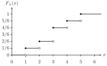
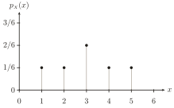
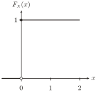

[上一篇](/lecture-notes/random-variables-and-pmf/)以[機率質量函數](/lecture-notes/random-variables-and-pmf/#def-pmf)描述離散型[隨機變數](/lecture-notes/random-variables-and-pmf/#def-random-variable)，把機率逐點記在值域的質點上。但機率質量函數只定義在離散型隨機變數上，[Definition 2.2](/lecture-notes/random-variables-and-pmf/#def-support-classification) 所分出的另一型並不適用。

另一方面，[Definition 2.1](/lecture-notes/random-variables-and-pmf/#def-random-variable) 要求對任意 $x\in\mathbb{R}$，能使 $X(\omega)\leqslant x$ 的樣本點集合都是事件，故 $\mathbb{P}(X\leqslant x)$ 對每一個實數 $x$ 都有定義。把 $x$ 看成變數，此機率本身就是一個定義在實數上的函數，且不必事先區分 $X$ 屬於哪一型。

Definition 2.4 (累積分配函數, cumulative distribution function, cdf)

若 $X$ 為定義於機率空間 $(S,\mathcal{F},\mathbb{P})$ 上之隨機變數，則定義函數

$$
F_{\sssig X}(x)=\mathbb{P}(X\leqslant x),\ x\in\mathbb{R}
$$

我們稱 $F_{\sssig X}(x)$ 為隨機變數 $X$ 的**累積分配函數 (cumulative distribution function, cdf)**，或簡稱為**分配函數 (distribution function, df)**。

累積分配函數有一些地方需要注意:

(1) **累積分配函數** $F_{\sssig X}(x)$ 是定義在實數集 $\mathbb{R}$ 上、對應至閉區間 $[0,1]$ 的函數，可以記為
{: .topic-paren-item}

$$
F\colon\mathbb{R}\to[0,1]
$$

Note

有些教科書將 cdf 的定義寫為

$$
F_{\sssig X}(x)=\mathbb{P}(X\leqslant x)=\mathbb{P}\bigl(X^{-1}(-\infty,x]\bigr),\ x\in\mathbb{R}
$$

$$
\begin{aligned}
F_{\sssig X}(x)&=\mathbb{P}(X\leqslant x)\\[0.4em]
&=\mathbb{P}\bigl(X^{-1}(-\infty,x]\bigr),\ x\in\mathbb{R}
\end{aligned}
$$

在此版本中，搭配反映射 $X^{-1}(\cdot)$ 的定義，更容易看出 cdf 如何將實數線區間對應回樣本空間中的事件來計算機率。

(2) 累積分配函數的定義並不限制 $X$ 為離散型或連續型隨機變數。在離散型隨機變數上，$\mathbb{P}(X\leqslant x)$ 以**加總 (summation)** 計算，故亦有部分教科書主張分開定義，並將離散型的情形譯為**累加分配函數**；在連續型隨機變數上則改採微積分中的**積分 (integration)**，雖本質上同為累積，但因運算形式有別，一般不視同加總。
{: .topic-paren-item}

Theorem 2.1 (cdf 的性質, properties of a cdf)

若 $F_{\sssig X}(x)$ 為 $X$ 之累積分配函數，則其具以下性質:

<ol class="topic-list-paren">
  <li>
  $$
  0\leqslant F_{\sssig X}(x)\leqslant 1,\ \forall x\in\mathbb{R}
  $$
  </li>
  <li>$F_{\sssig X}(x)$ <strong>非遞減 (non-decreasing)</strong></li>
  <li>$F_{\sssig X}(x)$ <strong>右連續 (right-continuous)</strong></li>
  <li>若 $X$ 為離散型隨機變數，$F_{\sssig X}(x)$ 為一<strong>階梯函數 (step function)</strong></li>
  <li>
  

  $$
  \lim_{x\to-\infty}F_{\sssig X}(x)=0,\quad\lim_{x\to\infty}F_{\sssig X}(x)=1
  $$
  

  

  $$
  \begin{gathered}
  \lim_{x\to-\infty}F_{\sssig X}(x)=0\\[0.5em]
  \lim_{x\to\infty}F_{\sssig X}(x)=1
  \end{gathered}
  $$
  

  </li>
</ol>

累積分配函數是一種累積的機率，以離散型隨機變數而言，其定義 $\mathbb{P}(X\leqslant x)$ 代表「小於等於 $x$ 的所有機率總和」，即

$$
\sum_{t\leqslant x}\mathbb{P}(X=t)
$$

故其當然介在 $0$ 至 $1$ 之間。

又因為其機率為累積 (或累加)，隨著自變數 $x$ 增長，函數值 $F_{\sssig X}(x)$ 只會向上增加或持平，故累積分配函數自然具有**非遞減**之性質。至於**右連續**的性質，則與第一章提過的[單調事件序列的機率極限](/lecture-notes/probability-rules-from-axioms/#theorem-continuity)息息相關。若我們取任意一個由右側遞減逼近 $x$ 的數列 $x_1>x_2>\cdots$，則事件序列 $\lbrace X\leqslant x_n\rbrace$ 會隨著 $n$ 增大而逐步縮減為事件 $\lbrace X\leqslant x\rbrace$，依據機率的連續性，其機率極限便收斂到 $F_{\sssig X}(x)$ 這一函數值，此即

$$
\lim_{n\to\infty}F_{\sssig X}(x_n)=\mathbb{P}(X\leqslant x)=F_{\sssig X}(x)
$$

若 $X$ 為連續型隨機變數，$F_{\sssig X}(x)$ 本身即為連續函數 (同時滿足左連續與右連續)；僅具右連續而在部分點不左連續的情形，則出現在離散型隨機變數或後文將介紹的[混合型隨機變數](/lecture-notes/mixed-random-variables/)。

在離散型隨機變數中，當 $x$ 遞增至具有正機率的質點時，cdf 會發生跳躍式的增長；在抵達下一個質點之前，由於區間內沒有新的質點，小於或等於 $x$ 的機率總和維持不變，函數圖形遂呈水平線段，此類函數稱為**階梯函數**。

Note

嚴格而言，[Theorem 2.1](#thm-cdf-properties) 的性質 (4) 須在「值域中的質點於任意有界區間內僅有有限多個」(即值域在實數線上無聚點) 的前提下成立。例如若離散型隨機變數的值域為 $\lbrace\,1/n\mid n=1,2,\ldots\,\rbrace$ 且機率為 $p_{\sssig X}(1/n)=2^{-n}$ 的形式，雖每個質點皆為孤立點，但原點 $0$ 右側任意鄰域內聚集無窮多個跳躍點，使含 $0$ 的區間無法切分為有限段水平線段，此時 $F_{\sssig X}$ 便非嚴格定義的階梯函數 (其餘四項性質仍成立)。

Example 2.2 (Continued)

若箱中有四顆大小形狀完全相同、分別編號 $0$ 至 $3$ 的球，若 $X$ 表示隨機從中一次抽取兩顆球的號碼總和，則試列出且畫出其 cdf。

本題承接 [Example 2.2](/lecture-notes/random-variables-and-pmf/#ex-two-ball-sum) 已求得的 pmf，其中 $p_{\sssig X}(3)=\frac{2}{6}=\frac{1}{3}$ 為最大，其餘四個質點 $1,2,4,5$ 的機率各為六分之一。由於 $F_{\sssig X}(x)$ 為小於或等於 $x$ 的各質點機率總和，以 pmf 寫出即為

$$
F_{\sssig X}(x)=\sum_{t\leqslant x}p_{\sssig X}(t)
$$

五個質點由小至大依序累加，可得

$$
F_{\sssig X}(x)=
\left\lbrace
\begin{array}{c@{\quad}l}
0, & x<1\\[0.55em]
\dfrac{1}{6}, & 1\leqslant x<2\\[0.55em]
\dfrac{2}{6}, & 2\leqslant x<3\\[0.55em]
\dfrac{4}{6}, & 3\leqslant x<4\\[0.55em]
\dfrac{5}{6}, & 4\leqslant x<5\\[0.55em]
1, & 5\leqslant x
\end{array}
\right.
$$

<figure id="fig-two-ball-sum-cdf" class="topic-figure topic-figure--wide">
  
  <figcaption>Fig. 2.1. 號碼總和 $X$ 的 cdf。函數在 $x=1,2,3,4,5$ 五個質點各躍升一階，兩階間維持水平。縱軸以 $y=3$ 對應機率 $1$，與 <a href="#fig-cdf-to-pmf">Fig. 2.2</a> 比例尺不同，兩圖高度不可直接比較。</figcaption>
</figure>

Note

由[上圖](#fig-two-ball-sum-cdf)可見，五個質點 $1,2,3,4,5$ 恰為階梯函數各段的分界點。由於 cdf 的定義取「小於或等於」，每個分界點皆歸入右側區間；例如在 $x=1$ 處質點機率 $p_{\sssig X}(1)$ 已計入，故函數值 $F_{\sssig X}(1)=\frac{1}{6}$ 與 $x$ 由右側趨近 $1$ 的極限值一致，具體呈現 [Theorem 2.1](#thm-cdf-properties) 性質 (3) 的右連續性。最左端 $x<1$ 與最右端 $x\geqslant5$ 兩段則分別恆為 $0$ 與 $1$，對應性質 (5) 的兩端極限。

[上圖](#fig-two-ball-sum-cdf)是典型的離散型 cdf，每一階的跳躍點都對應原本 pmf 中的質點，且躍升高度即為該點的機率，因此我們可以由離散型 cdf 還原出對應的 pmf，如下圖所示。

<figure id="fig-cdf-to-pmf" class="topic-figure topic-figure--wide">
  
  <figcaption>Fig. 2.2. 由 <a href="#fig-two-ball-sum-cdf">Fig. 2.1</a> 各階的躍升高度還原的 pmf。縱軸以 $y=6$ 對應機率 $1$，與 <a href="#fig-two-ball-sum-cdf">Fig. 2.1</a> 的比例尺不同，兩圖的高度不可直接比較。</figcaption>
</figure>

關於躍升的高度是否恰為該質點的機率，讀者可以在 Demos 的 [From pmf to cdf](/demos/pmf-cdf/) 中改變表中各點的機率值，觀察 cdf 上各階的躍升高度隨之改變；移動當前的 $x$ 逐一掃過各個質點，即可逐點核對。

Example 2.3 (Continued)

Let $X$ be a random variable with probability mass function

$$
p_{\sssig X}(x)=
\left\lbrace
\begin{array}{c@{\quad}l}
\left(\dfrac{1}{2}\right)^{x}, & x=1,2,\ldots\\[0.6em]
0, & \text{otherwise}
\end{array}
\right.
$$

<ol class="topic-list-paren topic-list-paren--start-2">
  <li>Find the cumulative distribution function of $X$.</li>
</ol>

<ol class="topic-list-paren topic-list-paren--start-2">
  <li>
  

  $$
  F_{\sssig X}(x)=
  \left\lbrace
  \begin{array}{c@{\quad}l}
  0, & x<1\\[0.7em]
  \dfrac{\frac{1}{2}\left(1-\left(\frac{1}{2}\right)^{\lfloor x\rfloor}\right)}{1-\frac{1}{2}}
  =1-\left(\dfrac{1}{2}\right)^{[x]}, & x\geqslant 1
  \end{array}
  \right.
  $$

  

  

  $$\begin{aligned}
  F_{\sssig X}(x)&=\left\lbrace
  \begin{array}{c@{\quad}l}%{@{}l@{}}
  0, & x<1\\[0.7em]
  \dfrac{\frac{1}{2}\left(1-\left(\frac{1}{2}\right)^{\lfloor x\rfloor}\right)}{1-\frac{1}{2}}, & x\geqslant 1
  \end{array}
  \right.\\[.8em]
  &=
  \left\lbrace
  \begin{array}{c@{\quad}l}%{@{}l@{}}
  0, & x<1\\[0.7em]
  1-\left(\dfrac{1}{2}\right)^{[x]}, & x\geqslant 1
  \end{array}
  \right.
  \end{aligned}
  $$

  

  </li>
</ol>

其中 $\lfloor x\rfloor$ 表**取底函數 (floor function)**，亦稱為**高斯符號** (記為 $[x]$)，表不大於 $x$ 之最大整數。
{: .topic-paren-cont}

Example 2.5

若 $X$ 為一隨機變數，且其 cdf 為

$$
F_{\sssig X}(x)=
\left\lbrace
\begin{array}{c@{\quad}l}
0, & x<0\\[0.4em]
1, & x\geqslant 0
\end{array}
\right.
$$

則求其 pmf 為何？

<figure id="fig-degenerate-cdf" class="topic-figure topic-figure--narrow">
  
  <figcaption>Fig. 2.3. $F_{\sssig X}$ 只在 $x=0$ 處躍升，高度為 $1$。</figcaption>
</figure>

$F_{\sssig X}(x)$ 在 $x=0$ 處發生一高度為 $1$ 之跳躍，故可由此得知

$$
p_{\sssig X}(x)=
\left\lbrace
\begin{array}{c@{\quad}l}
1, & x=0\\[0.4em]
0, & \text{otherwise}
\end{array}
\right.
$$

Note

本題隨機變數將全部機率集中在單點 $x=0$ 上 (即 $\mathbb{P}(X=0)=1$)，本質上即為常數 $0$。此類無隨機變化的隨機變數稱為**退化隨機變數 (degenerate random variable)**，其 cdf 圖形僅在該點出現一次高度為 $1$ 的跳躍；後文[討論變異數的性質](/lecture-notes/variance/#thm-variance-properties)時亦可見，退化隨機變數的變異數恆為零。

## 本篇小結

累積分配函數定義為 $F_{\sssig X}(x)=\mathbb{P}(X\leqslant x)$，定義域是整條實數線，函數值落在 $[0,1]$ 之中。它的定義並不限制 $X$ 的型態，離散型與連續型都適用，這是它與只定義在離散型上的機率質量函數最大的不同。

[Theorem 2.1](#thm-cdf-properties) 列出 cdf 的五項性質，包括函數值介於 $0$ 與 $1$ 之間、非遞減、右連續、當 $X$ 為離散型時呈階梯函數，以及左右兩端的極限分別為 $0$ 與 $1$。前兩項可由「累積」二字直接看出，右連續來自機率的連續性，第 (4) 款則需質點在有界區間內不無限聚集的前提。

離散型 cdf 的每一階都對應到一個質點，躍升的高度就是該點的機率，故 pmf 與 cdf 之間可以互推。[Example 2.2 (Continued)](#ex-two-ball-sum-cdf) 由 pmf 累加得到 cdf，[Example 2.5](#ex-degenerate-cdf) 則由 cdf 的單一跳躍回頭求得 pmf。[下一篇](/lecture-notes/probability-density-functions/)進入連續型隨機變數的[機率密度函數](/lecture-notes/probability-density-functions/#def-pdf)。

## 參考文獻與延伸閱讀

- 黃文璋，2010，《機率論》，二版，華泰文化。
- Sheldon Ross. 2019. *A First Course in Probability*. 10th ed. Pearson.
- Morris H. DeGroot and Mark J. Schervish. 2012. *Probability and Statistics*. 4th ed. Pearson.
- Vijay K. Rohatgi and A. K. Md. Ehsanes Saleh. 2015. *An Introduction to Probability and Statistics*. 3rd ed. Wiley.
