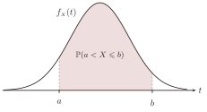
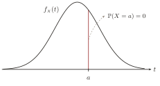

前幾篇已分別介紹離散型[隨機變數](/lecture-notes/random-variables-and-pmf/#def-random-variable)的[機率質量函數](/lecture-notes/random-variables-and-pmf/)、兩型共用的[累積分配函數](/lecture-notes/cumulative-distribution-functions/)，以及連續型隨機變數的[機率密度函數](/lecture-notes/probability-density-functions/)。三者的定義與性質都已齊備，彼此如何換算則尚未整理。

區間機率如何由 cdf 得到？連續型隨機變數落在單點上的機率是多少？區間端點的等號可不可以省略？以下將 pmf 與 pdf 的性質對照比較，並與 cdf 連結以回答這幾個問題。

Theorem 2.3 (由 cdf 計算區間機率, interval probabilities from a cdf)

若 $X$ 為一隨機變數，$a$ 與 $b$ 為二實數且 $a<b$，我們有下面的關係

$$
\begin{aligned}
\mathbb{P}(a<X\leqslant b)&=F_{\sssig X}(b)-F_{\sssig X}(a)\\[0.45em]
&=\sum_{a<x\leqslant b}p_{\sssig X}(x)\qquad(\text{當 }X\text{ 為離散型隨機變數})\\[0.45em]
&=\int_{a}^{b}f_{\sssig X}(x)\,dx\qquad(\text{當 }X\text{ 為連續型隨機變數})
\end{aligned}
$$

$$
\begin{aligned}
\mathbb{P}(&a<X\leqslant b)=F_{\sssig X}(b)-F_{\sssig X}(a)\\[0.45em]
&=\sum_{a<x\leqslant b}p_{\sssig X}(x) \quad (\text{當 }X\text{ 為離散型隨機變數})\\[0.45em]
&=\int_{a}^{b}f_{\sssig X}(x)\,dx \quad (\text{當 }X\text{ 為連續型隨機變數})
\end{aligned}
$$

**Proof.** 

由於 $a<b$，我們可知 $\lbrace X\leqslant a\rbrace$ 為 $\lbrace X\leqslant b\rbrace$ 的一個子集，故由[全機率定理](/lecture-notes/probability-rules-from-axioms/#theorem-total-and-addition)之特例知道

$$
\begin{aligned}
\mathbb{P}(a<X\leqslant b)&=\mathbb{P}\bigl(\lbrace X\leqslant b\rbrace-\lbrace X\leqslant a\rbrace\bigr)\\[0.45em]
&=\mathbb{P}(X\leqslant b)-\mathbb{P}(X\leqslant a)=F_{\sssig X}(b)-F_{\sssig X}(a)\\[0.45em]
&=\sum_{a<x\leqslant b}p_{\sssig X}(x)\qquad(\text{當 }X\text{ 為離散型隨機變數})\\[0.45em]
&=\int_{a}^{b}f_{\sssig X}(x)\,dx\qquad(\text{當 }X\text{ 為連續型隨機變數})
\end{aligned}
$$

$$
\begin{aligned}
\mathbb{P}(&a<X\leqslant b)=\mathbb{P}\bigl(\lbrace X\leqslant b\rbrace-\lbrace X\leqslant a\rbrace\bigr)\\[0.45em]
&=\mathbb{P}(X\leqslant b)-\mathbb{P}(X\leqslant a)\\[0.45em]
&=F_{\sssig X}(b)-F_{\sssig X}(a)\\[0.45em]
&=\sum_{a<x\leqslant b}p_{\sssig X}(x) \quad (\text{當 }X\text{ 為離散型隨機變數})\\[0.45em]
&=\int_{a}^{b}f_{\sssig X}(x)\,dx \quad (\text{當 }X\text{ 為連續型隨機變數})
\end{aligned}
$$

原式得證。 $\square$

在連續型隨機變數中，上述區間機率可由下圖理解。

<figure id="fig-interval-area" class="topic-figure topic-figure--wide">
  
  <figcaption>Fig. 2.6. 連續型隨機變數落在 $a$ 與 $b$ 之間的機率，即密度曲線在此區間下方圍出的面積。</figcaption>
</figure>

由面積觀點來看，任意可積函數在單點上的定積分恆為零，因為單點積分的底邊長度為零、沒有寬度可言；由此即得**連續型隨機變數的單點機率為零**，見下列 [Theorem 2.4](#thm-point-probability-zero)。

Theorem 2.4 (連續型隨機變數的單點機率為零, zero probability at a single point)

若 $X$ 為一連續型隨機變數，則對任意實數 $a$，我們有下面的結果

$$
\mathbb{P}(X=a)=\int_{a}^{a}f_{\sssig X}(x)\,dx=F_{\sssig X}(a)-F_{\sssig X}(a)=0
$$

$$
\begin{aligned}
\mathbb{P}(X=a)&=\int_{a}^{a}f_{\sssig X}(x)\,dx\\[0.45em]
&=F_{\sssig X}(a)-F_{\sssig X}(a)=0
\end{aligned}
$$

[Theorem 2.4](#thm-point-probability-zero) 可以說是連續型與離散型隨機變數之間最大的區別。離散型隨機變數是在特定的單點上帶有正機率，而連續型隨機變數在任何單點上的機率皆為零，**必須在一段區間上積分**才有面積，也才有機率。

我們可以用下圖來理解上面的定理。

<figure id="fig-single-point-zero" class="topic-figure topic-figure--wide">
  
  <figcaption>Fig. 2.7. 區間縮成單點 $a$ 之後，密度曲線下方只剩一條沒有寬度的線段，沒有面積可言，故 $\mathbb{P}(X=a)=0$。</figcaption>
</figure>

基於 [Theorem 2.4](#thm-point-probability-zero) 的結果，我們可以進一步得到下面這個方便且重要的性質。

Theorem 2.5 (連續型區間端點可互換, interchangeable endpoints in the continuous case)

若 $X$ 為一連續型隨機變數，且 $a<b$，$a,b\in\mathbb{R}$，我們有

<ol class="topic-list-paren topic-list-paren--math">
  <li>
  $$
  \begin{aligned}
  \mathbb{P}(a<X\leqslant b)&=\mathbb{P}(a<X<b)\\[0.45em]
  &=\mathbb{P}(a\leqslant X<b)\\[0.45em]
  &=\mathbb{P}(a\leqslant X\leqslant b)
  \end{aligned}
  $$
  </li>
  <li>
  $$
  F_{\sssig X}(x)=\mathbb{P}(X\leqslant x)=\mathbb{P}(X<x)
  $$
  </li>
</ol>

[Theorem 2.5](#thm-continuous-interval-endpoints) 僅適用於連續型隨機變數。離散型隨機變數在質點上具有正機率，**區間端點是否包含等號會直接改變機率值**，不可任意增刪等號。

對連續型隨機變數而言，由於端點的單點機率為零，各種開閉區間的機率皆可改寫為 cdf 的差值；在 cdf 已知時計算格外簡便，以下舉例說明。

Example 2.10

Assume that the increase in demand for electrical power (in millions of kilowatt hours) over the next $2$ years in a certain region is a random variable $X$ with density function

$$
f_{\sssig X}(x)=
\left\lbrace
\begin{array}{c@{\quad}l}
\dfrac{1}{64}x^{3}, & 0<x<4\\[0.7em]
0, & \text{otherwise}
\end{array}
\right.
$$

<ol class="topic-list-paren">
  <li>Show that $f_{\sssig X}$ is a legitimate probability density function.</li>
  <li>Find the cumulative distribution function $F_{\sssig X}$.</li>
  <li>If the region can supply at most $3$ million additional kilowatt hours, what is the probability that demand will exceed supply?</li>
</ol>

(1) 非負條件 $f_{\sssig X}(x)\geqslant0$ 對一切 $0<x<4$ 皆成立，且
{: .topic-paren-item}

$$
\int_{0}^{4}\frac{1}{64}x^{3}\,dx=\left[\frac{1}{256}x^{4}\right]_{0}^{4}=\frac{1}{256}\bigl(4^{4}-0^{4}\bigr)=1
$$

$$
\begin{aligned}
\int_{0}^{4}\frac{1}{64}&x^{3}\,dx=\left[\frac{1}{256}x^{4}\right]_{0}^{4}\\[0.45em]
&=\frac{1}{256}\bigl(4^{4}-0^{4}\bigr)=1
\end{aligned}
$$

故 $f_{\sssig X}(x)$ 確實為一機率密度函數。
{: .topic-paren-cont}

<ol class="topic-list-paren topic-list-paren--start-2 topic-list-paren--math">
  <li>
  

  $$
  F_{\sssig X}(x)=
  \left\lbrace
  \begin{array}{c@{\quad}l}
  0, & x\leqslant0\\[0.7em]
  \displaystyle\int_{0}^{x}\frac{1}{64}t^{3}\,dt=\frac{1}{256}x^{4}, & 0<x<4\\[0.7em]
  1, & x\geqslant4
  \end{array}
  \right.
  $$

  

  

  $$
  \begin{gathered}
  \int_{0}^{x}\frac{1}{64}t^{3}\,dt=\frac{1}{256}x^{4}\quad(0<x<4)\\[0.65em]
  F_{\sssig X}(x)=
  \left\lbrace
  \begin{array}{c@{\quad}l}
  0, & x\leqslant0\\[0.65em]
  \frac{1}{256}x^{4}, & 0<x<4\\[0.65em]
  1, & x\geqslant4
  \end{array}
  \right.
  \end{gathered}
  $$

  

  </li>
</ol>

(3) 依照題意敘述，需求超過供給的狀況即為 $3<X<4$，故所求為
{: .topic-paren-item}

$$
\begin{aligned}
\mathbb{P}(3<X<4)&=\mathbb{P}(3<X\leqslant4)=F_{\sssig X}(4)-F_{\sssig X}(3)\\[0.45em]
&=\frac{1}{256}\bigl(4^{4}-3^{4}\bigr)\fallingdotseq0.6836
\end{aligned}
$$

$$
\begin{aligned}
\mathbb{P}(3<X<4)&=\mathbb{P}(3<X\leqslant4)\\[0.45em]
&=F_{\sssig X}(4)-F_{\sssig X}(3)\\[0.45em]
&=\frac{1}{256}\bigl(4^{4}-3^{4}\bigr)\\[0.45em]
&\fallingdotseq0.6836
\end{aligned}
$$

Example 2.11

Let $Y$ be a continuous random variable with distribution function given by

$$
F_{\sssig Y}(y)=
\left\lbrace
\begin{array}{c@{\quad}l}
0, & y\leqslant0\\[0.5em]
y^{3}, & 0<y<1\\[0.5em]
1, & 1\leqslant y
\end{array}
\right.
$$

<ol class="topic-list-paren">
  <li>Find the density function of $Y$.</li>
  <li>Find $\mathbb{P}\left(Y\geqslant\frac{1}{4}\right)$.</li>
</ol>

<ol class="topic-list-paren topic-list-paren--math">
  <li>
  

  $$
  f_{\sssig Y}(y)=
  \left\lbrace
  \begin{array}{c@{\quad}l}
  \dfrac{d\,F_{\sssig Y}(y)}{dy}=\dfrac{d\,y^{3}}{dy}=3y^{2}, & 0<y<1\\[0.9em]
  0, & \text{elsewhere}
  \end{array}
  \right.
  $$

  

  

  $$
  \begin{gathered}
  \frac{d\,F_{\sssig Y}(y)}{dy}=\frac{d\,y^{3}}{dy}=3y^{2}\quad(0<y<1)\\[0.65em]
  f_{\sssig Y}(y)=
  \left\lbrace
  \begin{array}{c@{\quad}l}
  3y^{2}, & 0<y<1\\[0.75em]
  0, & \text{elsewhere}
  \end{array}
  \right.
  \end{gathered}
  $$

  

  </li>
  <li>
  

  $$
  \begin{aligned}
  \mathbb{P}\left(Y\geqslant\frac{1}{4}\right)&=1-\mathbb{P}\left(Y<\frac{1}{4}\right)=1-F_{\sssig Y}\left(\frac{1}{4}\right)\\[0.45em]
  &=1-\left(\frac{1}{4}\right)^{3}=\frac{63}{64}
  \end{aligned}
  $$

  

  

  $$
  \begin{aligned}
  \mathbb{P}\left(Y\geqslant\frac{1}{4}\right)&=1-\mathbb{P}\left(Y<\frac{1}{4}\right)\\[0.45em]
  &=1-F_{\sssig Y}\left(\frac{1}{4}\right)\\[0.45em]
  &=1-\left(\frac{1}{4}\right)^{3}\\[0.45em]
  &=\frac{63}{64}
  \end{aligned}
  $$

  

  </li>
</ol>

離散型分配由於具單點機率，故其範圍的等號不可任意省略，其 pmf 與 cdf 的關聯，請見[下列定理](#thm-discrete-interval-probability)。

Theorem 2.6 (離散型的 pmf 與 cdf, pmf and cdf in the discrete case)

若 $X$ 為離散型隨機變數，且 $a<b$，$a,b\in\mathbb{R}$ 為具有機率的質點，則

<ol class="topic-list-paren topic-list-paren--math">
  <li>
  $$
  p_{\sssig X}(a)=F_{\sssig X}(a)-F_{\sssig X}(a^{-})
  $$
  </li>
  <li>
  

  $$
  F_{\sssig X}(a)=\mathbb{P}(X\leqslant a)=\mathbb{P}(X<a)+p_{\sssig X}(a)
  $$

  

  

  $$
  \begin{aligned}
  F_{\sssig X}(a)&=\mathbb{P}(X\leqslant a)\\[0.45em]
  &=\mathbb{P}(X<a)+p_{\sssig X}(a)
  \end{aligned}
  $$

  

  </li>
  <li>
  

  $$
  \mathbb{P}(a<X<b)=F_{\sssig X}(b)-F_{\sssig X}(a)-p_{\sssig X}(b)
  $$

  

  

  $$
  \begin{aligned}
  \mathbb{P}(a<&X<b)\\[0.45em]
  &=F_{\sssig X}(b)-F_{\sssig X}(a)-p_{\sssig X}(b)
  \end{aligned}
  $$

  

  </li>
  <li>
  

  $$
  \mathbb{P}(a\leqslant X<b)=F_{\sssig X}(b)-F_{\sssig X}(a)-p_{\sssig X}(b)+p_{\sssig X}(a)
  $$

  

  

  $$
  \begin{aligned}
  &\mathbb{P}(a\leqslant X<b)\\[0.45em]
  &=F_{\sssig X}(b)-F_{\sssig X}(a)-p_{\sssig X}(b)+p_{\sssig X}(a)
  \end{aligned}
  $$

  

  </li>
  <li>
  

  $$
  \mathbb{P}(a\leqslant X\leqslant b)=F_{\sssig X}(b)-F_{\sssig X}(a)+p_{\sssig X}(a)
  $$

  

  

  $$
  \begin{aligned}
  \mathbb{P}(a\leqslant &X\leqslant b)\\[0.45em]
  &=F_{\sssig X}(b)-F_{\sssig X}(a)+p_{\sssig X}(a)
  \end{aligned}
  $$

  

  </li>
</ol>

Note

[Theorem 2.6](#thm-discrete-interval-probability) 中第 (1) 式的幾何意義，在於「$X=a$ 的單點機率即為 $F_{\sssig X}(x)$ 於 $x=a$ 處躍升的高度」；結合區間端點是否包含質點 $a$ 與 $b$，由第 (1) 式即可推得第 (2) 至 (5) 式，將離散型隨機變數的 pmf 與 cdf 完整連結。

計算離散型隨機變數的區間機率時，若已知其 cdf，往往能更簡便地求得答案。下面就來看一個例子。

Example 2.3 (Continued)

Let $X$ be a random variable with probability mass function

$$
p_{\sssig X}(x)=
\left\lbrace
\begin{array}{c@{\quad}l}
\left(\dfrac{1}{2}\right)^{x}, & x=1,2,\ldots\\[0.7em]
0, & \text{otherwise}
\end{array}
\right.
$$

<ol class="topic-list-paren topic-list-paren--start-3">
  <li>Evaluate $\mathbb{P}(2.3\leqslant X<5)$.</li>
</ol>

<ol class="topic-list-paren topic-list-paren--start-3 topic-list-paren--math">
  <li>
  

  $$
  \begin{aligned}
  \mathbb{P}(2.3\leqslant X<5)&=\mathbb{P}(2<X\leqslant4)=F_{\sssig X}(4)-F_{\sssig X}(2)\\[0.45em]
  &=\frac{15}{16}-\frac{3}{4}=\frac{3}{16}=0.1875
  \end{aligned}
  $$

  

  

  $$
  \begin{aligned}
  \mathbb{P}(2.3\leqslant X<5)&=\mathbb{P}(2<X\leqslant4)\\[0.45em]
  &=F_{\sssig X}(4)-F_{\sssig X}(2)\\[0.45em]
  &=\frac{15}{16}-\frac{3}{4}\\[0.45em]
  &=\frac{3}{16}=0.1875
  \end{aligned}
  $$

  

  </li>
</ol>

Example 2.12

In the course of a game, a basketball player takes $4$ field goal attempts. Let $X$ denote how many of these $4$ attempts the player converts. The pmf of $X$ is given by

$$
p_{\sssig X}(x)=
\left\lbrace
\begin{array}{c@{\quad}l}
\dbinom{4}{x}\left(\dfrac{1}{4}\right)^{x}\left(\dfrac{3}{4}\right)^{4-x}, & x=0,1,2,3,4\\[0.9em]
0, & \text{otherwise}
\end{array}
\right.
$$

  
$p_{\sssig X}(x)=$

  

    <svg viewBox="0 0 12 12" preserveAspectRatio="none"><path d="M 11 0.8 C 7.6 0.8 6 2.4 6 5.2 L 6 12" vector-effect="non-scaling-stroke"/></svg>
    
    <svg viewBox="0 0 12 12" preserveAspectRatio="none"><path d="M 6 0 L 6 3.4 C 6 5 4.6 6 1 6 C 4.6 6 6 7 6 8.6 L 6 12" vector-effect="non-scaling-stroke"/></svg>
    
    <svg viewBox="0 0 12 12" preserveAspectRatio="none"><path d="M 6 0 L 6 6.8 C 6 9.6 7.6 11.2 11 11.2" vector-effect="non-scaling-stroke"/></svg>
  

  

    
$\dbinom{4}{x}\left(\dfrac{1}{4}\right)^{x}\left(\dfrac{3}{4}\right)^{4-x},$

    
$x=0,1,2,3,4$

    
$0,$

    
$\text{otherwise}$

  

<ol class="topic-list-paren">
  <li>What is the probability that the player converts exactly $3$ of the attempts?</li>
  <li>What is the probability that the player converts strictly fewer than $3$ of the attempts?</li>
</ol>

<ol class="topic-list-paren topic-list-paren--math">
  <li>
  

  $$
  \mathbb{P}(X=3)=p_{\sssig X}(3)=\binom{4}{3}\left(\frac{1}{4}\right)^{3}\left(\frac{3}{4}\right)^{4-3}=0.046875
  $$

  

  

  $$
  \begin{aligned}
  \mathbb{P}(X=3)&=p_{\sssig X}(3)\\[0.45em]
  &=\binom{4}{3}\left(\frac{1}{4}\right)^{3}\left(\frac{3}{4}\right)^{4-3}\\[0.45em]
  &=0.046875
  \end{aligned}
  $$

  

  </li>
</ol>

(2) 由於該變數的值域皆為整數，故
{: .topic-paren-item}

$$
\begin{aligned}
\mathbb{P}(X<3)&=\mathbb{P}(X\leqslant2)=p_{\sssig X}(0)+p_{\sssig X}(1)+p_{\sssig X}(2)\\[0.45em]
&=\sum_{x=0}^{2}\binom{4}{x}\left(\frac{1}{4}\right)^{x}\left(\frac{3}{4}\right)^{4-x}\\[0.45em]
&=\binom{4}{0}\left(\frac{1}{4}\right)^{0}\left(\frac{3}{4}\right)^{4-0}+\binom{4}{1}\left(\frac{1}{4}\right)^{1}\left(\frac{3}{4}\right)^{4-1}\\[0.45em]
&\qquad+\binom{4}{2}\left(\frac{1}{4}\right)^{2}\left(\frac{3}{4}\right)^{4-2}=\frac{243}{256}\fallingdotseq0.9492
\end{aligned}
$$

$$
\begin{aligned}
\mathbb{P}(&X<3)=\mathbb{P}(X\leqslant2)\\[0.45em]
&=p_{\sssig X}(0)+p_{\sssig X}(1)+p_{\sssig X}(2)\\[0.45em]
&=\sum_{x=0}^{2}\binom{4}{x}\left(\frac{1}{4}\right)^{x}\left(\frac{3}{4}\right)^{4-x}\\[0.45em]
&=\binom{4}{0}\left(\frac{1}{4}\right)^{0}\left(\frac{3}{4}\right)^{4-0}\\[0.45em]
&\qquad+\binom{4}{1}\left(\frac{1}{4}\right)^{1}\left(\frac{3}{4}\right)^{4-1}\\[0.45em]
&\qquad+\binom{4}{2}\left(\frac{1}{4}\right)^{2}\left(\frac{3}{4}\right)^{4-2}\\[0.45em]
&=\frac{243}{256}\fallingdotseq0.9492
\end{aligned}
$$

## 本篇小結

[Theorem 2.3](#thm-interval-probability) 把區間機率化為 cdf 的兩個函數值相減，離散型可再寫成 pmf 在該區間上的加總，連續型則為 pdf 在該區間上的積分。證明的關鍵在於 $\lbrace X\leqslant a\rbrace$ 是 $\lbrace X\leqslant b\rbrace$ 的子集，故兩個累積機率相減即為兩者之差集的機率。

連續型隨機變數的單點定積分恆為 $0$，此即 [Theorem 2.4](#thm-point-probability-zero)；也因為端點的單點機率都是 $0$，[Theorem 2.5](#thm-continuous-interval-endpoints) 才能讓四種區間寫法的機率相等，$F_{\sssig X}(x)$ 亦可寫成 $\mathbb{P}(X<x)$。[Example 2.10](#ex-power-demand-density) 與 [Example 2.11](#ex-cubic-cdf) 都是先取得 cdf，再把區間機率換成兩個函數值之差。

離散型則相反，單點機率不為 $0$，端點的等號因而不可省略。[Theorem 2.6](#thm-discrete-interval-probability) 的五款對應關係都由第 (1) 款出發，單點機率就是 cdf 在該點躍升的高度，其餘四款只是把端點的質點機率加回或扣除。[Example 2.3 (Continued)](#ex-geometric-interval-probability) 與 [Example 2.12](#ex-basketball-binomial) 即為離散型的計算示範。[下一篇](/lecture-notes/mixed-random-variables/)討論同時具備兩型特性的混合型隨機變數。

## 參考文獻與延伸閱讀

- 黃文璋，2010，《機率論》，二版，華泰文化。
- Sheldon Ross. 2019. *A First Course in Probability*. 10th ed. Pearson.
- Morris H. DeGroot and Mark J. Schervish. 2012. *Probability and Statistics*. 4th ed. Pearson.
- Joseph K. Blitzstein and Jessica Hwang. 2019. *Introduction to Probability*. 2nd ed. Chapman and Hall/CRC.
