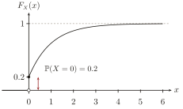

到目前為止，我們將[隨機變數](/lecture-notes/random-variables-and-pmf/#def-random-variable)分為離散型與連續型兩類。離散型以[機率質量函數](/lecture-notes/random-variables-and-pmf/)記錄每一個質點的單點機率，其 cdf 是在質點上跳躍的階梯函數；連續型則以[機率密度函數](/lecture-notes/probability-density-functions/)描述機率的疏密程度，由於[任一單點的機率皆為零](/lecture-notes/computing-probabilities-from-cdf/#thm-point-probability-zero)，其 cdf 因而處處連續。

這兩類並沒有涵蓋所有的隨機變數。有些隨機變數的 cdf 既有跳躍，也有連續上升的部分，離散型與連續型的特性同時出現在同一個變數上。以下便介紹這一類隨機變數，以及把它拆解為離散與連續兩個部分的分解定理。

有一部分隨機變數既非純粹的離散型，亦非純粹的連續型，而是同時具備離散型在特定單點上有正機率，以及連續型以密度描述機率疏密這兩種特性，我們稱之為**混合型隨機變數 (mixed random variable)**。

Example 2.13

Let $X$ be a random variable with distribution function

$$
F_{\sssig X}(x)=
\left\lbrace
\begin{array}{c@{\quad}l}
0, & \text{for }x<0\\[0.4em]
1-0.8e^{-x}, & \text{for }x\geqslant0
\end{array}
\right.
$$

Find the density function of $X$.

由 cdf 在 $x=0$ 的跳躍高度可得

$$
\mathbb{P}(X=0)=F_{\sssig X}(0)-F_{\sssig X}(0^{-})=1-0.8e^{0}-0=0.2
$$

$$
\begin{aligned}
\mathbb{P}(X=0)&=F_{\sssig X}(0)-F_{\sssig X}(0^{-})\\[0.4em]
&=1-0.8e^{0}-0=0.2
\end{aligned}
$$

故

$$
f_{\sssig X}(x)=
\left\lbrace
\begin{array}{c@{\quad}l}
0.2, & x=0\\[0.6em]
\dfrac{d\,(1-0.8e^{-x})}{dx}=0.8\,e^{-x}, & x>0\\[0.6em]
0, & \text{otherwise}
\end{array}
\right.
$$

$$
\begin{gathered}
\frac{d\,(1-0.8e^{-x})}{dx}=0.8\,e^{-x}\quad(x>0)\\[0.6em]
f_{\sssig X}(x)=
\left\lbrace
\begin{array}{c@{\quad}l}
0.2, & x=0\\[0.55em]
0.8\,e^{-x}, & x>0\\[0.55em]
0, & \text{otherwise}
\end{array}
\right.
\end{gathered}
$$

<figure id="fig-mixed-cdf" class="topic-figure topic-figure--wide">
  
  <figcaption>Fig. 2.8. $X$ 的 cdf: 在 $x=0$ 有一個高度為 $\mathbb{P}(X=0)=0.2$ 的跳躍，其後沿 $1-0.8e^{-x}$ 連續遞增，並以 $1$ 為水平漸近線。</figcaption>
</figure>

混合型隨機變數的分配可視為一個離散型分配與一個連續型分配的線性組合，這一點在機率函數與 cdf 上皆適用。以 [Example 2.13](#ex-mixed-cdf-density) 為例，其 cdf 可寫為

$$
F_{\sssig X}(x)=0.2\times F_{\sssig d}(x)+0.8\times F_{\sssig c}(x)
$$

其中，離散部分的 cdf 為

$$
F_{\sssig d}(x)=
\left\lbrace
\begin{array}{c@{\quad}l}
0, & x<0\\[0.4em]
1, & x\geqslant0
\end{array}
\right.
$$

連續部分的 cdf 為

$$
F_{\sssig c}(x)=
\left\lbrace
\begin{array}{c@{\quad}l}
0, & x<0\\[0.4em]
1-e^{-x}, & x\geqslant0
\end{array}
\right.
$$

在上面的拆解中，可以發現 $F_{\sssig d}(x)$ 與 $F_{\sssig c}(x)$ 分別是正規的離散型 cdf 與連續型 cdf。事實上，這裡的離散 cdf 與連續 cdf，及其線性組合的係數都是唯一的，這一點即下列定理所要陳述的內容。

Theorem 2.7 (分解定理, decomposition theorem)

若 $X$ 為一隨機變數，且 $F_{\sssig X}(x)$ 為其 cdf，則其可分解為

$$
F_{\sssig X}(x)=\alpha\,F_{\sssig d}(x)+(1-\alpha)\,F_{\sssig c}(x)
$$

$$
\begin{aligned}
F_{\sssig X}(x)=\alpha\,F_{\sssig d}(x)+(1-\alpha)\,F_{\sssig c}(x)
\end{aligned}
$$

其中 $0\leqslant\alpha\leqslant1$，且 $F_{\sssig d}(x)$ 表一離散隨機變數的 cdf，$F_{\sssig c}(x)$ 表一處處連續的 cdf；當 $0<\alpha<1$ 時，此分解必定唯一。

在進行分解的過程中，可先尋找線性組合的係數 $\alpha$，這個係數將等於離散質點的機率總和，在 [Example 2.13](#ex-mixed-cdf-density) 中，即為

$$
\alpha=0.2
$$

整體而言，尋找 $\alpha, F_{\sssig d}(x), F_{\sssig c}(x)$ 的步驟如下:

(1) 令 $x_1<x_2<\cdots$ 表該分配之所有離散質點，對應之機率分別為 $p_1,p_2,\ldots$；質點的個數可能是有限的 $k$ 個，也可能是可數無限多個。不論何者，$\alpha$ 都是對所有質點的機率求和，即
{: .topic-paren-item}

$$
\alpha=\sum_{i}p_i
$$

並令 $F_{\sssig 1}(x)$ 表所有不超過 $x$ 的質點之機率總和，即
{: .topic-paren-cont}

$$
F_{\sssig 1}(x)=\sum_{x_i\leqslant x}p_i
$$

質點只有有限的 $k$ 個時，逐段寫開即為
{: .topic-paren-cont}

$$
F_{\sssig 1}(x)=
\left\lbrace
\begin{array}{c@{\quad}l}
0, & x<x_1\\[0.4em]
p_1, & x_1\leqslant x<x_2\\[0.4em]
p_1+p_2, & x_2\leqslant x<x_3\\[0.4em]
\vdots & \\[0.4em]
\sum_{i=1}^{k}p_i, & x\geqslant x_k
\end{array}
\right.
$$

上式是以有限個質點 $x_1<\cdots<x_k$ 為例寫成階梯式；若質點有可數無限多個，一般而言便沒有最後一段 $x\geqslant x_k$ 的常數區間，$F_{\sssig 1}(x)=\sum_{x_i\leqslant x}p_i$ 會隨著 $x$ 增大而逐步趨近總和 $\alpha$。
{: .topic-paren-cont}

(2) $F_{\sssig 1}(x)$ 未必為一 cdf，則可令
{: .topic-paren-item}

$$
F_{\sssig d}(x)=\frac{1}{\alpha}\,F_{\sssig 1}(x)=
\left\lbrace
\begin{array}{c@{\quad}l}
0, & x<x_1\\[0.6em]
\dfrac{p_1}{\alpha}, & x_1\leqslant x<x_2\\[0.6em]
\vdots & \\[0.6em]
1, & x\geqslant x_k
\end{array}
\right.
$$

上式由 $F_{\sssig 1}(x)$ 各段同除以 $\alpha$ 而得 (若質點有可數無限多個，同樣沒有最後一段 $x\geqslant x_k$ 的常數區間，函數值會隨著 $x$ 增大而趨近於 $1$)，此即離散型部分的 cdf。
{: .topic-paren-cont}

(3) 令 $F_{\sssig 2}(x)=F_{\sssig X}(x)-F_{\sssig 1}(x)$，則 $F_{\sssig 2}(x)$ 未必為一 cdf，可令
{: .topic-paren-item}

$$
F_{\sssig c}(x)=\frac{1}{1-\alpha}\,F_{\sssig 2}(x)
$$

此即處處連續的 cdf。
{: .topic-paren-cont}

實際拆解時，並非事先知道 $F_{\sssig d}(x)$ 與 $F_{\sssig c}(x)$ 的形式，而是先求出離散權重 $\alpha$，再依據 [Theorem 2.1](/lecture-notes/cumulative-distribution-functions/#thm-cdf-properties) 中「任一 cdf 的兩端極限須分別為 $0$ 與 $1$」的性質，將尚未正規化的 $F_{\sssig 1}(x)$ 與 $F_{\sssig 2}(x)$ 分別除以 $\alpha$ 與 $1-\alpha$ 修正為正規的 cdf。

由於上述第 (2) 步須除以 $\alpha$、第 (3) 步須除以 $1-\alpha$，這套拆解流程是以混合型的 $0<\alpha<1$ 為前提；至於 $\alpha=0$ 與 $\alpha=1$ 兩個邊界情況，則分別退化為純粹連續型與純粹離散型:

**[ 當 $\alpha=0$ 時 ]**

$$
F_{\sssig X}(x)=F_{\sssig c}(x)
$$

此即 $X$ 為一個純粹的連續型隨機變數。

**[ 當 $\alpha=1$ 時 ]**

$$
F_{\sssig X}(x)=F_{\sssig d}(x)
$$

此即 $X$ 為一個純粹的離散型隨機變數。

Note

[Theorem 2.7](#thm-decomposition) 與第 (3) 步將 $F_{\sssig c}(x)$ 稱為「處處連續的 cdf」，而非直接稱為「連續型隨機變數的 cdf」。原因在於第 (3) 步扣除所有跳躍量後，雖保證 $F_{\sssig c}(x)$ 處處連續而無跳躍，但在少數奇異分配的例子中，處處連續的 cdf 未必具有對應的密度函數可積分 (即未必符合 [Definition 2.2](/lecture-notes/random-variables-and-pmf/#def-support-classification) 的積分判準)。不過在本系列與實務應用常見的混合型分配中，$F_{\sssig c}(x)$ 皆具有對應的 pdf (如本篇兩道例題中的指數分配)，直接視為連續型隨機變數的 cdf 操作即可。

若想親手安排離散與連續兩個部分，可以參考互動展示 [Mixed distributions](/demos/mixed/)。它讓讀者自行加入質點與其機率，觀察 cdf 在各質點躍升的高度恰為該點的機率，連續的部分則佔 $1-\alpha$ 的權重。

分解定理的概念不僅適用於 cdf，亦適用於混合型機率函數的線性拆解，以下舉例說明。

Example 2.14

Let $Y$ denote the length of life (in hundreds of hours) of electronic components. These components frequently fail immediately upon insertion into a system. It has been observed that the probability of immediate failure is $\frac{1}{4}$. If a component does not fail immediately, the distribution for its length of life has the exponential density function

$$
g(y)=
\left\lbrace
\begin{array}{c@{\quad}l}
e^{-y}, & y>0\\[0.4em]
0, & \text{elsewhere}
\end{array}
\right.
$$

<ol class="topic-list-paren">
  <li>Find the pdf and cdf of $Y$, also evaluate $\mathbb{P}(Y>1)$.</li>
</ol>

由於元件有 $\frac{1}{4}$ 的機率在裝上系統時馬上就壞掉，故我們可以假設

$$
f_{\sssig d}(y)=
\left\lbrace
\begin{array}{c@{\quad}l}
1, & y=0\\[0.4em]
0, & \text{elsewhere}
\end{array}
\right.
$$

表示馬上壞掉的元件的壽命分配，即離散部分的 pmf，並且由題意知道

$$
f_{\sssig c}(y)=g(y)=
\left\lbrace
\begin{array}{c@{\quad}l}
e^{-y}, & y>0\\[0.4em]
0, & \text{elsewhere}
\end{array}
\right.
$$

表示不會馬上壞掉的元件的壽命分配，即連續部分的 pdf。

則整體元件的壽命分配可以視為二種分配的線性組合，且混合比例為 $\frac{1}{4}$，此即

$$
f_{\sssig Y}(y)=\frac{1}{4}\,f_{\sssig d}(y)+\frac{3}{4}\,f_{\sssig c}(y)=
\left\lbrace
\begin{array}{c@{\quad}l}
\dfrac{1}{4}, & y=0\\[0.6em]
\dfrac{3}{4}e^{-y}, & y>0\\[0.6em]
0, & \text{elsewhere}
\end{array}
\right.
$$

$$
\begin{aligned}
f_{\sssig Y}(y)&=\frac{1}{4}\,f_{\sssig d}(y)+\frac{3}{4}\,f_{\sssig c}(y)\\[0.5em]
&=
\left\lbrace
\begin{array}{c@{\quad}l}
\dfrac{1}{4}, & y=0\\[0.6em]
\dfrac{3}{4}e^{-y}, & y>0\\[0.6em]
0, & \text{elsewhere}
\end{array}
\right.
\end{aligned}
$$

cdf 亦可以用二種類型的 cdf 經由線性組合得到，故先算出

$$
\begin{gathered}
F_{\sssig d}(y)=
\left\lbrace
\begin{array}{c@{\quad}l}
0, & y<0\\[0.4em]
1, & y\geqslant0
\end{array}
\right.\\[1em]
F_{\sssig c}(y)=
\left\lbrace
\begin{array}{c@{\quad}l}
0, & y<0\\[0.4em]
1-e^{-y}, & y\geqslant0
\end{array}
\right.
\end{gathered}
$$

且以此進行線性組合得到

$$
F_{\sssig Y}(y)=\frac{1}{4}F_{\sssig d}(y)+\frac{3}{4}F_{\sssig c}(y)=
\left\lbrace
\begin{array}{c@{\quad}l}
0, & y<0\\[0.6em]
1-\dfrac{3}{4}e^{-y}, & y\geqslant0
\end{array}
\right.
$$

$$
\begin{aligned}
F_{\sssig Y}(y)&=\frac{1}{4}F_{\sssig d}(y)+\frac{3}{4}F_{\sssig c}(y)\\[0.5em]
&=
\left\lbrace
\begin{array}{c@{\quad}l}
0, & y<0\\[0.6em]
1-\dfrac{3}{4}e^{-y}, & y\geqslant0
\end{array}
\right.
\end{aligned}
$$

則

$$
\mathbb{P}(Y>1)=1-F_{\sssig Y}(1)=1-\left(1-\frac{3}{4}e^{-1}\right)\fallingdotseq0.2759
$$

$$
\begin{aligned}
\mathbb{P}(Y>1)&=1-F_{\sssig Y}(1)\\[0.4em]
&=1-\left(1-\frac{3}{4}e^{-1}\right)\\[0.4em]
&\fallingdotseq0.2759
\end{aligned}
$$

## 本篇小結

混合型隨機變數同時具備離散型與連續型的特性。它在某些單點上有正機率，其 cdf 在該處跳躍；在其餘的範圍則以密度描述機率的疏密，機率函數的值不是機率。[Example 2.13](#ex-mixed-cdf-density) 的 $F_{\sssig X}$ 即為一例，它在 $x=0$ 跳躍 $0.2$，其後沿 $1-0.8e^{-x}$ 連續遞增。

[Theorem 2.7](#thm-decomposition) 指出，任一個 cdf 都可以寫成 $\alpha\,F_{\sssig d}(x)+(1-\alpha)\,F_{\sssig c}(x)$ 的形式，其中 $F_{\sssig d}$ 為一離散隨機變數的 cdf、$F_{\sssig c}$ 為一處處連續的 cdf，且當 $0<\alpha<1$ 時這樣的分解必定唯一。實際拆解時先求 $\alpha$，它等於所有離散質點的機率總和，再把 $F_{\sssig 1}$ 與 $F_{\sssig 2}$ 這兩個未必是 cdf 的函數，分別除以 $\alpha$ 與 $1-\alpha$ 修正而得。同樣的分解也適用於 pdf，[Example 2.14](#ex-component-lifetime) 便以 $\frac{1}{4}$ 與 $\frac{3}{4}$ 為權重，把元件壽命的分配寫成離散部分與連續部分的線性組合。

[下一節](/lecture-notes/expectation/)開始討論隨機變數的[期望值](/lecture-notes/expectation/#def-expectation)、[變異數](/lecture-notes/variance/#def-variance)、[標準差](/lecture-notes/variance-standard-deviation/#def-standard-deviation)與其他量數，先由其中的期望值談起。

## 參考文獻與延伸閱讀

- 黃文璋，2010，《機率論》，二版，華泰文化。
- Vijay K. Rohatgi and A. K. Md. Ehsanes Saleh. 2015. *An Introduction to Probability and Statistics*. 3rd ed. Wiley.
- Kai Lai Chung. 2001. *A Course in Probability Theory*. 3rd ed. Academic Press.
- Patrick Billingsley. 1995. *Probability and Measure*. 3rd ed. Wiley.
