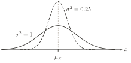

[上一篇](/lecture-notes/properties-of-expectation/)把[期望值](/lecture-notes/expectation/#def-expectation)的計算推廣到[隨機變數](/lecture-notes/random-variables-and-pmf/#def-random-variable)的函數 $g(X)$，並給出期望值與線性組合可交換的性質。期望值指出分配的聚集中心，但僅靠中心不足以描述一個分配。兩個期望值完全相同的隨機變數，取值散開的程度可相差很多。

本篇介紹用來衡量這種分散程度的量數，也就是變異數。以下先分別對離散型與連續型給出定義，再導出一個便於計算的公式，接著把它延伸到一般函數 $g(X)$ 的情形，然後列出變異數的兩項性質，並由其中的複合性質設定出三個常用的子性質，最後以一張比較圖說明變異數的大小在一個分配上的意義，並以兩道例題示範計算。

Definition 2.7 (變異數, variance)

若 $X$ 為離散型隨機變數，值域為 $\mathcal{R}\_{\sssig X}$、pmf 為 $p\_{\sssig X}(x)$，二階動差 $\mathbb{E}(\lvert X\rvert^{2})$ 為有限，則以下的量

$$
\sigma_{\sssig X}^{2}=\mathrm{Var}(X)=\mathbb{E}\bigl[(X-\mu_{\sssig X})^{2}\bigr]=\sum_{x\in\mathcal{R}_{\sssig X}}(x-\mu_{\sssig X})^{2}\,p_{\sssig X}(x)
$$

$$
\begin{aligned}
\sigma_{\sssig X}^{2}&=\mathrm{Var}(X)=\mathbb{E}\bigl[(X-\mu_{\sssig X})^{2}\bigr]\\[0.45em]
&=\sum_{x\in\mathcal{R}_{\sssig X}}(x-\mu_{\sssig X})^{2}\,p_{\sssig X}(x)
\end{aligned}
$$

為 $X$ 的**變異數 (variance)**。

若 $X$ 為連續型隨機變數，值域為 $\mathcal{R}\_{\sssig X}$、pdf 為 $f\_{\sssig X}(x)$，二階動差 $\mathbb{E}(\lvert X\rvert^{2})$ 為有限，則以下的量

$$
\sigma_{\sssig X}^{2}=\mathrm{Var}(X)=\mathbb{E}\bigl[(X-\mu_{\sssig X})^{2}\bigr]=\int_{-\infty}^{\infty}(x-\mu_{\sssig X})^{2}f_{\sssig X}(x)\,dx
$$

$$
\begin{aligned}
\sigma_{\sssig X}^{2}&=\mathrm{Var}(X)=\mathbb{E}\bigl[(X-\mu_{\sssig X})^{2}\bigr]\\[0.45em]
&=\int_{-\infty}^{\infty}(x-\mu_{\sssig X})^{2}f_{\sssig X}(x)\,dx
\end{aligned}
$$

為 $X$ 的**變異數**。

變異數有一些地方需要注意:

(1) $X$ 的變異數亦常常被記為 $\mathrm{V}(X)$。
{: .topic-paren-item}

(2) 變異數亦是一種期望值，從其定義上來看，變異數是**離差平方的期望值**，而**離差 (deviation)** 是指隨機變數與其期望值的差，即 $X-\mu_{\sssig X}$，用來指出一個隨機變數的值與其分配中心的距離。
{: .topic-paren-item}

Note

由於期望值為加權平均，離差平方的期望值即可視為隨機變數圍繞中心**平均的分散程度** (或**平均的變異程度**)。衡量隨機變數的變異程度是機率與統計的核心課題，在後續的區間估計與假說檢定中尤為關鍵。

(3) 變異數與期望值同為隨機變數的母數，是不具隨機性的常數；為與後文具隨機性的統計量「樣本變異數」區別，常稱 $\mathrm{Var}(X)$ 為母體變異數，樣本變異數則定義為
{: .topic-paren-item}

$$
S^{2}=\frac{1}{\,n-1\,}\sum_{i=1}^{n}\bigl(X_{i}-\overline{X}\bigr)^{2}
$$

Theorem 2.11 (變異數的計算公式, computational formula for the variance)

若 $X$ 為一隨機變數且其變異數存在，則

$$
\mathrm{Var}(X)=\mathbb{E}\bigl(X^{2}\bigr)-\bigl[\mathbb{E}(X)\bigr]^{2}
$$

**Proof.**

由 [Definition 2.7](#def-variance) 與 [Theorem 2.10](/lecture-notes/properties-of-expectation/#thm-expectation-linearity) 可知

$$
\begin{aligned}
\mathrm{Var}(X)&=\mathbb{E}\bigl[(X-\mu_{\sssig X})^{2}\bigr]=\mathbb{E}\bigl(X^{2}-2\mu_{\sssig X}X+\mu_{\sssig X}^{2}\bigr)\\[0.45em]
&=\mathbb{E}\bigl(X^{2}\bigr)-2\mu_{\sssig X}\mathbb{E}(X)+\mu_{\sssig X}^{2}\\[0.45em]
&=\mathbb{E}\bigl(X^{2}\bigr)-2\bigl[\mathbb{E}(X)\bigr]^{2}+\bigl[\mathbb{E}(X)\bigr]^{2}=\mathbb{E}\bigl(X^{2}\bigr)-\bigl[\mathbb{E}(X)\bigr]^{2}
\end{aligned}
$$

$$
\begin{aligned}
\mathrm{Var}(X)&=\mathbb{E}\bigl[(X-\mu_{\sssig X})^{2}\bigr]\\[0.45em]
&=\mathbb{E}\bigl(X^{2}-2\mu_{\sssig X}X+\mu_{\sssig X}^{2}\bigr)\\[0.45em]
&=\mathbb{E}\bigl(X^{2}\bigr)-2\mu_{\sssig X}\mathbb{E}(X)+\mu_{\sssig X}^{2}\\[0.45em]
&=\mathbb{E}\bigl(X^{2}\bigr)-2\bigl[\mathbb{E}(X)\bigr]^{2}+\bigl[\mathbb{E}(X)\bigr]^{2}\\[0.45em]
&=\mathbb{E}\bigl(X^{2}\bigr)-\bigl[\mathbb{E}(X)\bigr]^{2}
\end{aligned}
$$

原式得證。 $\square$

Note

直接依定義展開 $(X-\mu_{\sssig X})^{2}$ 求算變異數往往較為繁瑣；改用 [Theorem 2.11](#thm-variance-formula) 通常簡便許多，記憶上可歸納為「**平方的期望值減期望值的平方**」。

Theorem 2.12 (函數變異數, variance of a function)

若 $X$ 為**離散型**隨機變數，$g(\cdot)$ 為一實值可測函數，$\mathbb{E}\bigl[g^{2}(X)\bigr]$ 為有限，則以下的量

$$
\begin{aligned}
\mathrm{Var}\bigl[g(X)\bigr]&=\mathbb{E}\Bigl[\bigl(g(X)-\mathbb{E}[g(X)]\bigr)^{2}\Bigr]\\[0.45em]
&=\sum_{x\in\mathcal{R}_{\sssig X}}(g(x)-\mathbb{E}[g(X)])^{2}\,p_{\sssig X}(x)
\end{aligned}
$$

$$
\begin{aligned}
\mathrm{Var}\bigl[&g(X)\bigr]=\mathbb{E}\Bigl[\bigl(g(X)-\mathbb{E}[g(X)]\bigr)^{2}\Bigr]\\[0.45em]
&=\sum_{x\in\mathcal{R}_{\sssig X}}(g(x)-\mathbb{E}[g(X)])^{2}\,p_{\sssig X}(x)
\end{aligned}
$$

若 $X$ 為**連續型**隨機變數，$g(\cdot)$ 為一實值可測函數，$\mathbb{E}\bigl[g^{2}(X)\bigr]$ 為有限，則以下的量

$$
\begin{aligned}
\mathrm{Var}\bigl[g(X)\bigr]&=\mathbb{E}\Bigl[\bigl(g(X)-\mathbb{E}[g(X)]\bigr)^{2}\Bigr]\\[0.45em]
&=\int_{-\infty}^{\infty}(g(x)-\mathbb{E}[g(X)])^{2}f_{\sssig X}(x)\,dx
\end{aligned}
$$

$$
\begin{aligned}
\mathrm{Var}\bigl[&g(X)\bigr]=\mathbb{E}\Bigl[\bigl(g(X)-\mathbb{E}[g(X)]\bigr)^{2}\Bigr]\\[0.45em]
&=\int_{-\infty}^{\infty}(g(x)-\mathbb{E}[g(X)])^{2}f_{\sssig X}(x)\,dx
\end{aligned}
$$

[Theorem 2.12](#thm-variance-of-function) 之於 [Definition 2.7](#def-variance)，就如同 [Theorem 2.9](/lecture-notes/properties-of-expectation/#thm-expectation-of-function) 之於 [Definition 2.6](/lecture-notes/expectation/#def-expectation)。雖亦可先透過本章末節的[**隨機變數變換 (transformation of random variable)**](/lecture-notes/one-to-one-transformations/) 求得 $g(X)$ 的分配再算變異數，但兩者結果完全一致，直接套用 [Theorem 2.12](#thm-variance-of-function) 可省去推導轉換後分配的步驟。

此外，如果套用了 [Theorem 2.11](#thm-variance-formula)，我們可以將函數變異數用更簡單的方式來計算，即

$$
\mathrm{Var}\bigl[g(X)\bigr]=\mathbb{E}\Bigl[\bigl[g(X)\bigr]^{2}\Bigr]-\Bigl(\mathbb{E}\bigl[g(X)\bigr]\Bigr)^{2}
$$

$$
\begin{aligned}
\mathrm{Var}\bigl[g(X)\bigr]&=\mathbb{E}\Bigl[\bigl[g(X)\bigr]^{2}\Bigr]-\Bigl(\mathbb{E}\bigl[g(X)\bigr]\Bigr)^{2}
\end{aligned}
$$

舉例來說，取 $g(X)=X^{2}$ 便有

$$
\mathrm{Var}\bigl(X^{2}\bigr)=\mathbb{E}\Bigl[\bigl(X^{2}\bigr)^{2}\Bigr]-\Bigl[\mathbb{E}\bigl(X^{2}\bigr)\Bigr]^{2}=\mathbb{E}\bigl(X^{4}\bigr)-\Bigl[\mathbb{E}\bigl(X^{2}\bigr)\Bigr]^{2}
$$

$$
\begin{aligned}
\mathrm{Var}\bigl(X^{2}\bigr)&=\mathbb{E}\Bigl[\bigl(X^{2}\bigr)^{2}\Bigr]-\Bigl[\mathbb{E}\bigl(X^{2}\bigr)\Bigr]^{2}\\[0.45em]
&=\mathbb{E}\bigl(X^{4}\bigr)-\Bigl[\mathbb{E}\bigl(X^{2}\bigr)\Bigr]^{2}
\end{aligned}
$$

Note

[Theorem 2.11](#thm-variance-formula) 亦常改寫為母數符號的形式，即

$$
\sigma_{\sssig X}^{2}=\mathbb{E}\bigl(X^{2}\bigr)-\mu_{\sssig X}^{2}
$$

移項後即得

$$
\mathbb{E}\bigl(X^{2}\bigr)=\sigma_{\sssig X}^{2}+\mu_{\sssig X}^{2}
$$

在統計推論中，許多常見分配的期望值 $\mu_{\sssig X}$ 與變異數 $\sigma_{\sssig X}^{2}$ 為已知，直接積分或加總求二階原動差反而繁瑣，利用上式即可由 $\sigma_{\sssig X}^{2}+\mu_{\sssig X}^{2}$ 直接求得。一般而言，$\mathbb{E}(X^{r})$ 稱為 $X$ 的 $r$ 階原動差，隸屬於卡爾・皮爾森 (Karl Pearson, 1857-1936) 建立的[**動差系統 (moment system)**](/lecture-notes/moment-system/#def-population-moment)，本章稍後介紹[**動差母函數 (moment generating function, mgf)**](/lecture-notes/moment-generating-functions/#def-mgf) 時將一併詳述。

Theorem 2.13 (變異數的性質, variance properties)

若 $X$ 為一隨機變數，$g(\cdot)$ 為一實值可測函數，並且令 $a, b$ 為二常數，且 $\mathbb{E}(\lvert X\rvert^{2})<\infty$ 與 $\mathbb{E}\bigl[g^{2}(X)\bigr]<\infty$，則

<ol class="topic-list-paren topic-list-paren--math">
  <li>
  $$
  \mathrm{Var}(X)\geqslant0
  $$
  </li>
  <li>
  $$
  \mathrm{Var}\bigl[ag(X)+b\bigr]=a^{2}\,\mathrm{Var}\bigl[g(X)\bigr]
  $$
  </li>
</ol>

Note

[Theorem 2.13](#thm-variance-properties) 的兩項前提分別對應兩個結論。(1) 斷言的是 $\mathrm{Var}(X)\geqslant0$ 這件事，要先有 $\mathrm{Var}(X)$ 存在才談得上非負，故須 $\mathbb{E}(\lvert X\rvert^{2})$ 為有限，也就是 [Definition 2.7](#def-variance) 所要求的條件；(2) 的兩側都是 $g(X)$ 的變異數，故須 $\mathbb{E}[g^{2}(X)]<\infty$，即 [Theorem 2.12](#thm-variance-of-function) 所要求的條件。這兩個期望值一旦發散，對應的變異數就不存在，該款的敘述也就不成立。

**Proof.**

(1) 本處的證明我們同樣僅以離散型作為例子，連續型請讀者自行練習。由於平方項恆為非負，也就是
{: .topic-paren-item}

$$
(x-\mu_{\sssig X})^{2}\geqslant0,\quad\forall x\in\mathbb{R}
$$

故可知
{: .topic-paren-cont}

$$
\mathrm{Var}(X)=\mathbb{E}\bigl[(X-\mu_{\sssig X})^{2}\bigr]=\sum_{x\in\mathcal{R}_{\sssig X}}(x-\mu_{\sssig X})^{2}\,p_{\sssig X}(x)\geqslant0
$$

$$
\begin{aligned}
\mathrm{Var}(X)&=\mathbb{E}\bigl[(X-\mu_{\sssig X})^{2}\bigr]\\[0.45em]
&=\sum_{x\in\mathcal{R}_{\sssig X}}(x-\mu_{\sssig X})^{2}\,p_{\sssig X}(x)\geqslant0
\end{aligned}
$$

(2) 由 [Theorem 2.12](#thm-variance-of-function) 及 [Theorem 2.10](/lecture-notes/properties-of-expectation/#thm-expectation-linearity) 可知
{: .topic-paren-item}

$$
\begin{aligned}
\mathrm{Var}\bigl[ag(X)+b\bigr]&=\mathbb{E}\Bigl[\bigl(\bigl[ag(X)+b\bigr]-\mathbb{E}\bigl[ag(X)+b\bigr]\bigr)^{2}\Bigr]\\[0.45em]
&=\mathbb{E}\Bigl[\bigl(\bigl[ag(X)+b\bigr]-\bigl(a\,\mathbb{E}[g(X)]+b\bigr)\bigr)^{2}\Bigr]\\[0.45em]
&=\mathbb{E}\Bigl[\bigl(ag(X)-a\,\mathbb{E}[g(X)]\bigr)^{2}\Bigr]\\[0.45em]
&=\mathbb{E}\Bigl[a^{2}\bigl(g(X)-\mathbb{E}[g(X)]\bigr)^{2}\Bigr]\\[0.45em]
&=a^{2}\,\mathbb{E}\Bigl[\bigl(g(X)-\mathbb{E}[g(X)]\bigr)^{2}\Bigr]=a^{2}\,\mathrm{Var}\bigl[g(X)\bigr]
\end{aligned}
$$

$$
\begin{aligned}
\mathrm{Var}&\bigl[ag(X)+b\bigr]\\[0.45em]
&=\mathbb{E}\Bigl[\bigl(\bigl[ag(X)+b\bigr]-\mathbb{E}\bigl[ag(X)+b\bigr]\bigr)^{2}\Bigr]\\[0.45em]
&=\mathbb{E}\Bigl[\bigl(\bigl[ag(X)+b\bigr]-\bigl(a\,\mathbb{E}[g(X)]+b\bigr)\bigr)^{2}\Bigr]\\[0.45em]
&=\mathbb{E}\Bigl[\bigl(ag(X)-a\,\mathbb{E}[g(X)]\bigr)^{2}\Bigr]\\[0.45em]
&=\mathbb{E}\Bigl[a^{2}\bigl(g(X)-\mathbb{E}[g(X)]\bigr)^{2}\Bigr]\\[0.45em]
&=a^{2}\,\mathbb{E}\Bigl[\bigl(g(X)-\mathbb{E}[g(X)]\bigr)^{2}\Bigr]\\[0.45em]
&=a^{2}\,\mathrm{Var}\bigl[g(X)\bigr]
\end{aligned}
$$

原式得證。 $\square$
{: .topic-paren-cont}

[Theorem 2.13](#thm-variance-properties) 中，(1) 被稱為變異數的**非負性**，這個性質相當直觀，因為變異數是用來衡量一個隨機變數的離散程度的母數，故變異數非負是可以想見的。

此外，與 [Theorem 2.10](/lecture-notes/properties-of-expectation/#thm-expectation-linearity) 相仿，[Theorem 2.13](#thm-variance-properties) 的 (2) 是一個複合性質的定理，我們可以透過設定 $g(\cdot)$ 與 $a, b$ 的值，來得到許多有用的子性質，見以下設定。

(1) **[ 設定 $a=0$ ]**
{: .topic-paren-item}

$$
\mathrm{Var}(b)=0
$$

此即**常數不具變異性**。常數不具隨機性，所有機率集中在單一質點上，故無分散程度可言；此類隨機變數亦稱為**退化隨機變數 (degenerate random variable)**。
{: .topic-paren-cont}

(2) **[ 設定 $a=1$，$g(X)=X$ ]**
{: .topic-paren-item}

$$
\mathrm{Var}(X+b)=\mathrm{Var}(X)
$$

此即**平移不變性**。變異數衡量的是 $X$ 取值的離散程度，將整體分配平移常數 $b$ 並不改變分散幅度，故變異數維持不變。
{: .topic-paren-cont}

(3) **[ 設定 $a\neq0$ 且 $g(X)=X$，$b=0$ ]**
{: .topic-paren-item}

$$
\mathrm{Var}(aX)=a^{2}\,\mathrm{Var}(X)
$$

此即**平方伸縮性**。
{: .topic-paren-cont}

Note

由單位的角度理解平方伸縮性更為直觀。由於變異數取離差的平方，其計量單位為 $X$ 原單位的平方；因此將 $X$ 乘上常數 $a$ (伸縮 $a$ 倍) 時，變異數會隨單位平方而變為原先的 $a^{2}$ 倍，這與期望值隨之伸縮 $a$ 倍的一次關係不同。

下面我們便以圖示來理解「變異數的大小」在一個隨機變數的分配上的意義。

<figure id="fig-variance-comparison" class="topic-figure topic-figure--wide">
  
  <figcaption>Fig. 2.11. 兩個期望值完全相同的隨機變數之機率分配，共用同一組座標軸，其中較寬而矮的一條變異數較大，較窄而高的一條變異數較小。</figcaption>
</figure>

由圖可見，「變異數較大代表分配較為分散」是指**在距離期望值較遠的雙尾區域，變異數較大的分配仍具有較高的機率密度**；反之，變異數較小的分配在期望值附近密度較高，代表 **$X$ 的取值大多集中在期望值周圍**。

Example 2.15 (Continued)

Let $X$ denote the number of accidents occurring in Ankang City in a week, with the probability distribution given in the following table.

| $x$ | $3$ | $4$ | $5$ | $6$ |
|:---:|:---:|:---:|:---:|:---:|
| $\mathbb{P}(X=x)$ | $0.2$ | $0.3$ | $0.3$ | $0.2$ |
{: .topic-table--matrix}

<ol class="topic-list-paren topic-list-paren--start-2">
  <li>Find the variance of this distribution.</li>
</ol>

(2) 由[前一小題](/lecture-notes/expectation/#ex-weekly-accidents)已求得 $\mathbb{E}(X)=4.5$，而
{: .topic-paren-item}

$$
\begin{aligned}
\mathbb{E}\bigl(X^{2}\bigr)&=\sum_{x=3}^{6}x^{2}\,\mathbb{P}(X=x)\\[0.45em]
&=3^{2}\times0.2+4^{2}\times0.3+5^{2}\times0.3+6^{2}\times0.2\\[0.45em]
&=21.3
\end{aligned}
$$

$$
\begin{aligned}
\mathbb{E}\bigl(X^{2}\bigr)&=\sum_{x=3}^{6}x^{2}\,\mathbb{P}(X=x)\\[0.45em]
&=3^{2}\times0.2+4^{2}\times0.3\\[0.3em]
&\qquad\qquad+5^{2}\times0.3+6^{2}\times0.2\\[0.45em]
&=21.3
\end{aligned}
$$

故 $X$ 之變異數為
{: .topic-paren-cont}

$$
\begin{aligned}
\mathrm{Var}(X)&=\mathbb{E}\bigl(X^{2}\bigr)-\bigl[\mathbb{E}(X)\bigr]^{2}\\[0.45em]
&=21.3-(4.5)^{2}\\[0.45em]
&=1.05
\end{aligned}
$$

$$
\begin{aligned}
\mathrm{Var}(X)&=\mathbb{E}\bigl(X^{2}\bigr)-\bigl[\mathbb{E}(X)\bigr]^{2}\\[0.45em]
&=21.3-(4.5)^{2}\\[0.45em]
&=1.05
\end{aligned}
$$

Example 2.10 (Continued)

Assume that the increase in demand for electrical power (in millions of kilowatt hours) over the next $2$ years in a certain region is a random variable $X$ with density function

$$
f_{\sssig X}(x)=
\left\lbrace
\begin{array}{c@{\quad}l}
\dfrac{1}{64}x^{3}, & 0<x<4\\[0.7em]
0, & \text{otherwise}
\end{array}
\right.
$$

<ol class="topic-list-paren topic-list-paren--start-4">
  <li>Find the mean and the variance of the growth in demand.</li>
</ol>

(4) 承[前三小題](/lecture-notes/computing-probabilities-from-cdf/#ex-power-demand-density)的機率密度函數，我們先算出期望值為
{: .topic-paren-item}

$$
\mathbb{E}(X)=\int_{0}^{4}x\cdot\frac{1}{64}x^{3}\,dx=\left[\frac{1}{\,320\,}x^{5}\right]_{0}^{4}=\frac{\,16\,}{5}
$$

$$
\begin{aligned}
\mathbb{E}(X)&=\int_{0}^{4}x\cdot\frac{1}{64}x^{3}\,dx\\[0.45em]
&=\left[\frac{1}{\,320\,}x^{5}\right]_{0}^{4}=\frac{\,16\,}{5}
\end{aligned}
$$

再算出平方期望值為
{: .topic-paren-cont}

$$
\mathbb{E}\bigl(X^{2}\bigr)=\int_{0}^{4}x^{2}\cdot\frac{1}{64}x^{3}\,dx=\left[\frac{1}{\,384\,}x^{6}\right]_{0}^{4}=\frac{\,32\,}{3}
$$

$$
\begin{aligned}
\mathbb{E}\bigl(X^{2}\bigr)&=\int_{0}^{4}x^{2}\cdot\frac{1}{64}x^{3}\,dx\\[0.45em]
&=\left[\frac{1}{\,384\,}x^{6}\right]_{0}^{4}=\frac{\,32\,}{3}
\end{aligned}
$$

故所求的變異數為
{: .topic-paren-cont}

$$
\mathrm{Var}(X)=\mathbb{E}\bigl(X^{2}\bigr)-\bigl[\mathbb{E}(X)\bigr]^{2}=\frac{\,32\,}{3}-\left(\frac{16}{5}\right)^{2}=\frac{\,32\,}{75}\fallingdotseq0.4267
$$

$$
\begin{aligned}
\mathrm{Var}(X)&=\mathbb{E}\bigl(X^{2}\bigr)-\bigl[\mathbb{E}(X)\bigr]^{2}\\[0.45em]
&=\frac{\,32\,}{3}-\left(\frac{16}{5}\right)^{2}\\[0.45em]
&=\frac{\,32\,}{75}\fallingdotseq0.4267
\end{aligned}
$$

## 本篇小結

[Definition 2.7](#def-variance) 以二階動差 $\mathbb{E}(\lvert X\rvert^{2})<\infty$ 為前提，把變異數 $\sigma_{\sssig X}^{2}=\mathrm{Var}(X)$ 定義為離差平方的期望值。離散型以 $p_{\sssig X}(x)$ 為權重對 $(x-\mu_{\sssig X})^{2}$ 加總，連續型則以 $f_{\sssig X}(x)$ 為權重積分。它衡量的是一個隨機變數平均的分散程度，是母數而不具隨機性，指稱時以母體變異數與樣本變異數 $S^{2}$ 區別。

直接由定義計算並不方便，[Theorem 2.11](#thm-variance-formula) 給出 $\mathrm{Var}(X)=\mathbb{E}(X^{2})-[\mathbb{E}(X)]^{2}$ 這條公式，也就是平方的期望值減期望值的平方；同一套作法延伸到函數，便得到 [Theorem 2.12](#thm-variance-of-function) 的函數變異數。至於 $\sigma_{\sssig X}^{2}=\mathbb{E}(X^{2})-\mu_{\sssig X}^{2}$ 移項後所得的 $\mathbb{E}(X^{2})=\sigma_{\sssig X}^{2}+\mu_{\sssig X}^{2}$ 這層關係，讓我們得以繞過二階原動差的計算。

[Theorem 2.13](#thm-variance-properties) 的兩項性質，其一是非負性，其二是複合性質 $\mathrm{Var}[ag(X)+b]=a^{2}\mathrm{Var}[g(X)]$ 這一條；由後者設定 $a$、$b$ 與 $g(\cdot)$，依序得到常數不具變異性、平移不變性與平方伸縮性三個子性質。[Fig. 2.11](#fig-variance-comparison) 畫出期望值相同而變異數不同的兩個分配，變異數大者在離期望值較遠處仍有較大的密度。[Example 2.15 (Continued)](#ex-weekly-accidents-variance) 與 [Example 2.10 (Continued)](#ex-power-demand-variance) 分別以離散型加總與連續型積分示範計算公式的用法。[下一篇](/lecture-notes/variance-standard-deviation/)繼續以例題示範變異數的求算，並介紹期望值使平方離差的期望值最小的性質、泰勒近似，以及[標準差](/lecture-notes/variance-standard-deviation/#def-standard-deviation)。

## 參考文獻與延伸閱讀

- 黃文璋，2010，《機率論》，二版，華泰文化。
- Sheldon Ross. 2019. *A First Course in Probability*. 10th ed. Pearson.
- Morris H. DeGroot and Mark J. Schervish. 2012. *Probability and Statistics*. 4th ed. Pearson.
- George Casella and Roger L. Berger. 2002. *Statistical Inference*. 2nd ed. Duxbury.
