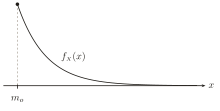
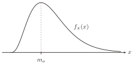

[上一篇](/lecture-notes/variance-standard-deviation/)以數道例題示範[變異數](/lecture-notes/variance/#def-variance)的求算，說明[期望值](/lecture-notes/expectation/#def-expectation)使平方離差的期望值達到最小，並以泰勒級數展開求出 $g(X)$ 的期望值與變異數的近似值，最後介紹與期望值同單位的[標準差](/lecture-notes/variance-standard-deviation/#def-standard-deviation)。期望值指出分配的中心，變異數與標準差則衡量分散程度，兩者合起來已能描述一個分配的大致樣貌，但仍有一些從別的角度出發的量數，能補上期望值與變異數看不到的訊息。

本篇介紹其中的眾數。以下先給出眾數的定義，說明它與樣本眾數的區別、可能不唯一的情形，以及在連續型之下判斷內解與角解的作法，再以兩張圖對照這兩種情形，接著以三道例題示範連續型與離散型的求法，最後對整數值[隨機變數](/lecture-notes/random-variables-and-pmf/#def-random-variable)給出一個由相鄰機率比值出發的判準，並以一道例題示範其用法。

Definition 2.9 (眾數, mode)

若 $X$ 為一隨機變數，pdf 為 $f\_{\sssig X}(x)$ (或 pmf 為 $p\_{\sssig X}(x)$)，值域為 $\mathcal{R}\_{\sssig X}$，並以 $\overline{\mathcal{R}\_{\sssig X}}$ 表 $\mathcal{R}\_{\sssig X}$ 的閉包 (closure)。連續型的密度在 $\overline{\mathcal{R}\_{\sssig X}}$ 的端點上，一律以自值域內部逼近的極限值計 (以該極限存在者為限)。若 $f\_{\sssig X}$ 在 $\overline{\mathcal{R}\_{\sssig X}}$ 上的最大值存在，則使 $f\_{\sssig X}$ 取到這個最大值的那些 $x$ 所成的集合

$$
\lbrace\,x\in\overline{\mathcal{R}_{\sssig X}}\mid f_{\sssig X}(x)=\max_{y\in\overline{\mathcal{R}_{\sssig X}}}f_{\sssig X}(y)\,\rbrace
$$

之中的每一個元素 $m_o$ 皆稱為隨機變數 $X$ 之**眾數 (mode)**；離散型隨機變數只需把式中的 $f\_{\sssig X}$ 換成 $p\_{\sssig X}$。

眾數有一些地方需要注意:

(1) 上述定義中的**眾數**常稱為**母體眾數 (population mode)**，以與敘述統計學中的**樣本眾數 (sample mode)** 區別。與樣本眾數相同，母體眾數可能不唯一，亦可能不存在；例如後文將介紹的均勻分配 (uniform distribution) 在區間上密度恆為常數，即為眾數不唯一之例。
{: .topic-paren-item}

(2) 定義上，母體眾數是指使機率函數達到最大值的點；直觀上，它就是整個分配中**最可能發生的點**。
{: .topic-paren-item}

Note

[Definition 2.9](#def-mode) 所指的「最大化」是在值域的閉包 $\overline{\mathcal{R}_{\sssig X}}$ 上尋找全域最大值；不過在多峰分配 (multimodal distribution) 或密度估計的文獻中，有時也會採取「局域最大化」的觀點，將每個局部高峰 (相對極值) 所在的點都視為眾數。在整數值離散型分配中，由於各質點彼此孤立，若要討論局部高峰，就必須改用「與左右緊鄰質點比較機率大小」的方式來界定 (參見 Keilson and Gerber (1971) 對離散型單峰與**對數凹性 (log-concavity)** 的討論)，這也正是本篇稍後以[相鄰兩點機率比值](#adjacent-ratio-criterion)求取眾數的依據。

求解連續型隨機變數的眾數時，通常先檢查密度函數的**臨界點 (critical point)**，並區分最大值落在值域的**內點 (interior point)** 或**邊界點 (boundary point)**，據以採用**內解 (interior solution)** 或**角解 (corner solution)** 判別。其中內解針對值域內點，利用微積分的一階與二階導數條件檢驗極值；角解則藉由繪圖或分析函數在區間上的單調增減性，判斷邊界點是否達到最大值。以下兩張圖分別呈現角解與內部解的情形。

<figure id="fig-mode-corner-solution" class="topic-figure topic-figure--wide">
  
  <figcaption>Fig. 2.12. 角解: 密度在值域的左端點以極限值取到最高水準，眾數 $m_o$ 即落在這個邊界點上。</figcaption>
</figure>

<figure id="fig-mode-interior-solution" class="topic-figure topic-figure--wide">
  
  <figcaption>Fig. 2.13. 內部解: 密度在值域內部的臨界點取到最高值，眾數 $m_o$ 即落在這個內點上。</figcaption>
</figure>

回顧前文 [Fig. 2.11](/lecture-notes/variance/#fig-variance-comparison) 的變異數比較圖，圖中期望值所在的位置同時也是機率密度達到最大值的點；這是因為該圖所繪為**單峰對稱分配 (unimodal and symmetric distribution)**，在此類分配中，若期望值存在且眾數唯一，期望值、眾數與後文介紹的[**中位數 (median)**](/lecture-notes/median/#def-median) 三者會落在同一點上。

Example 2.10 (Continued)

Assume that the increase in demand for electrical power (in millions of kilowatt hours) over the next $2$ years in a certain region is a random variable $X$ with density function

$$
f_{\sssig X}(x)=
\left\lbrace
\begin{array}{c@{\quad}l}
\dfrac{1}{64}x^{3}, & 0<x<4\\[0.7em]
0, & \text{otherwise}
\end{array}
\right.
$$

<ol class="topic-list-paren topic-list-paren--start-5">
  <li>Find the mode of the growth in demand.</li>
</ol>

(5) 承[前面各小題](/lecture-notes/computing-probabilities-from-cdf/#ex-power-demand-density)的密度函數，先看 $f\_{\sssig X}$ 在值域上的增減性質。由
{: .topic-paren-item}

$$
f^{\prime}_{\sssig X}(x)=\frac{3}{\,64\,}x^{2}>0,\quad 0<x<4
$$

可知 $f_{\sssig X}(x)$ 在開區間 $(0,4)$ 上嚴格遞增，在區間內部沒有臨界點，最大值會出現在右邊界，屬於角解的情形。依 [Definition 2.9](#def-mode) 在值域閉包 $[0,4]$ 上比較，右端點 $x=4$ 處取左側逼近的極限值，即
{: .topic-paren-cont}

$$
\lim_{x\to4^{-}}f_{\sssig X}(x)=\lim_{x\to4^{-}}\frac{1}{\,64\,}x^{3}=\frac{\,4^{3}\,}{64}=1
$$

$$
\begin{aligned}
\lim_{x\to4^{-}}f_{\sssig X}(x)&=\lim_{x\to4^{-}}\frac{1}{\,64\,}x^{3}\\[0.45em]
&=\frac{\,4^{3}\,}{64}=1
\end{aligned}
$$

此極限大於 $(0,4)$ 內任一點的密度，故眾數落在右端點，所求為
{: .topic-paren-cont}

$$
m_o=4
$$

Example 2.9 (Continued)

Suppose we break a stick of unit length at a point $X$ whose position has the density

$$
f_{\sssig X}(x)=6\,x(1-x),\quad 0<x<1
$$

<ol class="topic-list-paren topic-list-paren--start-3">
  <li>Find the mode of the length of the piece that contains the midpoint.</li>
</ol>

(3) 承[前一小題](/lecture-notes/properties-of-expectation/#ex-broken-stick-expected-length)，含中點的那一段必為較長的一段，故所求為
{: .topic-paren-item}

$$
Y=\max(X,\,1-X)
$$

的眾數。對 $\frac{1}{\,2\,}<y<1$ 有
{: .topic-paren-cont}

$$
\mathbb{P}(Y\leqslant y)=\mathbb{P}(1-y\leqslant X\leqslant y)=F_{\sssig X}(y)-F_{\sssig X}(1-y)
$$

$$
\begin{aligned}
\mathbb{P}(Y\leqslant y)&=\mathbb{P}(1-y\leqslant X\leqslant y)\\[0.45em]
&=F_{\sssig X}(y)-F_{\sssig X}(1-y)
\end{aligned}
$$

兩邊對 $y$ 微分，即得 $Y$ 之 pdf 為
{: .topic-paren-cont}

$$
f_{\sssig Y}(y)=f_{\sssig X}(y)+f_{\sssig X}(1-y)=12\,y(1-y),\quad \frac{1}{\,2\,}<y<1
$$

$$
\begin{aligned}
f_{\sssig Y}(y)&=f_{\sssig X}(y)+f_{\sssig X}(1-y)\\[0.45em]
&=12\,y(1-y),\quad \frac{1}{\,2\,}<y<1
\end{aligned}
$$

而
{: .topic-paren-cont}

$$
f^{\prime}_{\sssig Y}(y)=12(1-2y)<0,\quad \frac{1}{\,2\,}<y<1
$$

$$
f^{\prime}_{\sssig Y}(y)=12(1-2y)<0,\quad \frac{1}{\,2\,}<y<1
$$

可知 $f_{\sssig Y}(y)$ 在區間 $(\frac{1}{\,2\,},1)$ 上嚴格遞減，區間內部沒有臨界點。與前一題同理，依 [Definition 2.9](#def-mode) 在閉包 $[\frac{1}{\,2\,},1]$ 上比較，左端點處的右極限 $\lim_{y\to\frac{1}{2}^{+}}f_{\sssig Y}(y)=3$ 即為最大值，故眾數落在左端邊界點，所求為
{: .topic-paren-cont}

$$
m_o=\frac{1}{\,2\,}
$$

Note

這一題問的是含中點那一段長度的眾數，也就是 $Y$ 的眾數，而不是斷點位置 $X$ 的眾數。$X$ 與 $Y$ 的密度並不相同，必須先求出 $f\_{\sssig Y}$ 才能討論。

求出 $f_{\sssig Y}$ 之後，這一題正好與 [Fig. 2.13](#fig-mode-interior-solution) 的內部解成對照。由於 $f_{\sssig Y}$ 在開區間 $(\frac{1}{\,2\,},1)$ 內沒有臨界點，無法直接套用一階與二階導數條件求解，只能由密度本身的遞減性質判斷，最高的位置因而落在左端邊界上，這就是 [Fig. 2.12](#fig-mode-corner-solution) 的角解；唯有當密度函數在區間內部先升後降時，最高點才會落在內部的臨界點上，成為以一階與二階導數條件判定的內部解。

Example 2.15 (Continued)

Let $X$ denote the number of accidents occurring in Ankang City in a week, with the probability distribution given in the following table.

| $x$ | $3$ | $4$ | $5$ | $6$ |
|:---:|:---:|:---:|:---:|:---:|
| $\mathbb{P}(X=x)$ | $0.2$ | $0.3$ | $0.3$ | $0.2$ |
{: .topic-table--matrix}

<ol class="topic-list-paren topic-list-paren--start-3">
  <li>Find the mode of this distribution.</li>
</ol>

(3) 承[前面各小題](/lecture-notes/expectation/#ex-weekly-accidents)的機率分配，由表可知 $X=4$ 及 $5$ 都使得機率 $\mathbb{P}(X=x)$ 達到 $0.3$ 的最大值，故此機率分配的眾數所成的集合為
{: .topic-paren-item}

$$
\lbrace\,4,\,5\,\rbrace
$$

也就是 $4$ 與 $5$ 都是眾數。
{: .topic-paren-cont}

Note

離散型隨機變數無法直接對機率函數微分求極值，當 pmf 的形式較為複雜時，逐點比較大小並不容易；不過尋找使機率函數達到最大值之點的原則與連續型一致，對單峰的整數值分配亦可改由下文的相鄰機率比值判準求解。

部分教科書上將眾數的定義寫為滿足

$$
f_{\sssig X}(m_o)\geqslant f_{\sssig X}(x),\quad\forall\,x\in\mathbb{R}
$$

之點 $m_o$ (離散型則記為 $p_{\sssig X}(m_o)\geqslant p_{\sssig X}(x)$ 對所有 $x\in\mathbb{R}$ 成立)。這種寫法在絕大多數情況下與 [Definition 2.9](#def-mode) 等價，唯一的差別在於開區間的邊界點。若依這種寫法，像 [Example 2.10 (Continued)](#ex-power-demand-mode) 那樣密度在開區間右端點 $x=4$ 才達到最高水準的分配，會因為分段式在 $x=4$ 處定為 $0$ 而變成沒有眾數；[Definition 2.9](#def-mode) 改在值域的閉包上取極限比較，便能自然涵蓋這類角解。

若針對**單峰**的整數值離散型隨機變數 (即 pmf 隨 $x$ 遞增至某處後便單調遞減、不再回升，常見的充分條件為 pmf 具對數凹性)，要尋找眾數還有一個非常實用的判準，即直接比較相鄰質點的機率大小。令 $m_o$ 表示隨機變數 $X$ 的眾數，則當 $m_o$ 與 $m_o-1$、$m_o+1$ 皆在值域內時，必滿足
{: #adjacent-ratio-criterion}

$$
\left\lbrace
\begin{array}{l}
p_{\sssig X}(m_o)\geqslant p_{\sssig X}(m_o+1)\\[0.35em]
p_{\sssig X}(m_o)\geqslant p_{\sssig X}(m_o-1)
\end{array}
\right.
$$

利用上式，搭配 $X$ 的 pmf，即可求解眾數 $m_o$，見下列範例。

Example 2.22

令離散型隨機變數 $X$ 具以下 pmf:

$$
p_{\sssig X}(x)=
\left\lbrace
\begin{array}{c@{\quad}l}
\dfrac{e^{-\lambda}\lambda^{x}}{x!}, & x=0,1,2,\ldots\\[0.7em]
0, & \text{otherwise}
\end{array}
\right.
$$

其中 $\lambda>0$，試求該分配之眾數為何？

令 $m_o$ 表示隨機變數 $X$ 的眾數，則我們有

$$
\left\lbrace
\begin{array}{l}
p_{\sssig X}(m_o)\geqslant p_{\sssig X}(m_o+1)\\[0.35em]
p_{\sssig X}(m_o)\geqslant p_{\sssig X}(m_o-1)
\end{array}
\right.
$$

由此，分別可得到

$$
\frac{p_{\sssig X}(m_o)}{p_{\sssig X}(m_o+1)}=\frac{\dfrac{e^{-\lambda}\lambda^{m_o}}{m_o!}}{\dfrac{e^{-\lambda}\lambda^{m_o+1}}{(m_o+1)!}}=\frac{m_o+1}{\lambda}\geqslant1
$$

$$
\begin{aligned}
\frac{p_{\sssig X}(m_o)}{p_{\sssig X}(m_o+1)}&=\frac{\dfrac{e^{-\lambda}\lambda^{m_o}}{m_o!}}{\dfrac{e^{-\lambda}\lambda^{m_o+1}}{(m_o+1)!}}\\[0.45em]
&=\frac{m_o+1}{\lambda}\geqslant1
\end{aligned}
$$

與

$$
\frac{p_{\sssig X}(m_o)}{p_{\sssig X}(m_o-1)}=\frac{\dfrac{e^{-\lambda}\lambda^{m_o}}{m_o!}}{\dfrac{e^{-\lambda}\lambda^{m_o-1}}{(m_o-1)!}}=\frac{\lambda}{m_o}\geqslant1
$$

$$
\begin{aligned}
\frac{p_{\sssig X}(m_o)}{p_{\sssig X}(m_o-1)}&=\frac{\dfrac{e^{-\lambda}\lambda^{m_o}}{m_o!}}{\dfrac{e^{-\lambda}\lambda^{m_o-1}}{(m_o-1)!}}\\[0.45em]
&=\frac{\lambda}{m_o}\geqslant1
\end{aligned}
$$

合併此二式，可以得到

$$
\lambda-1\leqslant m_o\leqslant\lambda
$$

則所求為

$$
m_o=
\left\lbrace
\begin{array}{c@{\quad}l}
\lambda-1\ \text{或}\ \lambda, & \lambda\in\mathbb{N}\\[0.5em]
[\lambda], & \lambda\notin\mathbb{N}
\end{array}
\right.
$$

其中 $[\lambda]$ 是**高斯符號 (Gauss symbol)**，表不大於 $\lambda$ 之最大整數。

Note

當 $0<\lambda<1$ 時，由於

$$
p_{\sssig X}(0)=e^{-\lambda}>\lambda\,e^{-\lambda}=p_{\sssig X}(1)
$$

可知 pmf 從 $x=0$ 起便嚴格遞減，眾數直接落在左邊界 $m_o=0$ 處。此時 $m_o-1=-1$ 不在值域內，雖然不能直接代入第二個比值式除以 $p_{\sssig X}(-1)$，但這個結果依然與高斯符號 $[\lambda]=0$ 的公式完全吻合。

## 本篇小結

[Definition 2.9](#def-mode) 把眾數界定為使機率函數在值域的閉包上取到**最大值**的那些點所成的集合中的元素，連續型的密度在端點上以極限值比較，而這個最大值未必存在。既然是集合，眾數自然可能不只一個，也可能一個都沒有；均勻分配就是不唯一的例子。指稱時以母體眾數與樣本眾數區別，直觀上它是整個分配中最可能發生的點。在多峰分配與密度估計的文獻中，有時亦採取[局部高峰的觀點](#note-local-mode)，將每個相對極值點都視為眾數。

連續型求眾數的作法，是先判斷密度取到最高值的位置落在值域的內點還是邊界點。落在內點的以一階與二階條件判斷，是 [Fig. 2.13](#fig-mode-interior-solution) 的內部解；落在邊界點的只能由密度本身的增減性質判斷，是 [Fig. 2.12](#fig-mode-corner-solution) 的角解。[Example 2.10 (Continued)](#ex-power-demand-mode) 與 [Example 2.9 (Continued)](#ex-broken-stick-mode) 都是角解，而且密度所在的區間都是開區間，端點不屬於該區間，比較因而在閉包上進行，端點上的取值改用極限值，眾數即取在該端點。[Example 2.15 (Continued)](#ex-weekly-accidents-mode) 是離散型，逐點比較機率的大小即可，該題有兩個眾數。

部分教科書把眾數的最大化寫成在整條實數線上比較，與 [Definition 2.9](#def-mode) 同樣要求全域的最大化，差別只在值域的端點算不算數。在 pmf 為單峰的前提之下，整數值隨機變數的眾數可由相鄰兩點的機率比值求得，[Example 2.22](#ex-poisson-mode) 即是一例。[下一篇](/lecture-notes/median/)介紹另一個從位置出發的量數，中位數。

## 參考文獻與延伸閱讀

- 黃文璋，2010，《機率論》，二版，華泰文化。
- Alexander M. Mood, Franklin A. Graybill, and Duane C. Boes. 1974. *Introduction to the Theory of Statistics*. 3rd ed. McGraw-Hill.
- Julian Keilson and Hans U. Gerber. 1971. “Some Results for Discrete Unimodality.” *Journal of the American Statistical Association* 66 (334): 386–389.
- Sudhakar Dharmadhikari and Kumar Joag-Dev. 1988. *Unimodality, Convexity, and Applications*. Academic Press.
