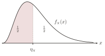

[上一篇](/lecture-notes/mode/)介紹[眾數](/lecture-notes/mode/#def-mode)，也就是使機率函數在值域的閉包上取到最大值的那些點。眾數關心的是一個分配的哪一處最可能發生，但要指出一個分配的中央位置，還有另一種常見的作法，找一個點，使它左右兩側的機率各佔一半。

本篇介紹的中位數就是這樣的量數。以下先給出定義，接著說明中位數可能不唯一、如何由[累積分配函數](/lecture-notes/cumulative-distribution-functions/#def-cdf)找到其中一個，以及它把分配切成前後兩段的直觀；然後介紹一個與[期望值](/lecture-notes/expectation/#def-expectation)恰成對照的性質，亦即[期望值使平方離差的期望值達到最小](/lecture-notes/variance-standard-deviation/#thm-mean-minimizes-squared-deviation)，中位數則使絕對離差的期望值達到最小，並附上證明與逐步說明；最後以圖示呈現中位數的直觀意涵。

Definition 2.10 (中位數, median)

令 $X$ 為一[隨機變數](/lecture-notes/random-variables-and-pmf/#def-random-variable)，若 $\eta\_{\sssig X}$ 滿足

$$
\mathbb{P}(X\leqslant\eta_{\sssig X})\geqslant\frac{1}{2}\quad\text{且}\quad\mathbb{P}(X\geqslant\eta_{\sssig X})\geqslant\frac{1}{2}
$$

$$
\begin{gathered}
\mathbb{P}(X\leqslant\eta_{\sssig X})\geqslant\frac{1}{2}\\[0.45em]
\text{且}\quad\mathbb{P}(X\geqslant\eta_{\sssig X})\geqslant\frac{1}{2}
\end{gathered}
$$

則稱 $\eta\_{\sssig X}$ 為 $X$ 的**中位數 (median)**。

中位數有一些地方需要注意:

(1) 上述定義中的中位數常稱為**母體中位數 (population median)**，以與敘述統計學中的**樣本中位數 (sample median)** 區別；與眾數相同，母體中位數亦可能不唯一，甚至可能不在值域內。
{: .topic-paren-item}

(2) 由於中位數未必唯一，我們可以透過下式找到**一個**中位數
{: .topic-paren-item}

$$
\eta_{\sssig X}=\inf\Bigl\lbrace\,x\in\mathbb{R}\,\Big|\,F_{\sssig X}(x)\geqslant\frac{1}{2}\,\Bigr\rbrace
$$

Note

當 $F\_{\sssig X}$ 連續且在值域 $\mathcal{R}\_{\sssig X}$ 上嚴格遞增時，由上式求得的中位數即為

$$
\eta_{\sssig X}=F^{-1}_{\sssig X}\left(\frac{1}{2}\right)
$$

且為該分配唯一的中位數。

(3) 直觀上，中位數的意義在於**將整個分配切為機率各半的前後兩段**；此定義與幾何直觀可直接推廣至後文的[**分位數 (quantile)**](/lecture-notes/quantiles/#def-quantile)。
{: .topic-paren-item}

Note

由於中位數將整個分配切為前後兩段，故在對稱分配中，中位數正好落在整個分配的正中央；特別是當該分配為單峰對稱分配且期望值存在、眾數唯一時，中位數、期望值與眾數三者的位置將會完全重合。

在 [Theorem 2.14](/lecture-notes/variance-standard-deviation/#thm-mean-minimizes-squared-deviation) 中我們曾提過，$\mathbb{E}\bigl[(X-a)^{2}\bigr]$ 是一種 $X$ 與 $a$ 之間的平均離散程度，但離散程度未必要使用平方作為考量。某些時候我們會使用 $X$ 和 $a$ 的**距離**，也就是 $\lvert X-a\rvert$，作為離散程度的依據，此時我們會有以下定理。

Theorem 2.17 (中位數使絕對離差的期望值最小, the median minimizes the mean absolute deviation)

若 $X$ 為一連續型隨機變數，pdf 為 $f\_{\sssig X}(x)$，且 $\mathbb{E}\bigl(\lvert X\rvert\bigr)<\infty$，令

$$
g(a)=\mathbb{E}\bigl[\lvert X-a\rvert\bigr],\quad\forall a\in\mathbb{R}
$$

則 $X$ 的中位數 $\eta\_{\sssig X}$ 是使得 $g(a)$ 達到最小值的 $a$，此即

$$
g(a)\geqslant g(\eta_{\sssig X}),\quad\forall a\in\mathbb{R}
$$

Note

為了讓下面的積分推導更為直觀，[Theorem 2.17](#thm-median-minimizes-absolute-deviation) 先以連續型隨機變數為前提，好讓我們可以直接利用連續型中位數將左右兩側積分面積恰好各切為二分之一的等式，即

$$
\int_{-\infty}^{\eta_{\sssig X}}f_{\sssig X}(x)\,dx=\frac{1}{2}\quad\text{與}\quad\int_{\eta_{\sssig X}}^{\infty}f_{\sssig X}(x)\,dx=\frac{1}{2}
$$

$$
\begin{gathered}
\int_{-\infty}^{\eta_{\sssig X}}f_{\sssig X}(x)\,dx=\frac{1}{2}\\[0.45em]
\text{與}\quad\int_{\eta_{\sssig X}}^{\infty}f_{\sssig X}(x)\,dx=\frac{1}{2}
\end{gathered}
$$

事實上，只要滿足一階絕對動差有限的條件 $\mathbb{E}\bigl(\lvert X\rvert\bigr)<\infty$，這個最小化性質對離散型或混合型隨機變數也完全成立，只是證明時須改由累積分配函數與 [Definition 2.10](#def-median) 的兩個不等式著手。

**Proof.**

由 [Definition 2.10](#def-median) 與絕對值的分段寫法可知

$$
\begin{aligned}
g(a)&=\mathbb{E}\bigl[\lvert X-a\rvert\bigr]=\int_{-\infty}^{\infty}\lvert x-a\rvert\,f_{\sssig X}(x)\,dx\\[0.45em]
&=\int_{-\infty}^{a}(a-x)\,f_{\sssig X}(x)\,dx+\int_{a}^{\infty}(x-a)\,f_{\sssig X}(x)\,dx\\[0.45em]
&=\int_{-\infty}^{\eta_{\sssig X}}(a-x)\,f_{\sssig X}(x)\,dx+\int_{\eta_{\sssig X}}^{a}(a-x)\,f_{\sssig X}(x)\,dx\\[0.2em]
&\qquad+\int_{a}^{\eta_{\sssig X}}(x-a)\,f_{\sssig X}(x)\,dx+\int_{\eta_{\sssig X}}^{\infty}(x-a)\,f_{\sssig X}(x)\,dx\\[0.45em]
&=\int_{-\infty}^{\eta_{\sssig X}}(\eta_{\sssig X}-x)\,f_{\sssig X}(x)\,dx+\int_{\eta_{\sssig X}}^{\infty}(x-\eta_{\sssig X})\,f_{\sssig X}(x)\,dx\\[0.2em]
&\qquad+2\int_{a}^{\eta_{\sssig X}}(x-a)\,f_{\sssig X}(x)\,dx\\[0.45em]
&=\mathbb{E}\bigl[\lvert X-\eta_{\sssig X}\rvert\bigr]+2\int_{a}^{\eta_{\sssig X}}(x-a)\,f_{\sssig X}(x)\,dx\\[0.45em]
&\geqslant\mathbb{E}\bigl[\lvert X-\eta_{\sssig X}\rvert\bigr]=g(\eta_{\sssig X})
\end{aligned}
$$

$$
\begin{aligned}
g(a)&=\mathbb{E}\bigl[\lvert X-a\rvert\bigr]\\[0.45em]
&=\int_{-\infty}^{\infty}\lvert x-a\rvert\,f_{\sssig X}(x)\,dx\\[0.45em]
&=\int_{-\infty}^{a}(a-x)\,f_{\sssig X}(x)\,dx\\[0.2em]
&\qquad+\int_{a}^{\infty}(x-a)\,f_{\sssig X}(x)\,dx\\[0.45em]
&=\int_{-\infty}^{\eta_{\sssig X}}(a-x)\,f_{\sssig X}(x)\,dx\\[0.2em]
&\qquad+\int_{\eta_{\sssig X}}^{a}(a-x)\,f_{\sssig X}(x)\,dx\\[0.2em]
&\qquad+\int_{a}^{\eta_{\sssig X}}(x-a)\,f_{\sssig X}(x)\,dx\\[0.2em]
&\qquad+\int_{\eta_{\sssig X}}^{\infty}(x-a)\,f_{\sssig X}(x)\,dx\\[0.45em]
&=\int_{-\infty}^{\eta_{\sssig X}}(\eta_{\sssig X}-x)\,f_{\sssig X}(x)\,dx\\[0.2em]
&\qquad+\int_{\eta_{\sssig X}}^{\infty}(x-\eta_{\sssig X})\,f_{\sssig X}(x)\,dx\\[0.2em]
&\qquad+2\int_{a}^{\eta_{\sssig X}}(x-a)\,f_{\sssig X}(x)\,dx\\[0.45em]
&=\mathbb{E}\bigl[\lvert X-\eta_{\sssig X}\rvert\bigr]\\[0.2em]
&\qquad+2\int_{a}^{\eta_{\sssig X}}(x-a)\,f_{\sssig X}(x)\,dx\\[0.45em]
&\geqslant\mathbb{E}\bigl[\lvert X-\eta_{\sssig X}\rvert\bigr]=g(\eta_{\sssig X})
\end{aligned}
$$

原式得證。 $\square$

Note

上述證明運用了幾步關鍵的積分拆解與合併。首先是調換積分上下界並變號，可得

$$
\begin{aligned}
\int_{\eta_{\sssig X}}^{a}(a-x)\,f_{\sssig X}(x)\,dx&=-\int_{a}^{\eta_{\sssig X}}(a-x)\,f_{\sssig X}(x)\,dx\\[0.45em]
&=\int_{a}^{\eta_{\sssig X}}(x-a)\,f_{\sssig X}(x)\,dx
\end{aligned}
$$

$$
\begin{aligned}
&\int_{\eta_{\sssig X}}^{a}(a-x)\,f_{\sssig X}(x)\,dx\\[0.45em]
&=-\int_{a}^{\eta_{\sssig X}}(a-x)\,f_{\sssig X}(x)\,dx\\[0.45em]
&=\int_{a}^{\eta_{\sssig X}}(x-a)\,f_{\sssig X}(x)\,dx
\end{aligned}
$$

由此可將過程中的其中二項合併，即

$$
\int_{\eta_{\sssig X}}^{a}(a-x)\,f_{\sssig X}(x)\,dx+\int_{a}^{\eta_{\sssig X}}(x-a)\,f_{\sssig X}(x)\,dx=2\int_{a}^{\eta_{\sssig X}}(x-a)\,f_{\sssig X}(x)\,dx
$$

$$
\begin{aligned}
&\int_{\eta_{\sssig X}}^{a}(a-x)\,f_{\sssig X}(x)\,dx\\[0.2em]
&\qquad+\int_{a}^{\eta_{\sssig X}}(x-a)\,f_{\sssig X}(x)\,dx\\[0.45em]
&=2\int_{a}^{\eta_{\sssig X}}(x-a)\,f_{\sssig X}(x)\,dx
\end{aligned}
$$

再者則是利用了以下的等式

$$
\begin{aligned}
\int_{-\infty}^{\eta_{\sssig X}}(a-x)\,f_{\sssig X}(x)\,dx&=a\int_{-\infty}^{\eta_{\sssig X}}f_{\sssig X}(x)\,dx-\int_{-\infty}^{\eta_{\sssig X}}x\,f_{\sssig X}(x)\,dx\\[0.45em]
&=a\cdot\frac{1}{2}-\int_{-\infty}^{\eta_{\sssig X}}x\,f_{\sssig X}(x)\,dx
\end{aligned}
$$

$$
\begin{aligned}
&\int_{-\infty}^{\eta_{\sssig X}}(a-x)\,f_{\sssig X}(x)\,dx\\[0.45em]
&=a\int_{-\infty}^{\eta_{\sssig X}}f_{\sssig X}(x)\,dx-\int_{-\infty}^{\eta_{\sssig X}}x\,f_{\sssig X}(x)\,dx\\[0.45em]
&=a\cdot\frac{1}{2}-\int_{-\infty}^{\eta_{\sssig X}}x\,f_{\sssig X}(x)\,dx
\end{aligned}
$$

以及

$$
\begin{aligned}
\int_{\eta_{\sssig X}}^{\infty}(x-a)\,f_{\sssig X}(x)\,dx&=\int_{\eta_{\sssig X}}^{\infty}x\,f_{\sssig X}(x)\,dx-a\int_{\eta_{\sssig X}}^{\infty}f_{\sssig X}(x)\,dx\\[0.45em]
&=\int_{\eta_{\sssig X}}^{\infty}x\,f_{\sssig X}(x)\,dx-a\cdot\frac{1}{2}
\end{aligned}
$$

$$
\begin{aligned}
&\int_{\eta_{\sssig X}}^{\infty}(x-a)\,f_{\sssig X}(x)\,dx\\[0.45em]
&=\int_{\eta_{\sssig X}}^{\infty}x\,f_{\sssig X}(x)\,dx-a\int_{\eta_{\sssig X}}^{\infty}f_{\sssig X}(x)\,dx\\[0.45em]
&=\int_{\eta_{\sssig X}}^{\infty}x\,f_{\sssig X}(x)\,dx-a\cdot\frac{1}{2}
\end{aligned}
$$

由此可合併得到

$$
\begin{aligned}
\int_{-\infty}^{\eta_{\sssig X}}(a-x)\,f_{\sssig X}(x)\,dx+\int_{\eta_{\sssig X}}^{\infty}(x-a)\,f_{\sssig X}(x)\,dx&=\int_{\eta_{\sssig X}}^{\infty}x\,f_{\sssig X}(x)\,dx\\[0.2em]
&\qquad-\int_{-\infty}^{\eta_{\sssig X}}x\,f_{\sssig X}(x)\,dx
\end{aligned}
$$

$$
\begin{aligned}
&\int_{-\infty}^{\eta_{\sssig X}}(a-x)\,f_{\sssig X}(x)\,dx\\[0.2em]
&\qquad+\int_{\eta_{\sssig X}}^{\infty}(x-a)\,f_{\sssig X}(x)\,dx\\[0.45em]
&=\int_{\eta_{\sssig X}}^{\infty}x\,f_{\sssig X}(x)\,dx-\int_{-\infty}^{\eta_{\sssig X}}x\,f_{\sssig X}(x)\,dx
\end{aligned}
$$

接著利用

$$
\begin{aligned}
\int_{-\infty}^{\eta_{\sssig X}}\eta_{\sssig X}\,f_{\sssig X}(x)\,dx-\int_{\eta_{\sssig X}}^{\infty}\eta_{\sssig X}\,f_{\sssig X}(x)\,dx&=\eta_{\sssig X}\int_{-\infty}^{\eta_{\sssig X}}f_{\sssig X}(x)\,dx\\[0.2em]
&\qquad-\eta_{\sssig X}\int_{\eta_{\sssig X}}^{\infty}f_{\sssig X}(x)\,dx=0
\end{aligned}
$$

$$
\begin{aligned}
&\int_{-\infty}^{\eta_{\sssig X}}\eta_{\sssig X}\,f_{\sssig X}(x)\,dx-\int_{\eta_{\sssig X}}^{\infty}\eta_{\sssig X}\,f_{\sssig X}(x)\,dx\\[0.45em]
&=\eta_{\sssig X}\int_{-\infty}^{\eta_{\sssig X}}f_{\sssig X}(x)\,dx-\eta_{\sssig X}\int_{\eta_{\sssig X}}^{\infty}f_{\sssig X}(x)\,dx\\[0.45em]
&=0
\end{aligned}
$$

與前式合併可得到

$$
\begin{aligned}
&\int_{-\infty}^{\eta_{\sssig X}}(a-x)\,f_{\sssig X}(x)\,dx+\int_{\eta_{\sssig X}}^{\infty}(x-a)\,f_{\sssig X}(x)\,dx+0\\[0.45em]
&=\int_{\eta_{\sssig X}}^{\infty}x\,f_{\sssig X}(x)\,dx-\int_{-\infty}^{\eta_{\sssig X}}x\,f_{\sssig X}(x)\,dx\\[0.2em]
&\qquad+\int_{-\infty}^{\eta_{\sssig X}}\eta_{\sssig X}\,f_{\sssig X}(x)\,dx-\int_{\eta_{\sssig X}}^{\infty}\eta_{\sssig X}\,f_{\sssig X}(x)\,dx\\[0.45em]
&=\int_{-\infty}^{\eta_{\sssig X}}(\eta_{\sssig X}-x)\,f_{\sssig X}(x)\,dx+\int_{\eta_{\sssig X}}^{\infty}(x-\eta_{\sssig X})\,f_{\sssig X}(x)\,dx\\[0.45em]
&=\mathbb{E}\bigl[\lvert X-\eta_{\sssig X}\rvert\bigr]
\end{aligned}
$$

$$
\begin{aligned}
&\int_{-\infty}^{\eta_{\sssig X}}(a-x)\,f_{\sssig X}(x)\,dx\\[0.2em]
&\qquad+\int_{\eta_{\sssig X}}^{\infty}(x-a)\,f_{\sssig X}(x)\,dx+0\\[0.45em]
&=\int_{\eta_{\sssig X}}^{\infty}x\,f_{\sssig X}(x)\,dx\\[0.2em]
&\qquad-\int_{-\infty}^{\eta_{\sssig X}}x\,f_{\sssig X}(x)\,dx\\[0.2em]
&\qquad+\int_{-\infty}^{\eta_{\sssig X}}\eta_{\sssig X}\,f_{\sssig X}(x)\,dx\\[0.2em]
&\qquad-\int_{\eta_{\sssig X}}^{\infty}\eta_{\sssig X}\,f_{\sssig X}(x)\,dx\\[0.45em]
&=\int_{-\infty}^{\eta_{\sssig X}}(\eta_{\sssig X}-x)\,f_{\sssig X}(x)\,dx\\[0.2em]
&\qquad+\int_{\eta_{\sssig X}}^{\infty}(x-\eta_{\sssig X})\,f_{\sssig X}(x)\,dx\\[0.45em]
&=\mathbb{E}\bigl[\lvert X-\eta_{\sssig X}\rvert\bigr]
\end{aligned}
$$

最後分析 $2\int_{a}^{\eta_{\sssig X}}(x-a)\,f_{\sssig X}(x)\,dx$ 這一項，可分為 $\eta\_{\sssig X}\leqslant a$ 與 $\eta\_{\sssig X}>a$ 兩類討論。

**[ $\eta\_{\sssig X}\leqslant a$ ]**

$$
2\int_{a}^{\eta_{\sssig X}}(x-a)\,f_{\sssig X}(x)\,dx=2\int_{\eta_{\sssig X}}^{a}(a-x)\,f_{\sssig X}(x)\,dx\geqslant0
$$

$$
\begin{aligned}
&2\int_{a}^{\eta_{\sssig X}}(x-a)\,f_{\sssig X}(x)\,dx\\[0.45em]
&=2\int_{\eta_{\sssig X}}^{a}(a-x)\,f_{\sssig X}(x)\,dx\geqslant0
\end{aligned}
$$

**[ $\eta\_{\sssig X}>a$ ]**

$$
2\int_{a}^{\eta_{\sssig X}}(x-a)\,f_{\sssig X}(x)\,dx\geqslant0
$$

故可知

$$
\begin{aligned}
g(a)&=\mathbb{E}\bigl[\lvert X-\eta_{\sssig X}\rvert\bigr]+2\int_{a}^{\eta_{\sssig X}}(x-a)\,f_{\sssig X}(x)\,dx\\[0.45em]
&\geqslant\mathbb{E}\bigl[\lvert X-\eta_{\sssig X}\rvert\bigr]=g(\eta_{\sssig X}),\quad\forall a\in\mathbb{R}
\end{aligned}
$$

$$
\begin{aligned}
g(a)&=\mathbb{E}\bigl[\lvert X-\eta_{\sssig X}\rvert\bigr]\\[0.2em]
&\qquad+2\int_{a}^{\eta_{\sssig X}}(x-a)\,f_{\sssig X}(x)\,dx\\[0.45em]
&\geqslant\mathbb{E}\bigl[\lvert X-\eta_{\sssig X}\rvert\bigr]\\[0.2em]
&=g(\eta_{\sssig X}),\quad\forall a\in\mathbb{R}
\end{aligned}
$$

原式得證。

以絕對離差 $\lvert X-a\rvert$ 衡量離散程度時，優點是單位與原隨機變數相同，缺點則是絕對值在微積分與代數推導上的性質不如平方簡便。直觀而言，[Theorem 2.17](#thm-median-minimizes-absolute-deviation) 指出**平均而言，所有 $X$ 到中位數 $\eta\_{\sssig X}$ 的距離最短**。下圖進一步呈現中位數將密度曲線下方面積對分的幾何意涵。

<figure id="fig-median-intuition" class="topic-figure topic-figure--wide">
  
  <figcaption>Fig. 2.14. 中位數 $\eta_{\sssig X}$ 把密度曲線下方的面積切成相等的兩塊，左右各為 $\frac{1}{2}$，圖中以陰影標出左邊那一塊。</figcaption>
</figure>

## 本篇小結

[Definition 2.10](#def-median) 以 $\mathbb{P}(X\leqslant\eta_{\sssig X})\geqslant\frac{1}{2}$ 與 $\mathbb{P}(X\geqslant\eta_{\sssig X})\geqslant\frac{1}{2}$ 兩個不等式界定中位數 $\eta_{\sssig X}$，指稱時以母體中位數與樣本中位數區別。中位數可能不唯一，甚至可能不在值域內；由累積分配函數取下確界 $\inf\lbrace x\in\mathbb{R}\mid F_{\sssig X}(x)\geqslant\frac{1}{2}\rbrace$ 可以找到其中一個，而在 $F_{\sssig X}$ 連續且於值域上嚴格遞增時，中位數唯一且為 $F^{-1}_{\sssig X}(\frac{1}{2})$。它把整個分配切成前後兩段的直觀，稍後會直接推廣到分位數；在對稱分配上它落在正中間，若又是單峰對稱分配，則與期望值和眾數重合。

[Theorem 2.17](#thm-median-minimizes-absolute-deviation) 與 [Theorem 2.14](/lecture-notes/variance-standard-deviation/#thm-mean-minimizes-squared-deviation) 恰成對照。平均離散程度若以平方衡量，使它最小的是期望值；若改以絕對距離衡量，使 $\mathbb{E}\bigl[\lvert X-a\rvert\bigr]$ 最小的則是中位數。證明的作法是把 $\lvert x-a\rvert$ 的積分依 $a$ 與 $\eta_{\sssig X}$ 的大小拆成四段，合併之後餘下一個非負的項，該項在 $a=\eta_{\sssig X}$ 時為零。[Fig. 2.14](#fig-median-intuition) 則畫出中位數把密度曲線下方的面積切成相等兩塊的樣子。

[下一篇](/lecture-notes/quantiles/)接著把中位數推廣為分位數，其中的 [Example 2.26](/lecture-notes/quantiles/#ex-nonunique-median) 會給出一個中位數不唯一的具體例子。

## 參考文獻與延伸閱讀

- 黃文璋，2010，《機率論》，二版，華泰文化。
- Morris H. DeGroot and Mark J. Schervish. 2012. *Probability and Statistics*. 4th ed. Pearson.
- Alexander M. Mood, Franklin A. Graybill, and Duane C. Boes. 1974. *Introduction to the Theory of Statistics*. 3rd ed. McGraw-Hill.
- Robert V. Hogg, Joseph W. McKean, and Allen T. Craig. 2019. *Introduction to Mathematical Statistics*. 8th ed. Pearson.
