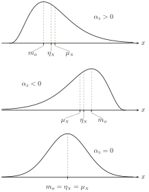
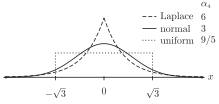

[上一篇](/lecture-notes/moment-system/)把[期望值](/lecture-notes/expectation/#def-expectation)與[變異數](/lecture-notes/variance/#def-variance)收進同一架構下，一階原動差就是期望值，二階主動差就是變異數。動差的階數再往上走，三階與四階主動差各自帶著分配的另一面訊息，只是它們的大小同時受分配尺度影響，兩個不同單位的[隨機變數](/lecture-notes/random-variables-and-pmf/#def-random-variable)之間無從直接比較，要先除以[標準差](/lecture-notes/variance-standard-deviation/#def-standard-deviation)的相應次方，化成沒有單位的數值。

本篇介紹由此得到的兩個形狀量數。先給動差偏態係數，說明它把分配分成正偏、對稱與負偏三類的作法，以及背後奇函數與偶函數的直觀；接著介紹皮爾森的兩個偏態係數，它們改由期望值、[眾數](/lecture-notes/mode/#def-mode)與[中位數](/lecture-notes/median/#def-median)的相對位置著手，並附上皮爾森的經驗法則與一張三種偏斜情形的對照圖。其後轉入峰態係數，說明以 $3$ 作為比較基準的理由、超額峰態係數的寫法，以及為什麼往後一律改稱厚尾分配與薄尾分配，最後以一張圖比較三種峰態的尾端厚薄。

Definition 2.13 (動差偏態係數, moment coefficient of skewness)

若 $X$ 為一隨機變數，$0<\sigma\_{\sssig X}<\infty$，且 $\mu\_{\sssig 3}=\mathbb{E}\bigl[(X-\mu\_{\sssig X})^{3}\bigr]<\infty$，則

$$
\alpha_{\sssig 3}=\mathbb{E}\Biggl[\biggl(\frac{X-\mu_{\sssig X}}{\sigma_{\sssig X}}\biggr)^{\!3}\Biggr]=\frac{\mathbb{E}\bigl[(X-\mu_{\sssig X})^{3}\bigr]}{\sigma_{\sssig X}^{3}}=\frac{\mu_{\sssig 3}}{\sigma_{\sssig X}^{3}}
$$

$$
\begin{aligned}
\alpha_{\sssig 3}&=\mathbb{E}\Biggl[\biggl(\frac{X-\mu_{\sssig X}}{\sigma_{\sssig X}}\biggr)^{\!3}\Biggr]\\[0.45em]
&=\frac{\mathbb{E}\bigl[(X-\mu_{\sssig X})^{3}\bigr]}{\sigma_{\sssig X}^{3}}=\frac{\mu_{\sssig 3}}{\sigma_{\sssig X}^{3}}
\end{aligned}
$$

為 $X$ 之**動差偏態係數 (moment coefficient of skewness)**。

動差偏態係數有一些地方需要注意:

(1) 動差偏態係數常簡稱為**偏態係數 (coefficient of skewness)**，亦稱**皮爾森動差偏態係數 (Pearson’s moment coefficient of skewness)**；此量數純由動差所定義，須注意將其與下文利用中央趨勢量數定義的[**皮爾森偏態係數 (Pearson’s coefficient of skewness)**](#def-pearson-skewness) 加以區分。
{: .topic-paren-item}

(2) **偏態 (skewness)** 主要衡量一個分配的**偏斜程度**，反過來說也是衡量分配的**對稱程度**；偏態係數則是以數值化的方式度量偏斜的方向與程度，簡單分類如下:
{: .topic-paren-item}

- 若 $\alpha\_{\sssig 3}>0$，則 $X$ 為**正偏分配 (positive-skewed distribution)** 或**右偏分配 (right-skewed distribution)**
- 若 $\alpha\_{\sssig 3}=0$，則此為**對稱分配 (symmetric distribution)** 的典型情形
- 若 $\alpha\_{\sssig 3}<0$，則 $X$ 為**負偏分配 (negative-skewed distribution)** 或**左偏分配 (left-skewed distribution)**

Note

就直觀而言，$(X-\mu\_{\sssig X})^{3}$ 是以期望值 $\mu\_{\sssig X}$ 為對稱中心的奇函數 (odd function)；若 $X$ 服從對稱分配，其密度函數 $f\_{\sssig X}(x)$ 為對稱於 $\mu\_{\sssig X}$ 的偶函數 (even function)，兩者乘積在整條實數線上的積分即為零。當分配不對稱時，積分的正負即可反映 $f\_{\sssig X}(x)$ 的尾端偏向。反之則未必成立；即便 $\alpha\_{\sssig 3}=0$，亦不足以保證隨機變數 $X$ 服從對稱分配。

偏斜程度也可以不從動差著手。下面介紹的兩個係數，改以三個中央趨勢量數之間的距離來衡量偏斜。

Definition 2.14 (皮爾森偏態係數, Pearson’s coefficient of skewness)

若 $X$ 為一隨機變數，則

(1) 令
{: .topic-paren-item}

$$
SK_{\sssig P_1}=\frac{\mu_{\sssig X}-m_o}{\sigma_{\sssig X}}
$$

則稱 $SK\_{\sssig P\_1}$ 為 $X$ 之**皮爾森第一偏態係數 (Pearson’s first coefficient of skewness)**，或稱**眾數偏態係數**。
{: .topic-paren-cont}

(2) 令
{: .topic-paren-item}

$$
SK_{\sssig P_2}=\frac{3\,(\mu_{\sssig X}-\eta_{\sssig X})}{\sigma_{\sssig X}}
$$

則稱 $SK\_{\sssig P\_2}$ 為 $X$ 之**皮爾森第二偏態係數 (Pearson’s second coefficient of skewness)**，或稱**中位數偏態係數**。
{: .topic-paren-cont}

上面兩式中的 $m_o$ 是 $X$ 的眾數，$\eta\_{\sssig X}$ 是 $X$ 的中位數，$\mu\_{\sssig X}$ 與 $\sigma\_{\sssig X}$ 則是 $X$ 的期望值與標準差。[Definition 2.9](/lecture-notes/mode/#def-mode) 把眾數界定為使機率函數在值域的閉包上取到最大值的那些點，這樣的點可能不只一個，也可能一個都沒有；上面這兩個偏態係數在應用上，因而以眾數存在且唯一的單峰分配為主。

動差系統與偏態，最早都是由皮爾森 (Karl Pearson, 1857-1936) 創立與研究，其對統計的卓越貢獻，亦使之與費雪 (Ronald A. Fisher, 1890-1962) 被並稱為「近代統計學的兩大奠基者」。

上述兩種偏態係數的設定，源於皮爾森研究分配偏態時發現的經驗法則。該法則指出，在單峰分配中，三個中央趨勢量數滿足近似關係

$$
\bigl\lvert\mu_{\sssig X}-m_o\bigr\rvert\fallingdotseq3\,\bigl\lvert\mu_{\sssig X}-\eta_{\sssig X}\bigr\rvert
$$

亦即**單峰分配中期望值與眾數的距離，約為期望值與中位數距離的三倍**。

下圖對照右偏分配、左偏分配與對稱分配的機率密度曲線，並同時標示三個中央趨勢量數的相對位置。

<figure id="fig-skewness-shapes" class="topic-figure topic-figure--wide">
  
  <figcaption>Fig. 2.17. 右偏、左偏與對稱三種分配的對照，三個面板共用同一段橫軸範圍與同一個縱向比例尺。上面的面板右偏，眾數、中位數與期望值由左至右分開；中間的面板左偏，三者的左右順序恰好相反；下面的面板對稱，三者同在一點。</figcaption>
</figure>

Note

正偏分配的「正」指偏態係數為正，右偏分配的「右」則指分配的長尾延伸向右側。以左偏、右偏描述偏態時，常被誤解為分配的「峰」偏向哪一側；實則偏態反映的是極端值的延伸方向，亦即「尾巴的偏向」而非「峰的偏向」。

偏態處理的是分配的左右不對稱。若把三次方換成四次方，離差的正負號不再保留，被放大的是離期望值較遠的那些取值，由此得到另一個形狀量數。

Definition 2.15 (峰態係數, coefficient of kurtosis)

若 $X$ 為一隨機變數，$0<\sigma\_{\sssig X}<\infty$，且 $\mu\_{\sssig 4}=\mathbb{E}\bigl[(X-\mu\_{\sssig X})^{4}\bigr]<\infty$，則

$$
\alpha_{\sssig 4}=\mathbb{E}\Biggl[\biggl(\frac{X-\mu_{\sssig X}}{\sigma_{\sssig X}}\biggr)^{\!4}\Biggr]=\frac{\mathbb{E}\bigl[(X-\mu_{\sssig X})^{4}\bigr]}{\sigma_{\sssig X}^{4}}=\frac{\mu_{\sssig 4}}{\sigma_{\sssig X}^{4}}
$$

$$
\begin{aligned}
\alpha_{\sssig 4}&=\mathbb{E}\Biggl[\biggl(\frac{X-\mu_{\sssig X}}{\sigma_{\sssig X}}\biggr)^{\!4}\Biggr]\\[0.45em]
&=\frac{\mathbb{E}\bigl[(X-\mu_{\sssig X})^{4}\bigr]}{\sigma_{\sssig X}^{4}}=\frac{\mu_{\sssig 4}}{\sigma_{\sssig X}^{4}}
\end{aligned}
$$

為 $X$ 之**峰態係數 (coefficient of kurtosis)**。

峰態係數有一些地方需要注意:

(1) **峰態 (kurtosis)** 衡量的是標準化之後的離差取四次方的平均，也就是遠離期望值的取值對這個平均所作的貢獻，簡單分類如下:
{: .topic-paren-item}

- 若 $\alpha\_{\sssig 4}>3$，則 $X$ 為**高狹峰分配 (leptokurtic distribution)** 或**超高斯分配 (super-Gaussian distribution)**、**厚尾分配 (thick-tailed distribution)**
- 若 $\alpha\_{\sssig 4}=3$，則 $X$ 為**常態峰分配 (mesokurtic distribution)**
- 若 $\alpha\_{\sssig 4}<3$，則 $X$ 為**低矮峰分配 (platykurtic distribution)** 或**亞高斯分配 (sub-Gaussian distribution)**、**薄尾分配 (thin-tailed distribution)**

Note

「高狹峰分配」與「低矮峰分配」這組傳統中文譯名容易引起誤解。高狹峰字面上看似指峰頂較常態分配更尖高，但 $\alpha\_{\sssig 4}>3$ 的判準實為分配**尾部比常態分配更厚實**；同理，低矮峰亦非必有寬矮的峰頂，其判準在於分配**尾部比常態分配更瘦薄**。為避免混淆，後文討論此特徵時一律稱為**厚尾分配**與**薄尾分配**。

(2) 峰態係數以**常態分配 (normal distribution)**，或稱**高斯分配 (Gaussian distribution)** 為比較基準。由於常態分配的峰態係數恰為 $3$，部分書籍遂將峰態係數改定為
{: .topic-paren-item}

$$
\kappa=\alpha_{\sssig 4}-3
$$

稱為**超額峰態係數 (coefficient of excess kurtosis)**。不過反之並不成立，峰態係數等於 $3$ 的分配未必皆為常態分配。
{: .topic-paren-cont}

(3) 就積分結構而言，**峰態係數衡量了遠離期望值的點對四次方平均的貢獻**。當遠離期望值的區域佔有較高機率密度時，離差經四次方放大後會使積分結果偏大；反之，若機率密度高度集中於期望值附近而少有極端離差，積分結果便較小。
{: .topic-paren-item}

Note

峰態的概念不應與變異數、標準差等分散趨勢混淆。分散趨勢量數刻畫的是整體數值散開的程度，而峰態關注的則是數值是否高度聚集於中心並伴隨極端離差，只是在衡量時主要透過「分配尾端的厚薄」來判讀。前文 [Fig. 2.11](/lecture-notes/variance/#fig-variance-comparison) 所比較的，正是前一種整體的分散性。

下面我們將各種峰態的分配畫在同一張圖上來比較其差異。

<figure id="fig-kurtosis-comparison" class="topic-figure topic-figure--wide">
  
  <figcaption>Fig. 2.18. 三條曲線分別為期望值 $0$、變異數 $1$ 的拉普拉斯分配 (Laplace distribution)、標準常態分配與均勻分配，峰態係數依序為 $6$、$3$ 與 $\frac{9}{5}$，正是 $\alpha_{\sssig 4}>3$、$\alpha_{\sssig 4}=3$ 與 $\alpha_{\sssig 4}<3$ 的具體例子。均勻分配的密度只在 $(-\sqrt{3},\sqrt{3})$ 上為正，在此之外直接為 $0$；任意兩個分配的尾端厚薄仍須另行比較。</figcaption>
</figure>

上圖中，與常態峰相比，$\alpha\_{\sssig 4}=6$ 的厚尾分配雖有較窄高的峰頂，更關鍵的特徵則在於其尾部比常態分配更為厚實；至於 $\alpha\_{\sssig 4}=\frac{9}{5}$ 的薄尾分配，除了中央較為平坦寬闊之外，超過區間端點後機率密度即直接歸零，亦即**尾部已薄至 $0$**，自然較常態分配更為瘦薄。

## 本篇小結

[Definition 2.13](#def-moment-skewness) 以 $\alpha\_{\sssig 3}=\mu\_{\sssig 3}/\sigma\_{\sssig X}^{3}$ 界定動差偏態係數，把三階主動差除以標準差的三次方，化成沒有單位的數值。$\alpha\_{\sssig 3}>0$ 為正偏分配 (右偏分配)、$\alpha\_{\sssig 3}<0$ 為負偏分配 (左偏分配)，對稱分配則是 $\alpha\_{\sssig 3}=0$ 的典型情形，反過來由 $\alpha\_{\sssig 3}=0$ 並不足以保證分配對稱。這個分類的直觀來自奇函數與偶函數。對稱分配的密度是偶函數，乘上以期望值為對稱點的奇函數 $(X-\mu\_{\sssig X})^{3}$ 之後，積分為 $0$。

[Definition 2.14](#def-pearson-skewness) 的兩個皮爾森偏態係數改由中央趨勢量數之間的距離著手。第一偏態係數用期望值與眾數的差，第二偏態係數用期望值與中位數的差再乘以 $3$，兩者之所以能夠對應，靠的是單峰分配中 $\lvert\mu\_{\sssig X}-m_o\rvert\fallingdotseq3\lvert\mu\_{\sssig X}-\eta\_{\sssig X}\rvert$ 這個經驗法則。[Fig. 2.17](#fig-skewness-shapes) 把右偏、左偏與對稱三種情形排在一起，右偏那一個面板的三個量數由左至右依序分開，兩段距離之比 $\fallingdotseq3.049$。要留意的是，右偏的「右」指的是尾巴的偏向，不是峰的偏向。

[Definition 2.15](#def-kurtosis) 以 $\alpha\_{\sssig 4}=\mu\_{\sssig 4}/\sigma\_{\sssig X}^{4}$ 界定峰態係數，衡量的是遠離期望值的取值所作的貢獻。以常態分配的 $3$ 為比較基準，$\alpha\_{\sssig 4}>3$ 為厚尾分配、$\alpha\_{\sssig 4}=3$ 為常態峰分配、$\alpha\_{\sssig 4}<3$ 為薄尾分配，部分書籍另以 $\kappa=\alpha\_{\sssig 4}-3$ 這個超額峰態係數把基準移到 $0$。中文譯名容易讓人只看峰的尖扁，實際的判準在尾端的厚薄，[Fig. 2.18](#fig-kurtosis-comparison) 的三條曲線期望值與變異數都相同，差別正在尾端。[下一篇](/lecture-notes/moment-generating-functions/)介紹[動差母函數](/lecture-notes/moment-generating-functions/#def-mgf)，並以三道例題示範動差母函數的求算，以及如何由它算出各階動差。

## 參考文獻與延伸閱讀

- 黃文璋，2010，《機率論》，二版，華泰文化。
- Karl Pearson. 1895. “Contributions to the Mathematical Theory of Evolution. II. Skew Variation in Homogeneous Material.” *Philosophical Transactions of the Royal Society of London (A)* 186: 343–414.
- Peter H. Westfall. 2014. “Kurtosis as Peakedness, 1905–2014. R.I.P.” *The American Statistician* 68 (3): 191–195.
- Theodore M. Porter. 2004. *Karl Pearson: The Scientific Life in a Statistical Age*. Princeton University Press.
