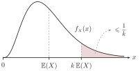
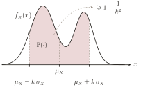

[上一篇](/lecture-notes/characteristic-functions/)介紹[特徵函數](/lecture-notes/characteristic-functions/#def-characteristic-function)，它與[動差母函數](/lecture-notes/moment-generating-functions/#def-mgf)同樣以一個函數表示整個機率分配。從[動差](/lecture-notes/moment-system/#def-population-moment)系統到各種母函數，我們一路上處理的都是分配本身的描述；然而實務上經常遇到另一種處境。分配的形式並不清楚，手上只有[期望值](/lecture-notes/expectation/#def-expectation)，或再加上一個[變異數](/lecture-notes/variance/#def-variance)。

機率不等式及相關法則這一節處理的正是這種處境，在僅知道低階動差的條件下，為機率給出一個可用的範圍。本篇先給出一條以非負函數界定機率的定理，再由它挑選不同的 $h(\cdot)$，依序導出馬可夫不等式、柴比雪夫不等式與單邊柴比雪夫不等式 (亦即坎特利不等式)，並以兩張圖說明前兩者的直觀意義。這三個不等式所用到的動差訊息都不超過一階與二階。最後把 $h(\cdot)$ 取為 $e^{tx}$，整個動差母函數因而一次被用上，得到的是前提嚴格得多、上界也更貼近真實機率的車諾夫不等式。這五條不等式各自怎麼挑、怎麼代入，將留到[下一篇](/lecture-notes/probability-inequalities-examples/)以八道例題逐一演練。

## 機率不等式

Theorem 2.31 (非負函數的機率界限, a bound for nonnegative functions)

令 $h(\cdot)$ 為一非負可測實值函數，$X$ 為一[隨機變數](/lecture-notes/random-variables-and-pmf/#def-random-variable)，$a>0$ 為一常數且 $\mathbb{E}\bigl[h(X)\bigr]<\infty$ 成立，則

$$
\mathbb{P}\bigl(h(X)\geqslant a\bigr)\leqslant\frac{\,\mathbb{E}\bigl[h(X)\bigr]\,}{a}
$$

**Proof.**

我們在此僅以連續型為例證明，並令 $A=\lbrace\,x\mid h(x)\geqslant a\,\rbrace$，則

$$
\begin{aligned}
\mathbb{E}\bigl[h(X)\bigr]&=\int_{-\infty}^{\infty}h(x)\,f_{\sssig X}(x)\,dx\\[0.45em]
&=\int_{A}h(x)\,f_{\sssig X}(x)\,dx+\int_{A^{\prime}}h(x)\,f_{\sssig X}(x)\,dx\\[0.45em]
&\geqslant\int_{A}h(x)\,f_{\sssig X}(x)\,dx\geqslant\int_{A}a\,f_{\sssig X}(x)\,dx\\[0.45em]
&=a\int_{A}f_{\sssig X}(x)\,dx=a\,\mathbb{P}(X\in A)=a\,\mathbb{P}\bigl(h(X)\geqslant a\bigr)
\end{aligned}
$$

$$
\begin{aligned}
&\mathbb{E}\bigl[h(X)\bigr]=\int_{-\infty}^{\infty}h(x)\,f_{\sssig X}(x)\,dx\\[0.45em]
&=\int_{A}h(x)\,f_{\sssig X}(x)\,dx+\int_{A^{\prime}}h(x)\,f_{\sssig X}(x)\,dx\\[0.45em]
&\geqslant\int_{A}h(x)\,f_{\sssig X}(x)\,dx\geqslant\int_{A}a\,f_{\sssig X}(x)\,dx\\[.45em]
&=a\int_{A}f_{\sssig X}(x)\,dx=a\,\mathbb{P}(X\in A)\\[.45em]
&=a\,\mathbb{P}\bigl(h(X)\geqslant a\bigr)
\end{aligned}
$$

故可得

$$
\mathbb{P}\bigl(h(X)\geqslant a\bigr)\leqslant\frac{\,\mathbb{E}\bigl[h(X)\bigr]\,}{a}
$$

原式得證。 $\square$

Note

上述證明的關鍵在於 $h(\cdot)$ 為非負函數，故 $\mathbb{E}[h(X)]$ 在任意子集上的分段積分皆非負，捨去 $A^{\prime}$ 上的積分後即得第一個不等號；再由事件等價關係 $X\in A$ $\Longleftrightarrow$ $h(X)\geqslant a$ 將積分還原為機率 $\mathbb{P}(h(X)\geqslant a)$。[Theorem 2.31](#thm-nonnegative-function-bound) 藉由選取不同的非負函數 $h(\cdot)$，便可依序衍生出以下一系列常用的機率不等式。

Theorem 2.32 (馬可夫不等式, Markov’s inequality)

若 $X$ 為一非負隨機變數，$a>0$ 為一常數且 $\mathbb{E}(\lvert X\rvert)<\infty$，則

$$
\mathbb{P}(X\geqslant a)\leqslant\frac{\,\mathbb{E}(X)\,}{a}
$$

**Proof.**

在 [Theorem 2.31](#thm-nonnegative-function-bound) 中，可設定 $h(x)=x_{+}=\max\lbrace x,0\rbrace$，此函數在整條實數線上連續且非負，因而符合該定理對 $h(\cdot)$ 的要求；又 $X$ 為非負隨機變數，故 $h(X)=X$，可知

$$
\mathbb{P}\bigl(h(X)\geqslant a\bigr)=\mathbb{P}(X\geqslant a)\leqslant\frac{\,\mathbb{E}\bigl[h(X)\bigr]\,}{a}=\frac{\,\mathbb{E}(X)\,}{a}
$$

$$
\begin{aligned}
\mathbb{P}\bigl(h(X)\geqslant a\bigr)&=\mathbb{P}(X\geqslant a)\\[0.45em]
&\leqslant\frac{\,\mathbb{E}\bigl[h(X)\bigr]\,}{a}=\frac{\,\mathbb{E}(X)\,}{a}
\end{aligned}
$$

原式得證。 $\square$

馬可夫不等式 (Markov’s inequality) 有一些地方需要注意:

(1) 除要求 $X$ 非負外，馬可夫不等式僅要求期望值存在，故在**僅知期望值 (一階動差) 而未知完整機率分配**時即可用來界定機率範圍；不過當 $a\leqslant\mathbb{E}(X)$ 時，不等式右側的 $\frac{\mathbb{E}(X)}{a}$ 不小於 $1$，無法提供額外的機率資訊。
{: .topic-paren-item}

Note

若在 [Theorem 2.31](#thm-nonnegative-function-bound) 中令 $h(x)=(x_{+})^{r}=\bigl[\max\lbrace x,0\rbrace\bigr]^{r}$，其中 $r>0$，且已知 $\mathbb{E}(\lvert X\rvert^{r})<\infty$，則馬可夫不等式可以進一步擴展為

$$
\mathbb{P}(X\geqslant a)\leqslant\frac{\,\mathbb{E}(X^{r})\,}{a^{r}}
$$

此處的 $h(x)=(x_{+})^{r}$ 在整條實數線上連續且非負，因而符合該定理對 $h(\cdot)$ 的要求；又 $X$ 為非負隨機變數，故 $h(X)=X^{r}$。我們證明如下:

**Proof.**

在 [Theorem 2.31](#thm-nonnegative-function-bound) 中，若我們把門檻常數取為 $a^{r}$，則

$$
\begin{aligned}
\mathbb{P}\bigl(h(X)\geqslant a^{r}\bigr)&=\mathbb{P}(X^{r}\geqslant a^{r})=\mathbb{P}(X\geqslant a)\\[0.45em]
&\leqslant\frac{\,\mathbb{E}\bigl[h(X)\bigr]\,}{a^{r}}=\frac{\,\mathbb{E}(X^{r})\,}{a^{r}}
\end{aligned}
$$

$$
\begin{aligned}
\mathbb{P}\bigl(h(X)\geqslant a^{r}\bigr)&=\mathbb{P}(X^{r}\geqslant a^{r})\\[0.45em]
&=\mathbb{P}(X\geqslant a)\\[.45em]
&\leqslant\frac{\,\mathbb{E}\bigl[h(X)\bigr]\,}{a^{r}}\\[0.45em]
&=\frac{\,\mathbb{E}(X^{r})\,}{a^{r}}
\end{aligned}
$$

原式得證。 $\square$

上述證明的關鍵，在於將 [Theorem 2.31](#thm-nonnegative-function-bound) 的門檻常數取為 $a^{r}$ 而非 $a$，藉此配合 $h(x)=(x_{+})^{r}$ 先得

$$
\mathbb{P}\bigl(h(X)\geqslant a^{r}\bigr)=\mathbb{P}(X^{r}\geqslant a^{r})\leqslant\frac{\,\mathbb{E}(X^{r})\,}{a^{r}}
$$

$$
\begin{aligned}
\mathbb{P}\bigl(h(X)\geqslant a^{r}\bigr)&=\mathbb{P}(X^{r}\geqslant a^{r})\leqslant\frac{\,\mathbb{E}(X^{r})\,}{a^{r}}
\end{aligned}
$$

再由非負實數集上的事件等價關係

$$
\lbrace\,x\mid x^{r}\geqslant a^{r},\ x\geqslant0\,\rbrace=\lbrace\,x\mid x\geqslant a,\ x\geqslant0\,\rbrace
$$

$$
\begin{aligned}
&\lbrace\,x\mid x^{r}\geqslant a^{r},\ x\geqslant0\,\rbrace\\[.45em]
=&\lbrace\,x\mid x\geqslant a,\ x\geqslant0\,\rbrace
\end{aligned}
$$

確認 $\mathbb{P}(X^{r}\geqslant a^{r})=\mathbb{P}(X\geqslant a)$ 成立。此擴展版本在下方[**柴比雪夫不等式 (Chebyshev’s inequality)**](#thm-chebyshev) 的證明中將直接派上用場。

(2) 馬可夫不等式連結了事件機率與期望值；其直觀在於**期望值為分配的聚集中心，多數取值應落在其附近**，據此可界定非負隨機變數不小於某門檻值的**機率上界**。
{: .topic-paren-item}

Note

在 [Theorem 2.32](#thm-markov) 中，若 $\mathbb{E}(X)>0$，由於期望值 $\mathbb{E}(X)$ 本身為正常數，對任意 $k>0$ 取門檻常數 $a=k\,\mathbb{E}(X)$，即得其倍數形式如下

$$
\mathbb{P}\bigl(X\geqslant k\,\mathbb{E}(X)\bigr)\leqslant\frac{\mathbb{E}(X)}{\,k\,\mathbb{E}(X)\,}=\frac{1}{\,k\,}
$$

此式表明「非負隨機變數 $X$ 不小於其期望值 $k$ 倍」的機率至多為 $\frac{1}{k}$。舉例來說，所得達世界人均所得十倍以上的人口比例，至多為世界總人口的十分之一。

若我們用圖示來理解馬可夫不等式，可以把上述直觀意義化約成下面這張圖。

<figure id="fig-markov-intuition" class="topic-figure topic-figure--wide">
  
  <figcaption>Fig. 2.19. 馬可夫不等式的圖示。取 $k=1.7$，右側界線落在 $k\,\mathbb{E}(X)$。加上陰影的右尾是事件 $X\geqslant k\,\mathbb{E}(X)$，其機率不超過 $\frac{1}{k}$。</figcaption>
</figure>

Theorem 2.33 (柴比雪夫不等式, Chebyshev’s inequality)

若 $X$ 為一隨機變數，$a>0$ 為一常數且期望值 $\mathbb{E}(X)=\mu_{\sssig X}$ 與變異數 $\mathrm{Var}(X)=\sigma_{\sssig X}^{2}$ 皆為有限，則

$$
\mathbb{P}\bigl(\lvert X-\mu_{\sssig X}\rvert\geqslant a\bigr)\leqslant\frac{\,\sigma_{\sssig X}^{2}\,}{a^{2}}\quad\text{且}\quad\mathbb{P}\bigl(\lvert X-\mu_{\sssig X}\rvert<a\bigr)\geqslant1-\frac{\,\sigma_{\sssig X}^{2}\,}{a^{2}}
$$

$$
\begin{gathered}
\mathbb{P}\bigl(\lvert X-\mu_{\sssig X}\rvert\geqslant a\bigr)\leqslant\frac{\,\sigma_{\sssig X}^{2}\,}{a^{2}}\\[0.45em]
\text{且}\quad\mathbb{P}\bigl(\lvert X-\mu_{\sssig X}\rvert<a\bigr)\geqslant1-\frac{\,\sigma_{\sssig X}^{2}\,}{a^{2}}
\end{gathered}
$$

**Proof.**

我們在此以[馬可夫不等式之擴展版本](#note-markov-extended)證明之，令 $h(x)=x^{2}$，則

$$
\begin{aligned}
\mathbb{P}\bigl(\lvert X-\mu_{\sssig X}\rvert\geqslant a\bigr)&=\mathbb{P}\bigl(h(\lvert X-\mu_{\sssig X}\rvert)\geqslant h(a)\bigr)\\[0.45em]
&=\mathbb{P}\bigl((X-\mu_{\sssig X})^{2}\geqslant a^{2}\bigr)\\[0.45em]
&\leqslant\frac{\,\mathbb{E}\bigl[(X-\mu_{\sssig X})^{2}\bigr]\,}{a^{2}}=\frac{\,\sigma_{\sssig X}^{2}\,}{a^{2}}
\end{aligned}
$$

$$
\begin{aligned}
&\mathbb{P}\bigl(\lvert X-\mu_{\sssig X}\rvert\geqslant a\bigr)\\[.45em]
&=\mathbb{P}\bigl(h(\lvert X-\mu_{\sssig X}\rvert)\geqslant h(a)\bigr)\\[0.45em]
&=\mathbb{P}\bigl((X-\mu_{\sssig X})^{2}\geqslant a^{2}\bigr)\\[0.45em]
&\leqslant\frac{\,\mathbb{E}\bigl[(X-\mu_{\sssig X})^{2}\bigr]\,}{a^{2}}\\[.45em]
&=\frac{\,\sigma_{\sssig X}^{2}\,}{a^{2}}
\end{aligned}
$$

又餘事件機率為 $1$ 減去該事件機率，故得

$$
\begin{aligned}
\mathbb{P}\bigl(\lvert X-\mu_{\sssig X}\rvert<a\bigr)&=1-\mathbb{P}\bigl(\lvert X-\mu_{\sssig X}\rvert\geqslant a\bigr)\\[0.45em]
&\geqslant1-\frac{\,\sigma_{\sssig X}^{2}\,}{a^{2}}
\end{aligned}
$$

$$
\begin{aligned}
\mathbb{P}\bigl(\lvert X-\mu_{\sssig X}\rvert<a\bigr)&=1-\mathbb{P}\bigl(\lvert X-\mu_{\sssig X}\rvert\geqslant a\bigr)\\[0.45em]
&\geqslant1-\frac{\,\sigma_{\sssig X}^{2}\,}{a^{2}}
\end{aligned}
$$

原式得證。 $\square$

柴比雪夫不等式有一些地方需要注意:

(1) 與[馬可夫不等式](#thm-markov)相比，$X$ 不限定於非負的隨機變數，但多要求了變異數必須存在。在**僅知道期望值與變異數 (一二階動差) 而完全不知道其機率分配形式，但必須求取機率範圍**的時候，是很好用的手段。
{: .topic-paren-item}

(2) 柴比雪夫不等式分別給出「隨機變數與期望值的距離不小於 $a$」的**機率上界**，以及「與期望值的距離小於 $a$」的**機率下界**。這兩項敘述藉由餘事件關係彼此等價；在連續型分配中端點是否包含等號不影響機率，但在離散型分配中則須嚴格區分嚴格不等號與非嚴格不等號。
{: .topic-paren-item}

Note

柴比雪夫不等式同時連結了事件機率、期望值與變異數。其核心直觀與馬可夫不等式一致，皆源於**期望值是分配的聚集中心，多數取值應落在其附近**；更進一步的是，柴比雪夫不等式以變異數 (或[標準差](/lecture-notes/variance-standard-deviation/#def-standard-deviation)) 作為衡量 $X$ 偏離期望值遠近的基準。

以標準差為單位度量某點與隨機變數期望值之間的距離，稱為**統計距離**或**馬氏距離 (Mahalanobis distance)**；此作法消除了原始測量單位造成的尺度差異，得以在統一尺度下衡量統計意義上的遠近。

(3) 與馬可夫不等式的倍數形式相仿，在 [Theorem 2.33](#thm-chebyshev) 中設 $\sigma\_{\sssig X}>0$ 並對任意 $k>0$ 取門檻常數 $a=k\,\sigma\_{\sssig X}$，即得標準差倍數形式
{: #chebyshev-standard-deviation-form .topic-paren-item}

$$
\mathbb{P}\bigl(\lvert X-\mu_{\sssig X}\rvert\geqslant k\,\sigma_{\sssig X}\bigr)\leqslant\frac{1}{\,k^{2}\,}\quad\text{且}\quad\mathbb{P}\bigl(\lvert X-\mu_{\sssig X}\rvert<k\,\sigma_{\sssig X}\bigr)\geqslant1-\frac{1}{\,k^{2}\,}
$$

$$
\begin{gathered}
\mathbb{P}\bigl(\lvert X-\mu_{\sssig X}\rvert\geqslant k\,\sigma_{\sssig X}\bigr)\leqslant\frac{1}{\,k^{2}\,}\\[0.45em]
\text{且}\quad\mathbb{P}\bigl(\lvert X-\mu_{\sssig X}\rvert<k\,\sigma_{\sssig X}\bigr)\geqslant1-\frac{1}{\,k^{2}\,}
\end{gathered}
$$

Note

結合前則 [Note](#note-meaning-of-chebyshev) 的統計距離觀點，上式表明**隨機變數偏離期望值達 $k$ 個標準差以上的機率至多為 $\frac{1}{k^{2}}$**，等價地，**落在期望值加減 $k$ 個標準差之內的機率至少為 $1-\frac{1}{k^{2}}$ 此一數值**。實務分析常僅掌握期望值與標準差等彙整資料 (summarized data) 而未知母體分配形式，此時即可藉此界定指定區間的機率範圍。

(4) 在**僅知期望值與變異數**而不限制分配形式的前提下，柴比雪夫不等式的上界 $\frac{\sigma_{\sssig X}^{2}}{a^{2}}$ (或 $\frac{1}{k^{2}}$) **無法再被改進**；亦即存在滿足相同一、二階動差的機率分配恰好達到此等號，故僅憑前兩階動差的資訊，無法對同一區間給出更小的普適上界。
{: .topic-paren-item}

Note

後文將介紹的[**鐘形分配經驗法則 (empirical rule of bell-shaped distribution)**](/lecture-notes/empirical-rule-bell-shaped-distributions/#thm-empirical-rule) 同樣討論各標準差倍數區間內的機率，卻能給出遠較柴比雪夫界限緊密的近似數值；原因在於**鐘形分配 (bell-shaped distribution)** 這項形狀假設本身提供了比單純一、二階動差豐富得多的分配資訊。一般而言，若額外掌握單峰、對稱或動差母函數等更多分配訊息，馬可夫不等式與柴比雪夫不等式的機率界限皆可進一步收緊，具體的推導與作法見[下一篇的例題](/lecture-notes/probability-inequalities-examples/)。

(5) 事實上柴比雪夫不等式未必要透過馬可夫不等式推導，亦可直接由變異數的定義證明。我們便順勢將上述[第 (3) 點](#chebyshev-standard-deviation-form)中的標準差倍數版本證明如下:
{: .topic-paren-item}

**Proof.**

由變異數的定義展開，並將積分區間依 $\mu_{\sssig X}\pm k\,\sigma_{\sssig X}$ 拆成三段，可得

$$
\begin{aligned}
\sigma_{\sssig X}^{2}&=\mathbb{E}\bigl[(X-\mu_{\sssig X})^{2}\bigr]=\int_{-\infty}^{\infty}(x-\mu_{\sssig X})^{2}f_{\sssig X}(x)\,dx\\[0.45em]
&=\int_{-\infty}^{\mu_{\sssig X}-k\,\sigma_{\sssig X}}(x-\mu_{\sssig X})^{2}f_{\sssig X}(x)\,dx+\int_{\mu_{\sssig X}-k\,\sigma_{\sssig X}}^{\mu_{\sssig X}+k\,\sigma_{\sssig X}}(x-\mu_{\sssig X})^{2}f_{\sssig X}(x)\,dx\\[0.2em]
&\qquad +\int_{\mu_{\sssig X}+k\,\sigma_{\sssig X}}^{\infty}(x-\mu_{\sssig X})^{2}f_{\sssig X}(x)\,dx\\[0.45em]
&\geqslant\int_{-\infty}^{\mu_{\sssig X}-k\,\sigma_{\sssig X}}(x-\mu_{\sssig X})^{2}f_{\sssig X}(x)\,dx+\int_{\mu_{\sssig X}+k\,\sigma_{\sssig X}}^{\infty}(x-\mu_{\sssig X})^{2}f_{\sssig X}(x)\,dx\\[0.45em]
&\geqslant\int_{-\infty}^{\mu_{\sssig X}-k\,\sigma_{\sssig X}}k^{2}\sigma_{\sssig X}^{2}\,f_{\sssig X}(x)\,dx+\int_{\mu_{\sssig X}+k\,\sigma_{\sssig X}}^{\infty}k^{2}\sigma_{\sssig X}^{2}\,f_{\sssig X}(x)\,dx
\end{aligned}
$$

$$
\begin{aligned}
\sigma_{\sssig X}^{2}&=\mathbb{E}\bigl[(X-\mu_{\sssig X})^{2}\bigr]\\[0.45em]
&=\int_{-\infty}^{\infty}(x-\mu_{\sssig X})^{2}f_{\sssig X}(x)\,dx\\[0.45em]
&=\int_{-\infty}^{\mu_{\sssig X}-k\,\sigma_{\sssig X}}(x-\mu_{\sssig X})^{2}f_{\sssig X}(x)\,dx\\[0.2em]
&\qquad +\int_{\mu_{\sssig X}-k\,\sigma_{\sssig X}}^{\mu_{\sssig X}+k\,\sigma_{\sssig X}}(x-\mu_{\sssig X})^{2}f_{\sssig X}(x)\,dx\\[0.2em]
&\qquad +\int_{\mu_{\sssig X}+k\,\sigma_{\sssig X}}^{\infty}(x-\mu_{\sssig X})^{2}f_{\sssig X}(x)\,dx\\[0.45em]
&\geqslant\int_{-\infty}^{\mu_{\sssig X}-k\,\sigma_{\sssig X}}(x-\mu_{\sssig X})^{2}f_{\sssig X}(x)\,dx\\[0.2em]
&\qquad +\int_{\mu_{\sssig X}+k\,\sigma_{\sssig X}}^{\infty}(x-\mu_{\sssig X})^{2}f_{\sssig X}(x)\,dx\\[0.45em]
&\geqslant\int_{-\infty}^{\mu_{\sssig X}-k\,\sigma_{\sssig X}}k^{2}\sigma_{\sssig X}^{2}\,f_{\sssig X}(x)\,dx\\[0.2em]
&\qquad +\int_{\mu_{\sssig X}+k\,\sigma_{\sssig X}}^{\infty}k^{2}\sigma_{\sssig X}^{2}\,f_{\sssig X}(x)\,dx
\end{aligned}
$$

其中第二個不等號是因為

$$
k^{2}\sigma_{\sssig X}^{2}=\bigl[(\mu_{\sssig X}+k\,\sigma_{\sssig X})-\mu_{\sssig X}\bigr]^{2}=\bigl[(\mu_{\sssig X}-k\,\sigma_{\sssig X})-\mu_{\sssig X}\bigr]^{2}
$$

$$
\begin{aligned}
k^{2}\sigma_{\sssig X}^{2}&=\bigl[(\mu_{\sssig X}+k\,\sigma_{\sssig X})-\mu_{\sssig X}\bigr]^{2}\\[0.45em]
&=\bigl[(\mu_{\sssig X}-k\,\sigma_{\sssig X})-\mu_{\sssig X}\bigr]^{2}
\end{aligned}
$$

而兩段積分區域上的 $(x-\mu_{\sssig X})^{2}$ 皆不小於 $k^{2}\sigma_{\sssig X}^{2}$。故可得

$$
\begin{aligned}
\sigma_{\sssig X}^{2}&\geqslant k^{2}\sigma_{\sssig X}^{2}\left(\int_{-\infty}^{\mu_{\sssig X}-k\,\sigma_{\sssig X}}f_{\sssig X}(x)\,dx+\int_{\mu_{\sssig X}+k\,\sigma_{\sssig X}}^{\infty}f_{\sssig X}(x)\,dx\right)\\[0.45em]
&=k^{2}\sigma_{\sssig X}^{2}\times\mathbb{P}\bigl(X\leqslant\mu_{\sssig X}-k\,\sigma_{\sssig X}\ \text{或}\ X\geqslant\mu_{\sssig X}+k\,\sigma_{\sssig X}\bigr)\\[0.45em]
&=k^{2}\sigma_{\sssig X}^{2}\times\mathbb{P}\bigl(\lvert X-\mu_{\sssig X}\rvert\geqslant k\,\sigma_{\sssig X}\bigr)
\end{aligned}
$$

$$
\begin{aligned}
\sigma_{\sssig X}^{2}&\geqslant k^{2}\sigma_{\sssig X}^{2}\Biggl(\int_{-\infty}^{\mu_{\sssig X}-k\,\sigma_{\sssig X}}f_{\sssig X}(x)\,dx\\[0.2em]
&\qquad\qquad\qquad\qquad +\int_{\mu_{\sssig X}+k\,\sigma_{\sssig X}}^{\infty}f_{\sssig X}(x)\,dx\Biggr)\\[0.45em]
&=k^{2}\sigma_{\sssig X}^{2}\\[0.2em]
&\qquad \times\mathbb{P}\bigl(X\leqslant\mu_{\sssig X}\!-\!k\sigma_{\sssig X}\ \text{或}\ X\geqslant\mu_{\sssig X}\!+\!k\sigma_{\sssig X}\bigr)\\[0.45em]
&=k^{2}\sigma_{\sssig X}^{2}\times\mathbb{P}\bigl(\lvert X-\mu_{\sssig X}\rvert\geqslant k\,\sigma_{\sssig X}\bigr)
\end{aligned}
$$

由 $k>0$ 與 $\sigma_{\sssig X}>0$ 可知 $k^{2}\sigma_{\sssig X}^{2}>0$，兩側同除以 $k^{2}\sigma_{\sssig X}^{2}$，即為

$$
\mathbb{P}\bigl(\lvert X-\mu_{\sssig X}\rvert\geqslant k\,\sigma_{\sssig X}\bigr)\leqslant\frac{\sigma_{\sssig X}^{2}}{\,k^{2}\sigma_{\sssig X}^{2}\,}=\frac{1}{\,k^{2}\,}
$$

原式得證。 $\square$

我們同樣透過下面的圖示，來理解柴比雪夫不等式背後的直觀意義。

<figure id="fig-chebyshev-intuition" class="topic-figure topic-figure--wide">
  
  <figcaption>Fig. 2.20. 柴比雪夫不等式的圖示。取 $k=1.3$，陰影部分為事件 $\lvert X-\mu_{\sssig X}\rvert<k\,\sigma_{\sssig X}$，其機率至少為 $1-\frac{1}{k^{2}}$。</figcaption>
</figure>

上圖明白地呈現了「與期望值相距不到 $k$ 個標準差的範圍 (陰影部分)，至少有 $1-\frac{1}{k^{2}}$ 的機率」；而與其等價的另一段敘述「與期望值相距不小於 $k$ 個標準差的範圍 (未加陰影部分)，至多有 $\frac{1}{k^{2}}$ 的機率」，亦能由圖看出。

Note

若讀者較不習慣使用統計距離來理解柴比雪夫不等式，亦可將上圖的 $k\,\sigma_{\sssig X}$ 改寫為 $a$，則其表示式便會對應到 [Theorem 2.33](#thm-chebyshev) 中的原始版本。此外，雖然這個版本的柴比雪夫不等式對 $k$ 只要求 $k>0$，但在實務上，$k\leqslant1$ 時 $\frac{1}{k^{2}}$ 不小於 $1$，是無法提供任何資訊的，因為一個機率本來就要介在 $0$ 到 $1$ 之間。

儘管上圖是以連續型分配作為圖例，但讀者仍不應忘記，柴比雪夫不等式對**任意具有期望值與變異數**的分配，皆可以使用，其中當然也包含離散型分配，因此在分界點上，等號的方向歸屬應當特別釐清。

Theorem 2.34 (單邊柴比雪夫不等式, one-tailed Chebyshev’s inequality)

若 $X$ 為一隨機變數，$a>0$ 為一常數且期望值 $\mathbb{E}(X)=\mu_{\sssig X}$ 與變異數 $\mathrm{Var}(X)=\sigma_{\sssig X}^{2}$ 皆為有限，則

$$
\mathbb{P}\bigl(X-\mu_{\sssig X}\geqslant a\bigr)\leqslant\frac{\,\sigma_{\sssig X}^{2}\,}{\,\sigma_{\sssig X}^{2}+a^{2}\,}\quad\text{且}\quad\mathbb{P}\bigl(X-\mu_{\sssig X}\leqslant-a\bigr)\leqslant\frac{\,\sigma_{\sssig X}^{2}\,}{\,\sigma_{\sssig X}^{2}+a^{2}\,}
$$

$$
\begin{gathered}
\mathbb{P}\bigl(X-\mu_{\sssig X}\geqslant a\bigr)\leqslant\frac{\,\sigma_{\sssig X}^{2}\,}{\,\sigma_{\sssig X}^{2}+a^{2}\,}\\[0.45em]
\text{且}\quad\mathbb{P}\bigl(X-\mu_{\sssig X}\leqslant-a\bigr)\leqslant\frac{\,\sigma_{\sssig X}^{2}\,}{\,\sigma_{\sssig X}^{2}+a^{2}\,}
\end{gathered}
$$

**Proof.**

若 $\sigma_{\sssig X}=0$，則 $\mathbb{P}(X=\mu_{\sssig X})=1$，兩個不等式的左右兩側皆為 $0$，結論成立；以下設 $\sigma_{\sssig X}>0$。令 $Y=X-\mu_{\sssig X}$，則我們有

$$
\mathbb{E}(Y)=\mathbb{E}(X-\mu_{\sssig X})=0,\quad\mathrm{Var}(Y)=\mathbb{E}(Y^{2})=\mathrm{Var}(X)=\sigma_{\sssig X}^{2}
$$

$$
\begin{gathered}
\mathbb{E}(Y)=\mathbb{E}(X-\mu_{\sssig X})=0,\\[0.45em]
\mathrm{Var}(Y)=\mathbb{E}(Y^{2})=\mathrm{Var}(X)=\sigma_{\sssig X}^{2}
\end{gathered}
$$

令 $h(y)=(y+c)^{2}$，其中 $c>0$，則對於 $Y=X-\mu_{\sssig X}\geqslant a>0$，有 $h(Y)=h(X-\mu_{\sssig X})\geqslant h(a)$。由 [Theorem 2.31](#thm-nonnegative-function-bound) 可知

$$
\begin{aligned}
\mathbb{P}\bigl(X-\mu_{\sssig X}\geqslant a\bigr)&=\mathbb{P}(Y\geqslant a)\leqslant\mathbb{P}\bigl(h(Y)\geqslant h(a)\bigr)\\[0.45em]
&\leqslant\frac{\,\mathbb{E}\bigl[h(Y)\bigr]\,}{h(a)}=\frac{\,\mathbb{E}\bigl[(Y+c)^{2}\bigr]\,}{(a+c)^{2}},\quad c>0
\end{aligned}
$$

$$
\begin{aligned}
\mathbb{P}&\bigl(X-\mu_{\sssig X}\geqslant a\bigr)=\mathbb{P}(Y\geqslant a)\\[0.45em]
&\leqslant\mathbb{P}\bigl(h(Y)\geqslant h(a)\bigr)\leqslant\frac{\,\mathbb{E}\bigl[h(Y)\bigr]\,}{h(a)}\\[0.45em]
&=\frac{\,\mathbb{E}\bigl[(Y+c)^{2}\bigr]\,}{(a+c)^{2}},\quad c>0
\end{aligned}
$$

此式對每一個 $c>0$ 都成立，此即

$$
\mathbb{P}\bigl(X-\mu_{\sssig X}\geqslant a\bigr)\leqslant\inf_{c>0}\frac{\,\mathbb{E}\bigl[(Y+c)^{2}\bigr]\,}{(a+c)^{2}}
$$

又由 $\mathbb{E}(Y)=0$ 可知

$$
\mathbb{E}\bigl[(Y+c)^{2}\bigr]=\mathbb{E}\bigl[Y^{2}+2cY+c^{2}\bigr]=\mathbb{E}(Y^{2})+c^{2}=\sigma_{\sssig X}^{2}+c^{2}
$$

$$
\begin{aligned}
\mathbb{E}\bigl[(Y+c)^{2}\bigr]&=\mathbb{E}\bigl[Y^{2}+2cY+c^{2}\bigr]\\[0.45em]
&=\mathbb{E}(Y^{2})+c^{2}=\sigma_{\sssig X}^{2}+c^{2}
\end{aligned}
$$

故可知

$$
\inf_{c>0}\frac{\,\mathbb{E}\bigl[(Y+c)^{2}\bigr]\,}{(a+c)^{2}}=\inf_{c>0}\frac{\,\sigma_{\sssig X}^{2}+c^{2}\,}{(a+c)^{2}}
$$

並可令 $g(c)=\frac{\,\sigma_{\sssig X}^{2}+c^{2}\,}{(a+c)^{2}}$，則由微積分可知，一階條件 (first-order condition, f.o.c.) 為

$$
g^{\prime}(c)=\frac{\,2ca-2\sigma_{\sssig X}^{2}\,}{(a+c)^{3}}=0
$$

$$
\Longrightarrow\ c=\frac{\,\sigma_{\sssig X}^{2}\,}{a}
$$

二階條件 (second-order condition, s.o.c.) 請讀者自行驗證。將 $c$ 代回，則

$$
\begin{aligned}
\inf_{c>0}\frac{\,\sigma_{\sssig X}^{2}+c^{2}\,}{(a+c)^{2}}&=\frac{\,\sigma_{\sssig X}^{2}+c^{2}\,}{(a+c)^{2}}\Bigg|_{c=\frac{\sigma_{\sssig X}^{2}}{a}}=\frac{\,\sigma_{\sssig X}^{2}+\bigl(\frac{\sigma_{\sssig X}^{2}}{a}\bigr)^{2}\,}{\bigl(a+\frac{\sigma_{\sssig X}^{2}}{a}\bigr)^{2}}\\[0.45em]
&=\frac{\,\sigma_{\sssig X}^{2}\bigl(1+\frac{\sigma_{\sssig X}^{2}}{a^{2}}\bigr)\,}{a^{2}\bigl(1+\frac{\sigma_{\sssig X}^{2}}{a^{2}}\bigr)^{2}}=\frac{\sigma_{\sssig X}^{2}}{\,a^{2}+\sigma_{\sssig X}^{2}\,}
\end{aligned}
$$

$$
\begin{aligned}
\inf_{c>0}&\frac{\,\sigma_{\sssig X}^{2}+c^{2}\,}{(a+c)^{2}}=\frac{\,\sigma_{\sssig X}^{2}+c^{2}\,}{(a+c)^{2}}\Bigg|_{c=\frac{\sigma_{\sssig X}^{2}}{a}}\\[0.45em]
&=\frac{\,\sigma_{\sssig X}^{2}+\bigl(\frac{\sigma_{\sssig X}^{2}}{a}\bigr)^{2}\,}{\bigl(a+\frac{\sigma_{\sssig X}^{2}}{a}\bigr)^{2}}=\frac{\,\sigma_{\sssig X}^{2}\bigl(1+\frac{\sigma_{\sssig X}^{2}}{a^{2}}\bigr)\,}{a^{2}\bigl(1+\frac{\sigma_{\sssig X}^{2}}{a^{2}}\bigr)^{2}}\\[0.45em]
&=\frac{\sigma_{\sssig X}^{2}}{\,a^{2}+\sigma_{\sssig X}^{2}\,}
\end{aligned}
$$

故可知

$$
\mathbb{P}\bigl(X-\mu_{\sssig X}\geqslant a\bigr)\leqslant\frac{\,\sigma_{\sssig X}^{2}\,}{\,a^{2}+\sigma_{\sssig X}^{2}\,}
$$

另一部分同理可證。原式得證。 $\square$

單邊柴比雪夫不等式 (one-tailed Chebyshev’s inequality) 有幾點須注意:

(1) 此不等式又被稱作**坎特利不等式 (Cantelli’s inequality)**，與[馬可夫不等式](#thm-markov)及[柴比雪夫不等式](#thm-chebyshev)相似，是由 [Theorem 2.31](#thm-nonnegative-function-bound)，經由挑選特殊的函數 $h(\cdot)$ 所衍生而來。
{: .topic-paren-item}

Note

若將單邊柴比雪夫不等式的左右兩尾合併，可得

$$
\mathbb{P}\bigl(\lvert X-\mu_{\sssig X}\rvert\geqslant a\bigr)\leqslant\frac{\,2\,\sigma_{\sssig X}^{2}\,}{\,\sigma_{\sssig X}^{2}+a^{2}\,}
$$

此式稱為**弱版**的柴比雪夫不等式。另一方面，針對單尾事件而言，坎特利不等式可視為強化版的馬可夫不等式，因其額外納入二階動差資訊並對平移常數 $c>0$ 取下確界，從而收緊單尾機率上界；下文介紹的[車諾夫不等式 (Chernoff inequality)](#thm-chernoff) 亦循相同思路，藉由納入動差母函數所含的各階動差資訊進一步壓低上界。

(2) 與馬可夫不等式、柴比雪夫不等式相仿，坎特利不等式同樣具有另一個版本。若 $k>0$ 且 $\sigma_{\sssig X}>0$，則
{: .topic-paren-item}

$$
\mathbb{P}\bigl(X-\mu_{\sssig X}\geqslant k\,\sigma_{\sssig X}\bigr)\leqslant\frac{1}{\,1+k^{2}\,}\quad\text{且}\quad\mathbb{P}\bigl(X-\mu_{\sssig X}\leqslant-k\,\sigma_{\sssig X}\bigr)\leqslant\frac{1}{\,1+k^{2}\,}
$$

$$
\begin{gathered}
\mathbb{P}\bigl(X-\mu_{\sssig X}\geqslant k\,\sigma_{\sssig X}\bigr)\leqslant\frac{1}{\,1+k^{2}\,}\\[0.45em]
\text{且}\quad\mathbb{P}\bigl(X-\mu_{\sssig X}\leqslant-k\,\sigma_{\sssig X}\bigr)\leqslant\frac{1}{\,1+k^{2}\,}
\end{gathered}
$$

Note

在上式中取 $k=1$，可得

$$
\mathbb{P}(X\geqslant\mu_{\sssig X}+\sigma_{\sssig X})\leqslant\frac{1}{\,2\,}\quad\text{且}\quad\mathbb{P}(X\leqslant\mu_{\sssig X}-\sigma_{\sssig X})\leqslant\frac{1}{\,2\,}
$$

$$
\begin{gathered}
\mathbb{P}(X\geqslant\mu_{\sssig X}+\sigma_{\sssig X})\leqslant\frac{1}{\,2\,}\\[0.45em]
\text{且}\quad\mathbb{P}(X\leqslant\mu_{\sssig X}-\sigma_{\sssig X})\leqslant\frac{1}{\,2\,}
\end{gathered}
$$

這個結果指出，**對任意分配而言，[中位數](/lecture-notes/median/#def-median) $\eta\_{\sssig X}$ 與期望值 $\mu\_{\sssig X}$ 位置的差距，前後應不超過一個標準差**。

Theorem 2.35 (車諾夫不等式, Chernoff inequality)

若 $X$ 為一隨機變數，且存在某個 $h>0$，使得 $\mathbb{E}\bigl(e^{tX}\bigr)$ 在 $-h<t<h$ 區間內皆存在，記其 mgf 為 $M_{\sssig X}(t)$，則

<ol class="topic-list-paren topic-list-paren--math">
  <li>
  $$
  \mathbb{P}(X\geqslant a)\leqslant e^{-ta}\,M_{\sssig X}(t),~\forall\,0<t<h
  $$
  </li>
  <li>
  $$
  \mathbb{P}(X\leqslant a)\leqslant e^{-ta}\,M_{\sssig X}(t),~\forall\,{-h}<t<0
  $$
  </li>
</ol>

**Proof.**

(1) 由於 $0<t<h$，$X\geqslant a$ 與 $t\,X\geqslant t\,a$ 是同一個事件，且 $\mathbb{E}\bigl(e^{tX}\bigr)=M_{\sssig X}(t)$ 為有限值，故由 [Theorem 2.31](#thm-nonnegative-function-bound) 可知
{: .topic-paren-item}

$$
\begin{aligned}
\mathbb{P}(X\geqslant a)&=\mathbb{P}(t\,X\geqslant t\,a)=\mathbb{P}\bigl(e^{tX}\geqslant e^{ta}\bigr)\\[0.45em]
&\leqslant\frac{\,\mathbb{E}\bigl(e^{tX}\bigr)\,}{e^{ta}}=e^{-ta}\,M_{\sssig X}(t),\quad\forall\,0<t<h
\end{aligned}
$$

$$
\begin{aligned}
\mathbb{P}(&X\geqslant a)=\mathbb{P}(t\,X\geqslant t\,a)\\[0.45em]
&=\mathbb{P}\bigl(e^{tX}\geqslant e^{ta}\bigr)\leqslant\frac{\,\mathbb{E}\bigl(e^{tX}\bigr)\,}{e^{ta}}\\[0.45em]
&=e^{-ta}\,M_{\sssig X}(t),\quad\forall\,0<t<h
\end{aligned}
$$

(2) 同理，$-h<t<0$ 時兩側同乘 $t$ 會使不等號反向，$X\leqslant a$ 與 $t\,X\geqslant t\,a$ 因而是同一個事件，且 $\mathbb{E}\bigl(e^{tX}\bigr)=M_{\sssig X}(t)$ 同樣為有限值，故由 [Theorem 2.31](#thm-nonnegative-function-bound) 可知
{: .topic-paren-item}

$$
\begin{aligned}
\mathbb{P}(X\leqslant a)&=\mathbb{P}(t\,X\geqslant t\,a)=\mathbb{P}\bigl(e^{tX}\geqslant e^{ta}\bigr)\\[0.45em]
&\leqslant\frac{\,\mathbb{E}\bigl(e^{tX}\bigr)\,}{e^{ta}}=e^{-ta}\,M_{\sssig X}(t),\quad\forall\,{-h}<t<0
\end{aligned}
$$

$$
\begin{aligned}
\mathbb{P}(&X\leqslant a)=\mathbb{P}(t\,X\geqslant t\,a)\\[0.45em]
&=\mathbb{P}\bigl(e^{tX}\geqslant e^{ta}\bigr)\leqslant\frac{\,\mathbb{E}\bigl(e^{tX}\bigr)\,}{e^{ta}}\\[0.45em]
&=e^{-ta}\,M_{\sssig X}(t),\quad\forall\,{-h}<t<0
\end{aligned}
$$

原式得證。 $\square$
{: .topic-paren-cont}

Note

[車諾夫不等式](#thm-chernoff)與[馬可夫不等式](#thm-markov)同由 [Theorem 2.31](#thm-nonnegative-function-bound) 衍生而來，但前提嚴格得多；要求 [mgf](/lecture-notes/moment-generating-functions/#def-mgf) 在原點鄰域內存在，意味著所有階動差皆須有限。相對地，正因動差母函數包含了更完整的分配資訊，對區間內所有合乎條件的 $t$ 取下確界即可得到更緊密的尾機率上界，此即

$$
\mathbb{P}(X\geqslant a)\leqslant\inf_{0<t<h}\,e^{-ta}\,M_{\sssig X}(t)\quad\text{且}\quad\mathbb{P}(X\leqslant a)\leqslant\inf_{-h<t<0}\,e^{-ta}\,M_{\sssig X}(t)
$$

$$
\begin{gathered}
\mathbb{P}(X\geqslant a)\leqslant\inf_{0<t<h}\,e^{-ta}\,M_{\sssig X}(t)\\[0.45em]
\text{且} \quad \mathbb{P}(X\leqslant a)\leqslant\inf_{-h<t<0}\,e^{-ta}\,M_{\sssig X}(t)
\end{gathered}
$$

實際計算時，可將已知的 $M_{\sssig X}(t)$ 與門檻 $a$ 代入右側，再以微積分求取使上界最小的參數 $t$。

## 本篇小結

[Theorem 2.31](#thm-nonnegative-function-bound) 是本篇三個不等式共同的起點。對非負可測實值函數 $h(\cdot)$ 與常數 $a>0$，只要 $\mathbb{E}[h(X)]<\infty$，就有 $\mathbb{P}(h(X)\geqslant a)$ $\leqslant$ $\frac{\mathbb{E}[h(X)]}{a}$ 這條界限。證明的關鍵有兩步，第一步是把 $\mathbb{E}[h(X)]$ 的積分拆成 $A=\lbrace x\mid h(x)\geqslant a\rbrace$ 與 $A^{\prime}$ 兩段，由 $h(\cdot)$ 非負而捨去 $A^{\prime}$ 上的積分；第二步是在 $A$ 之上以 $a$ 取代 $h(x)$，再由 $X\in A$ $\Longleftrightarrow$ $h(X)\geqslant a$ 把積分換回機率。

在這條定理中取 $h(x)=x_{+}$，對非負隨機變數即得[馬可夫不等式](#thm-markov) $\mathbb{P}(X\geqslant a)$ $\leqslant$ $\frac{\mathbb{E}(X)}{a}$，它只用到一階動差；取 $h(x)=(x_{+})^{r}$ 得到[擴展版](#note-markov-extended)，再以 $r=2$ 施於 $\lvert X-\mu_{\sssig X}\rvert$，便得到[柴比雪夫不等式](#thm-chebyshev) $\mathbb{P}(\lvert X-\mu_{\sssig X}\rvert\geqslant a)$ $\leqslant$ $\frac{\sigma_{\sssig X}^{2}}{a^{2}}$，它多用了二階動差，因而不再要求隨機變數非負。

這兩條不等式都另有以 $k$ 倍期望值或 $k$ 倍標準差表示的版本，兩個版本都要求 $k>0$，前者另需 $\mathbb{E}(X)>0$、後者另需 $\sigma_{\sssig X}>0$，其直觀分別呈現在 [Fig. 2.19](#fig-markov-intuition) 與 [Fig. 2.20](#fig-chebyshev-intuition)。前者是右尾的機率不超過 $\frac{1}{k}$，後者是中央區間的機率至少為 $1-\frac{1}{k^{2}}$。柴比雪夫不等式也可以不經由馬可夫不等式，直接由變異數的定義分段放大而得。

[Theorem 2.34](#thm-one-tailed-chebyshev) 的單邊柴比雪夫不等式，亦即坎特利不等式，改取 $h(y)=(y+c)^{2}$ 之後對 $c>0$ 取下確界，把單側的機率界定在 $\frac{\sigma_{\sssig X}^{2}}{\sigma_{\sssig X}^{2}+a^{2}}$ 之內；兩側合併得到的是弱版的柴比雪夫不等式，而在 $\sigma_{\sssig X}>0$ 之下取 $k=1$，則得到[中位數與期望值相距不超過一個標準差](#note-median-mean-distance)的結果。以上三個不等式所用的動差訊息都只到二階。

[Theorem 2.35](#thm-chernoff) 的車諾夫不等式改以動差母函數界定尾機率，$M_{\sssig X}(t)$ 在以 $0$ 為中心的某個開區間內皆存在時，對該區間內每一個 $t>0$ 皆有 $\mathbb{P}(X\geqslant a)$ $\leqslant$ $e^{-ta}M_{\sssig X}(t)$，每一個 $t<0$ 皆有 $\mathbb{P}(X\leqslant a)$ $\leqslant$ $e^{-ta}M_{\sssig X}(t)$。證明的作法是把 $X\geqslant a$ 改寫成 $e^{tX}\geqslant e^{ta}$，再套用同一條[非負函數的機率界限](#thm-nonnegative-function-bound)，可見它與[馬可夫不等式](#thm-markov)同出一源，差別只在所挑選的函數是 $e^{tx}$，而不是 $x_{+}=\max\lbrace x,0\rbrace$ 或其 $r$ 次方。

由於上尾與下尾兩個版本對每一個合乎範圍的 $t$ 都成立，我們還可以對 $t$ 取下確界，取得其中最小的一個上界。mgf 存在等於要求各階動差都存在，這個前提比前三者都嚴格得多，換來的是更貼近真實機率的上界。這五條不等式的例題集中在[下一篇](/lecture-notes/probability-inequalities-examples/)，共八道。

## 參考文獻與延伸閱讀

- 黃文璋，2010，《機率論》，二版，華泰文化。
- George Casella and Roger L. Berger. 2002. *Statistical Inference*. 2nd ed. Duxbury.
- Robert V. Hogg, Joseph W. McKean, and Allen T. Craig. 2019. *Introduction to Mathematical Statistics*. 8th ed. Pearson.
- Sheldon Ross. 2019. *A First Course in Probability*. 10th ed. Pearson.
