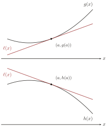
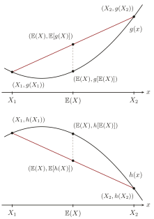

[上一篇](/lecture-notes/probability-inequalities-examples/)介紹車諾夫不等式，以[動差母函數](/lecture-notes/moment-generating-functions/#def-mgf)為工具，替尾機率取得比[柴比雪夫不等式](/lecture-notes/probability-inequalities/#thm-chebyshev)更緊的上界。從[馬可夫不等式](/lecture-notes/probability-inequalities/#thm-markov)一路看下來，這幾篇的不等式都在做同一件事，由少量的動差資訊出發，替一個尾機率找出上界。

本篇的延森不等式換了一個比較的對象。它比較的是 $\mathbb{E}\bigl[g(X)\bigr]$ 與 $g\bigl[\mathbb{E}(X)\bigr]$，兩邊都是動差，不再是尾機率的上界，而決定這兩者大小的，是函數 $g$ 的凸性或凹性。以下先給出凸函數與凹函數的定義，再以圖示說明凸函數的切線落在函數下方、凹函數的切線落在函數上方；接著給出延森不等式與其證明，並說明它與「先平均再取函數值」和「先取函數值再平均」誰大誰小的關係；最後以三道例題示範它在算術幾何調和三種平均數、[期望值](/lecture-notes/expectation/#def-expectation)與[中位數](/lecture-notes/median/#def-median)之距離，以及 KL 訊息數非負這三個問題上的用法。

Definition 2.20 (凸函數與凹函數, convex and concave function)

(1) 若實值函數 $f(\cdot)$ 的定義域為一**凸集合 (convex set)**，在單變數的情形即為一個區間，且對其定義域中任兩點 $x, y$ 及 $t\in[0,1]$ 都具有
{: .topic-paren-item}

$$
f\bigl(t\,x+(1-t)\,y\bigr)\leqslant t\,f(x)+(1-t)\,f(y)
$$

$$
\begin{aligned}
f\bigl(t\,x+(1-t)\,y\bigr)&\leqslant t\,f(x)+(1-t)\,f(y)
\end{aligned}
$$

則 $f(\cdot)$ 為一個**凸函數 (convex function)**。
{: .topic-paren-cont}

(2) 若實值函數 $h(\cdot)$ 的定義域為一凸集合，且對其定義域中任兩點 $x, y$ 及 $t\in[0,1]$ 都具有下列不等式
{: .topic-paren-item}

$$
h\bigl(t\,x+(1-t)\,y\bigr)\geqslant t\,h(x)+(1-t)\,h(y)
$$

$$
\begin{aligned}
h\bigl(t\,x+(1-t)\,y\bigr)&\geqslant t\,h(x)+(1-t)\,h(y)
\end{aligned}
$$

則稱 $h(\cdot)$ 為一個**凹函數 (concave function)**。
{: .topic-paren-cont}

所謂凸函數是指「凸向下的函數」，我們可以將其簡化理解為「凹向上」或「凸向下」的函數；而凹函數則與之相反，是指「凹向下的函數」。

Note

部分中國大陸數學教材對函數「凸」與「凹」的命名與臺灣及英語學界相反；閱讀不同來源的中文文獻時，建議對照英文原文以避免混淆。

上述定義中，$f(\cdot)$ 若改為對其定義域中任兩相異點 $x\neq y$ 及 $t\in(0,1)$ 都具有

$$
f\bigl(t\,x+(1-t)\,y\bigr)<t\,f(x)+(1-t)\,f(y)
$$

則 $f(\cdot)$ 稱為**嚴格凸函數 (strictly convex function)**。

同理，$h(\cdot)$ 若改為對其定義域中任兩相異點 $x\neq y$ 及 $t\in(0,1)$ 都具有

$$
h\bigl(t\,x+(1-t)\,y\bigr)>t\,h(x)+(1-t)\,h(y)
$$

則 $h(\cdot)$ 稱為**嚴格凹函數 (strictly concave function)**。

Note

當函數可微時，**凸函數圖形上任一點的切線必位於該函數下方**，而**凹函數圖形上任一點的切線必位於該函數上方**；[Fig. 2.21](#fig-convexity-tangent) 的上下面板分別展示這兩項性質。

<figure id="fig-convexity-tangent" class="topic-figure topic-figure--wide">
  
  <figcaption>Fig. 2.21. 上下兩個面板共用同一段橫軸範圍與同一個縱向比例尺。上面的面板是凸函數 $g(x)$，通過 $(a, g(a))$ 的切線 $\ell(x)$ 除該點之外都在曲線下方；下面的面板是凹函數 $h(x)$，通過 $(a, h(a))$ 的切線 $\ell(x)$ 除該點之外都在曲線上方。</figcaption>
</figure>

由上方面板可見，通過 $\bigl(a, g(a)\bigr)$ 的切線 $\ell(x)=g^{\prime}(a)\bigl(x-a\bigr)+g(a)$ 處處落在凸函數 $g(x)$ 下方，亦即對定義域內所有 $x$ 皆滿足 $g(x)\geqslant g^{\prime}(a)(x-a)+g(a)$；下方面板中通過 $\bigl(a, h(a)\bigr)$ 的切線 $\ell(x)=h^{\prime}(a)\bigl(x-a\bigr)+h(a)$ 則處處落在凹函數 $h(x)$ 上方，兩者的不等號方向恰好相反。

凸函數與凹函數是特殊的函數，在機率不等式具有許多應用，見[下列定理](#thm-jensen)。

Theorem 2.36 (延森不等式, Jensen’s inequality)

若 $X$ 為一[隨機變數](/lecture-notes/random-variables-and-pmf/#def-random-variable)，且 $\mathbb{E}(X)$ 為有限，則有以下二個性質:

(1) 若令 $g(\cdot)$ 為一凸函數，則有
{: .topic-paren-item}

$$
\mathbb{E}\bigl[g(X)\bigr]\geqslant g\bigl[\mathbb{E}(X)\bigr]
$$

(2) 若令 $h(\cdot)$ 為一凹函數，則有
{: .topic-paren-item}

$$
\mathbb{E}\bigl[h(X)\bigr]\leqslant h\bigl[\mathbb{E}(X)\bigr]
$$

**Proof.**

(1) 令 $g(\cdot)$ 為一個凸函數。依 [Definition 2.20](#def-convex-concave)，$g$ 的定義域為一個區間，記為 $D$；$g(X)$ 要有定義，$X$ 必須以機率 $1$ 落在 $D$ 之內，因此 $\mathbb{E}(X)$ 只可能是 $D$ 的端點或內點。若 $\mathbb{E}(X)$ 恰為 $D$ 的端點，則 $X-\mathbb{E}(X)$ 以機率 $1$ 不改變正負號，故 $\lvert X-\mathbb{E}(X)\rvert$ 為非負隨機變數而其期望值為 $0$，對任意 $\varepsilon>0$ 由[馬可夫不等式](/lecture-notes/probability-inequalities/#thm-markov)可得 $\mathbb{P}\bigl(\lvert X-\mathbb{E}(X)\rvert\geqslant\varepsilon\bigr)=0$，故 $X$ 以機率 $1$ 等於 $\mathbb{E}(X)$，不等式兩側相等；以下設 $\mathbb{E}(X)$ 落在 $D$ 的內部。
{: .topic-paren-item}

[Fig. 2.21](#fig-convexity-tangent) 畫的是可微的情形，凸函數卻未必處處可微，以下改用不要求可微的支撐直線。凸函數在其定義域的內部，每一點 $a$ 都有一條**支撐直線 (supporting line)**，也就是通過 $\bigl(a,\,g(a)\bigr)$ 而在整個 $D$ 上都不高於 $g$ 的直線。取通過 $\bigl(\mathbb{E}(X),\,g[\mathbb{E}(X)]\bigr)$ 的支撐直線，並記其斜率為 $s$，則有
{: .topic-paren-cont}

$$
g(X)\geqslant s\,\bigl(X-\mathbb{E}(X)\bigr)+g\bigl[\mathbb{E}(X)\bigr]
$$

其中 $g$ 於 $\mathbb{E}(X)$ 可微時 $s=g^{\prime}\bigl[\mathbb{E}(X)\bigr]$，這條支撐直線就是切線，與 [Fig. 2.21](#fig-convexity-tangent) 上面的面板所畫的同型，只是切點取在 $\mathbb{E}(X)$。兩側同取期望值 (期望值 $\mathbb{E}\bigl[g(X)\bigr]$ 必定有意義，理由見證明之後的 [Note](#note-jensen-supporting-line))，可得
{: .topic-paren-cont}

$$
\begin{aligned}
\mathbb{E}\bigl[g(X)\bigr]&\geqslant\mathbb{E}\Bigl[s\,\bigl(X-\mathbb{E}(X)\bigr)+g\bigl[\mathbb{E}(X)\bigr]\Bigr]\\[0.45em]
&=s\,\mathbb{E}\bigl[X-\mathbb{E}(X)\bigr]+g\bigl[\mathbb{E}(X)\bigr]\\[0.45em]
&=g\bigl[\mathbb{E}(X)\bigr]
\end{aligned}
$$

$$
\begin{aligned}
\mathbb{E}\bigl[g(X)\bigr]&\geqslant\mathbb{E}\Bigl[s\,\bigl(X-\mathbb{E}(X)\bigr)+g\bigl[\mathbb{E}(X)\bigr]\Bigr]\\[0.45em]
&=s\,\mathbb{E}\bigl[X-\mathbb{E}(X)\bigr]+g\bigl[\mathbb{E}(X)\bigr]\\[0.45em]
&=g\bigl[\mathbb{E}(X)\bigr]
\end{aligned}
$$

故可知
{: .topic-paren-cont}

$$
\mathbb{E}\bigl[g(X)\bigr]\geqslant g\bigl[\mathbb{E}(X)\bigr]
$$

(2) 令 $h(\cdot)$ 為一個凹函數，其定義域同樣為一個區間 $D$，且 $X$ 以機率 $1$ 落在 $D$ 之內；$\mathbb{E}(X)$ 恰為 $D$ 的端點時同第 (1) 款，以下設它落在 $D$ 的內部。此時 $-h$ 為凸函數，故 $h$ 在 $D$ 的內部每一點也都有一條支撐直線，只是這條直線在 $D$ 上都不低於 $h$。取通過 $\bigl(\mathbb{E}(X),\,h[\mathbb{E}(X)]\bigr)$ 的支撐直線，並記其斜率為 $s$，則有
{: .topic-paren-item}

$$
h(X)\leqslant s\,\bigl(X-\mathbb{E}(X)\bigr)+h\bigl[\mathbb{E}(X)\bigr]
$$

其中 $h$ 於 $\mathbb{E}(X)$ 可微時 $s=h^{\prime}\bigl[\mathbb{E}(X)\bigr]$，這條支撐直線就是切線，與 [Fig. 2.21](#fig-convexity-tangent) 下面的面板所畫的同型，只是切點取在 $\mathbb{E}(X)$ 處。將兩側同取期望值，即可得
{: .topic-paren-cont}

$$
\begin{aligned}
\mathbb{E}\bigl[h(X)\bigr]&\leqslant\mathbb{E}\Bigl[s\,\bigl(X-\mathbb{E}(X)\bigr)+h\bigl[\mathbb{E}(X)\bigr]\Bigr]\\[0.45em]
&=s\,\mathbb{E}\bigl[X-\mathbb{E}(X)\bigr]+h\bigl[\mathbb{E}(X)\bigr]\\[0.45em]
&=h\bigl[\mathbb{E}(X)\bigr]
\end{aligned}
$$

$$
\begin{aligned}
\mathbb{E}\bigl[h(X)\bigr]&\leqslant\mathbb{E}\Bigl[s\,\bigl(X-\mathbb{E}(X)\bigr)+h\bigl[\mathbb{E}(X)\bigr]\Bigr]\\[0.45em]
&=s\,\mathbb{E}\bigl[X-\mathbb{E}(X)\bigr]+h\bigl[\mathbb{E}(X)\bigr]\\[0.45em]
&=h\bigl[\mathbb{E}(X)\bigr]
\end{aligned}
$$

故可知
{: .topic-paren-cont}

$$
\mathbb{E}\bigl[h(X)\bigr]\leqslant h\bigl[\mathbb{E}(X)\bigr]
$$

原式得證。 $\square$
{: .topic-paren-cont}

Note

當 $g(\cdot)$ 在期望值 $\mathbb{E}(X)$ 處可微時，上述支撐直線的斜率 $s$ 即為導數 $g^{\prime}\bigl[\mathbb{E}(X)\bigr]$，該支撐直線即為切線；但因 [Definition 2.20](#def-convex-concave) 並未要求凸函數處處可微 (例如下文 [Example 2.46](#ex-mean-median-distance) 所用的絕對值函數 $g(x)=\lvert x-m\rvert$ 在 $x=m$ 處便不可微)，證明中改採不要求可微的支撐直線，使定理適用於一切凸函數與凹函數。

此外，由於凸函數 $g(X)$ 恆不低於支撐直線 $\ell(X)=s\,\bigl(X-\mathbb{E}(X)\bigr)+g\bigl[\mathbb{E}(X)\bigr]$，且在 $\mathbb{E}(X)$ 為有限的前提下必有 $\mathbb{E}\bigl[\lvert\ell(X)\rvert\bigr]<\infty$，故 $g(X)$ 取負值部分的期望值必定有限，這保證了 $\mathbb{E}\bigl[g(X)\bigr]$ 在擴充實數區間 $(-\infty,+\infty]$ 中必定有意義；凹函數滿足 $\mathbb{E}\bigl[h(X)\bigr]\in[-\infty,+\infty)$ 的理由亦完全對稱。

對照 [Definition 2.20](#def-convex-concave) 可見，凸函數與凹函數實質上是在比較兩點「**先平均再取函數值**」與「**先取函數值再平均**」的大小關係。取 $t=\frac{1}{\,2\,}$ 時最為直觀，此時 $t\,x+(1-t)\,y=\frac{1}{\,2\,}(x+y)$ 恰為兩點的算術平均，凸 (凹) 函數的定義即指出「先平均再取函數值」小於等於 (大於等於)「先取函數值再平均」。將兩點的加權平均 $t\,x+(1-t)\,y$ 推廣為一般機率分配下的期望值 $\mathbb{E}(X)$，便自然得到延森不等式；[Fig. 2.22](#fig-jensen-convex) 的上下兩個面板即以圖形呈現此直觀關係。

<figure id="fig-jensen-convex" class="topic-figure topic-figure--wide">
  
  <figcaption>Fig. 2.22. 上下兩個面板共用同一段橫軸範圍與同一個縱向比例尺，圖示對應的是 $X$ 只取 $X_1$ 與 $X_2$ 兩個值、機率各為 $\frac{1}{2}$ 的分配，$\mathbb{E}(X)$ 因而落在兩點的正中間。上面的面板是凸函數 $g(x)$，$\mathbb{E}[g(X)]$ 是連接 $(X_1, g(X_1))$ 與 $(X_2, g(X_2))$ 之弦的中點，落在曲線上的 $g[\mathbb{E}(X)]$ 之上；下面的面板是凹函數 $h(x)$，弦的中點 $\mathbb{E}[h(X)]$ 落在曲線上的 $h[\mathbb{E}(X)]$ 之下，不等號的方向恰好相反。兩者的落差都是圖中垂直虛線的長度。</figcaption>
</figure>

若 $X$ 為一般的機率分配，連接弦上對應的點雖未必落在正中央，但延森不等式的大小關係依然完全相同。

Example 2.45

Let $a_{1},\ldots,a_{n}$ be positive numbers whose arithmetic, geometric, and harmonic means are $m_{\sssig A}$, $m_{\sssig G}$, and $m_{\sssig H}$, respectively. Using Jensen’s inequality, prove that $m_{\sssig A}\geqslant m_{\sssig G}\geqslant m_{\sssig H}$.

令隨機變數 $X$ 滿足 $\mathbb{P}(X=a_i)=\frac{1}{\,n\,}$，$i=1,\ldots,n$，且令 $h(x)=\ln x$，$x>0$，則 $h(x)$ 為一個凹函數，依[延森不等式](#thm-jensen)可知

$$
\mathbb{E}(\ln X)\leqslant\ln\bigl(\mathbb{E}(X)\bigr)
$$

而上式兩側分別為

$$
\begin{gathered}
\mathbb{E}\bigl(\ln X\bigr)=\frac{1}{\,n\,}(\ln a_1+\cdots+\ln a_n)=\ln m_{\sssig G}\\[0.45em]
\ln\bigl(\mathbb{E}(X)\bigr)=\ln\Bigl[\frac{1}{\,n\,}\bigl(a_1+\cdots+a_n\bigr)\Bigr]=\ln m_{\sssig A}
\end{gathered}
$$

$$
\begin{aligned}
\mathbb{E}\bigl(\ln X\bigr)&=\frac{1}{\,n\,}(\ln a_1+\cdots+\ln a_n)\\[0.2em]
&=\ln m_{\sssig G}
\end{aligned}
$$

$$
\begin{aligned}
\ln\bigl(\mathbb{E}(X)\bigr)&=\ln\Bigl[\frac{1}{\,n\,}\bigl(a_1+\cdots+a_n\bigr)\Bigr]\\[0.2em]
&=\ln m_{\sssig A}
\end{aligned}
$$

故可知 $\ln m_{\sssig G}\leqslant\ln m_{\sssig A}$，即

$$
m_{\sssig A}\geqslant m_{\sssig G}
$$

此即**算幾不等式 (AM-GM inequality)**。又依調和平均數之定義可知

$$
\frac{1}{\,m_{\sssig H}\,}=\frac{1}{\,n\,}\sum_{i=1}^{n}\frac{1}{\,a_i\,}
$$

則由算幾不等式可知

$$
\frac{1}{\,m_{\sssig H}\,}=\frac{1}{\,n\,}\sum_{i=1}^{n}\frac{1}{\,a_i\,}\geqslant\biggl(\prod_{i=1}^{n}\frac{1}{\,a_i\,}\biggr)^{\frac{1}{\,n\,}}=\frac{1}{\,\bigl(\prod_{i=1}^{n}a_i\bigr)^{\frac{1}{\,n\,}}\,}=\frac{1}{\,m_{\sssig G}\,}
$$

$$
\begin{aligned}
\frac{1}{\,m_{\sssig H}\,}&=\frac{1}{\,n\,}\sum_{i=1}^{n}\frac{1}{\,a_i\,}\\[0.45em]
&\geqslant\biggl(\prod_{i=1}^{n}\frac{1}{\,a_i\,}\biggr)^{\frac{1}{\,n\,}}\\[0.45em]
&=\frac{1}{\,\bigl(\prod_{i=1}^{n}a_i\bigr)^{\frac{1}{\,n\,}}\,}\\[.45em]
&=\frac{1}{\,m_{\sssig G}\,}
\end{aligned}
$$

即 $m_{\sssig G}\geqslant m_{\sssig H}$，故合併算幾不等式可知

$$
m_{\sssig A}\geqslant m_{\sssig G}\geqslant m_{\sssig H}
$$

Example 2.46

Let $X$ be a continuous random variable with mean $\mu$, median $m$, and standard deviation $\sigma$. Show that the mean is within one standard deviation of the median, that is, $\lvert\mu-m\rvert\leqslant\sigma$.

令 $g(x)=\lvert x-m\rvert$，$\forall x\in\mathbb{R}$，則 $g(x)$ 為凸函數，由[延森不等式](#thm-jensen)知

$$
\lvert\mu-m\rvert=\bigl\lvert\mathbb{E}(X)-m\bigr\rvert\leqslant\mathbb{E}\bigl[\lvert X-m\rvert\bigr]\leqslant\mathbb{E}\bigl[\lvert X-\mu\rvert\bigr]
$$

$$
\begin{aligned}
\lvert\mu-m\rvert&=\bigl\lvert\mathbb{E}(X)-m\bigr\rvert\\[0.45em]
&\leqslant\mathbb{E}\bigl[\lvert X-m\rvert\bigr]\\[0.45em]
&\leqslant\mathbb{E}\bigl[\lvert X-\mu\rvert\bigr]
\end{aligned}
$$

又令 $h(x)=\sqrt{x}$，$\forall x\geqslant0$，則實值函數 $h(x)$ 為一個凹函數，再次套用[延森不等式](#thm-jensen)即可得到下式

$$
\mathbb{E}\bigl[\lvert X-\mu\rvert\bigr]=\mathbb{E}\Bigl[\sqrt{(X-\mu)^{2}}\Bigr]\leqslant\sqrt{\mathbb{E}\bigl[(X-\mu)^{2}\bigr]}=\sqrt{\sigma^{2}}=\sigma
$$

$$
\begin{aligned}
\mathbb{E}\bigl[\lvert X-\mu\rvert\bigr]&=\mathbb{E}\Bigl[\sqrt{(X-\mu)^{2}}\Bigr]\\[0.45em]
&\leqslant\sqrt{\mathbb{E}\bigl[(X-\mu)^{2}\bigr]}\\[0.45em]
&=\sqrt{\sigma^{2}}=\sigma
\end{aligned}
$$

故可知

$$
\lvert\mu-m\rvert\leqslant\sigma
$$

Note

前文在[坎特利不等式的討論](/lecture-notes/probability-inequalities/#note-median-mean-distance)中已由單尾機率界限推得同一結論，亦即任意具備有限二階動差的分配，其中位數與期望值的距離必不超過一個[標準差](/lecture-notes/variance-standard-deviation/#def-standard-deviation)。本題改以延森不等式給出另一種證明，並於第一步的第二個不等號運用了 [Theorem 2.17](/lecture-notes/median/#thm-median-minimizes-absolute-deviation) 中「中位數使絕對離差期望值 $\mathbb{E}\bigl[\lvert X-a\rvert\bigr]$ 最小」的性質。

Example 2.47

Let $f_{0}$ and $f_{1}$ be two probability density functions. The Kullback-Leibler information number is defined as

$$
K(f_{0}, f_{1})=\mathbb{E}_{0}\biggl[\ln\frac{\,f_{0}(X)\,}{f_{1}(X)}\biggr]=\int_{\lbrace f_{0}>0\rbrace}\ln\frac{\,f_{0}(x)\,}{f_{1}(x)}\,f_{0}(x)\,dx
$$

$$
\begin{aligned}
K(&f_{0}, f_{1})=\mathbb{E}_{0}\biggl[\ln\frac{\,f_{0}(X)\,}{f_{1}(X)}\biggr]\\[0.45em]
&=\int_{\lbrace f_{0}>0\rbrace}\ln\frac{\,f_{0}(x)\,}{f_{1}(x)}\,f_{0}(x)\,dx
\end{aligned}
$$

Show that $K(f_{0}, f_{1})\geqslant0$.

在 $\lbrace f_{0}>0\rbrace$ 的範圍內，不妨設 $f_{1}(x)>0$ 成立 (若 $f_{1}(x)$ 在某個使 $f_{0}(x)>0$ 的正機率區域上為零，則 $K(f_{0}, f_{1})=\infty\geqslant0$ 自然成立)。令 $W=\frac{\,f_{1}(X)\,}{\,f_{0}(X)\,}$，則

$$
K(f_{0}, f_{1})=\mathbb{E}_{0}\biggl[\ln\frac{\,f_{0}(X)\,}{f_{1}(X)}\biggr]=\mathbb{E}_{0}\biggl(\ln\frac{1}{\,W\,}\biggr)=\mathbb{E}_{0}\bigl(-\ln W\bigr)
$$

$$
\begin{aligned}
K(f_{0}, f_{1})&=\mathbb{E}_{0}\biggl[\ln\frac{\,f_{0}(X)\,}{f_{1}(X)}\biggr]\\[0.45em]
&=\mathbb{E}_{0}\biggl(\ln\frac{1}{\,W\,}\biggr)\\[.45em]
&=\mathbb{E}_{0}\bigl(-\ln W\bigr)
\end{aligned}
$$

若令 $g(y)=-\ln y$，則 $g(y)$ 為一個凸函數，由[延森不等式](#thm-jensen)可以得到下式

$$
\begin{aligned}
\mathbb{E}_{0}(-\ln W)&\geqslant-\ln\bigl[\mathbb{E}_{0}(W)\bigr]=-\ln\biggl[\int_{\lbrace f_{0}>0\rbrace}\frac{\,f_{1}(x)\,}{\,f_{0}(x)\,}\,f_{0}(x)\,dx\biggr]\\[0.45em]
&=-\ln\biggl[\int_{\lbrace f_{0}>0\rbrace}f_{1}(x)\,dx\biggr]
\end{aligned}
$$

$$
\begin{aligned}
&\mathbb{E}_{0}(-\ln W)\geqslant-\ln\bigl[\mathbb{E}_{0}(W)\bigr]\\[0.45em]
&=-\ln\biggl[\int_{\lbrace f_{0}>0\rbrace}\frac{\,f_{1}(x)\,}{\,f_{0}(x)\,}\,f_{0}(x)\,dx\biggr]\\[0.45em]
&=-\ln\biggl[\int_{\lbrace f_{0}>0\rbrace}f_{1}(x)\,dx\biggr]
\end{aligned}
$$

又因 $f_{1}$ 為機率密度函數，其在集合 $\lbrace f_{0}>0\rbrace$ 上的積分不會超過在整條實數線上的積分，亦即有

$$
\int_{\lbrace f_{0}>0\rbrace}f_{1}(x)\,dx\leqslant\int_{-\infty}^{\infty}f_{1}(x)\,dx=1
$$

$$
\begin{aligned}
\int_{\lbrace f_{0}>0\rbrace}f_{1}(x)\,dx&\leqslant\int_{-\infty}^{\infty}f_{1}(x)\,dx=1
\end{aligned}
$$

而 $-\ln(\cdot)$ 為遞減函數，故可知

$$
K(f_{0}, f_{1})=\mathbb{E}_{0}(-\ln W)\geqslant-\ln1=0
$$

$$
\begin{aligned}
K(f_{0}, f_{1})&=\mathbb{E}_{0}(-\ln W)\\[0.45em]
&\geqslant-\ln1=0
\end{aligned}
$$

Note

本題當中的 **KL 訊息數 (Kullback-Leibler information)** 在文獻上亦常被稱作 KL 散度 (Kullback-Leibler divergence) 或**相對熵 (relative entropy)**，在機率統計領域用來描述以分配 $f_{1}$ 近似真實分配 $f_{0}$ 時的訊息損失；式中的 $\frac{\,f_{0}(x)\,}{f_{1}(x)}$ 正是概似比，因此 KL 訊息數就是對數概似比在 $f_{0}$ 之下的期望值，這也是它與數理統計中**概似比檢定 (likelihood ratio test, LRT)** 的接點。

一般通俗說明常將 KL 訊息數解讀為兩分配之間的「差異性」；但因 $K(f\_{0}, f\_{1})$ 對 $f\_{0}$ 與 $f\_{1}$ 並不對稱，亦不滿足三角不等式，並非數學意義上的距離函數，故詮釋為以 $f\_{1}$ 近似 $f\_{0}$ 所產生的「訊息損失」更為貼切。

在應用情境上，當真實分配 $f\_{0}$ 過於複雜、需改以結構較簡單或便於計算的機率模型 $f\_{1}$ 近似時，便可藉 KL 訊息數度量近似過程所損失的訊息量。相同概念亦見於機器學習的神經網路模型，此時被近似的 $f\_{0}$ 為參數量龐大的複雜模型，並以 KL 訊息數衡量簡化後的模型 $f\_{1}$ 是否仍具備與原模型相近的表現。

本題的證明同時確認 KL 訊息數恆為非負，亦即以較簡單的模型近似複雜分配時，只可能損失訊息而不會憑空增加訊息。至於等號成立的充要條件，由 $-\ln(\cdot)$ 為嚴格凸函數可知延森不等式取等號要求 $W$ 以機率 $1$ 為常數，而 $-\ln\bigl[\mathbb{E}\_{0}(W)\bigr]\geqslant0$ 取等號則要求 $\mathbb{E}\_{0}(W)=1$；兩者合起來即代表 $f\_{1}$ 與 $f\_{0}$ 幾乎處處相等，故 KL 訊息數為零恰對應兩個分配相同。

此外，式中的 $\mathbb{E}\_{0}(\cdot)$ 表以 $f\_{0}$ 作為機率密度函數 (故積分僅在值域 $\lbrace f\_{0}>0\rbrace$ 上進行) 所計算的期望值；被積式內的 $f\_{0}(X)$ 與 $f\_{1}(X)$ 則是將 $f\_{0}$ 與 $f\_{1}$ 視為一般實值函數作用於 $X$，形成轉換後的隨機變數。後文討論隨機變數的函數轉換時，將進一步說明轉換後的結果仍為隨機變數，並介紹求算其機率分配的方法。

## 本篇小結

[Definition 2.20](#def-convex-concave) 以任兩點的加權平均界定凸函數與凹函數。在定義域這個凸集合中任取兩點 $x, y$ 與權重 $t\in[0,1]$，若 $f(t\,x+(1-t)\,y)$ 不超過 $t\,f(x)+(1-t)\,f(y)$ 則 $f$ 為凸函數，不等號反向則為凹函數；兩式各自改為嚴格不等式，並把兩點限為相異、權重限於 $t\in(0,1)$ 之內，就是嚴格凸函數與嚴格凹函數。[Fig. 2.21](#fig-convexity-tangent) 以可微的情形畫出這個定義的一個特別的性質。凸函數上任一點的切線都在函數下方，凹函數上任一點的切線都在函數上方。

[Theorem 2.36](#thm-jensen) 的延森不等式，把上述性質由兩點的加權平均推廣到期望值。凸函數滿足 $\mathbb{E}[g(X)]\geqslant g[\mathbb{E}(X)]$，凹函數滿足 $\mathbb{E}[h(X)]\leqslant h[\mathbb{E}(X)]$。它與前面幾篇的不等式不同之處在於，兩側比較的都是動差，而不是尾機率的上界。證明的作法是在 $(\mathbb{E}(X), g[\mathbb{E}(X)])$ 這一點取支撐直線，先把 $g(X)$ 縮小 (或放大) 為一條直線，再對整條直線取期望值，此時一次項因 $\mathbb{E}[X-\mathbb{E}(X)]=0$ 而消去，只留下常數項；證明只用到支撐直線，不要求 $g$ 可微，而 $g$ 於該點可微時，這條支撐直線就是切線。[Fig. 2.22](#fig-jensen-convex) 的上下兩個面板則以兩點分配畫出這個落差，弦的中點對應 $\mathbb{E}[g(X)]$ 之值，曲線上的點對應 $g[\mathbb{E}(X)]$ 之值。

三道例題示範了它的用法。[Example 2.45](#ex-am-gm-hm) 對取值機率均等的隨機變數用凹函數 $\ln x$，一次得到算幾不等式，再把算幾不等式用到 $\frac{1}{a_i}$ 上便補上調和平均數；[Example 2.46](#ex-mean-median-distance) 先用凸函數 $\lvert x-m\rvert$，再用凹函數 $\sqrt{x}$，兩次延森加上中位數使絕對離差期望值最小的性質，得到期望值與中位數相距不超過一個標準差；[Example 2.47](#ex-kullback-leibler-nonnegative) 令 $W=f_{1}(X)/f_{0}(X)$ 之後對凸函數 $-\ln$ 用延森，證得 KL 訊息數非負。機率不等式在只有少量動差資訊時能給出大致的機率範圍，[下一篇](/lecture-notes/empirical-rule-bell-shaped-distributions/)轉而介紹另一種來自經驗的判斷方式，也就是經驗法則。

## 參考文獻與延伸閱讀

- 黃文璋，2010，《機率論》，二版，華泰文化。
- George Casella and Roger L. Berger. 2002. *Statistical Inference*. 2nd ed. Duxbury.
- R. Tyrrell Rockafellar. 1970. *Convex Analysis*. Princeton University Press.
