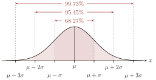

[上一篇](/lecture-notes/convexity-jensen-inequality/)由[凸函數與凹函數](/lecture-notes/convexity-jensen-inequality/#def-convex-concave)的定義出發，得到延森不等式，把一個[隨機變數](/lecture-notes/random-variables-and-pmf/#def-random-variable)經過函數轉換前後，兩個[期望值](/lecture-notes/expectation/#def-expectation)的大小關係定了下來。機率不等式這一小節到此告一段落。

本篇改由另一個方向作判斷。若已經知道一個分配的形狀大致呈鐘形，我們可以不經由不等式，直接說出期望值左右一個、兩個與三個[標準差](/lecture-notes/variance-standard-deviation/#def-standard-deviation)之內各涵蓋多少機率。以下先說明什麼是經驗法則，接著給出鐘形分配經驗法則的三個機率與兩點使用上的提醒，最後以一張圖把這三個區間的涵蓋比例畫出來。

## 經驗法則

機率不等式在僅有少量的資訊 (例如僅有期望值或[變異數](/lecture-notes/variance/#def-variance)) 下，能夠給出一個大致的機率範圍。稍早介紹的[馬可夫不等式](/lecture-notes/probability-inequalities/#thm-markov)、[柴比雪夫不等式](/lecture-notes/probability-inequalities/#thm-chebyshev)、[車諾夫不等式](/lecture-notes/probability-inequalities/#thm-chernoff)與[延森不等式](/lecture-notes/convexity-jensen-inequality/#thm-jensen)，都是只憑少量的資訊便替某個機率或某個期望值定出界限的結果。然而根據過往的經驗，我們亦能夠給出一些有用的判斷，這種方法稱作**經驗法則 (empirical rule 或 rule of thumb)**。

Theorem 2.37 (鐘形分配經驗法則, empirical rule of bell-shaped distribution)

若隨機變數 $X$ 服從常態分配，或其分配可合理地以常態分配近似，且期望值 $\mu_{\sssig X}$ 有限、變異數滿足 $0<\sigma_{\sssig X}^{2}<\infty$，則

<ol class="topic-list-paren topic-list-paren--math">
  <li>
  $$
  \mathbb{P}\bigl(\lvert X-\mu_{\sssig X}\rvert<\sigma_{\sssig X}\bigr)\fallingdotseq0.6827
  $$
  </li>
  <li>
  $$
  \mathbb{P}\bigl(\lvert X-\mu_{\sssig X}\rvert<2\,\sigma_{\sssig X}\bigr)\fallingdotseq0.9545
  $$
  </li>
  <li>
  $$
  \mathbb{P}\bigl(\lvert X-\mu_{\sssig X}\rvert<3\,\sigma_{\sssig X}\bigr)\fallingdotseq0.9973
  $$
  </li>
</ol>

鐘形分配經驗法則 (empirical rule of bell-shaped distribution) 有一些地方需要注意:

(1) 凡是「分配形狀長得像鐘」或是「分配形狀長得像土丘」，我們都稱作**鐘形分配 (bell-shaped distribution)** 或**土丘形分配 (mound-shaped distribution)**，但**這不代表它是某種確切的分配，而是一個概括的稱呼**。不過嚴格來說，單憑外觀大致對稱、中央有一個高峰，並不足以保證三個中央區間的機率都落在上述數值附近 (例如 $t$ 分配與拉普拉斯分配的外觀也呈現鐘形，但其尾端機率與常態分配仍有所差異)，因此 [Theorem 2.37](#thm-empirical-rule) 是以「常態分配或可合理以常態分配近似的分配」作為前提。
{: .topic-paren-item}

(2) 此經驗法則源自**[常態分配](/lecture-notes/normal-distribution/#def-normal) (normal distribution)**，對一般鐘形分配僅提供近似機率；當隨機變數確實服從常態分配時，上列三個數值即為將理論機率四捨五入至小數點後第四位的結果。
{: .topic-paren-item}

Note

為什麼會說這個經驗法則是從常態分配而來呢？當 $X$ 服從常態分配時，我們可將其標準化為 $Z=\frac{\,X-\mu_{\sssig X}\,}{\sigma_{\sssig X}}$ 的形式，此時 $Z$ 服從**標準常態分配 (standard normal distribution)**。若以 $\Phi(\cdot)$ 表示 $Z$ 的 [cdf](/lecture-notes/cumulative-distribution-functions/#def-cdf)，並利用標準常態分配對原點 $0$ 的對稱性 $\Phi(-k)=1-\Phi(k)$ 及連續型單點機率為零的性質，則對任意正數 $k>0$ 皆有

$$
\mathbb{P}\bigl(\lvert X-\mu_{\sssig X}\rvert<k\,\sigma_{\sssig X}\bigr)=\mathbb{P}\bigl(\lvert Z\rvert<k\bigr)=\Phi(k)-\Phi(-k)=2\,\Phi(k)-1
$$

$$
\begin{aligned}
&\mathbb{P}\bigl(\lvert X-\mu_{\sssig X}\rvert<k\,\sigma_{\sssig X}\bigr)=\mathbb{P}\bigl(\lvert Z\rvert<k\bigr)\\[.45em]
&=\Phi(k)-\Phi(-k)=2\,\Phi(k)-1
\end{aligned}
$$

將 $k=1,2,3$ 分別代入上式並四捨五入至小數點後第四位，便可得到 $0.6827$、$0.9545$ 與 $0.9973$ 這三個數值，正是 [Theorem 2.37](#thm-empirical-rule) 中的結果。關於常態分配與標準化技巧的完整介紹，將留待後續第四章常態分配再行詳述。

下面就將這個經驗法則的意涵轉化為圖形。

<figure id="fig-empirical-rule-coverage" class="topic-figure topic-figure--wide">
  
  <figcaption>Fig. 2.23. 常態分配的密度曲線與三個中央區間。以期望值 $\mu$ 為中心，左右各一個、兩個與三個標準差之內的三塊區域，面積依序約為 $0.6827$、$0.9545$ 與 $0.9973$ 這三個數值，即圖中所標示的 $68.27\%$、$95.45\%$ 與 $99.73\%$ 這三個面積比例。</figcaption>
</figure>

## 本篇小結

機率不等式只憑少量的資訊，便替某個機率或某個期望值定出界限。經驗法則的作法不同，先認定分配的形狀，再直接說出中央區間的機率。[Theorem 2.37](#thm-empirical-rule) 就是其中一個，它指出期望值左右一個、兩個與三個標準差之內的機率，依序約為 $0.6827$、$0.9545$ 與 $0.9973$；[Fig. 2.23](#fig-empirical-rule-coverage) 把這三個區間畫在同一條密度曲線之下，三塊陰影的面積正是這三個數值。

使用時有兩點要留意。其一，鐘形與土丘形只是對外觀的概括稱呼，不是某一種確切的分配，因此這三個機率能不能用，取決於該分配與常態分配的接近程度。隨機變數確實服從常態分配時，這三個機率相當準確，只是外觀像鐘則未必。其二，三個數值都是近似值，不宜當成精確的機率。[下一篇](/lecture-notes/one-to-one-transformations/)轉入隨機變數的函數轉換，說明已知 $X$ 的機率分配時，如何求出 $Y=g(X)$ 的機率分配，並以數道例題示範離散型與連續型的作法。

## 參考文獻與延伸閱讀

- 黃文璋，2010，《機率論》，二版，華泰文化。
- Dennis D. Wackerly, William Mendenhall III, and Richard L. Scheaffer. 2008. *Mathematical Statistics with Applications*. 7th ed. Thomson Brooks/Cole.
- David S. Moore, George P. McCabe, and Bruce A. Craig. 2021. *Introduction to the Practice of Statistics*. 10th ed. Macmillan Learning.
- George Casella and Roger L. Berger. 2002. *Statistical Inference*. 2nd ed. Duxbury.
