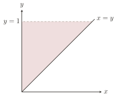

[上一篇](/lecture-notes/joint-probability-density-functions/)由[聯合累積分配函數](/lecture-notes/joint-cumulative-distribution-functions/#def-joint-cdf)的積分表示式給出[聯合機率密度函數](/lecture-notes/joint-probability-density-functions/#def-joint-pdf)的定義，並列出它應具備的[三項性質](/lecture-notes/joint-probability-density-functions/#thm-joint-pdf-proper)。在二元離散型的情形中，我們曾把[聯合機率質量函數](/lecture-notes/random-vectors-joint-pmf/#def-joint-pmf)對其中一個變數的所有可能取值加總，得到另一個變數的[邊際機率質量函數](/lecture-notes/random-vectors-joint-pmf/#def-marginal-pmf)；二元連續型[隨機向量](/lecture-notes/random-vectors-joint-pmf/#def-random-vector)無法以加總處理，如同單變數時，須改以積分完成。

本篇即依此給出邊際機率密度函數的定義，說明「沿著另一個變數的軸把聯合機率密度疊加起來」這個直觀意義，並以兩道例題示範常數的求法、兩個邊際機率密度函數的求取，以及聯合累積分配函數的分段計算。

Definition 3.6 (邊際機率密度函數, marginal pdf)

若 $(X,Y)$ 為一二元**連續型**隨機向量，其聯合機率密度函數為 $f_{\sssig XY}(x,y)$，則稱下式所定義的函數

$$
f_{\sssig X}(x)=\int_{y\in\mathcal{R}_{\sssig Y}}f_{\sssig XY}(x,y)\,dy
$$

為 $X$ 的**邊際機率密度函數 (marginal pdf)**，並稱以下的函數

$$
f_{\sssig Y}(y)=\int_{x\in\mathcal{R}_{\sssig X}}f_{\sssig XY}(x,y)\,dx
$$

為 $Y$ 的**邊際機率密度函數**。

與離散型的 [marginal pmf](/lecture-notes/random-vectors-joint-pmf/#def-marginal-pmf) 相同，marginal pdf 本身即是正規的單變數 pdf，具備[單變數 pdf](/lecture-notes/probability-density-functions/#def-pdf) 的所有性質，且積分完成後不應殘存被積掉的變數；例如 $Y$ 的 marginal pdf 不再殘留 $X$，反之亦然。

marginal pdf 的直觀意義是「沿著另一個變數的軸把原本的聯合機率密度做疊加」。以 $X$ 的邊際分配為例，即沿 $Y$ 軸將原本的聯合機率密度「壓扁」，圖示如下:

<figure id="fig-marginal-pdf-from-surface" class="topic-figure topic-figure--wide">
  
  <figcaption>Fig. 3.3. marginal pdf 是把 joint pdf 沿著另一個變數的軸積分之後所留下的函數。曲面後方左邊的那一條曲線為 $f_{\sssig Y}(y)$，右邊的那一條為 $f_{\sssig X}(x)$。</figcaption>
</figure>

在 [Fig. 3.3](#fig-marginal-pdf-from-surface) 中，沿 $Y$ 軸將整個聯合機率密度曲面「壓扁」至鉛直牆面後，原本落在同一個 $X$ 值的聯合機率密度隨之「疊加」，累積出的高度即構成 $f\_{\sssig X}(x)$ 的函數圖形；$f\_{\sssig Y}(y)$ 的情形亦同理可得。這正是「只對其中一個變數積分」的幾何直覺。

Note

觀察 [Fig. 3.3](#fig-marginal-pdf-from-surface) 可見，後牆與側牆上的 marginal pdf 主峰高度皆高於中央 joint pdf 曲面的峰頂；這是因為以 $f_{\sssig X}(x)$ 為例，每一點的高度都是將該 $x$ 座標處沿整條 $y$ 軸的聯合機率密度積分累加所得。同時，牆面上的邊際曲線在幾何型態上與單變數 pdf 完全一致，直觀呈現出「marginal pdf 仍是一個正規的單變數 pdf」。

Example 3.2

Let $(X,Y)$ be a continuous random vector with joint probability density function

$$
f_{\sssig XY}(x,y)=
\left\lbrace
\begin{array}{c@{\quad}l}
c\,xy(1-x), & 0<x<1,\ 0<y<1\\[0.5em]
0, & \text{o.w.}
\end{array}
\right.
$$

where $c$ is a constant.

<ol class="topic-list-paren">
  <li>Find the value of $c$.</li>
  <li>Find the marginal pdf of $X$ and the marginal pdf of $Y$.</li>
  <li>Find the joint cdf of $(X,Y)$.</li>
</ol>

(1) 由 [joint pdf 之性質](/lecture-notes/joint-probability-density-functions/#thm-joint-pdf-proper)可知
{: .topic-paren-item}

$$
\begin{aligned}
1&=\int_{0}^{1}\int_{0}^{1}c\,xy(1-x)\,dx\,dy=c\int_{0}^{1}\int_{0}^{1}(x-x^{2})y\,dx\,dy\\[0.45em]
&=c\int_{0}^{1}y\int_{0}^{1}(x-x^{2})\,dx\,dy=c\int_{0}^{1}y\left[\frac{1}{2}x^{2}-\frac{1}{3}x^{3}\right]_{0}^{1}\,dy\\[0.45em]
&=\frac{c}{\,6\,}\int_{0}^{1}y\,dy=\frac{c}{\,6\,}\left[\frac{1}{2}y^{2}\right]_{0}^{1}=\frac{c}{\,12\,}\qquad\therefore\, c=12
\end{aligned}
$$

$$
\begin{aligned}
1&=\int_{0}^{1}\int_{0}^{1}c\,xy(1-x)\,dx\,dy\\[0.45em]
&=c\int_{0}^{1}\int_{0}^{1}(x-x^{2})y\,dx\,dy\\[0.45em]
&=c\int_{0}^{1}y\int_{0}^{1}(x-x^{2})\,dx\,dy\\[0.45em]
&=c\int_{0}^{1}y\left[\frac{1}{2}x^{2}-\frac{1}{3}x^{3}\right]_{0}^{1}\,dy\\[0.45em]
&=\frac{c}{\,6\,}\int_{0}^{1}y\,dy=\frac{c}{\,6\,}\left[\frac{1}{2}y^{2}\right]_{0}^{1}\\[0.45em]
&=\frac{c}{\,12\,}\qquad\therefore\, c=12
\end{aligned}
$$

又 $f_{\sssig XY}(x,y)=12\,xy(1-x)\geqslant0$ 對 $0<x<1$ 與 $0<y<1$ 皆成立，故可知所求常數之值為
{: .topic-paren-cont}

$$
c=12
$$

(2) 由 [marginal pdf 之定義](#def-marginal-pdf)可知
{: .topic-paren-item}

$$
\begin{aligned}
f_{\sssig X}(x)&=\int_{0}^{1}12\,xy(1-x)\,dy=12\,x(1-x)\int_{0}^{1}y\,dy\\[0.45em]
&=12\,x(1-x)\left[\frac{1}{\,2\,}y^{2}\right]_{0}^{1}=6\,x(1-x),\ 0<x<1
\end{aligned}
$$

$$
\begin{aligned}
f_{\sssig X}(x)&=\int_{0}^{1}12\,xy(1-x)\,dy\\[0.45em]
&=12\,x(1-x)\int_{0}^{1}y\,dy\\[0.45em]
&=12\,x(1-x)\left[\frac{1}{\,2\,}y^{2}\right]_{0}^{1}\\[0.45em]
&=6\,x(1-x),\ 0<x<1
\end{aligned}
$$

由此可得
{: .topic-paren-cont}

$$
f_{\sssig X}(x)=
\left\lbrace
\begin{array}{c@{\quad}l}
6\,x(1-x), & 0<x<1\\[0.5em]
0, & \text{o.w.}
\end{array}
\right.
$$

同樣由 marginal pdf 之定義可知
{: .topic-paren-cont}

$$
\begin{aligned}
f_{\sssig Y}(y)&=\int_{0}^{1}12\,xy(1-x)\,dx=12\,y\int_{0}^{1}(x-x^{2})\,dx\\[0.45em]
&=12\,y\left[\frac{1}{2}x^{2}-\frac{1}{3}x^{3}\right]_{0}^{1}=2y,\ 0<y<1
\end{aligned}
$$

$$
\begin{aligned}
f_{\sssig Y}(y)&=\int_{0}^{1}12\,xy(1-x)\,dx\\[0.45em]
&=12\,y\int_{0}^{1}(x-x^{2})\,dx\\[0.45em]
&=12\,y\left[\frac{1}{2}x^{2}-\frac{1}{3}x^{3}\right]_{0}^{1}\\[0.45em]
&=2y,\ 0<y<1
\end{aligned}
$$

由此可得
{: .topic-paren-cont}

$$
f_{\sssig Y}(y)=
\left\lbrace
\begin{array}{c@{\quad}l}
2y, & 0<y<1\\[0.5em]
0, & \text{o.w.}
\end{array}
\right.
$$

(3) 由 [joint cdf 的定義](/lecture-notes/joint-cumulative-distribution-functions/#def-joint-cdf)可知
{: .topic-paren-item}

$$
\begin{aligned}
F_{\sssig XY}(x,y)&=\mathbb{P}(X\leqslant x,Y\leqslant y)=\int_{-\infty}^{y}\int_{-\infty}^{x}f_{\sssig XY}(t,s)\,dt\,ds\\[0.6em]
&=\left\lbrace
\begin{array}{c@{\quad}l}
0, & x\leqslant0\ \text{或}\ y\leqslant0\\[0.6em]
\int_{0}^{y}\int_{0}^{x}12\,ts(1-t)\,dt\,ds, & 0<x<1,\ 0<y<1\\[0.6em]
\int_{0}^{y}\int_{0}^{1}12\,ts(1-t)\,dt\,ds, & x\geqslant1,\ 0<y<1\\[0.6em]
\int_{0}^{1}\int_{0}^{x}12\,ts(1-t)\,dt\,ds, & 0<x<1,\ y\geqslant1\\[0.6em]
1, & x\geqslant1,\ y\geqslant1
\end{array}
\right.\\[0.6em]
&=\left\lbrace
\begin{array}{c@{\quad}l}
0, & x\leqslant0\ \text{或}\ y\leqslant0\\[0.6em]
(3-2x)x^{2}y^{2}, & 0<x<1,\ 0<y<1\\[0.6em]
y^{2}, & x\geqslant1,\ 0<y<1\\[0.6em]
3x^{2}-2x^{3}, & 0<x<1,\ y\geqslant1\\[0.6em]
1, & x\geqslant1,\ y\geqslant1
\end{array}
\right.
\end{aligned}
$$

$$
\begin{aligned}
F_{\sssig XY}(x,y)&=\mathbb{P}(X\leqslant x,Y\leqslant y)\\[0.45em]
&=\int_{-\infty}^{y}\int_{-\infty}^{x}f_{\sssig XY}(t,s)\,dt\,ds
\end{aligned}
$$

  
$=$

  

    <svg viewBox="0 0 12 12" preserveAspectRatio="none"><path d="M 11 0.8 C 7.6 0.8 6 2.4 6 5.2 L 6 12" vector-effect="non-scaling-stroke"/></svg>
    
    <svg viewBox="0 0 12 12" preserveAspectRatio="none"><path d="M 6 0 L 6 3.4 C 6 5 4.6 6 1 6 C 4.6 6 6 7 6 8.6 L 6 12" vector-effect="non-scaling-stroke"/></svg>
    
    <svg viewBox="0 0 12 12" preserveAspectRatio="none"><path d="M 6 0 L 6 6.8 C 6 9.6 7.6 11.2 11 11.2" vector-effect="non-scaling-stroke"/></svg>
  

  

    
$0,$

    
$x\leqslant0$ 或 $y\leqslant0$

    
$\int_{0}^{y}\int_{0}^{x}12\,ts(1-t)\,dt\,ds,$

    
$0<x<1,\ 0<y<1$

    
$\int_{0}^{y}\int_{0}^{1}12\,ts(1-t)\,dt\,ds,$

    
$x\geqslant1,\ 0<y<1$

    
$\int_{0}^{1}\int_{0}^{x}12\,ts(1-t)\,dt\,ds,$

    
$0<x<1,\ y\geqslant1$

    
$1,$

    
$x\geqslant1,\ y\geqslant1$

  

$$
\begin{aligned}
&=\left\lbrace
\begin{array}{c@{}l}
0, & x\leqslant0\ \text{或}\ y\leqslant0\\[0.5em]
(3-2x)x^{2}y^{2}, & 0<x<1,\ 0<y<1\\[0.5em]
y^{2}, & x\geqslant1,\ 0<y<1\\[0.5em]
3x^{2}-2x^{3}, & 0<x<1,\ y\geqslant1\\[0.5em]
1, & x\geqslant1,\ y\geqslant1
\end{array}
\right.
\end{aligned}
$$

Example 3.3

Let $(X,Y)$ be a continuous random vector with joint pdf

$$
f_{\sssig XY}(x,y)=
\left\lbrace
\begin{array}{c@{\quad}l}
k\,(x+y), & 0\leqslant x\leqslant y\leqslant 1\\[0.5em]
0, & \text{o.w.}
\end{array}
\right.
$$

<ol class="topic-list-paren">
  <li>Find the value of $k$ that makes $f_{\sssig XY}(x,y)$ a well-defined pdf.</li>
  <li>Find the marginal pdf of $X$ and the marginal pdf of $Y$.</li>
  <li>Find the joint cdf of $(X,Y)$.</li>
</ol>

(1) 本題所敘述的值域範圍如 [Fig. 3.4](#fig-triangle-range-integration)。
{: .topic-paren-item}

<figure id="fig-triangle-range-integration" class="topic-figure topic-figure--narrow">
  
  <figcaption>Fig. 3.4. 聯合值域 $0\leqslant x\leqslant y\leqslant 1$ 是斜線 $x=y$、縱軸與虛線 $y=1$ 所圍成的三角形，填色的部分即積分範圍。</figcaption>
</figure>

joint pdf 在此範圍積分結果應為 $1$，即
{: .topic-paren-cont}

$$
\begin{aligned}
1&=\int_{0}^{1}\int_{0}^{y}k\,(x+y)\,dx\,dy=k\int_{0}^{1}\int_{0}^{y}(x+y)\,dx\,dy\\[0.45em]
&=k\int_{0}^{1}\left[\frac{1}{2}x^{2}+xy\right]_{0}^{y}\,dy=k\int_{0}^{1}\frac{3}{2}y^{2}\,dy\\[0.45em]
&=k\left[\frac{1}{2}y^{3}\right]_{0}^{1}=\frac{k}{\,2\,}\qquad\therefore\, k=2
\end{aligned}
$$

$$
\begin{aligned}
1&=\int_{0}^{1}\int_{0}^{y}k\,(x+y)\,dx\,dy\\[0.45em]
&=k\int_{0}^{1}\int_{0}^{y}(x+y)\,dx\,dy\\[0.45em]
&=k\int_{0}^{1}\left[\frac{1}{2}x^{2}+xy\right]_{0}^{y}\,dy\\[0.45em]
&=k\int_{0}^{1}\frac{3}{2}y^{2}\,dy=k\left[\frac{1}{2}y^{3}\right]_{0}^{1}\\[0.45em]
&=\frac{k}{\,2\,}\qquad\therefore\, k=2
\end{aligned}
$$

又 $f_{\sssig XY}(x,y)=2\,(x+y)\geqslant0$ 對 $0\leqslant x\leqslant y\leqslant 1$ 皆成立，故所求為
{: .topic-paren-cont}

$$
k=2
$$

(2) 由 [marginal pdf 之定義](#def-marginal-pdf)可知
{: .topic-paren-item}

$$
f_{\sssig X}(x)=\int_{x}^{1}2(x+y)\,dy=2\left[xy+\frac{1}{2}y^{2}\right]_{x}^{1}=-3x^{2}+2x+1,\ 0\leqslant x\leqslant 1
$$

$$
\begin{aligned}
f_{\sssig X}(x)&=\int_{x}^{1}2(x+y)\,dy\\[0.45em]
&=2\left[xy+\frac{1}{2}y^{2}\right]_{x}^{1}\\[0.45em]
&=-3x^{2}+2x+1,\ 0\leqslant x\leqslant 1
\end{aligned}
$$

由此可得
{: .topic-paren-cont}

$$
f_{\sssig X}(x)=
\left\lbrace
\begin{array}{c@{\quad}l}
-3x^{2}+2x+1, & 0\leqslant x\leqslant 1\\[0.5em]
0, & \text{o.w.}
\end{array}
\right.
$$

  
$f_{\sssig X}(x)=$

  

    <svg viewBox="0 0 12 12" preserveAspectRatio="none"><path d="M 11 0.8 C 7.6 0.8 6 2.4 6 5.2 L 6 12" vector-effect="non-scaling-stroke"/></svg>
    
    <svg viewBox="0 0 12 12" preserveAspectRatio="none"><path d="M 6 0 L 6 3.4 C 6 5 4.6 6 1 6 C 4.6 6 6 7 6 8.6 L 6 12" vector-effect="non-scaling-stroke"/></svg>
    
    <svg viewBox="0 0 12 12" preserveAspectRatio="none"><path d="M 6 0 L 6 6.8 C 6 9.6 7.6 11.2 11 11.2" vector-effect="non-scaling-stroke"/></svg>
  

  

    
$-3x^{2}+2x+1,$

    
$0\leqslant x\leqslant 1$

    
$0,$

    
$\text{o.w.}$

  

同樣由 marginal pdf 之定義可知
{: .topic-paren-cont}

$$
f_{\sssig Y}(y)=\int_{0}^{y}2(x+y)\,dx=2\left[\frac{1}{2}x^{2}+xy\right]_{0}^{y}=3y^{2},\ 0\leqslant y\leqslant 1
$$

$$
\begin{aligned}
f_{\sssig Y}(y)&=\int_{0}^{y}2(x+y)\,dx\\[0.45em]
&=2\left[\frac{1}{2}x^{2}+xy\right]_{0}^{y}\\[0.45em]
&=3y^{2},\ 0\leqslant y\leqslant 1
\end{aligned}
$$

由此可得
{: .topic-paren-cont}

$$
f_{\sssig Y}(y)=
\left\lbrace
\begin{array}{c@{\quad}l}
3y^{2}, & 0\leqslant y\leqslant 1\\[0.5em]
0, & \text{o.w.}
\end{array}
\right.
$$

(3) 由 [joint cdf 之定義](/lecture-notes/joint-cumulative-distribution-functions/#def-joint-cdf)可知
{: .topic-paren-item}

$$
\begin{aligned}
F_{\sssig XY}(x,y)&=\mathbb{P}(X\leqslant x,Y\leqslant y)=\int_{-\infty}^{y}\int_{-\infty}^{x}f_{\sssig XY}(t,s)\,dt\,ds\\[0.6em]
&=\left\lbrace
\begin{array}{c@{\quad}l}
0, & x<0\ \text{或}\ y<0\\[0.6em]
\int_{0}^{x}\int_{t}^{y}2(t+s)\,ds\,dt, & 0\leqslant x\leqslant y\leqslant 1\\[0.6em]
\int_{0}^{x}\int_{t}^{1}2(t+s)\,ds\,dt, & 0\leqslant x\leqslant 1,\ y>1\\[0.6em]
\int_{0}^{y}\int_{0}^{s}2(t+s)\,dt\,ds, & x>y,\ 0\leqslant y\leqslant 1\\[0.6em]
1, & x\geqslant1,\ y\geqslant1
\end{array}
\right.\\[0.6em]
&=\left\lbrace
\begin{array}{c@{\quad}l}
0, & x<0\ \text{或}\ y<0\\[0.6em]
-x^{3}+yx^{2}+y^{2}x, & 0\leqslant x\leqslant y\leqslant 1\\[0.6em]
-x^{3}+x^{2}+x, & 0\leqslant x\leqslant 1,\ y>1\\[0.6em]
y^{3}, & x>y,\ 0\leqslant y\leqslant 1\\[0.6em]
1, & x\geqslant1,\ y\geqslant1
\end{array}
\right.
\end{aligned}
$$

$$
\begin{aligned}
F_{\sssig XY}(x,y)&=\mathbb{P}(X\leqslant x,Y\leqslant y)\\[0.45em]
&=\int_{-\infty}^{y}\int_{-\infty}^{x}f_{\sssig XY}(t,s)\,dt\,ds
\end{aligned}
$$

  
$=$

  

    <svg viewBox="0 0 12 12" preserveAspectRatio="none"><path d="M 11 0.8 C 7.6 0.8 6 2.4 6 5.2 L 6 12" vector-effect="non-scaling-stroke"/></svg>
    
    <svg viewBox="0 0 12 12" preserveAspectRatio="none"><path d="M 6 0 L 6 3.4 C 6 5 4.6 6 1 6 C 4.6 6 6 7 6 8.6 L 6 12" vector-effect="non-scaling-stroke"/></svg>
    
    <svg viewBox="0 0 12 12" preserveAspectRatio="none"><path d="M 6 0 L 6 6.8 C 6 9.6 7.6 11.2 11 11.2" vector-effect="non-scaling-stroke"/></svg>
  

  

    
$0,$

    
$x<0$ 或 $y<0$

    
$\int_{0}^{x}\int_{t}^{y}2(t+s)\,ds\,dt,$

    
$0\leqslant x\leqslant y\leqslant 1$

    
$\int_{0}^{x}\int_{t}^{1}2(t+s)\,ds\,dt,$

    
$0\leqslant x\leqslant 1,\ y>1$

    
$\int_{0}^{y}\int_{0}^{s}2(t+s)\,dt\,ds,$

    
$x>y,\ 0\leqslant y\leqslant 1$

    
$1,$

    
$x\geqslant1,\ y\geqslant1$

  

$$
\begin{aligned}
&=\left\lbrace
\begin{array}{c@{}l}
0, & x<0\ \text{或}\ y<0\\[0.5em]
-x^{3}+yx^{2}+y^{2}x, & 0\leqslant x\leqslant y\leqslant 1\\[0.5em]
-x^{3}+x^{2}+x, & 0\leqslant x\leqslant 1,\ y>1\\[0.5em]
y^{3}, & x>y,\ 0\leqslant y\leqslant 1\\[0.5em]
1, & x\geqslant1,\ y\geqslant1
\end{array}
\right.
\end{aligned}
$$

Note

第 (3) 小題依 $(x,y)$ 所在區域靈活運用了富比尼定理調換積分順序。例如在 $0\leqslant x\leqslant y\leqslant 1$ 時改採先對 $s$ (由 $t$ 至 $y$)、後對 $t$ (由 $0$ 至 $x$) 積分，而在 $x>y,\ 0\leqslant y\leqslant 1$ 時則維持先對 $t$、後對 $s$ 積分，藉此免除將同一塊梯形區域拆成兩項積分的繁瑣步驟。

## 本篇小結

[Definition 3.6](#def-marginal-pdf) 把邊際分配推廣到二元連續型的情形。對二元連續型隨機向量 $(X,Y)$ 而言，把 joint pdf 對 $y$ 在 $\mathcal{R}\_{\sssig Y}$ 上積分所得的 $f_{\sssig X}(x)$ 是 $X$ 的 marginal pdf，對 $x$ 在 $\mathcal{R}\_{\sssig X}$ 上積分所得的 $f_{\sssig Y}(y)$ 則是 $Y$ 的 marginal pdf。這與離散型的 [marginal pmf](/lecture-notes/random-vectors-joint-pmf/#def-marginal-pmf) 只差在把加總換成積分。這裡的 marginal pdf 仍是一種正規的單變數 pdf，也不應殘存任何被積分的變數。

[Fig. 3.3](#fig-marginal-pdf-from-surface) 給出這件事的直觀意義。$X$ 的 marginal pdf 就是沿著 $Y$ 軸把聯合機率密度「壓扁」，原本落在同一個 $X$ 值上的那些機率密度隨之「疊加」，疊加後的高度即 $f_{\sssig X}(x)$ 的函數值。也因為是疊加，marginal pdf 的主峰高度會比 joint pdf 來得高；而它的圖形與單變數的 pdf 一模一樣，正是「marginal pdf 仍是一個 pdf」的體現。

[Example 3.2](#ex-joint-pdf-region-basic) 的聯合值域是一個正方形，由積分為 $1$ 求得 $c=12$，再各自對一個變數積分得到 $6\,x(1-x)$ 與 $2y$ 兩個 marginal pdf，最後把平面依 $(x,y)$ 所在的範圍切成五段寫出 joint cdf。[Example 3.3](#ex-joint-pdf-triangle-region) 的聯合值域則是 [Fig. 3.4](#fig-triangle-range-integration) 的三角形，積分的上下限因而隨另一個變數而變，求 $f_{\sssig X}(x)$ 時 $y$ 由 $x$ 積到 $1$，求 $f_{\sssig Y}(y)$ 時 $x$ 由 $0$ 積到 $y$；求 joint cdf 時也需要調換積分順序，這正是富比尼定理的用處。

[下一篇](/lecture-notes/region-probabilities-joint-density/)先以一道聯合值域為 $y>x>0$ 的例題求取邊際機率密度函數，再回頭比較三道例題在聯合值域與積分範圍上的差別，並以圖示說明聯合累積分配函數為何需要分段。

## 參考文獻與延伸閱讀

- 黃文璋，2010，《機率論》，二版，華泰文化。
- Sheldon Ross. 2019. *A First Course in Probability*. 10th ed. Pearson.
- Robert V. Hogg, Joseph W. McKean, and Allen T. Craig. 2019. *Introduction to Mathematical Statistics*. 8th ed. Pearson.
- George Casella and Roger L. Berger. 2002. *Statistical Inference*. 2nd ed. Duxbury.
