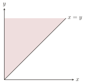
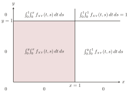
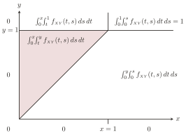
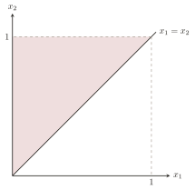
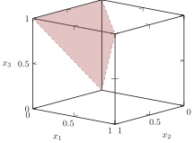
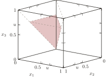

[上一篇](/lecture-notes/marginal-probability-density-functions/)把[聯合機率密度函數](/lecture-notes/joint-probability-density-functions/#def-joint-pdf)對其中一個變數積分，給出[邊際機率密度函數](/lecture-notes/marginal-probability-density-functions/#def-marginal-pdf)的定義，並以兩道例題示範常數、邊際 pdf 與 joint cdf 的求法。本篇先看第三道同型例題，再把三題放在一起，比較它們的聯合值域各自有什麼特色。

三道例題的差別，全在於聯合值域是不是一個積空間。是積空間的那一題，joint cdf 的積分範圍可以用九宮格把整個平面完全切開；不是積空間的那兩題，分段的方式就要依值域的邊界決定。本篇各取一題畫成分區圖，說明 joint cdf 為何必須分段給出。

本篇最後的兩道例題，把注意力由聯合值域轉到所求的事件本身。兩題的聯合值域都很單純，一個是整個平面，一個是單位正方形與單位立方體，但所求的範圍分別是圓盤、半平面與由大小順序所決定的區域，都不是矩形。處理的辦法都一樣，先把機率寫成該範圍上的重積分，再換一個較容易計算的座標系，或者直接取該範圍在值域中的佔比。

Example 3.4

Suppose the joint pdf of $X$ and $Y$ is

$$
f_{\sssig XY}(x,y)=
\left\lbrace
\begin{array}{c@{\quad}l}
e^{-y}, & y>x>0\\[0.4em]
0, & \text{o.w.}
\end{array}
\right.
$$

<ol class="topic-list-paren">
  <li>Find the marginal pdf of $X$.</li>
</ol>

(1) 本題所敘述的值域範圍如下圖所示
{: .topic-paren-item}

<figure id="fig-exponential-range-integration" class="topic-figure topic-figure--wide">
  
  <figcaption>Fig. 3.5. 填色的一塊是聯合值域，左界是縱軸，下界是直線 $x=y$，因此 $y$ 恆大於 $x$。</figcaption>
</figure>

故由 [marginal pdf 之定義](/lecture-notes/marginal-probability-density-functions/#def-marginal-pdf)可知
{: .topic-paren-cont}

$$
f_{\sssig X}(x)=\int_{x}^{\infty}e^{-y}\,dy=\Bigl[-e^{-y}\Bigr]_{x}^{\infty}=e^{-x},\quad x>0
$$

$$
\begin{aligned}
f_{\sssig X}(x)&=\int_{x}^{\infty}e^{-y}\,dy=\Bigl[-e^{-y}\Bigr]_{x}^{\infty}\\[0.45em]
&=e^{-x},\quad x>0
\end{aligned}
$$

由此可得
{: .topic-paren-cont}

$$
f_{\sssig X}(x)=
\left\lbrace
\begin{array}{c@{\quad}l}
e^{-x}, & x>0\\[0.4em]
0, & \text{o.w.}
\end{array}
\right.
$$

比較 [Example 3.2](/lecture-notes/marginal-probability-density-functions/#ex-joint-pdf-region-basic) 至 [Example 3.4](#ex-joint-pdf-exponential-region) 可見幾項結構差異。回顧 [Example 3.2](/lecture-notes/marginal-probability-density-functions/#ex-joint-pdf-region-basic) 的計算結果，其 joint pdf 恰為兩個 marginal pdf 的乘積，且聯合值域是由兩個邊際值域共同構成的積空間。後文將會說明，同時滿足此二條件即代表 $X$ 與 $Y$ 為**[獨立隨機變數](/lecture-notes/independent-random-variables/#def-indep-r-v) (independent random variables)**；相對地，[Example 3.3](/lecture-notes/marginal-probability-density-functions/#ex-joint-pdf-triangle-region) 與 [Example 3.4](#ex-joint-pdf-exponential-region) 的聯合值域皆非積空間，兩變數顯然不獨立。

此外，[Example 3.4](#ex-joint-pdf-exponential-region) 的函數式 $e^{-y}$ 在值域條件之外雖未顯含變數 $x$，但因值域條件 $y>x>0$ 同時限制了 $x$ 與 $y$ 的範圍，該函數仍是 $(X,Y)$ 的 joint pdf，而非 $Y$ 自身的 marginal pdf。

在 [Example 3.2](/lecture-notes/marginal-probability-density-functions/#ex-joint-pdf-region-basic) 與 [Example 3.3](/lecture-notes/marginal-probability-density-functions/#ex-joint-pdf-triangle-region) 求取 joint cdf 時，則須依 $(x,y)$ 所在位置分區討論。由於 **joint cdf 是定義在整個 $\mathbb{R}^{2}$ 平面上的函數，平面上任一點 $(x,y)$ 都需要有對應的函數值**，而當 $(x,y)$ 落在不同區域時，積分上下限與函數形式隨之改變。以聯合值域為積空間的 [Example 3.2](/lecture-notes/marginal-probability-density-functions/#ex-joint-pdf-region-basic) 為例，可沿正方形邊界將平面劃分為九宮格逐區計算，如下圖所示:

<figure id="fig-product-space-nine-regions" class="topic-figure topic-figure--wide">
  
  <figcaption>Fig. 3.6. 縱線 $x=1$ 與橫線 $y=1$ 把平面切成九塊，填色的正方形就是聯合值域，每一塊所標的二重積分就是該處的 joint cdf，$x<0$ 與 $y<0$ 之處取值皆為 $0$。</figcaption>
</figure>

分區討論的依據可對照前文的 [Fig. 3.1](/lecture-notes/joint-cumulative-distribution-functions/#fig-joint-cdf-quadrants)。由於 joint cdf 代表**點 $(x,y)$ 左下方所圍出區域的機率**，必須先確定**目前 $(x,y)$ 所在的位置**，才能判斷其左下角區域所包含之**有機率的部分**為何。至於聯合值域為三角形的 [Example 3.3](/lecture-notes/marginal-probability-density-functions/#ex-joint-pdf-triangle-region)，第一象限則須沿斜線 $x=y$ 與邊界 $x=1,\ y=1$ 切分如下圖:

<figure id="fig-non-product-space-regions" class="topic-figure topic-figure--wide">
  
  <figcaption>Fig. 3.7. 填色的三角形是聯合值域，斜線 $x=y$、橫線 $y=1$ 與縱線 $x=1$ 把第一象限分成四塊，每一塊所標的二重積分就是該處的 joint cdf，$x<0$ 與 $y<0$ 之處取值皆為 $0$。</figcaption>
</figure>

上述兩張分區圖所標示的各塊區域，即對應 **joint cdf 分段表示式中的各個範圍**；正因**不同範圍內所包含之有機率的部分不同，對應的積分式亦隨之相異**，求取 joint cdf 時必須完整分段給出。

Example 3.5

Suppose $X$ and $Y$ are independent random variables each having the standard normal density $\mathcal{N}(0,1)$, i.e.,

$$
X,Y\overset{\mathrm{iid}}{\sim}f_{\sssig X}(x)=\frac{1}{\,\sqrt{2\pi}\,}e^{\frac{\,-x^{2}\,}{2}},\quad -\infty<x<\infty
$$

$$
\begin{aligned}
X,Y\overset{\mathrm{iid}}{\sim}f_{\sssig X}(x)&=\frac{1}{\,\sqrt{2\pi}\,}e^{\frac{\,-x^{2}\,}{2}},\\[0.45em]
&\qquad-\infty<x<\infty
\end{aligned}
$$

<ol class="topic-list-paren">
  <li>Find the probability that $X^{2}+Y^{2}\leqslant 1$.</li>
  <li>Find the probability that $X\geqslant Y$.</li>
</ol>

(1) 由於
{: .topic-paren-item}

$$
X,Y\overset{\mathrm{iid}}{\sim}f_{\sssig X}(x)=\frac{1}{\,\sqrt{2\pi}\,}e^{\frac{\,-x^{2}\,}{2}},\quad -\infty<x<\infty
$$

$$
\begin{aligned}
X,Y\overset{\mathrm{iid}}{\sim}f_{\sssig X}(x)&=\frac{1}{\,\sqrt{2\pi}\,}e^{\frac{\,-x^{2}\,}{2}},\\[0.45em]
&\qquad-\infty<x<\infty
\end{aligned}
$$

故知道
{: .topic-paren-cont}

$$
f_{\sssig XY}(x,y)=f_{\sssig X}(x)\,f_{\sssig Y}(y)=\frac{1}{\,2\pi\,}e^{\frac{\,-(x^{2}+y^{2})\,}{2}},\quad x,y\in\mathbb{R}
$$

$$
\begin{aligned}
f_{\sssig XY}(x,y)&=f_{\sssig X}(x)\,f_{\sssig Y}(y)\\[0.45em]
&=\frac{1}{\,2\pi\,}e^{\frac{\,-(x^{2}+y^{2})\,}{2}},\quad x,y\in\mathbb{R}
\end{aligned}
$$

若令 $A=\lbrace\,(x,y)\mid x^{2}+y^{2}\leqslant 1\,\rbrace$ 這個集合，則有
{: .topic-paren-cont}

$$
\mathbb{P}(X^{2}+Y^{2}\leqslant 1)=\iint_{A}f_{\sssig XY}(x,y)\,dx\,dy
$$

又依照極座標轉換 (polar coordinates transformation)，可令
{: .topic-paren-cont}

$$
\left\lbrace
\begin{array}{l}
x=r\,\cos\theta\\[0.35em]
y=r\,\sin\theta
\end{array}
\right.
$$

則有
{: .topic-paren-cont}

$$
\mathbf{J}=
\left\lvert
\begin{array}{cc}
\dfrac{\partial x}{\partial r} & \dfrac{\partial x}{\partial\theta}\\[0.8em]
\dfrac{\partial y}{\partial r} & \dfrac{\partial y}{\partial\theta}
\end{array}
\right\rvert=r
$$

可將 $A$ 以 $(r,\theta)$ 表示為
{: .topic-paren-cont}

$$
A=\lbrace\,(x,y)\mid x^{2}+y^{2}\leqslant 1\,\rbrace=\lbrace\,(r,\theta)\mid 0\leqslant r\leqslant 1,\ 0\leqslant\theta\leqslant 2\pi\,\rbrace
$$

$$
\begin{aligned}
A&=\lbrace\,(x,y)\mid x^{2}+y^{2}\leqslant 1\,\rbrace\\[0.45em]
&=\lbrace\,(r,\theta)\mid 0\leqslant r\leqslant 1,\\[0.2em]
&\qquad\quad 0\leqslant\theta\leqslant 2\pi\,\rbrace
\end{aligned}
$$

故我們有
{: .topic-paren-cont}

$$
\begin{aligned}
\mathbb{P}(X^{2}+Y^{2}\leqslant 1)&=\iint_{A}f_{\sssig XY}(x,y)\,dx\,dy=\int_{0}^{2\pi}\!\!\int_{0}^{1}\frac{1}{\,2\pi\,}e^{\frac{\,-r^{2}\,}{2}}\,r\,dr\,d\theta\\[0.45em]
&=\frac{1}{\,2\pi\,}\left(\int_{0}^{2\pi}d\theta\right)\left(\int_{0}^{1}e^{\frac{\,-r^{2}\,}{2}}\,d\frac{\,r^{2}\,}{2}\right)=1-e^{\frac{\,-1\,}{2}}
\end{aligned}
$$

$$
\begin{aligned}
\mathbb{P}(X^{2}+Y^{2}\leqslant 1)&=\iint_{A}f_{\sssig XY}(x,y)\,dx\,dy\\[0.45em]
&=\int_{0}^{2\pi}\!\!\int_{0}^{1}\frac{1}{\,2\pi\,}e^{\frac{\,-r^{2}\,}{2}}\,r\,dr\,d\theta\\[0.45em]
&=\frac{1}{\,2\pi\,}\left(\int_{0}^{2\pi}d\theta\right)\left(\int_{0}^{1}e^{\frac{\,-r^{2}\,}{2}}\,d\frac{\,r^{2}\,}{2}\right)\\[0.45em]
&=1-e^{\frac{\,-1\,}{2}}
\end{aligned}
$$

(2) 令 $B=\lbrace\,(x,y)\mid x\geqslant y\,\rbrace$ 表所求範圍之集合，則有
{: .topic-paren-item}

$$
\mathbb{P}(X\geqslant Y)=\iint_{B}f_{\sssig XY}(x,y)\,dx\,dy
$$

又依照極座標轉換，可令
{: .topic-paren-cont}

$$
\left\lbrace
\begin{array}{l}
x=r\,\cos\theta\\[0.35em]
y=r\,\sin\theta
\end{array}
\right.
$$

則有
{: .topic-paren-cont}

$$
\mathbf{J}=
\left\lvert
\begin{array}{cc}
\dfrac{\partial x}{\partial r} & \dfrac{\partial x}{\partial\theta}\\[0.8em]
\dfrac{\partial y}{\partial r} & \dfrac{\partial y}{\partial\theta}
\end{array}
\right\rvert=r
$$

可將 $B$ 以 $(r,\theta)$ 表示為
{: .topic-paren-cont}

$$
B=\lbrace\,(x,y)\mid x\geqslant y\,\rbrace=\lbrace\,(r,\theta)\mid 0\leqslant r<\infty,\ -\tfrac{3}{4}\pi\leqslant\theta\leqslant\tfrac{1}{4}\pi\,\rbrace
$$

$$
\begin{aligned}
B&=\lbrace\,(x,y)\mid x\geqslant y\,\rbrace\\[0.45em]
&=\lbrace\,(r,\theta)\mid 0\leqslant r<\infty,\\[0.2em]
&\qquad\quad -\tfrac{3}{4}\pi\leqslant\theta\leqslant\tfrac{1}{4}\pi\,\rbrace
\end{aligned}
$$

故我們有
{: .topic-paren-cont}

$$
\begin{aligned}
\mathbb{P}(X\geqslant Y)&=\iint_{B}f_{\sssig XY}(x,y)\,dx\,dy=\int_{-\frac{3}{4}\pi}^{\frac{1}{4}\pi}\!\!\int_{0}^{\infty}\frac{1}{\,2\pi\,}e^{\frac{\,-r^{2}\,}{2}}\,r\,dr\,d\theta\\[0.45em]
&=\frac{1}{\,2\pi\,}\left(\int_{-\frac{3}{4}\pi}^{\frac{1}{4}\pi}d\theta\right)\left(\int_{0}^{\infty}e^{\frac{\,-r^{2}\,}{2}}\,d\frac{\,r^{2}\,}{2}\right)=\frac{1}{\,2\,}
\end{aligned}
$$

$$
\begin{aligned}
\mathbb{P}(X\geqslant Y)&=\iint_{B}f_{\sssig XY}(x,y)\,dx\,dy\\[0.45em]
&=\int_{-\frac{3}{4}\pi}^{\frac{1}{4}\pi}\!\!\int_{0}^{\infty}\frac{1}{\,2\pi\,}e^{\frac{\,-r^{2}\,}{2}}\,r\,dr\,d\theta\\[0.45em]
&=\frac{1}{\,2\pi\,}\left(\int_{-\frac{3}{4}\pi}^{\frac{1}{4}\pi}d\theta\right)\left(\int_{0}^{\infty}e^{\frac{\,-r^{2}\,}{2}}\,d\frac{\,r^{2}\,}{2}\right)\\[0.45em]
&=\frac{1}{\,2\,}
\end{aligned}
$$

Example 3.6

設 $X_1,X_2,X_3\overset{\mathrm{iid}}{\sim}\mathcal{U}(0,1)$ 為獨立同分配的隨機變數，回答以下問題:

<ol class="topic-list-paren">
  <li>試求 $\mathbb{P}(X_1<X_2)$。</li>
  <li>試求 $\mathbb{P}(X_1<X_2<X_3)$。</li>
  <li>試求 $\mathbb{P}(X_1<X_2<X_3<u)$，其中 $0<u<1$。</li>
</ol>

(1) **[ 法一 ]**
{: .topic-paren-item}

由題意可知
{: .topic-paren-cont}

$$
f_{\sssig X_1X_2}(x_1,x_2)=f_{\sssig X_1}(x_1)\,f_{\sssig X_2}(x_2)=1,\quad 0<x_1,x_2<1
$$

$$
\begin{aligned}
f_{\sssig X_1X_2}(x_1,x_2)&=f_{\sssig X_1}(x_1)\,f_{\sssig X_2}(x_2)=1,\\[0.45em]
&\quad 0<x_1,x_2<1
\end{aligned}
$$

則有
{: .topic-paren-cont}

$$
\mathbb{P}(X_1<X_2)=\int_{0}^{1}\!\!\int_{0}^{x_2}f_{\sssig X_1X_2}(x_1,x_2)\,dx_1\,dx_2=\int_{0}^{1}\!\!\int_{0}^{x_2}1\,dx_1\,dx_2=\Bigl[\frac{1}{\,2\,}x_2^{2}\Bigr]_{0}^{1}=\frac{1}{\,2\,}
$$

$$
\begin{aligned}
\mathbb{P}(X_1<X_2)&=\int_{0}^{1}\!\!\int_{0}^{x_2}f_{\sssig X_1X_2}(x_1,x_2)\,dx_1\,dx_2\\[0.45em]
&=\int_{0}^{1}\!\!\int_{0}^{x_2}1\,dx_1\,dx_2\\[0.45em]
&=\Bigl[\frac{1}{\,2\,}x_2^{2}\Bigr]_{0}^{1}=\frac{1}{\,2\,}
\end{aligned}
$$

**[ 法二 ]**
{: .topic-paren-cont}

本題所求範圍如下圖所示
{: .topic-paren-cont}

<figure id="fig-x1-less-than-x2-region" class="topic-figure topic-figure--wide">
  
  <figcaption>Fig. 3.8. 直線 $x_1=x_2$ 把值域切成兩塊，填色的一塊就是 $x_1<x_2$ 所對應的範圍。</figcaption>
</figure>

又因聯合分配為均勻分配，機率為所求範圍在值域中之佔比，即
{: .topic-paren-cont}

$$
\mathbb{P}(X_1<X_2)=1\times 1\times\frac{1}{\,2\,}=\frac{1}{\,2\,}
$$

(2) **[ 法一 ]**
{: .topic-paren-item}

由題意可知
{: .topic-paren-cont}

$$
f_{\sssig X_1X_2X_3}(x_1,x_2,x_3)=f_{\sssig X_1}(x_1)\,f_{\sssig X_2}(x_2)\,f_{\sssig X_3}(x_3)=1,\quad 0<x_1,x_2,x_3<1
$$

$$
\begin{aligned}
f_{\sssig X_1X_2X_3}(x_1,x_2,x_3)&=f_{\sssig X_1}(x_1)\,f_{\sssig X_2}(x_2)\,f_{\sssig X_3}(x_3)=1,\\[0.45em]
&\qquad 0<x_1,x_2,x_3<1
\end{aligned}
$$

則有
{: .topic-paren-cont}

$$
\begin{aligned}
\mathbb{P}(X_1<X_2<X_3)&=\int_{0}^{1}\!\!\int_{0}^{x_3}\!\!\int_{0}^{x_2}f_{\sssig X_1X_2X_3}(x_1,x_2,x_3)\,dx_1\,dx_2\,dx_3\\[0.45em]
&=\int_{0}^{1}\!\!\int_{0}^{x_3}\!\!\int_{0}^{x_2}1\,dx_1\,dx_2\,dx_3=\Bigl[\frac{1}{\,6\,}x_3^{3}\Bigr]_{0}^{1}=\frac{1}{\,6\,}
\end{aligned}
$$

$$
\begin{aligned}
&\mathbb{P}(X_1<X_2<X_3)\\[0.45em]
&\ =\int_{0}^{1}\!\!\int_{0}^{x_3}\!\!\int_{0}^{x_2}f_{\sssig X_1X_2X_3}(x_1,x_2,x_3)\,dx_1\,dx_2\,dx_3\\[0.45em]
&\ =\int_{0}^{1}\!\!\int_{0}^{x_3}\!\!\int_{0}^{x_2}1\,dx_1\,dx_2\,dx_3\\[0.45em]
&\ =\Bigl[\frac{1}{\,6\,}x_3^{3}\Bigr]_{0}^{1}=\frac{1}{\,6\,}
\end{aligned}
$$

**[ 法二 ]**
{: .topic-paren-cont}

本題所求範圍如下圖所示
{: .topic-paren-cont}

<figure id="fig-three-uniform-region-a" class="topic-figure topic-figure--wide">
  
  <figcaption>Fig. 3.9. 立方體之中填色的四面體，就是 $x_1<x_2<x_3$ 所對應的範圍。</figcaption>
</figure>

又因聯合分配為均勻分配，機率為所求範圍在值域中之佔比，即
{: .topic-paren-cont}

$$
\mathbb{P}(X_1<X_2<X_3)=1\times 1\times\frac{1}{\,2\,}\times 1\times\frac{1}{\,3\,}=\frac{1}{\,6\,}
$$

(3) **[ 法一 ]**
{: .topic-paren-item}

由題意可知
{: .topic-paren-cont}

$$
f_{\sssig X_1X_2X_3}(x_1,x_2,x_3)=f_{\sssig X_1}(x_1)\,f_{\sssig X_2}(x_2)\,f_{\sssig X_3}(x_3)=1,\quad 0<x_1,x_2,x_3<1
$$

$$
\begin{aligned}
f_{\sssig X_1X_2X_3}(x_1,x_2,x_3)&=f_{\sssig X_1}(x_1)\,f_{\sssig X_2}(x_2)\,f_{\sssig X_3}(x_3)=1,\\[0.45em]
&\qquad 0<x_1,x_2,x_3<1
\end{aligned}
$$

則有
{: .topic-paren-cont}

$$
\begin{aligned}
\mathbb{P}(X_1<X_2<X_3<u)&=\int_{0}^{u}\!\!\int_{0}^{x_3}\!\!\int_{0}^{x_2}f_{\sssig X_1X_2X_3}(x_1,x_2,x_3)\,dx_1\,dx_2\,dx_3\\[0.45em]
&=\int_{0}^{u}\!\!\int_{0}^{x_3}\!\!\int_{0}^{x_2}1\,dx_1\,dx_2\,dx_3=\Bigl[\frac{1}{\,6\,}x_3^{3}\Bigr]_{0}^{u}=\frac{\,u^{3}\,}{\,6\,},\quad 0<u<1
\end{aligned}
$$

$$
\begin{aligned}
&\mathbb{P}(X_1<X_2<X_3<u)\\[0.45em]
&\ =\int_{0}^{u}\!\!\int_{0}^{x_3}\!\!\int_{0}^{x_2}f_{\sssig X_1X_2X_3}(x_1,x_2,x_3)\,dx_1\,dx_2\,dx_3\\[0.45em]
&\ =\int_{0}^{u}\!\!\int_{0}^{x_3}\!\!\int_{0}^{x_2}1\,dx_1\,dx_2\,dx_3\\[0.45em]
&\ =\Bigl[\frac{1}{\,6\,}x_3^{3}\Bigr]_{0}^{u}=\frac{\,u^{3}\,}{\,6\,},\quad 0<u<1
\end{aligned}
$$

**[ 法二 ]**
{: .topic-paren-cont}

本題所求範圍如下圖所示
{: .topic-paren-cont}

<figure id="fig-three-uniform-region-b" class="topic-figure topic-figure--wide">
  
  <figcaption>Fig. 3.10. 刻度多標一個 $u$，填色四面體縮到以 $u$ 為界，就是 $x_1<x_2<x_3<u$ 所對應的範圍。</figcaption>
</figure>

又因聯合分配為均勻分配，機率為所求範圍在值域中之佔比，即
{: .topic-paren-cont}

$$
\mathbb{P}(X_1<X_2<X_3<u)=u\times u\times\frac{1}{\,2\,}\times u\times\frac{1}{\,3\,}=\frac{\,u^{3}\,}{\,6\,},\quad 0<u<1
$$

$$
\begin{aligned}
\mathbb{P}(X_1<X_2<X_3<u)&=u\times u\times\frac{1}{\,2\,}\times u\times\frac{1}{\,3\,}\\[0.45em]
&=\frac{\,u^{3}\,}{\,6\,},\quad 0<u<1
\end{aligned}
$$

## 本篇小結

[Example 3.4](#ex-joint-pdf-exponential-region) 的聯合值域是 $y>x>0$ 這個楔形，joint pdf 在其上等於 $e^{-y}$ 這個式子，對 $y$ 由 $x$ 積到無窮大之後，得到 $X$ 的邊際 pdf 為 $e^{-x}$，值域為 $x>0$。這一題的 joint pdf 除了值域範圍之外並沒有任何的 $x$，但它仍然是 $X$ 與 $Y$ 的 joint pdf，而不只是 $Y$ 自己的 marginal pdf。

把 [Example 3.2](/lecture-notes/marginal-probability-density-functions/#ex-joint-pdf-region-basic)、[Example 3.3](/lecture-notes/marginal-probability-density-functions/#ex-joint-pdf-triangle-region) 與 [Example 3.4](#ex-joint-pdf-exponential-region) 放在一起看，差別在於聯合值域是不是積空間。[Example 3.2](/lecture-notes/marginal-probability-density-functions/#ex-joint-pdf-region-basic) 的 joint pdf 是兩個 marginal pdf 的乘積，值域也是兩個邊際值域所形成的積空間，這兩個條件正是稍後要談的獨立隨機變數；另外兩題則都不是。也因為 joint cdf 是定義在 $\mathbb{R}^{2}$ 上的函數，平面上每一點都要有函數值，值域為積空間的那一題可以用九宮格把平面完全切開，值域不是積空間的那一題則要跟著邊界分段，兩張分區圖把這件事畫了出來。

[Example 3.5](#ex-independent-normal-region) 與 [Example 3.6](#ex-three-iid-uniform-order) 把重點移到所求的事件上。前者的兩個變數獨立且各服從 $\mathcal{N}(0,1)$，joint pdf 是兩個密度的乘積，所求的單位圓盤與半平面在直角座標之下都不容易積分，改用極座標之後，兩個積分分別給出 $1-e^{-\frac{1}{2}}$ 與 $\frac{1}{2}$。後者的三個變數獨立且各服從 $\mathcal{U}(0,1)$，joint pdf 在值域上恆為 $1$，逐層積分可得 $\frac{1}{2}$、$\frac{1}{6}$ 與 $\frac{u^{3}}{6}$ 三個答案；由於密度恆為 $1$，同樣三個答案也可以直接取所求範圍在值域中的佔比得到。

[下一篇](/lecture-notes/marginal-cumulative-distribution-functions/)先以兩道均勻分配序列的例題延續同樣的手法，再回到分配函數本身，介紹[邊際累積分配函數](/lecture-notes/marginal-cumulative-distribution-functions/#def-marginal-cdf)。

## 參考文獻與延伸閱讀

- 黃文璋，2010，《機率論》，二版，華泰文化。
- Sheldon Ross. 2019. *A First Course in Probability*. 10th ed. Pearson.
- Robert V. Hogg, Joseph W. McKean, and Allen T. Craig. 2019. *Introduction to Mathematical Statistics*. 8th ed. Pearson.
- George Casella and Roger L. Berger. 2002. *Statistical Inference*. 2nd ed. Duxbury.
