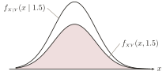

[上一篇](/lecture-notes/marginal-cumulative-distribution-functions/)補上了[邊際累積分配函數](/lecture-notes/marginal-cumulative-distribution-functions/#def-marginal-cdf)，把聯合與邊際的各個機率函數與分配函數之間的關係補齊。本篇把[隨機向量](/lecture-notes/random-vectors-joint-pmf/#def-random-vector)中的一個或多個變數固定成常數，介紹此時的機率分配，並分別給出離散型與連續型的定義。

在處理多元隨機向量時，常可先將其中部分變數暫視為常數以簡化機率計算；若進一步將一個或多個[隨機變數](/lecture-notes/random-variables-and-pmf/#def-random-variable)的取值真正固定為給定常數，其餘變數在此條件下所服從的分配即為**條件機率分配 (conditional probability distribution)**，以下詳述。

Definition 3.8 (條件機率質量函數, conditional pmf)

令 $(X,Y)$ 為二元**離散型**隨機變數，其 joint pmf 為 $p_{\sssig XY}(x,y)$。

若 $Y$ 的 marginal pmf 為 $p_{\sssig Y}(y)$，則

$$
p_{\sssig X\mid Y}(x\mid y)=\frac{\,p_{\sssig XY}(x,y)\,}{p_{\sssig Y}(y)}
$$

為 **$X$ 給定 $Y=y$ 下的條件[機率質量函數](/lecture-notes/random-variables-and-pmf/#def-pmf) (conditional pmf of $X$ given $Y=y$)**。

若 $X$ 的 marginal pmf 為 $p_{\sssig X}(x)$，則

$$
p_{\sssig Y\mid X}(y\mid x)=\frac{\,p_{\sssig XY}(x,y)\,}{p_{\sssig X}(x)}
$$

為 **$Y$ 給定 $X=x$ 下的條件機率質量函數 (conditional pmf of $Y$ given $X=x$)**。

條件機率質量函數有一些地方需要注意:

(1) conditional pmf 仍然是一種 pmf，並且這種 pmf 只有 $X$ (或 $Y$) 作為隨機變數，$Y=y$ (或 $X=x$) 則視為常數。事實上，**條件分配仍然是一種機率分配**。
{: .topic-paren-item}

(2) conditional pmf 是第一章所談到的[條件機率](/lecture-notes/conditional-probability-information/#definition-conditional-probability)，推廣至離散隨機變數的版本，其直觀意義也是相同的，即**樣本空間縮小至 $Y=y$ (或 $X=x$) 已經發生的狀況下，再來探討此時 $X=x$ (或 $Y=y$) 發生的條件機率**。
{: .topic-paren-item}

(3) 由於 conditional pmf 仍然是一種 pmf，故與 pmf 相同，**conditional pmf 本身就是機率**，而且這種機率**是一種條件機率**。我們可以由這個性質將[上述定義](#def-conditional-pmf)改寫為
{: .topic-paren-item}

$$
p_{\sssig Y\mid X}(y\mid x)=\mathbb{P}(Y=y\mid X=x)=\frac{\,\mathbb{P}(X=x,Y=y)\,}{\mathbb{P}(X=x)}
$$

$$
\begin{aligned}
p_{\sssig Y\mid X}(y\mid x)&=\mathbb{P}(Y=y\mid X=x)\\[0.45em]
&=\frac{\,\mathbb{P}(X=x,Y=y)\,}{\mathbb{P}(X=x)}
\end{aligned}
$$

(4) 既然 conditional pmf 仍是一種 pmf，便同樣具有以下三個性質:
{: .topic-paren-item}

$$
\begin{gathered}
0\leqslant p_{\sssig X\mid Y}(x\mid y)\leqslant 1,\ \forall\,x\in\mathcal{R}_{\sssig X}\\[0.5em]
\mathbb{P}\bigl(X\in\mathcal{R}_{\sssig X}\bigm\vert Y=y\bigr)=\sum_{x\in\mathcal{R}_{\sssig X}}p_{\sssig X\mid Y}(x\mid y)=1\\[0.5em]
\mathbb{P}\bigl(X\in A\bigm\vert Y=y\bigr)=\sum_{x\in A\cap\mathcal{R}_{\sssig X}}p_{\sssig X\mid Y}(x\mid y)
\end{gathered}
$$

$$
\begin{gathered}
0\leqslant p_{\sssig X\mid Y}(x\mid y)\leqslant 1,\ \forall\,x\in\mathcal{R}_{\sssig X}\\[0.5em]
\mathbb{P}\bigl(X\in\mathcal{R}_{\sssig X}\bigm\vert Y=y\bigr)=\sum_{x\in\mathcal{R}_{\sssig X}}p_{\sssig X\mid Y}(x\mid y)=1\\[0.5em]
\mathbb{P}\bigl(X\in A\bigm\vert Y=y\bigr)=\sum_{x\in A\cap\mathcal{R}_{\sssig X}}p_{\sssig X\mid Y}(x\mid y)
\end{gathered}
$$

此處隨機變數僅有 $X$ (或 $Y$)，條件中的 $Y=y$ (或 $X=x$) **已固定為常數**。
{: .topic-paren-cont}

Definition 3.9 (條件機率密度函數, conditional pdf)

令 $(X,Y)$ 為二元**連續型**隨機變數，其 joint pdf 為 $f_{\sssig XY}(x,y)$。

若 $Y$ 的 marginal pdf 為 $f_{\sssig Y}(y)$，則

$$
f_{\sssig X\mid Y}(x\mid y)=\frac{\,f_{\sssig XY}(x,y)\,}{f_{\sssig Y}(y)}
$$

為 **$X$ 給定 $Y=y$ 下的條件[機率密度函數](/lecture-notes/probability-density-functions/#def-pdf) (conditional pdf of $X$ given $Y=y$)**。

若 $X$ 的 marginal pdf 為 $f_{\sssig X}(x)$，則

$$
f_{\sssig Y\mid X}(y\mid x)=\frac{\,f_{\sssig XY}(x,y)\,}{f_{\sssig X}(x)}
$$

為 **$Y$ 給定 $X=x$ 下的條件機率密度函數 (conditional pdf of $Y$ given $X=x$)**。

條件機率密度函數有一些地方需要注意:

(1) conditional pdf 仍然是一種 pdf，並且這種 pdf 只有 $X$ (或 $Y$) 作為隨機變數，$Y=y$ (或 $X=x$) 則視為常數。但是，由於 [pdf](/lecture-notes/probability-density-functions/#def-pdf) 本身並不是機率，故 **conditional pdf 本身亦不是機率**。
{: .topic-paren-item}

(2) 既然 conditional pdf 仍是一種 pdf，便同樣具有以下三個性質:
{: .topic-paren-item}

$$
\begin{gathered}
f_{\sssig X\mid Y}(x\mid y)\geqslant 0,\ \forall\,x\in\mathcal{R}_{\sssig X}\\[0.5em]
\mathbb{P}\bigl(X\in\mathcal{R}_{\sssig X}\bigm\vert Y=y\bigr)=\int_{x\in\mathcal{R}_{\sssig X}}f_{\sssig X\mid Y}(x\mid y)\,dx=1\\[0.5em]
\mathbb{P}\bigl(X\in A\bigm\vert Y=y\bigr)=\int_{x\in A\cap\mathcal{R}_{\sssig X}}f_{\sssig X\mid Y}(x\mid y)\,dx
\end{gathered}
$$

$$
\begin{gathered}
f_{\sssig X\mid Y}(x\mid y)\geqslant 0,\ \forall\,x\in\mathcal{R}_{\sssig X}\\[0.5em]
\mathbb{P}\bigl(X\in\mathcal{R}_{\sssig X}\bigm\vert Y=y\bigr)=\int_{x\in\mathcal{R}_{\sssig X}}f_{\sssig X\mid Y}(x\mid y)\,dx=1\\[0.5em]
\mathbb{P}\bigl(X\in A\bigm\vert Y=y\bigr)=\int_{x\in A\cap\mathcal{R}_{\sssig X}}f_{\sssig X\mid Y}(x\mid y)\,dx
\end{gathered}
$$

此處隨機變數僅有 $X$ (或 $Y$)，條件中的 $Y=y$ (或 $X=x$) **已固定為常數**。
{: .topic-paren-cont}

(3) conditional pmf 可以解釋為 $Y=y$ 已經發生的事件中，$X=x$ 的條件機率，這一點在 conditional pdf 上將轉為固定在 $Y=y$ 之下來探討 $X$ 的**機率密度**，如下所示:
{: .topic-paren-item}

<figure id="fig-conditional-density-slice" class="topic-figure topic-figure--wide">
  
  <figcaption>Fig. 3.11. joint pdf 的曲面在 $Y=1.5$ 處切一刀，所得的截面就是圖中填色的那一片薄片。樣本空間縮小到這一片之上，再討論 $X$ 的機率密度，即 conditional pdf。</figcaption>
</figure>

[Fig. 3.11](#fig-conditional-density-slice) 中填色的截面代表 $Y=1.5$ 的條件空間，將範圍縮小至此空間探討 $X$ 的機率分配即對應 conditional pdf。然而，截面曲線本身僅是 $f\_{\sssig XY}(x,1.5)$，其曲線下面積等於 $f\_{\sssig Y}(1.5)$，未必為 $1$，故尚非合法的 pdf；須除以該截面處的邊際機率密度 $f\_{\sssig Y}(1.5)$，將曲線等比例「拉高」(或降低) 至曲線下面積為 $1$，方能成為正規的 pdf，如下圖所示:

<figure id="fig-conditional-density-normalize" class="topic-figure topic-figure--wide">
  
  <figcaption>Fig. 3.12. 兩條曲線的形狀完全相同，只差在高度。較低的一條是 joint pdf 在 $Y=1.5$ 處的切面 $f_{\sssig XY}(x,1.5)$，把它除以該處的邊際機率密度才拉高為 $f_{\sssig X\mid Y}(x\mid 1.5)$，成為一個合法的 pdf。</figcaption>
</figure>

Note

比較 [Fig. 3.12](#fig-conditional-density-normalize) 的兩條曲線可見，未經標準化的截面函數 $f\_{\sssig XY}(x,1.5)$ 對 $x$ 的相對高低形狀已與真正的條件密度 $f\_{\sssig X\mid Y}(x\mid 1.5)$ 完全一致，兩者僅差一個與 $x$ 無關的常數倍數 $1/f\_{\sssig Y}(1.5)$。這是因為給定 $Y=1.5$ 後，$(X,Y)$ 的相對變動即被限制在 joint pdf 曲面的單一鉛直切片上，除以邊際密度只是重新標準化使總積分為 $1$，不會改變曲線對 $x$ 的函數型態。

若想在立體曲面上實際移動切面，可在互動展示 [Conditional Slices, Side-Wall Marginals, and Area Renormalization](/demos/slice-renormalization/) 中調整切片位置 $x\_0$ 或改沿 $Y=y\_0$ 切割，同步對照側牆上的邊際密度 $f\_{\sssig X}(x\_0)$ 高度、原始截面曲線 $f\_{\sssig XY}(x\_0,y)$ 與面積標準化為 $1$ 的條件密度曲線 $f\_{\sssig Y\mid X}(y\mid x\_0)$，觀察 $f\_{\sssig X}(x\_0)<1$ 時曲線如何拉高、$f\_{\sssig X}(x\_0)>1$ 時又如何壓低。

## 本篇小結

[Definition 3.8](#def-conditional-pmf) 把條件機率推廣到二元離散型的情形。給定 $Y=y$ 之下 $X$ 的條件機率質量函數，是[聯合機率質量函數](/lecture-notes/random-vectors-joint-pmf/#def-joint-pmf)除以 $Y$ 的[邊際機率質量函數](/lecture-notes/random-vectors-joint-pmf/#def-marginal-pmf)，給定 $X=x$ 之下 $Y$ 的條件機率質量函數亦同。這種 pmf 只有 $X$ 是隨機變數，$Y=y$ 則視為常數；它本身就是機率，而且就是第一章的條件機率推廣到離散隨機變數的版本，也就是把樣本空間縮小到 $Y=y$ 已經發生的狀況下，再看 $X=x$ 發生的機率。既然它仍是一種 pmf，也就同樣具有介於 $0$ 與 $1$ 之間、在值域上加總為 $1$，以及給定 $Y=y$ 之下事件 $A$ 的條件機率為 $A\cap\mathcal{R}_{\sssig X}$ 上之加總這三個性質。

[Definition 3.9](#def-conditional-pdf) 以完全相同的形式給出二元連續型的情形。條件機率密度函數就是[聯合機率密度函數](/lecture-notes/joint-probability-density-functions/#def-joint-pdf)除以另一個變數的[邊際機率密度函數](/lecture-notes/marginal-probability-density-functions/#def-marginal-pdf)。差別在於 pdf 本身並不是機率，故 conditional pdf 也不是機率，但它同樣具有非負、在值域上積分為 $1$，以及給定 $Y=y$ 之下事件 $A$ 的條件機率為 $A\cap\mathcal{R}_{\sssig X}$ 上之積分這三個性質。

由圖形來看，固定 $Y=1.5$ 等於在 joint pdf 的曲面上切下一個截面，本篇的第一張圖畫的就是這片切面。但這片切面所給的只是 $f_{\sssig XY}(x,1.5)$ 這個式子，它未必恰巧滿足一個 pdf 該有的條件，還要除以 $Y=1.5$ 這個空間本身的邊際機率密度，才會被拉高或降低到該有的高度；第二張圖把調整前後的兩條曲線畫在一起，兩者的形狀完全相同，差別只在高度。

[下一篇](/lecture-notes/conditional-distributions-examples/)以五道例題練習條件機率質量函數與條件機率密度函數的求法，並由其中一題引出截尾分配。

## 參考文獻與延伸閱讀

- 黃文璋，2010，《機率論》，二版，華泰文化。
- Sheldon Ross. 2019. *A First Course in Probability*. 10th ed. Pearson.
- Robert V. Hogg, Joseph W. McKean, and Allen T. Craig. 2019. *Introduction to Mathematical Statistics*. 8th ed. Pearson.
- George Casella and Roger L. Berger. 2002. *Statistical Inference*. 2nd ed. Duxbury.
