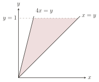

[上一篇](/lecture-notes/conditional-distributions-examples/)以五道例題示範了[條件機率質量函數](/lecture-notes/conditional-distributions/#def-conditional-pmf)與[條件機率密度函數](/lecture-notes/conditional-distributions/#def-conditional-pdf)的求法，並把條件放寬到一整段範圍，得到截尾分配。這些例題所處理的，都是在另一變數取定某值或落在某範圍後，這個變數的機率分配會變成什麼樣子。

本篇處理的則是相反的情形。若這個條件完全沒有改變原本的機率分配，也就是條件機率密度函數與[邊際機率密度函數](/lecture-notes/marginal-probability-density-functions/#def-marginal-pdf)一模一樣，那會是什麼狀況。這正是第一章[事件的獨立](/lecture-notes/independence-and-conditional-independence/#definition-117)推廣到[隨機變數](/lecture-notes/random-variables-and-pmf/#def-random-variable)之後的樣子。在進入獨立的定義之前，我們先把條件機率密度函數的定義移項，得到乘法原理的機率函數版本。

## 乘法原理

Theorem 3.3 (乘法原理, multiplication rule)

若 $(X,Y)$ 為二元隨機變數，joint pdf 為 $f_{\sssig XY}(x,y)$，且 conditional pdf 為 $f_{\sssig X\mid Y}(x\mid y)$ 及 $f_{\sssig Y\mid X}(y\mid x)$，marginal pdf 為 $f_{\sssig X}(x)$ 及 $f_{\sssig Y}(y)$，則

$$
f_{\sssig XY}(x,y)=f_{\sssig X\mid Y}(x\mid y)\,f_{\sssig Y}(y)=f_{\sssig Y\mid X}(y\mid x)\,f_{\sssig X}(x)
$$

$$
\begin{aligned}
f_{\sssig XY}(x,y)&=f_{\sssig X\mid Y}(x\mid y)\,f_{\sssig Y}(y)\\[0.45em]
&=f_{\sssig Y\mid X}(y\mid x)\,f_{\sssig X}(x)
\end{aligned}
$$

離散版本只要將其改為 pmf 即可。

這個定理即是第一章的 [Theorem 1.13](/lecture-notes/conditional-probability-information/#theorem-18) 的機率函數版本，二者的本質是一模一樣的，是由條件機率及條件機率函數的定義所轉化過來。

## 獨立隨機變數

Definition 3.10 (獨立隨機變數, independent random variables)

$X$ 與 $Y$ 是二個隨機變數，**$X$ 與 $Y$ 獨立 (independent)** 記為 $X\indep Y$，其定義與下列各關係式等價:

<ol class="topic-list-paren topic-list-paren--math">
  <li>
$$
f_{\sssig X\mid Y}(x\mid y)=f_{\sssig X}(x),\ \forall\,(x,y)\in\mathcal{R}_{\sssig XY}
$$
  </li>
  <li>
$$
f_{\sssig Y\mid X}(y\mid x)=f_{\sssig Y}(y),\ \forall\,(x,y)\in\mathcal{R}_{\sssig XY}
$$
  </li>
  <li>
$$
f_{\sssig XY}(x,y)=f_{\sssig X}(x)\,f_{\sssig Y}(y),\ \forall\,(x,y)\in\mathcal{R}_{\sssig XY}
$$
  </li>
</ol>

獨立隨機變數有一些地方需要注意:

(1) 離散版本只要將其改為 pmf 即可。
{: .topic-paren-item}

(2) 在第一章探討[事件的獨立](/lecture-notes/independence-and-conditional-independence/#definition-117)時，我們曾理解為 **$A$ 的發生並不影響 $B$ 發生的機率**，推廣到隨機變數時，其直觀意義為 **$X$ (或 $Y$) 的值為多少並不影響 $Y$ (或 $X$) 的值**。
{: .topic-paren-item}

(3) 若事件 $\lbrace\,(X,Y)\in A\,\rbrace$ 可以拆解為 $\lbrace\,X\in A_{\sssig X}\,\rbrace$ $\times$ $\lbrace\,Y\in A_{\sssig Y}\,\rbrace$ 這樣的形式，且 $X\indep Y$，則有下式
{: .topic-paren-item}

$$
\mathbb{P}\bigl((X,Y)\in A\bigr)=\mathbb{P}(X\in A_{\sssig X})\,\mathbb{P}(Y\in A_{\sssig Y})
$$

簡單的例子如下:
{: .topic-paren-cont}

$$
\begin{aligned}
\mathbb{P}(a<X<b,\ c<Y<d)&=\int_{c}^{d}\!\!\int_{a}^{b}f_{\sssig XY}(x,y)\,dx\,dy\\[0.45em]
&=\int_{c}^{d}\!\!\int_{a}^{b}f_{\sssig X}(x)\,f_{\sssig Y}(y)\,dx\,dy\\[0.45em]
&=\int_{a}^{b}f_{\sssig X}(x)\,dx\int_{c}^{d}f_{\sssig Y}(y)\,dy\\[0.45em]
&=\mathbb{P}(a<X<b)\,\mathbb{P}(c<Y<d)
\end{aligned}
$$

$$
\begin{aligned}
\mathbb{P}(a<X<b,\ c<Y<d)&=\int_{c}^{d}\!\!\int_{a}^{b}f_{\sssig XY}(x,y)\,dx\,dy\\[0.45em]
&=\int_{c}^{d}\!\!\int_{a}^{b}f_{\sssig X}(x)\,f_{\sssig Y}(y)\,dx\,dy\\[0.45em]
&=\int_{a}^{b}f_{\sssig X}(x)\,dx\int_{c}^{d}f_{\sssig Y}(y)\,dy\\[0.45em]
&=\mathbb{P}(a<X<b)\,\mathbb{P}(c<Y<d)
\end{aligned}
$$

Note

在二元離散型的機率列聯表中，每一格的數值即為聯合機率 $p\_{\sssig XY}(x,y)$，表邊的行列總和則對應邊際機率 $p\_{\sssig X}(x)$ 與 $p\_{\sssig Y}(y)$。因此依獨立定義，兩隨機變數互相獨立 ($X\indep Y$)，**若且唯若機率列聯表中的每一格皆等於其所在列與行邊際機率的乘積**，亦即對所有 $(x,y)\in\mathcal{R}\_{\sssig XY}$ (及整張表的所有格位) 皆滿足

$$
p_{\sssig XY}(x,y)=p_{\sssig X}(x)\,p_{\sssig Y}(y)
$$

(4) 上述定義可推廣至 $n$ 個隨機變數，即 $X_1,X_2,\ldots,X_n$ 互相獨立，若且唯若
{: .topic-paren-item}

$$
f_{\sssig X_1\cdots X_n}(x_1,\ldots,x_n)=\prod_{i=1}^{n}f_{\sssig X_i}(x_i)
$$

(5) 判斷一組隨機變數是否獨立時，可利用以下的分解判準。$X\indep Y$ 成立，若且唯若同時滿足下列兩項條件:
{: .topic-paren-item}

- 聯合值域 $\mathcal{R}\_{\sssig XY}$ 為積空間 (即二維矩形)
- $f\_{\sssig XY}(x,y)=g(x)\,h(y)$，且 $g(x)$ 僅為 $x$ 的函數、$h(y)$ 僅為 $y$ 的函數。

Note

此判準中的 $g(x)$ 與 $h(y)$ 不必預先標準化為 $X$ 與 $Y$ 各自的 pdf，只要能拆成僅含 $x$ 與僅含 $y$ 的兩項非負函數相乘即可 (常數倍數可在積分時重新分配)。此外，由於「兩項條件同時成立」與 $X\indep Y$ 等價，只要其中任一項條件不滿足 (例如聯合值域為三角形而非積空間，即使密度函數形式上可拆解)，即可直接判定 $X\not\indep Y$。

若想從三維截面觀察獨立時條件密度不隨給定值改變的幾何意義，可在互動展示 [Conditional Slices, Side-Wall Marginals, and Area Renormalization](/demos/slice-renormalization/) 中將參數 $\beta$ 設為 $0$ 並移動切片位置 $x\_0$，此時原始截面 $f\_{\sssig XY}(x\_0,y)$ 的高低雖隨 $f\_{\sssig X}(x\_0)$ 起伏，除以截面積後的條件密度曲線 $f\_{\sssig Y\mid X}(y\mid x\_0)$ 則處處與側牆上的邊際密度 $f\_{\sssig Y}(y)$ 完全重合。

Example 3.2 (Continued)

Let $(X,Y)$ be a continuous random vector with joint probability density function

$$
f_{\sssig XY}(x,y)=
\left\lbrace
\begin{array}{c@{\quad}l}
12\,xy(1-x), & 0<x<1,\ 0<y<1\\[0.5em]
0, & \text{o.w.}
\end{array}
\right.
$$

  
$f_{\sssig XY}(x,y)=$

  

    <svg viewBox="0 0 12 12" preserveAspectRatio="none"><path d="M 11 0.8 C 7.6 0.8 6 2.4 6 5.2 L 6 12" vector-effect="non-scaling-stroke"/></svg>
    
    <svg viewBox="0 0 12 12" preserveAspectRatio="none"><path d="M 6 0 L 6 3.4 C 6 5 4.6 6 1 6 C 4.6 6 6 7 6 8.6 L 6 12" vector-effect="non-scaling-stroke"/></svg>
    
    <svg viewBox="0 0 12 12" preserveAspectRatio="none"><path d="M 6 0 L 6 6.8 C 6 9.6 7.6 11.2 11 11.2" vector-effect="non-scaling-stroke"/></svg>
  

  

    
$12\,xy(1-x),$

    
$0<x<1,\ 0<y<1$

    
$0,$

    
$\text{o.w.}$

  

<ol class="topic-list-paren topic-list-paren--start-5">
  <li>Determine whether $X$ and $Y$ are independent.</li>
</ol>

(5) 由[獨立隨機變數](#def-indep-r-v)的快速判斷法可知
{: .topic-paren-item}

$$
f_{\sssig XY}(x,y)=12(x-x^{2})y=6(x-x^{2})\times 2y=f_{\sssig X}(x)\,f_{\sssig Y}(y)
$$

$$
\begin{aligned}
f_{\sssig XY}(x,y)&=12(x-x^{2})y\\[0.45em]
&=6(x-x^{2})\times 2y\\[0.45em]
&=f_{\sssig X}(x)\,f_{\sssig Y}(y)
\end{aligned}
$$

且 $0<x<1,\ 0<y<1$ 確實是一個積空間 $\ \Longleftrightarrow\ X\indep Y$
{: .topic-paren-cont}

Example 3.3 (Continued)

Let $(X,Y)$ be a continuous random vector with joint pdf

$$
f_{\sssig XY}(x,y)=
\left\lbrace
\begin{array}{c@{\quad}l}
2(x+y), & 0\leqslant x\leqslant y\leqslant 1\\[0.5em]
0, & \text{o.w.}
\end{array}
\right.
$$

<ol class="topic-list-paren topic-list-paren--start-5">
  <li>Are $X$ and $Y$ independent?</li>
</ol>

(5) 由[獨立隨機變數的定義](#def-indep-r-v)可知
{: .topic-paren-item}

$$
f_{\sssig XY}(x,y)\neq f_{\sssig X}(x)\,f_{\sssig Y}(y)\qquad\Longleftrightarrow\ X\not\indep Y
$$

$$
f_{\sssig XY}(x,y)\neq f_{\sssig X}(x)\,f_{\sssig Y}(y)\qquad\Longleftrightarrow\ X\not\indep Y
$$

Example 3.9 (Continued)

Let $(X_1,X_2)$ be a two-dimensional discrete random vector whose joint pmf and marginal pmfs are given in the following table.

| $X_1\backslash X_2$ | $0$ | $1$ | $2$ | $p_{\sssig X_1}(x_1)$ |
| :---: | :---: | :---: | :---: | :---: |
| $0$ | $0.2$ | $0.1$ | $0.1$ | $0.4$ |
| $1$ | $0.1$ | $0.2$ | $0.1$ | $0.4$ |
| $2$ | $0.1$ | $0.1$ | $0$ | $0.2$ |
| $p_{\sssig X_2}(x_2)$ | $0.4$ | $0.4$ | $0.2$ | $1$ |
{: .topic-table--joint-pmf}

<ol class="topic-list-paren topic-list-paren--start-3">
  <li>Are $X_1$ and $X_2$ independent?</li>
</ol>

(3) 由[獨立隨機變數之定義](#def-indep-r-v)可驗證
{: .topic-paren-item}

$$
p_{\sssig X_1X_2}(1,1)=0.2\neq p_{\sssig X_1}(1)\,p_{\sssig X_2}(1)=0.4\times 0.4=0.16
$$

$$
\Longleftrightarrow\ X_1\not\indep X_2
$$

$$
\begin{aligned}
p_{\sssig X_1X_2}(1,1)&=0.2\\[0.45em]
&\neq p_{\sssig X_1}(1)\,p_{\sssig X_2}(1)=0.4\times 0.4=0.16
\end{aligned}
$$

$$
\Longleftrightarrow\ X_1\not\indep X_2
$$

Example 3.12

Let $X$ and $Y$ denote two binary random variables, and let $\mathbb{P}(Y=j\mid X=i)$ be the conditional probability for $i,j=0,1$. Define

$$
\alpha=\frac{\,\mathbb{P}(Y=1\mid X=1)\,}{\,\mathbb{P}(Y=0\mid X=1)\,},\quad \beta=\frac{\,\mathbb{P}(Y=1\mid X=0)\,}{\,\mathbb{P}(Y=0\mid X=0)\,}
$$

$$
\begin{gathered}
\alpha=\frac{\,\mathbb{P}(Y=1\mid X=1)\,}{\,\mathbb{P}(Y=0\mid X=1)\,},\\[0.45em]
\beta=\frac{\,\mathbb{P}(Y=1\mid X=0)\,}{\,\mathbb{P}(Y=0\mid X=0)\,}
\end{gathered}
$$

and let $\theta=\frac{\,\alpha\,}{\,\beta\,}$.

<ol class="topic-list-paren">
  <li>Show that if $X$ and $Y$ are independent, then $\theta=1$.</li>
  <li>Show that $\theta$ can be expressed as
$$
\frac{\,\mathbb{P}(X=1\mid Y=1)\,\mathbb{P}(X=0\mid Y=0)\,}{\,\mathbb{P}(X=0\mid Y=1)\,\mathbb{P}(X=1\mid Y=0)\,}
$$
  </li>
  <li>Are $X$ and $Y$ independent if $\theta=1$?</li>
</ol>

(1) 若 $X\indep Y$，則可知
{: .topic-paren-item}

$$
\mathbb{P}(Y=j\mid X=i)=\mathbb{P}(Y=j),\ \forall\,i,j=0,1
$$

$$
\begin{aligned}
\mathbb{P}(Y=j\mid X=i)&=\mathbb{P}(Y=j),\\[0.45em]
&\forall\,i,j=0,1
\end{aligned}
$$

故有
{: .topic-paren-cont}

$$
\begin{gathered}
\alpha=\frac{\,\mathbb{P}(Y=1\mid X=1)\,}{\,\mathbb{P}(Y=0\mid X=1)\,}=\frac{\,\mathbb{P}(Y=1)\,}{\,\mathbb{P}(Y=0)\,}\\[0.45em]
\beta=\frac{\,\mathbb{P}(Y=1\mid X=0)\,}{\,\mathbb{P}(Y=0\mid X=0)\,}=\frac{\,\mathbb{P}(Y=1)\,}{\,\mathbb{P}(Y=0)\,}
\end{gathered}
$$

此即
{: .topic-paren-cont}

$$
\alpha=\beta\qquad\therefore\, \theta=\frac{\,\alpha\,}{\,\beta\,}=1
$$

(2) 依題意設定可知
{: .topic-paren-item}

$$
\begin{aligned}
\theta&=\frac{\,\alpha\,}{\,\beta\,}=\frac{\,\mathbb{P}(Y=1\mid X=1)\,\mathbb{P}(Y=0\mid X=0)\,}{\,\mathbb{P}(Y=0\mid X=1)\,\mathbb{P}(Y=1\mid X=0)\,}\\[0.55em]
&=\frac{\,\dfrac{\,\mathbb{P}(Y=1,X=1)\,}{\mathbb{P}(X=1)}\,\dfrac{\,\mathbb{P}(Y=0,X=0)\,}{\mathbb{P}(X=0)}\,}{\,\dfrac{\,\mathbb{P}(Y=0,X=1)\,}{\mathbb{P}(X=1)}\,\dfrac{\,\mathbb{P}(Y=1,X=0)\,}{\mathbb{P}(X=0)}\,}\\[0.55em]
&=\frac{\,\mathbb{P}(X=1,Y=1)\,\mathbb{P}(X=0,Y=0)\,}{\,\mathbb{P}(X=1,Y=0)\,\mathbb{P}(X=0,Y=1)\,}\\[0.55em]
&=\frac{\,\dfrac{\,\mathbb{P}(X=1,Y=1)\,}{\mathbb{P}(Y=1)}\,\dfrac{\,\mathbb{P}(X=0,Y=0)\,}{\mathbb{P}(Y=0)}\,}{\,\dfrac{\,\mathbb{P}(X=1,Y=0)\,}{\mathbb{P}(Y=0)}\,\dfrac{\,\mathbb{P}(X=0,Y=1)\,}{\mathbb{P}(Y=1)}\,}\\[0.55em]
&=\frac{\,\mathbb{P}(X=1\mid Y=1)\,\mathbb{P}(X=0\mid Y=0)\,}{\,\mathbb{P}(X=0\mid Y=1)\,\mathbb{P}(X=1\mid Y=0)\,}
\end{aligned}
$$

$$
\begin{aligned}
\theta&=\frac{\,\alpha\,}{\,\beta\,}\\[0.55em]
&=\frac{\mathbb{P}(Y=1\mid X=1)\,\mathbb{P}(Y=0\mid X=0)}{\mathbb{P}(Y=0\mid X=1)\,\mathbb{P}(Y=1\mid X=0)}\\[0.55em]
&=\frac{\dfrac{\mathbb{P}(Y=1,X=1)}{\mathbb{P}(X=1)}\,\dfrac{\mathbb{P}(Y=0,X=0)}{\mathbb{P}(X=0)}}{\dfrac{\mathbb{P}(Y=0,X=1)}{\mathbb{P}(X=1)}\,\dfrac{\mathbb{P}(Y=1,X=0)}{\mathbb{P}(X=0)}}\\[0.55em]
&=\frac{\mathbb{P}(X=1,Y=1)\,\mathbb{P}(X=0,Y=0)}{\mathbb{P}(X=1,Y=0)\,\mathbb{P}(X=0,Y=1)}\\[0.55em]
&=\frac{\dfrac{\mathbb{P}(X=1,Y=1)}{\mathbb{P}(Y=1)}\,\dfrac{\mathbb{P}(X=0,Y=0)}{\mathbb{P}(Y=0)}}{\dfrac{\mathbb{P}(X=1,Y=0)}{\mathbb{P}(Y=0)}\,\dfrac{\mathbb{P}(X=0,Y=1)}{\mathbb{P}(Y=1)}}\\[0.55em]
&=\frac{\mathbb{P}(X=1\mid Y=1)\,\mathbb{P}(X=0\mid Y=0)}{\mathbb{P}(X=0\mid Y=1)\,\mathbb{P}(X=1\mid Y=0)}
\end{aligned}
$$

(3) 令以下三個記號分別表示聯合機率與兩個邊際機率
{: .topic-paren-item}

$$
p_{ij}=\mathbb{P}(X=i,Y=j),\quad p_{i\bullet}=\mathbb{P}(X=i),\quad p_{\bullet j}=\mathbb{P}(Y=j)
$$

$$
\begin{gathered}
p_{ij}=\mathbb{P}(X=i,Y=j),\\[0.45em]
p_{i\bullet}=\mathbb{P}(X=i),\quad p_{\bullet j}=\mathbb{P}(Y=j)
\end{gathered}
$$

由 (2) 可以知道，若 $\theta=1$ 可推得 $p_{11}\,p_{00}=p_{10}\,p_{01}$ 這條等式，則有
{: .topic-paren-cont}

$$
\begin{aligned}
p_{1\bullet}\,p_{\bullet 1}&=(p_{10}+p_{11})(p_{01}+p_{11})\\[0.45em]
&=p_{10}\,p_{01}+p_{10}\,p_{11}+p_{11}\,p_{01}+p_{11}\,p_{11}\\[0.45em]
&=p_{11}\,p_{00}+p_{10}\,p_{11}+p_{11}\,p_{01}+p_{11}\,p_{11}\\[0.45em]
&=p_{11}\,(p_{00}+p_{10}+p_{01}+p_{11})=p_{11}
\end{aligned}
$$

$$
\begin{aligned}
p_{1\bullet}\,p_{\bullet 1}&=(p_{10}+p_{11})(p_{01}+p_{11})\\[0.45em]
&=p_{10}\,p_{01}+p_{10}\,p_{11}\\[0.45em]
&\qquad +p_{11}\,p_{01}+p_{11}\,p_{11}\\[0.45em]
&=p_{11}\,p_{00}+p_{10}\,p_{11}\\[0.45em]
&\qquad +p_{11}\,p_{01}+p_{11}\,p_{11}\\[0.45em]
&=p_{11}\,(p_{00}+p_{10}+p_{01}+p_{11})=p_{11}
\end{aligned}
$$

且同理可知 $p_{i\bullet}\,p_{\bullet j}=p_{ij}$ 對 $i,j=0,1$ 皆成立，故若 $\theta=1$ 則有
{: .topic-paren-cont}

$$
X\indep Y
$$

Example 3.13

Let the random variables $X$, $Y$, and $Z$ have joint probability density function

$$
f_{\sssig XYZ}(x,y,z)=
\left\lbrace
\begin{array}{c@{\quad}l}
1, & 0<x<y<1,\ 0<z<2\\[0.5em]
0, & \text{o.w.}
\end{array}
\right.
$$

  
$f_{\sssig XYZ}(x,y,z)=$

  

    <svg viewBox="0 0 12 12" preserveAspectRatio="none"><path d="M 11 0.8 C 7.6 0.8 6 2.4 6 5.2 L 6 12" vector-effect="non-scaling-stroke"/></svg>
    
    <svg viewBox="0 0 12 12" preserveAspectRatio="none"><path d="M 6 0 L 6 3.4 C 6 5 4.6 6 1 6 C 4.6 6 6 7 6 8.6 L 6 12" vector-effect="non-scaling-stroke"/></svg>
    
    <svg viewBox="0 0 12 12" preserveAspectRatio="none"><path d="M 6 0 L 6 6.8 C 6 9.6 7.6 11.2 11 11.2" vector-effect="non-scaling-stroke"/></svg>
  

  

    
$1,$

    
$0<x<y<1,\ 0<z<2$

    
$0,$

    
$\text{o.w.}$

  

Find $\mathbb{P}(4X>Y\mid 4Z<2)$.

令 $g(x,y)=2$，$h(z)=\frac{1}{\,2\,}$，由 $f_{\sssig XYZ}(x,y,z)=g(x,y)\,h(z)$ 以及下面的集合分解

$$
\lbrace\,(x,y,z)\mid 0<x<y<1,\ 0<z<2\,\rbrace=\lbrace\,(x,y)\mid 0<x<y<1\,\rbrace\times\lbrace\,z\mid 0<z<2\,\rbrace
$$

$$
\begin{aligned}
\lbrace\,&(x,y,z)\mid 0<x<y<1,\ 0<z<2\,\rbrace\\[0.45em]
&=\lbrace\,(x,y)\mid 0<x<y<1\,\rbrace\\[0.45em]
&\qquad \times\lbrace\,z\mid 0<z<2\,\rbrace
\end{aligned}
$$

可知 $(X,Y)\indep Z$，則有

$$
\mathbb{P}(4X>Y\mid 4Z<2)=\mathbb{P}(4X>Y)
$$

又由於

$$
f_{\sssig XY}(x,y)=
\left\lbrace
\begin{array}{c@{\quad}l}
2, & 0<x<y<1\\[0.5em]
0, & \text{o.w.}
\end{array}
\right.
$$

為一種[均勻分配](/lecture-notes/uniform-distribution-integral-transform/#def-uniform-distribution) (uniform distribution)，故可知 $\mathbb{P}(4X>Y)$ 即為下圖範圍在值域中的面積佔比

<figure id="fig-independence-range" class="topic-figure topic-figure--narrow">
  
  <figcaption>Fig. 3.15. 聯合值域是斜線 $x=y$、虛線 $y=1$ 與縱軸所圍成的三角形，斜線 $4x=y$ 再把它切成兩塊，填色的一塊即 $4x>y$ 的範圍。</figcaption>
</figure>

即

$$
\mathbb{P}(4X>Y)=\frac{3}{\,4\,}
$$

Note

本題中 $(X,Y)$ 的邊際聯合分配雖非矩形上的標準模型，但因其在值域 $0<x<y<1$ 內的機率密度恆為常數 $2$，本質上仍屬於一般區域上的均勻分配 (由於值域為三角形，$X$ 與 $Y$ 彼此並不獨立)。前文處理單位正方形或單位立方體上的標準均勻分配時，因整個值域的面積或體積為 $1$ 且密度恆為 $1$，事件機率直接等於子區域的面積或體積；此處值域面積為 $\frac{1}{2}$、常數密度為 $2$，曲面下體積便等價於子區域面積在整個值域面積中的佔比。

## 本篇小結

[Theorem 3.3](#thm-multiplication-rule-r-v) 把第一章的乘法原理改寫成機率函數的版本。聯合 pdf 等於條件 pdf 乘上邊際 pdf，離散版本只要把 pdf 改成 pmf 即可。[Definition 3.10](#def-indep-r-v) 接著以三個等價條件界定獨立，條件 pdf 等於邊際 pdf，兩個方向各一條，以及聯合 pdf 等於兩個邊際 pdf 的乘積。第一章把獨立理解成一個事件的發生不影響另一個事件的機率，這裡則是一個變數的值不影響另一個變數的值。獨立成立時，一個事件若可以拆解成兩個一維事件的乘積，其機率也隨之拆成兩個機率的乘積；$n$ 個變數的獨立則寫成聯合 pdf 等於 $n$ 個邊際 pdf 的連乘。

實際判斷時另有一個快速的作法。聯合值域為積空間，且聯合 pdf 可以拆成一個只含 $x$ 的函數與一個只含 $y$ 的函數之乘積，兩個條件同時滿足才與獨立等價，其中的兩個函數不必分別是 $X$ 與 $Y$ 的 pdf。[Example 3.2 (Continued)](#ex-joint-pdf-region-basic-independence) 的值域是正方形且 joint pdf 可以拆開，故兩變數獨立；[Example 3.3 (Continued)](#ex-joint-pdf-triangle-region-independence) 的值域是三角形，joint pdf 不等於兩個 marginal pdf 的乘積，故不獨立；[Example 3.9 (Continued)](#ex-discrete-conditional-table-independence) 則以列聯表中的一格不等於兩個邊際機率的乘積，判定離散型的兩個變數不獨立。

[Example 3.12](#ex-binary-independence-check) 由兩個二元變數的條件機率之比值定義出 $\theta$，先證明獨立可推得 $\theta=1$，再把 $\theta$ 改寫成四個聯合機率的比值，並由這個形式反過來證明 $\theta=1$ 也可推得獨立，故兩者其實等價。[Example 3.13](#ex-three-variable-independence) 則示範獨立可以發生在成組的變數之間。$(X,Y)$ 與 $Z$ 的值域可以拆成兩塊的乘積，密度也可以拆成兩個函數的乘積，故 $Z$ 的條件不影響 $(X,Y)$ 的機率，所求因而降回二維，再以面積佔比求得。

[下一篇](/lecture-notes/multivariate-expectations/)把[期望值](/lecture-notes/expectation/#def-expectation)推廣到多元隨機變數，並說明兩個隨機變數獨立時，其函數乘積的期望值可以拆成兩個期望值的乘積。

## 參考文獻與延伸閱讀

- 黃文璋，2010，《機率論》，二版，華泰文化。
- Sheldon Ross. 2019. *A First Course in Probability*. 10th ed. Pearson.
- Robert V. Hogg, Joseph W. McKean, and Allen T. Craig. 2019. *Introduction to Mathematical Statistics*. 8th ed. Pearson.
- George Casella and Roger L. Berger. 2002. *Statistical Inference*. 2nd ed. Duxbury.
