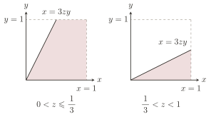

[上一篇](/lecture-notes/double-expectation-examples/)以五道例題示範了[雙重期望值定理](/lecture-notes/double-expectation-theorem/#thm-double-expectation)的用法，其中的共同手法是先給定一個變數、求出[條件期望值](/lecture-notes/conditional-expectation-and-variance/#def-conditional-expectation)，再以該變數的分配對條件期望值加權平均，得到邊際的期望值。

既然加權平均可以由條件期望值得到邊際期望值，同樣的做法能不能直接用在分配本身上呢？本篇的定理給出肯定的回答，邊際的 pmf 與 pdf 都可以寫成條件 pmf 與條件 pdf 的期望值，這就是[隨機變數](/lecture-notes/random-variables-and-pmf/#def-random-variable)版本的全機率定理。本篇先給出這條定理與它的證明，說明它與第一章事件版本的全機率定理如何對照，再以三道例題示範它在機率計算上的用法，並說明條件的選擇可以依照計算的方便來決定。

## 隨機變數版本的全機率定理

Theorem 3.10 (全機率定理, the law of total probability)

若 $X$ 與 $Y$ 之 conditional pmf 為 $p_{\sssig X\mid Y}(x\mid y)$ 與 $p_{\sssig Y\mid X}(y\mid x)$，邊際 pmf 為 $p_{\sssig X}(x)$ 與 $p_{\sssig Y}(y)$，則

$$
p_{\sssig X}(x)=\mathbb{E}\Bigl[p_{\sssig X\mid Y}(x\mid Y)\Bigr]\quad\text{及}\quad p_{\sssig Y}(y)=\mathbb{E}\Bigl[p_{\sssig Y\mid X}(y\mid X)\Bigr]
$$

$$
\begin{gathered}
p_{\sssig X}(x)=\mathbb{E}\Bigl[p_{\sssig X\mid Y}(x\mid Y)\Bigr]\\[0.55em]
\text{及}\quad p_{\sssig Y}(y)=\mathbb{E}\Bigl[p_{\sssig Y\mid X}(y\mid X)\Bigr]
\end{gathered}
$$

若 $X$ 與 $Y$ 之 conditional pdf 為 $f_{\sssig X\mid Y}(x\mid y)$ 與 $f_{\sssig Y\mid X}(y\mid x)$，邊際 pdf 為 $f_{\sssig X}(x)$ 與 $f_{\sssig Y}(y)$，則

$$
f_{\sssig X}(x)=\mathbb{E}\Bigl[f_{\sssig X\mid Y}(x\mid Y)\Bigr]\quad\text{及}\quad f_{\sssig Y}(y)=\mathbb{E}\Bigl[f_{\sssig Y\mid X}(y\mid X)\Bigr]
$$

$$
\begin{gathered}
f_{\sssig X}(x)=\mathbb{E}\Bigl[f_{\sssig X\mid Y}(x\mid Y)\Bigr]\\[0.55em]
\text{及}\quad f_{\sssig Y}(y)=\mathbb{E}\Bigl[f_{\sssig Y\mid X}(y\mid X)\Bigr]
\end{gathered}
$$

**Proof.**

我們僅以連續型證明 $X$ 邊際的狀況，其餘狀況同理可得

$$
\begin{aligned}
\mathbb{E}\Bigl[f_{\sssig X\mid Y}(x\mid Y)\Bigr]&=\int_{y\in\mathcal{R}_{\sssig Y}}\biggl[f_{\sssig X\mid Y}(x\mid y)\biggr]\,f_{\sssig Y}(y)\,dy\\[0.45em]
&=\int_{y\in\mathcal{R}_{\sssig Y}}f_{\sssig XY}(x,y)\,dy=f_{\sssig X}(x)
\end{aligned}
$$

$$
\begin{aligned}
\mathbb{E}\Bigl[f_{\sssig X\mid Y}(x\mid Y)\Bigr]&=\int_{y\in\mathcal{R}_{\sssig Y}}\biggl[f_{\sssig X\mid Y}(x\mid y)\biggr]\,f_{\sssig Y}(y)\,dy\\[0.45em]
&=\int_{y\in\mathcal{R}_{\sssig Y}}f_{\sssig XY}(x,y)\,dy=f_{\sssig X}(x)
\end{aligned}
$$

原式得證。 $\square$

Note

對照第一章事件版本的全機率定理 ([Theorem 1.16](/lecture-notes/total-probability-bayes-rule/#theorem-law-of-total-probability))，當時是以分割事件機率 $\mathbb{P}(A_i)$ 為權重對條件機率 $\mathbb{P}(B\mid A_i)$ 加權求和而得 $\mathbb{P}(B)$；此處則是以邊際密度 $f\_{\sssig Y}(y)$ (或邊際質量 $p\_{\sssig Y}(y)$) 為權重，對條件密度 $f\_{\sssig X\mid Y}(x\mid y)$ 加權平均而得 $f\_{\sssig X}(x)$。兩者的結構完全對應，事件版本是以互斥事件族 $\lbrace A_i\rbrace$ 分割樣本空間，隨機變數版本則是以條件變數 $Y$ 的各個可能取值分割整個值域空間。

## 全機率定理在機率計算上的應用

Example 3.26

Let $Y$ and $Z$ be independent standard uniform random variables following $\mathcal{U}(0,1)$. Find the probability that the quadratic equation $x^{2}+2xY+Z=0$ has a real root.

$x^{2}+2xY+Z=0$ 有實根表示 $(2Y)^{2}-4\times 1\times Z\geqslant 0$，則所求為

$$
\begin{aligned}
\mathbb{P}\bigl(Z\leqslant Y^{2}\bigr)&=\int_{0}^{1}\mathbb{P}\bigl(Z\leqslant Y^{2}\bigm\vert Y=y\bigr)\,f_{\sssig Y}(y)\,dy\\[0.45em]
&=\int_{0}^{1}\mathbb{P}\bigl(Z\leqslant y^{2}\bigm\vert Y=y\bigr)\,f_{\sssig Y}(y)\,dy\\[0.45em]
&=\int_{0}^{1}\biggl[\int_{0}^{y^{2}}1\,dz\biggr]\times 1\,dy=\int_{0}^{1}y^{2}\,dy=\frac{1}{\,3\,}
\end{aligned}
$$

$$
\begin{aligned}
\mathbb{P}\bigl(Z\leqslant Y^{2}\bigr)&=\int_{0}^{1}\mathbb{P}\bigl(Z\leqslant Y^{2}\bigm\vert Y=y\bigr)\,f_{\sssig Y}(y)\,dy\\[0.45em]
&=\int_{0}^{1}\mathbb{P}\bigl(Z\leqslant y^{2}\bigm\vert Y=y\bigr)\,f_{\sssig Y}(y)\,dy\\[0.45em]
&=\int_{0}^{1}\biggl[\int_{0}^{y^{2}}1\,dz\biggr]\times 1\,dy\\[0.45em]
&=\int_{0}^{1}y^{2}\,dy=\frac{1}{\,3\,}
\end{aligned}
$$

Note

上述做法亦可直接記為 $\mathbb{P}\bigl(Z\leqslant Y^{2}\bigr)=\mathbb{E}\bigl[\mathbb{P}(Z\leqslant Y^{2}\mid Y)\bigr]$ 這一等式，亦即將事件發生的條件機率視為 $Y$ 的函數，再對 $Y$ 取期望值以求得無條件事件機率，此即全機率定理在事件機率上的直接形式。

Example 3.27

Let $X$, $Y$, and $Z$ be independent random variables uniformly distributed over $(0,1)$. Compute $\mathbb{P}(X\geqslant YZ)$.

$$
\begin{aligned}
\mathbb{P}(X\geqslant YZ)&=\mathbb{E}\bigl[\mathbb{P}(X\geqslant YZ\mid Y,Z)\bigr]\\[0.45em]
&=\int_{0}^{1}\int_{0}^{1}\mathbb{P}(X\geqslant YZ\mid Y=y,Z=z)\,f_{\sssig YZ}(y,z)\,dy\,dz\\[0.45em]
&=\int_{0}^{1}\int_{0}^{1}\mathbb{P}(X\geqslant yz)\,f_{\sssig YZ}(y,z)\,dy\,dz\\[0.45em]
&=\int_{0}^{1}\int_{0}^{1}\biggl[\int_{yz}^{1}f_{\sssig X\mid YZ}(x\mid y,z)\,dx\biggr]\,f_{\sssig YZ}(y,z)\,dy\,dz\\[0.45em]
&=\int_{0}^{1}\int_{0}^{1}\biggl[\int_{yz}^{1}1\,dx\biggr]\,f_{\sssig YZ}(y,z)\,dy\,dz\\[0.45em]
&=\int_{0}^{1}\int_{0}^{1}(1-yz)\,dy\,dz=\int_{0}^{1}\Bigl(1-\frac{1}{2}z\Bigr)\,dz=\frac{3}{\,4\,}
\end{aligned}
$$

$$
\begin{aligned}
\mathbb{P}(X\geqslant YZ)&=\mathbb{E}\bigl[\mathbb{P}(X\geqslant YZ\mid Y,Z)\bigr]\\[0.45em]
&=\int_{0}^{1}\int_{0}^{1}\mathbb{P}(X\geqslant YZ\mid Y=y,Z=z)\\[0.2em]
&\quad f_{\sssig YZ}(y,z)\,dy\,dz\\[0.45em]
&=\int_{0}^{1}\int_{0}^{1}\mathbb{P}(X\geqslant yz)\,f_{\sssig YZ}(y,z)\,dy\,dz\\[0.45em]
&=\int_{0}^{1}\int_{0}^{1}\biggl[\int_{yz}^{1}f_{\sssig X\mid YZ}(x\mid y,z)\,dx\biggr]\\[0.2em]
&\quad f_{\sssig YZ}(y,z)\,dy\,dz\\[0.45em]
&=\int_{0}^{1}\int_{0}^{1}\biggl[\int_{yz}^{1}1\,dx\biggr]\,f_{\sssig YZ}(y,z)\,dy\,dz\\[0.45em]
&=\int_{0}^{1}\int_{0}^{1}(1-yz)\,dy\,dz\\[0.45em]
&=\int_{0}^{1}\Bigl(1-\frac{1}{2}z\Bigr)\,dz=\frac{3}{\,4\,}
\end{aligned}
$$

Note

上述推導有兩點值得留意:

(1) 給定的條件可同時包含多個隨機變數 (如本題同時給定 $Y,Z$)，此時外層期望值須以該組條件變數的聯合分配 $f_{\sssig YZ}(y,z)$ 作為加權密度。

(2) 本題亦可如本章前段直接由聯合密度作三重積分求算

$$
\mathbb{P}(X\geqslant YZ)=\int_{0}^{1}\int_{0}^{1}\int_{yz}^{1}f_{\sssig XYZ}(x,y,z)\,dx\,dy\,dz
$$

$$
\begin{aligned}
&\mathbb{P}(X\geqslant YZ)\\[0.35em]
&=\int_{0}^{1}\int_{0}^{1}\int_{yz}^{1}f_{\sssig XYZ}(x,y,z)\,dx\,dy\,dz
\end{aligned}
$$

兩種算法完全等價。差別在於直接積分法須先取得完整的 joint pdf $f\_{\sssig XYZ}(x,y,z)$，而當模型本身較易取得 conditional pdf 時，使用全機率定理更為簡便；本題則因三個變數互相獨立，故 conditional pdf $f\_{\sssig X\mid YZ}(x\mid y,z)$ 直接退化為 $f\_{\sssig X}(x)$。

Example 3.28

Let $X$, $Y$, and $Z$ be iid $\mathcal{U}(0,1)$ continuous random variables. Find $\mathbb{P}(X\geqslant 3YZ)$.

所求為

$$
\mathbb{E}\bigl[\mathbb{P}(X\geqslant 3YZ\mid Z)\bigr]=\int_{0}^{1}\mathbb{P}(X\geqslant 3YZ\mid Z=z)\,f_{\sssig Z}(z)\,dz
$$

$$
\begin{aligned}
\mathbb{E}\bigl[\mathbb{P}(X\geqslant 3YZ\mid Z)\bigr]&=\int_{0}^{1}\mathbb{P}(X\geqslant 3YZ\mid Z=z)\\[0.3em]
&\qquad\times f_{\sssig Z}(z)\,dz
\end{aligned}
$$

$$
\begin{aligned}
\text{又}\ \ \mathbb{P}(X\geqslant 3YZ\mid Z=z)&=\mathbb{P}(X\geqslant 3Yz\mid Z=z)=\mathbb{P}(X\geqslant 3Yz)\\[0.45em]
&=\left\lbrace
\begin{array}{c@{\quad}l}
1-\frac{3}{\,2\,}z, & 0<z\leqslant\frac{1}{\,3\,}\\[0.8em]
\frac{1}{\,6z\,}, & \frac{1}{\,3\,}<z<1
\end{array}
\right.
\end{aligned}
$$

$$
\begin{aligned}
\text{又}\ \ \mathbb{P}(X\geqslant 3YZ\mid Z=z)&=\mathbb{P}(X\geqslant 3Yz\mid Z=z)\\[0.45em]
&=\mathbb{P}(X\geqslant 3Yz)\\[0.45em]
&=\left\lbrace
\begin{array}{c@{}l}
1-\frac{3}{\,2\,}z, & 0<z\leqslant\frac{1}{\,3\,}\\[0.8em]
\frac{1}{\,6z\,}, & \frac{1}{\,3\,}<z<1
\end{array}
\right.
\end{aligned}
$$

$$
\begin{aligned}
\text{故}\ \ \mathbb{P}(X\geqslant 3YZ)&=\mathbb{E}\bigl[\mathbb{P}(X\geqslant 3YZ\mid Z)\bigr]\\[0.45em]
&=\int_{0}^{\frac{1}{3}}\Bigl(1-\frac{3}{\,2\,}z\Bigr)\,dz+\int_{\frac{1}{3}}^{1}\frac{1}{\,6z\,}\,dz=\frac{1}{\,4\,}+\frac{1}{\,6\,}\ln 3
\end{aligned}
$$

$$
\begin{aligned}
\text{故}\ \ \mathbb{P}(X\geqslant 3YZ)&=\mathbb{E}\bigl[\mathbb{P}(X\geqslant 3YZ\mid Z)\bigr]\\[0.45em]
&=\int_{0}^{\frac{1}{3}}\Bigl(1-\frac{3}{\,2\,}z\Bigr)\,dz+\int_{\frac{1}{3}}^{1}\frac{1}{\,6z\,}\,dz\\[0.45em]
&=\frac{1}{\,4\,}+\frac{1}{\,6\,}\ln 3
\end{aligned}
$$

Note

本題若仿照[上一題](#ex-three-uniform-comparison)同時給定 $Y,Z$，因不等式多了係數 $3$，當 $3yz>1$ 時條件機率會截斷為 $0$，反而使雙重積分的區域討論更繁瑣；改為僅給定單一變數 $Z=z$ 則簡潔許多。在給定 $Z=z$ 下，依斜線 $x=3zy$ 與正方形上邊或右邊相交，積分區域分為以下兩種情形:

<figure id="fig-total-probability-regions" class="topic-figure topic-figure--wide">
  
  <figcaption>Fig. 3.17. 兩條虛線 $x=1$ 與 $y=1$ 和兩軸圍出一個方形，斜線 $x=3zy$ 的斜率隨 $z$ 而變，左圖的斜線與方形的上邊相交、右圖的斜線與方形的右邊相交，兩圖填色的一塊都是 $x\geqslant 3zy$ 的範圍。</figcaption>
</figure>

由於 $X$ 與 $Y$ 獨立且均服從標準均勻分配，各分支下的條件機率直接化為圖中標色區域的面積。由此亦可見全機率定理在應用上的靈活性，可依問題結構選取最便於計算的條件變數。

## 本篇小結

[Theorem 3.10](#thm-law-of-total-prob-r-v) 把加權平均的做法由期望值移到機率函數本身。邊際 pmf 是條件 pmf 以條件變數的分配加權所得，即 $p_{\sssig X}(x)$ $=$ $\mathbb{E}\bigl[p_{\sssig X\mid Y}(x\mid Y)\bigr]$ 這一條等式，連續型的邊際 pdf 亦然。證明只需把外層的期望值寫成對 $y$ 的積分，被積分的兩項相乘正是 $f_{\sssig XY}(x,y)$，再對 $y$ 積分就得到 $f_{\sssig X}(x)$。這條定理與第一章 [Theorem 1.16](/lecture-notes/total-probability-bayes-rule/#theorem-law-of-total-probability) 的對照相當清楚，當時是以 $A_i$ 分割樣本空間、以 $\mathbb{P}(A_i)$ 為權重，此處則是以條件變數 $Y$ 分割值域空間、以 $f_{\sssig Y}(y)$ 為權重。

三道例題示範這條定理在機率計算上的用法。[Example 3.26](#ex-quadratic-real-root-probability) 先把「有實根」化為判別式非負的條件，所求機率因而是 $\mathbb{P}(Z\leqslant Y^{2})$，給定 $Y=y$ 之後再對 $y$ 加權積分，得到 $\frac{1}{3}$；這個做法寫成 $\mathbb{E}\bigl[\mathbb{P}(Z\leqslant Y^{2}\mid Y)\bigr]$ 之後，就是全機率定理本身。[Example 3.27](#ex-three-uniform-comparison) 說明條件可以同時擺上多於一個的變數，此時外層的期望值使用的是 $Y$ 與 $Z$ 的聯合分配，答案為 $\frac{3}{4}$；這個算法與直接以三重積分計算是等價的，差別只在先知道的是 joint pdf 還是 conditional pdf。

[Example 3.28](#ex-three-uniform-product-inequality) 的三倍使積分範圍需要分段討論，若把 $Y$ 與 $Z$ 都給定反而更難算，因此只給定 $Z$，並依 $z$ 落在 $0<z\leqslant\frac{1}{3}$ 或 $\frac{1}{3}<z<1$ 分成兩種範圍，各以面積求得條件機率，最後加權積分得到 $\frac{1}{4}+\frac{1}{6}\ln 3$ 這個值。由此可見全機率定理在條件的選擇上相當靈活，完全可以依照計算上的方便來決定。

[下一篇](/lecture-notes/variance-decomposition-theorem/)將把同樣的加權做法用在[變異數](/lecture-notes/variance/#def-variance)上，介紹變異數分解定理。

## 參考文獻與延伸閱讀

- 黃文璋，2010，《機率論》，二版，華泰文化。
- Sheldon Ross. 2019. *A First Course in Probability*. 10th ed. Pearson.
- Robert V. Hogg, Joseph W. McKean, and Allen T. Craig. 2019. *Introduction to Mathematical Statistics*. 8th ed. Pearson.
- George Casella and Roger L. Berger. 2002. *Statistical Inference*. 2nd ed. Duxbury.
