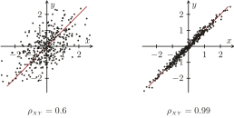
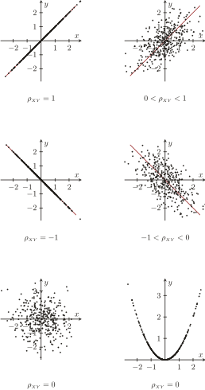

[上一篇](/lecture-notes/covariance-matrix/)把[共變異數](/lecture-notes/covariance/#def-covariance)推廣到[隨機向量](/lecture-notes/random-vectors-joint-pmf/#def-random-vector)之上，以 [Definition 3.17](/lecture-notes/covariance-matrix/#def-covar-matrix) 的[共變異數矩陣](/lecture-notes/covariance-matrix/#def-covar-matrix)收納各個分量兩兩之間的共變異數，並整理了常數向量與矩陣作用在隨機向量上時，[期望值](/lecture-notes/expectation/#def-expectation)與共變異數矩陣的算法。

共變異數的正負號說明了 $X$ 與 $Y$ 共同變化的方向，但它沒有範圍限制，因此看不出相關程度的上限，也無法用來比較兩組不同的二元分配間，哪一組的相關程度比較高。本篇要介紹的相關係數即是為此而設，它在共變異數之外，額外把 $X$ 與 $Y$ 各自的變異程度消除掉。本篇先給出定義與一條比較簡易的表示式，再依相關係數的取值把相關程度分成五類並以散佈圖圖示，接著證明相關係數的六款性質，最後說明相關係數的幾何意義。

## 相關係數的定義與相關程度的分類

Definition 3.19 (相關係數, correlation coefficient)

若 $X$ 與 $Y$ 為二[隨機變數](/lecture-notes/random-variables-and-pmf/#def-random-variable)，且期望值分別為 $\mu_{\sssig X}$ 與 $\mu_{\sssig Y}$，變異數分別為 $\sigma_{\sssig X}^{2}, \sigma_{\sssig Y}^{2}$，則

$$
\rho_{\sssig XY}=\operatorname{Corr}(X,Y)=\mathbb{E}\Biggl[\biggl(\frac{X-\mu_{\sssig X}}{\sigma_{\sssig X}}\biggr)\biggl(\frac{Y-\mu_{\sssig Y}}{\sigma_{\sssig Y}}\biggr)\Biggr]
$$

$$
\begin{aligned}
\rho_{\sssig XY}&=\operatorname{Corr}(X,Y)\\[0.45em]
&=\mathbb{E}\Biggl[\biggl(\frac{X-\mu_{\sssig X}}{\sigma_{\sssig X}}\biggr)\biggl(\frac{Y-\mu_{\sssig Y}}{\sigma_{\sssig Y}}\biggr)\Biggr]
\end{aligned}
$$

為 $X$ 與 $Y$ 的**相關係數 (correlation coefficient)**

相關係數有一些地方需要注意:

(1) 相關係數在共變異數的基礎上，進一步除以各自的標準差以消除 $X$ 與 $Y$ 的變異尺度，形成**標準化 (standardized)** 的無單位量數，使其取值恆介於 $-1$ 與 $1$ 之間，後文將詳述此性質。
{: .topic-paren-item}

Note

式中的 $\frac{X-\mu\_{\sssig X}}{\sigma\_{\sssig X}}$ 與 $\frac{Y-\mu\_{\sssig Y}}{\sigma\_{\sssig Y}}$ 分別為 $X$ 與 $Y$ 的標準化隨機變數，各自的期望值皆為 $0$、變異數皆為 $1$，故相關係數亦能直觀地寫成兩標準化變數的共變異數

$$
\rho_{\sssig XY}=\operatorname{Cov}\biggl(\frac{X-\mu_{\sssig X}}{\sigma_{\sssig X}},\ \frac{Y-\mu_{\sssig Y}}{\sigma_{\sssig Y}}\biggr)
$$

$$
\begin{aligned}
\rho_{\sssig XY}&=\operatorname{Cov}\biggl(\frac{X-\mu_{\sssig X}}{\sigma_{\sssig X}},\ \frac{Y-\mu_{\sssig Y}}{\sigma_{\sssig Y}}\biggr)
\end{aligned}
$$

(2) 相關係數所衡量的相關性，是指線性相關 (linear correlation) 的強度，換句話說就是 **$X$ 與 $Y$ 之間的關係有多接近直線**。
{: .topic-paren-item}

線性相關程度，是指相關係數的數值 (即 $\lvert\rho_{\sssig XY}\rvert$)，其值越大 (表示 $\rho_{\sssig XY}$ 越接近 $1$ 或 $-1$)，則觀察值的散佈情形越接近一條直線；反之，其值越小 (越接近 $0$)，則散佈情形越不具直線關係。
{: .topic-paren-cont}

下圖是 $\rho_{\sssig XY}=0.6$ 與 $\rho_{\sssig XY}=0.99$ 的聯合分配抽取樣本形成的散佈圖 (scatter plot):
{: .topic-paren-cont}

<figure id="fig-correlation-strength-scatter" class="topic-figure topic-figure--wide">
  
  <figcaption>Fig. 3.18. 左右兩個面板共用同一組座標範圍與同一個比例尺，各畫一批樣本的散佈，並附同一條斜率為正的參考直線。左面板所標的 $\rho_{\sssig XY}$ 較小，點散得開，離參考直線遠的不少；右面板所標的 $\rho_{\sssig XY}$ 接近 $1$，點幾乎都貼著參考直線排成一條窄帶。$\lvert\rho_{\sssig XY}\rvert$ 越大，點的散佈就越接近一條直線，這正是相關係數所衡量的線性相關強度。</figcaption>
</figure>

上圖左側抽自相關係數為 $0.6$ 的聯合分配，右側則抽自相關係數達 $0.99$ 的聯合分配，可見後者樣本點緊密排列於斜直線附近。
{: .topic-paren-cont}

(3) 由相關係數的定義，我們可以得到一個比較簡易的表示式，即
{: .topic-paren-item}

$$
\begin{aligned}
\operatorname{Corr}(X,Y)&=\frac{1}{\sigma_{\sssig X}\,\sigma_{\sssig Y}}\mathbb{E}\Bigl[(X-\mu_{\sssig X})(Y-\mu_{\sssig Y})\Bigr]\\[0.45em]
&=\frac{\sigma_{\sssig XY}}{\sigma_{\sssig X}\,\sigma_{\sssig Y}}=\frac{\operatorname{Cov}(X,Y)}{\sqrt{\mathrm{Var}(X)\,\mathrm{Var}(Y)}}
\end{aligned}
$$

$$
\begin{aligned}
\operatorname{Corr}(X,Y)&=\frac{1}{\sigma_{\sssig X}\,\sigma_{\sssig Y}}\mathbb{E}\Bigl[(X-\mu_{\sssig X})(Y-\mu_{\sssig Y})\Bigr]\\[0.45em]
&=\frac{\sigma_{\sssig XY}}{\sigma_{\sssig X}\,\sigma_{\sssig Y}}=\frac{\operatorname{Cov}(X,Y)}{\sqrt{\mathrm{Var}(X)\,\mathrm{Var}(Y)}}
\end{aligned}
$$

(4) 與共變異數相同，相關係數的正負號對應正相關與負相關 (亦對應上圖參考直線斜率的正負號)，為 $0$ 則代表零相關。但須注意，**相關係數的數值大小與直線斜率的數值大小沒有關係**。
{: .topic-paren-item}

(5) 相關係數與共變異數最大的不同在有範圍限制，因此我們可以看出相關程度的上限，也能以此比較兩組不同的二元分配間，哪一組的相關程度較高，這都是共變異數做不到的地方，也正因此，我們可將其分類如下:
{: .topic-paren-item}

- 若 $\rho_{\sssig XY}=1$，則稱 $X$ 與 $Y$ **完全正相關 (perfectly positively correlated)**
- 若 $0<\rho_{\sssig XY}<1$，則稱 $X$ 與 $Y$ **正相關 (positively correlated)**
- 若 $\rho_{\sssig XY}=0$，則稱 $X$ 與 $Y$ **零相關 (uncorrelated)**
- 若 $-1<\rho_{\sssig XY}<0$，則稱 $X$ 與 $Y$ **負相關 (negatively correlated)**
- 若 $\rho_{\sssig XY}=-1$，則稱 $X$ 與 $Y$ **完全負相關 (perfectly negatively correlated)**

(6) 下面我們便將以上的五種分類情況圖示如下:
{: .topic-paren-item}

<figure id="fig-correlation-types-scatter" class="topic-figure topic-figure--wide">
  
  <figcaption>Fig. 3.19. 六個面板排成三列，每列兩個，畫出五種相關型態，最後一個面板另外畫零相關卻不獨立的情形。第一列左邊是完全正相關，點全落在同一條上升的直線上；右邊是正相關，點散成一團沿上升方向拉長的雲。第二列的方向相反，左邊是完全負相關，右邊是負相關。第三列左邊是零相關，點沒有方向可言。第三列右邊的點排成一條開口向上的二次曲線，$X$ 與 $Y$ 顯然有關係，$\rho_{\sssig XY}$ 卻與左邊一樣是 $0$，因為相關係數只衡量線性的那一部分。前四個面板各附一條與該型態同號的參考直線，後兩個面板沒有參考直線。</figcaption>
</figure>

在 [Fig. 3.19](#fig-correlation-types-scatter) 右下角的面板中，$X$ 與 $Y$ 雖呈現明顯的二次函數關係，相關係數卻仍為 $0$，原因在於**相關性只用來衡量線性相關**。

Note

直觀而言，線性相關衡量的是整體是否具有「$X$ 增大時 $Y$ 隨之增大 (或減小)」的一致趨勢。二次曲線在極值點左右兩側的增減方向正好相反，兩側的相關趨勢在整體平均下互相抵銷，故相關係數為 $0$。

## 相關係數的性質

Theorem 3.19 (相關係數的性質, correlation properties)

若 $X$ 與 $Y$ 為二隨機變數，$a, b, c, d$ 為任意常數，則

<ol class="topic-list-paren">
  <li>
  若 $X$ $\indep$ $Y$，則
  $$
  \operatorname{Corr}(X,Y)=0
  $$
  </li>
  <li>
  $$
  \operatorname{Corr}(X,a)=0
  $$
  </li>
  <li>
  $$
  \operatorname{Corr}(X,X)=1
  $$
  </li>
  <li>
  

  $$
  \operatorname{Corr}\bigl(aX+c,\,bY+d\bigr)=\operatorname{sgn}(ab)\cdot\operatorname{Corr}\bigl(X,Y\bigr)
  $$
  

  

  $$
  \begin{aligned}
  \operatorname{Corr}\bigl(&aX+c,\,bY+d\bigr)\\[0.45em]
  &=\operatorname{sgn}(ab)\cdot\operatorname{Corr}\bigl(X,Y\bigr)
  \end{aligned}
  $$
  

  其中 $\operatorname{sgn}(\cdot)$ 表示符號函數
  </li>
  <li>
  $$
  \operatorname{Corr}(X,Y)=\operatorname{Corr}(Y,X)
  $$
  </li>
  <li>
  $$
  -1\leqslant\operatorname{Corr}(X,Y)\leqslant1
  $$
  </li>
</ol>

**Proof.**

(1) 若 $X$ $\indep$ $Y$，則
{: .topic-paren-item}

$$
\operatorname{Cov}(X,Y)=0\qquad\therefore\, \operatorname{Corr}(X,Y)=0
$$

(2)
{: .topic-paren-item}

$$
\operatorname{Cov}(X,a)=0\qquad\therefore\, \operatorname{Corr}(X,a)=0
$$

(3)
{: .topic-paren-item}

$$
\operatorname{Cov}(X,X)=\mathrm{Var}(X)
$$

$$
\Longrightarrow\ \operatorname{Corr}(X,X)=\frac{\operatorname{Cov}(X,X)}{\sqrt{\mathrm{Var}(X)\,\mathrm{Var}(X)}}=1
$$

$$
\begin{aligned}
\Longrightarrow\ \operatorname{Corr}(X,X)&=\frac{\operatorname{Cov}(X,X)}{\sqrt{\mathrm{Var}(X)\,\mathrm{Var}(X)}}\\[0.2em]
&=1
\end{aligned}
$$

(4)
{: .topic-paren-item}

$$
\operatorname{Cov}\bigl(aX+c,\,bY+d\bigr)=ab\,\operatorname{Cov}(X,Y)
$$

由[變異數的性質](/lecture-notes/variance/#thm-variance-properties)可知
{: .topic-paren-cont}

$$
\mathrm{Var}(aX+c)=a^{2}\,\mathrm{Var}(X),\quad \mathrm{Var}(bY+d)=b^{2}\,\mathrm{Var}(Y)
$$

$$
\begin{gathered}
\mathrm{Var}(aX+c)=a^{2}\,\mathrm{Var}(X),\\[0.45em]
\mathrm{Var}(bY+d)=b^{2}\,\mathrm{Var}(Y)
\end{gathered}
$$

$$
\begin{aligned}
\Longrightarrow\ \operatorname{Corr}\bigl(aX+c,\,bY+d\bigr)&=\frac{\operatorname{Cov}\bigl(aX+c,\,bY+d\bigr)}{\sqrt{\mathrm{Var}(aX+c)\,\mathrm{Var}(bY+d)}}\\[0.45em]
&=\frac{ab\,\operatorname{Cov}(X,Y)}{\lvert ab\rvert\sqrt{\mathrm{Var}(X)\,\mathrm{Var}(Y)}}
\end{aligned}
$$

$$
\begin{aligned}
\Longrightarrow\ &\operatorname{Corr}\bigl(aX+c,\,bY+d\bigr)\\[0.45em]
&=\frac{\operatorname{Cov}\bigl(aX+c,\,bY+d\bigr)}{\sqrt{\mathrm{Var}(aX+c)\,\mathrm{Var}(bY+d)}}\\[0.45em]
&=\frac{ab\,\operatorname{Cov}(X,Y)}{\lvert ab\rvert\sqrt{\mathrm{Var}(X)\,\mathrm{Var}(Y)}}
\end{aligned}
$$

且由於
{: .topic-paren-cont}

$$
\frac{ab}{\lvert ab\rvert}=\operatorname{sgn}(ab)=\left\lbrace
\begin{array}{c@{\quad}l}
1, & \text{if } ab>0\\[0.6em]
-1, & \text{if } ab<0
\end{array}
\right.
$$

$$
\begin{aligned}
\Longrightarrow\ \operatorname{Corr}\bigl(aX+c,\,bY+d\bigr)&=\left\lbrace
\begin{array}{c@{\quad}l}
\operatorname{Corr}(X,Y), & \text{if } ab>0\\[0.6em]
-\operatorname{Corr}(X,Y), & \text{if } ab<0
\end{array}
\right.\\[0.45em]
&=\operatorname{sgn}(ab)\cdot\operatorname{Corr}\bigl(X,Y\bigr)
\end{aligned}
$$

$$
\begin{aligned}
\Longrightarrow\ &\operatorname{Corr}\bigl(aX+c,\,bY+d\bigr)\\[0.45em]
&=\left\lbrace
\begin{array}{c@{}l}
\operatorname{Corr}(X,Y), & \text{if } ab>0\\[0.6em]
-\operatorname{Corr}(X,Y), & \text{if } ab<0
\end{array}
\right.\\[0.45em]
&=\operatorname{sgn}(ab)\cdot\operatorname{Corr}\bigl(X,Y\bigr)
\end{aligned}
$$

(5)
{: .topic-paren-item}

$$
\operatorname{Cov}(X,Y)=\operatorname{Cov}(Y,X)
$$

$$
\begin{aligned}
\Longrightarrow\ \operatorname{Corr}(X,Y)&=\frac{\operatorname{Cov}(X,Y)}{\sqrt{\mathrm{Var}(X)\,\mathrm{Var}(Y)}}\\[0.45em]
&=\frac{\operatorname{Cov}(Y,X)}{\sqrt{\mathrm{Var}(Y)\,\mathrm{Var}(X)}}=\operatorname{Corr}(Y,X)
\end{aligned}
$$

$$
\begin{aligned}
\Longrightarrow\ \operatorname{Corr}(X,Y)&=\frac{\operatorname{Cov}(X,Y)}{\sqrt{\mathrm{Var}(X)\,\mathrm{Var}(Y)}}\\[0.45em]
&=\frac{\operatorname{Cov}(Y,X)}{\sqrt{\mathrm{Var}(Y)\,\mathrm{Var}(X)}}=\operatorname{Corr}(Y,X)
\end{aligned}
$$

(6) 令
{: .topic-paren-item}

$$
U=\frac{X-\mu_{\sssig X}}{\sigma_{\sssig X}},\quad V=\frac{Y-\mu_{\sssig Y}}{\sigma_{\sssig Y}}
$$

考慮 $\mathbb{E}\bigl[(U+t\,V)^{2}\bigr]$ 這個式子，其中 $t\in\mathbb{R}$，則
{: .topic-paren-cont}

$$
\begin{aligned}
\mathbb{E}\bigl[(U+t\,V)^{2}\bigr]&=\mathbb{E}\bigl(U^{2}+2t\,UV+t^{2}\,V^{2}\bigr)\\[0.45em]
&=\mathbb{E}\bigl(U^{2}\bigr)+2\,\mathbb{E}(UV)\,t+\mathbb{E}\bigl(V^{2}\bigr)\,t^{2}\geqslant0
\end{aligned}
$$

$$
\begin{aligned}
\mathbb{E}\bigl[(U+t\,V)^{2}\bigr]&=\mathbb{E}\bigl(U^{2}+2t\,UV+t^{2}\,V^{2}\bigr)\\[0.45em]
&=\mathbb{E}\bigl(U^{2}\bigr)+2\,\mathbb{E}(UV)\,t\\[0.2em]
&\qquad+\mathbb{E}\bigl(V^{2}\bigr)\,t^{2}\geqslant0
\end{aligned}
$$

$$
\bigl(\because\ (U+t\,V)^{2}\geqslant0\ \Longrightarrow\ \mathbb{E}\bigl[(U+tV)^{2}\bigr]\geqslant0\bigr)
$$

$$
\begin{aligned}
&\bigl(\because\ (U+t\,V)^{2}\geqslant0\\[0.25em]
&\qquad\Longrightarrow\ \mathbb{E}\bigl[(U+tV)^{2}\bigr]\geqslant0\bigr)
\end{aligned}
$$

若將 $\mathbb{E}\bigl[(U+tV)^{2}\bigr]$ $=$ $\mathbb{E}\bigl(U^{2}\bigr)$ $+\,2\,\mathbb{E}(UV)\,t$ $+\,\mathbb{E}\bigl(V^{2}\bigr)\,t^{2}$ 視為 $t$ 的二次式，則可知
{: .topic-paren-cont}

$$
\bigl[2\,\mathbb{E}(UV)\bigr]^{2}-4\,\mathbb{E}\bigl(U^{2}\bigr)\mathbb{E}\bigl(V^{2}\bigr)\leqslant0
$$

$$
\Longrightarrow\ \bigl[\mathbb{E}(UV)\bigr]^{2}\leqslant\mathbb{E}\bigl(U^{2}\bigr)\mathbb{E}\bigl(V^{2}\bigr)
$$

此不等式即隨機變數版本的**柯西-舒瓦茲不等式 (Cauchy-Schwarz inequality)**。代回原變數可得
{: .topic-paren-cont}

$$
\begin{aligned}
\bigl[\mathbb{E}(UV)\bigr]^{2}&=\Biggl(\mathbb{E}\biggl[\Bigl(\frac{X-\mu_{\sssig X}}{\sigma_{\sssig X}}\Bigr)\Bigl(\frac{Y-\mu_{\sssig Y}}{\sigma_{\sssig Y}}\Bigr)\biggr]\Biggr)^{2}=\rho_{\sssig XY}^{2}\\[0.45em]
&\leqslant\mathbb{E}\bigl(U^{2}\bigr)\mathbb{E}\bigl(V^{2}\bigr)\\[0.45em]
&=\mathbb{E}\biggl[\Bigl(\frac{X-\mu_{\sssig X}}{\sigma_{\sssig X}}\Bigr)^{2}\biggr]\,\mathbb{E}\biggl[\Bigl(\frac{Y-\mu_{\sssig Y}}{\sigma_{\sssig Y}}\Bigr)^{2}\biggr]=1\qquad\therefore\, -1\leqslant\rho_{\sssig XY}\leqslant1
\end{aligned}
$$

$$
\begin{aligned}
\bigl[\mathbb{E}(UV)\bigr]^{2}&=\Biggl(\mathbb{E}\biggl[\Bigl(\frac{X-\mu_{\sssig X}}{\sigma_{\sssig X}}\Bigr)\Bigl(\frac{Y-\mu_{\sssig Y}}{\sigma_{\sssig Y}}\Bigr)\biggr]\Biggr)^{2}\\[0.2em]
&=\rho_{\sssig XY}^{2}\\[0.45em]
&\leqslant\mathbb{E}\bigl(U^{2}\bigr)\mathbb{E}\bigl(V^{2}\bigr)\\[0.2em]
&=\mathbb{E}\biggl[\Bigl(\frac{X-\mu_{\sssig X}}{\sigma_{\sssig X}}\Bigr)^{2}\biggr]\,\mathbb{E}\biggl[\Bigl(\frac{Y-\mu_{\sssig Y}}{\sigma_{\sssig Y}}\Bigr)^{2}\biggr]\\[0.2em]
&=1\qquad\therefore\, -1\leqslant\rho_{\sssig XY}\leqslant1
\end{aligned}
$$

原式得證。 $\square$
{: .topic-paren-cont}

[Theorem 3.19](#thm-corr-proper) 的前五款性質皆可由共變異數的性質除以標準差之積而得。其中第 (3) 款指出變數與自身的相關係數恆為 $1$；第 (4) 款則顯示，由於相關係數在定義時已消除單位尺度，對隨機變數作非零常數伸縮並不會改變相關係數的絕對值大小 (不具平方或絕對值伸縮性)，僅須考慮係數乘積 $ab$ 的正負號對相關方向的影響。

第 (6) 款證明中所用的不等式與實數版本的**柯西-舒瓦茲不等式**相對應。對任意實數 $U\_1, \ldots, U\_n$ 與 $V_1, \ldots, V_n$，實數版柯西-舒瓦茲不等式為

$$
\biggl(\sum_{i=1}^{n}U_iV_i\biggr)^{2}\leqslant\biggl(\sum_{i=1}^{n}U_i^{2}\biggr)\biggl(\sum_{i=1}^{n}V_i^{2}\biggr)
$$

$$
\begin{aligned}
\biggl(&\sum_{i=1}^{n}U_iV_i\biggr)^{2}\\[0.45em]
&\leqslant\biggl(\sum_{i=1}^{n}U_i^{2}\biggr)\biggl(\sum_{i=1}^{n}V_i^{2}\biggr)
\end{aligned}
$$

將上式兩側同除以 $n^{2}$ 改寫為算術平均的形式

$$
\biggl(\frac{1}{\,n\,}\sum_{i=1}^{n}U_iV_i\biggr)^{2}\leqslant\biggl(\frac{1}{\,n\,}\sum_{i=1}^{n}U_i^{2}\biggr)\biggl(\frac{1}{\,n\,}\sum_{i=1}^{n}V_i^{2}\biggr)
$$

$$
\begin{aligned}
\biggl(&\frac{1}{\,n\,}\sum_{i=1}^{n}U_iV_i\biggr)^{2}\\[0.45em]
&\leqslant\biggl(\frac{1}{\,n\,}\sum_{i=1}^{n}U_i^{2}\biggr)\biggl(\frac{1}{\,n\,}\sum_{i=1}^{n}V_i^{2}\biggr)
\end{aligned}
$$

即可與隨機變數期望值版本直接對照。

Note

在上述第 (6) 款的證明中，若存在唯一的 $t\in\mathbb{R}$，使得

$$
\mathbb{E}\bigl[(U+tV)^{2}\bigr]=\mathbb{E}\bigl(U^{2}\bigr)+2\,\mathbb{E}(UV)\,t+\mathbb{E}\bigl(V^{2}\bigr)\,t^{2}=0
$$

$$
\begin{aligned}
\mathbb{E}\bigl[(U+tV)^{2}\bigr]&=\mathbb{E}\bigl(U^{2}\bigr)+2\,\mathbb{E}(UV)\,t\\[0.2em]
&\qquad+\mathbb{E}\bigl(V^{2}\bigr)\,t^{2}=0
\end{aligned}
$$

則二次式的判別式為 $0$，即得 $\bigl[\mathbb{E}(UV)\bigr]^{2}=\mathbb{E}\bigl(U^{2}\bigr)\mathbb{E}\bigl(V^{2}\bigr)$ 的結論，對應 $\rho_{\sssig XY}^{2}=1$。另一方面，對該實數 $t$，非負隨機變數 $(U+tV)^{2}$ 的期望值為 $0$，故必有 $\mathbb{P}(U+tV=0)=1$，表示 $(U,V)$ (進而 $(X,Y)$) 的觀察值落在同一條直線上的機率為 $1$，符合 $\rho\_{\sssig XY}^{2}=1$ 的結論。

舉一簡單離散分配為例，設

$$
\mathbb{P}\bigl((X,Y)=(a_i,b_i)\bigr)=\frac{1}{\,n\,},\quad i=1,\ldots,n
$$

$$
\begin{gathered}
\mathbb{P}\bigl((X,Y)=(a_i,b_i)\bigr)=\frac{1}{\,n\,},\\[0.45em]
i=1,\ldots,n
\end{gathered}
$$

則我們有

$$
\begin{gathered}
\mathbb{E}\bigl(X^{2}\bigr)=\frac{1}{\,n\,}\bigl(a_1^{2}+\cdots+a_n^{2}\bigr),\\[0.45em]
\mathbb{E}\bigl(Y^{2}\bigr)=\frac{1}{\,n\,}\bigl(b_1^{2}+\cdots+b_n^{2}\bigr),\\[0.45em]
\mathbb{E}(XY)=\frac{1}{\,n\,}\bigl(a_1b_1+\cdots+a_nb_n\bigr)
\end{gathered}
$$

由實數版本的柯西不等式可知

$$
\begin{aligned}
\mathbb{E}\bigl(X^{2}\bigr)\mathbb{E}\bigl(Y^{2}\bigr)&=\frac{1}{\,n\,}\bigl(a_1^{2}+\cdots+a_n^{2}\bigr)\,\frac{1}{\,n\,}\bigl(b_1^{2}+\cdots+b_n^{2}\bigr)\\[0.45em]
&\geqslant\Bigl[\frac{1}{\,n\,}\bigl(a_1b_1+\cdots+a_nb_n\bigr)\Bigr]^{2}=\bigl[\mathbb{E}(XY)\bigr]^{2}
\end{aligned}
$$

$$
\begin{aligned}
\mathbb{E}\bigl(X^{2}\bigr)\mathbb{E}\bigl(Y^{2}\bigr)&=\frac{1}{\,n\,}\bigl(a_1^{2}+\cdots+a_n^{2}\bigr)\\[0.2em]
&\qquad \frac{1}{\,n\,}\bigl(b_1^{2}+\cdots+b_n^{2}\bigr)\\[0.45em]
&\geqslant\Bigl[\frac{1}{\,n\,}\bigl(a_1b_1+\cdots+a_nb_n\bigr)\Bigr]^{2}\\[0.2em]
&=\bigl[\mathbb{E}(XY)\bigr]^{2}
\end{aligned}
$$

並且等號成立於

$$
a_i=t\,b_i,\quad i=1,\ldots,n,\ \exists\,t
$$

## 相關係數的幾何意義

相關係數在幾何上可詮釋為兩個中心化隨機變數在變數空間中「夾角的餘弦值」。當餘弦值為 $1$ 時，表示兩向量夾角為 $0$ (同向)，對應完全正相關；餘弦值為 $-1$ 時，表示兩向量夾角為 $\pi$ (反向)，對應完全負相關；餘弦值為 $0$ 時，表示兩向量「垂直」，對應零相關。在線性代數、線性模型與實驗設計等領域中，亦常將零相關或獨立與向量的垂直 (或譯直交 (orthogonal)) 互相連結。

Note

延續上一個離散均勻分配的例子，令 $\boldsymbol{a}=[a\_1,\ldots,a\_n]^{\mathrm{T}}$ 與 $\boldsymbol{b}=[b_1,\ldots,b_n]^{\mathrm{T}}$，由實數內積的柯西-舒瓦茲不等式可得

$$
\bigl(\lVert\boldsymbol{a}\rVert^{2}\,\lVert\boldsymbol{b}\rVert^{2}\bigr)\geqslant\bigl(\,\boldsymbol{a}^{\mathrm{T}}\,\boldsymbol{b}\,\bigr)^{2}
$$

此即

$$
-1\leqslant\cos(\boldsymbol{a},\boldsymbol{b})\leqslant1
$$

並且等號成立於

$$
a_i=t\,b_i,\quad i=1,\ldots,n,\ \exists\,t
$$

注意上式的 $\cos(\boldsymbol{a},\boldsymbol{b})$ 對應的是未中心化的 $\frac{\mathbb{E}(XY)}{\sqrt{\mathbb{E}(X^{2})\,\mathbb{E}(Y^{2})}}$ 這一比值；若先將兩變數減去各自的期望值作中心化平移 (當 $\mu\_{\sssig X}=\mu\_{\sssig Y}=0$ 時兩式即相等)，則中心化向量的夾角餘弦值恰為 $\rho_{\sssig XY}$，且對原變數加上任意常數平移均不改變中心化向量的夾角，也呼應相關係數的平移不變性。

## 本篇小結

[Definition 3.19](#def-corr) 把共變異數往前推一步。先把 $X$ 與 $Y$ 分別標準化，再求兩者相乘的期望值，所得即 $X$ 與 $Y$ 的相關係數。由定義可以整理出 $\rho_{\sssig XY}$ 等於共變異數除以兩個[標準差](/lecture-notes/variance-standard-deviation/#def-standard-deviation)相乘的簡易表示式，也就是 $\operatorname{Corr}(X,Y)$ $=$ $\frac{\operatorname{Cov}(X,Y)}{\sqrt{\mathrm{Var}(X)\,\mathrm{Var}(Y)}}$ 這個式子。相關係數所衡量的是線性相關的強度，$\lvert\rho_{\sssig XY}\rvert$ 越大則觀察值的散佈情形越接近一條直線；要留意的是它的正負號雖然與直線斜率的符號一致，數值大小卻與斜率的數值大小沒有關係。

相關係數與共變異數最大的不同在有範圍限制，因此可以看出相關程度的上限，也能夠比較兩組不同的二元分配間哪一組的相關程度比較高，並依 $\rho_{\sssig XY}$ 的取值分成完全正相關、正相關、零相關、負相關與完全負相關五類。本篇的六面板散佈圖除了這五類之外，另畫了一組排成碗形的觀察值。$X$ 與 $Y$ 明明是二次函數的關係，相關係數卻是 $0$，因為二次曲線在極值左右兩側的成長趨勢正好相反，整體而言互相抵銷，而相關性只用來衡量線性相關。

[Theorem 3.19](#thm-corr-proper) 的六款性質，前五款都由[共變異數的對應性質](/lecture-notes/covariance/#thm-covar-proper)除以標準差之積而得，其中第四款顯示對 $X$ 與 $Y$ 作伸縮平移之後，相關係數至多只改變正負號，改變與否由 $\operatorname{sgn}(ab)$ 決定，這正是單位尺度已在定義時被消除的結果。第六款的範圍則另有一套作法。把兩個標準化變數的線性組合平方之後取期望值，得到 $t$ 的一個非負二次式，再由判別式非正推出隨機變數版本的柯西-舒瓦茲不等式，最後代回標準化變數即得 $-1\leqslant\rho_{\sssig XY}\leqslant1$ 這個範圍。等號成立的情形對應到觀察值全部落在一條直線上的機率為 $1$ 這件事。

相關係數另有幾何意義，即兩個中心化隨機變數在變數空間中夾角的餘弦值，餘弦值為 $1$ 表示同向、為 $-1$ 表示反向、為 $0$ 則表示垂直，恰好呼應完全正相關、完全負相關與零相關。若未先減去期望值，內積餘弦對應的僅是 $\frac{\mathbb{E}(XY)}{\sqrt{\mathbb{E}(X^{2})\,\mathbb{E}(Y^{2})}}$ 這一動差比值；須先作中心化平移使兩變數期望值為 $0$，所得夾角餘弦值才等於 $\rho_{\sssig XY}$，且對原變數加上任意常數平移均不改變中心化後的向量夾角，這也再一次呼應相關係數的平移不變性。

[下一篇](/lecture-notes/correlation-properties-and-matrix/)接著證明變異數-共變異數不等式，並把相關係數的想法推廣到隨機向量上，成為[相關矩陣](/lecture-notes/correlation-properties-and-matrix/#def-corr-matrix)。

## 參考文獻與延伸閱讀

- 黃文璋，2010，《機率論》，二版，華泰文化。
- Sheldon Ross. 2019. *A First Course in Probability*. 10th ed. Pearson.
- Robert V. Hogg, Joseph W. McKean, and Allen T. Craig. 2019. *Introduction to Mathematical Statistics*. 8th ed. Pearson.
- George Casella and Roger L. Berger. 2002. *Statistical Inference*. 2nd ed. Duxbury.
