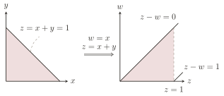

[上一篇](/lecture-notes/population-linear-regression/)以母體線性迴歸式，把兩個[隨機變數](/lecture-notes/random-variables-and-pmf/#def-random-variable)之間的線性關係寫成一條直線，並以三道例題示範它的求法。到這裡為止，我們所處理的都是[隨機向量](/lecture-notes/random-vectors-joint-pmf/#def-random-vector)自身的分配、條件分配與由這些分配所導出的各種量數。

本篇要看的是另一件事情。已知 $(X_1,X_2)$ 的聯合分配，令 $Y_1$ 與 $Y_2$ 各為 $X_1$ 與 $X_2$ 的函數，$(Y_1,Y_2)$ 的聯合分配是什麼？我們先說明 $\boldsymbol{Y}=g(\boldsymbol{X})$ 在什麼條件之下仍然是一個隨機向量，接著分離散型與連續型兩個部分，各給出一種求法，最後以五道例題示範。

前文已介紹[單一隨機變數的函數轉換](/lecture-notes/one-to-one-transformations/)；在統計推論中，更常需要處理隨機向量的函數轉換。例如**抽樣分配 (sampling distribution)** 所探討的即是**統計量 (statistics)** 的分配，而**統計量是樣本的函數組合**，故掌握隨機向量函數轉換後的分配求法，是後續推論的基礎。

隨機向量的函數轉換的形式如下:

$$
\begin{array}{ccccc}
\boxed{\text{已知}} & \Longrightarrow & \boxed{\text{函數關係}} & \Longrightarrow & \boxed{\text{所求}}\\[0.55em]
\boldsymbol{X}\sim f_{\sssig \boldsymbol{X}}(\boldsymbol{x}) & & \text{令 }\boldsymbol{Y}=g(\boldsymbol{X}) & & \boldsymbol{Y}\sim f_{\sssig \boldsymbol{Y}}(\boldsymbol{y})
\end{array}
$$

$$
\begin{array}{c}
\boxed{\text{已知}}\\[0.3em]
\boldsymbol{X}\sim f_{\sssig \boldsymbol{X}}(\boldsymbol{x})\\[0.55em]
\Downarrow\\[0.55em]
\boxed{\text{函數關係}}\\[0.3em]
\text{令 }\boldsymbol{Y}=g(\boldsymbol{X})\\[0.55em]
\Downarrow\\[0.55em]
\boxed{\text{所求}}\\[0.3em]
\boldsymbol{Y}\sim f_{\sssig \boldsymbol{Y}}(\boldsymbol{y})
\end{array}
$$

由下列定理可知，轉換後的 $\boldsymbol{Y}=g(\boldsymbol{X})$ 仍為隨機向量。

Theorem 3.22 (隨機向量的可測函數, measurable functions of a random vector)

若 $\boldsymbol{X}$ 為一隨機向量，且函數 $g(\cdot)\colon\mathbb{R}^n\to\mathbb{R}^m$ 為一定義在實數上的實值可測向量函數，則 $\boldsymbol{Y}=g(\boldsymbol{X})$ 亦為一個隨機向量。

計算 $\boldsymbol{Y}$ 的機率分配之方法眾多，以下分列之。

## 隨機變數的多對多函數轉換

前文在[隨機變數的函數轉換](/lecture-notes/one-to-one-transformations/)中處理的是「單一隨機變數轉為單一隨機變數」的情形；本篇則討論「多個隨機變數共同轉為多個隨機變數」的多對多轉換 (此處的「一對一」與「多對多」指轉換前後隨機變數的個數，而非單射函數之意)。由於一般多對多轉換可直接由二對二情形推廣，以下僅介紹二對二轉換，形式如下:

$$
\begin{array}{ccccc}
\boxed{\text{已知}} & \Longrightarrow & \boxed{\text{函數關係}} & \Longrightarrow & \boxed{\text{所求}}\\[0.55em]
(X_1,X_2)\sim f_{\sssig X_1X_2}(x_1,x_2) & & \text{令 }\begin{array}{c} Y_1=g_1(X_1,X_2)\\ Y_2=g_2(X_1,X_2)\end{array} & & (Y_1,Y_2)\sim f_{\sssig Y_1Y_2}(y_1,y_2)
\end{array}
$$

$$
\begin{array}{c}
\boxed{\text{已知}}\\[0.3em]
(X_1,X_2)\sim f_{\sssig X_1X_2}(x_1,x_2)\\[0.55em]
\Downarrow\\[0.55em]
\boxed{\text{函數關係}}\\[0.3em]
\text{令 }\begin{array}{c} Y_1=g_1(X_1,X_2)\\ Y_2=g_2(X_1,X_2)\end{array}\\[0.55em]
\Downarrow\\[0.55em]
\boxed{\text{所求}}\\[0.3em]
(Y_1,Y_2)\sim f_{\sssig Y_1Y_2}(y_1,y_2)
\end{array}
$$

## 離散型的 pmf 法

當隨機變數為離散時，我們的做法如下:

**pmf 法**

設轉換 $(g\_1,g\_2)$ 在聯合值域 $\mathcal{R}\_{\sssig X\_1X\_2}$ 上為一對一對應，使其可唯一反解為 $X\_1=h\_1(Y\_1,Y\_2)$ 與 $X_2=h_2(Y_1,Y_2)$，則有

$$
\begin{aligned}
p_{\sssig Y_1Y_2}(y_1,y_2)&=\mathbb{P}(Y_1=y_1,Y_2=y_2)=\mathbb{P}\bigl(g_1(X_1,X_2)=y_1,g_2(X_1,X_2)=y_2\bigr)\\[0.45em]
&=\mathbb{P}\bigl(X_1=h_1(y_1,y_2),X_2=h_2(y_1,y_2)\bigr)=p_{\sssig X_1X_2}\bigl(h_1(y_1,y_2),h_2(y_1,y_2)\bigr)
\end{aligned}
$$

$$
\begin{aligned}
p_{\sssig Y_1Y_2}(y_1,y_2)&=\mathbb{P}(Y_1=y_1,Y_2=y_2)\\[0.45em]
&=\mathbb{P}\bigl(g_1(X_1,X_2)=y_1,\\[0.2em]
&\qquad\qquad g_2(X_1,X_2)=y_2\bigr)\\[0.45em]
&=\mathbb{P}\bigl(X_1=h_1(y_1,y_2),\\[0.2em]
&\qquad\qquad X_2=h_2(y_1,y_2)\bigr)\\[0.45em]
&=p_{\sssig X_1X_2}\bigl(h_1(y_1,y_2),h_2(y_1,y_2)\bigr)
\end{aligned}
$$

上述過程中，由 $g\_1(X\_1,X\_2)=y\_1,$ $g\_2(X\_1,X\_2)=y\_2$ 化為 $X\_1=h\_1(y\_1,y\_2),$ $X\_2=h\_2(y\_1,y\_2)$ 即為解二元聯立方程式，將原變數反解為新變數的函數。

Note

在多維轉換問題中，雖然仍可使用[直接列表法](/lecture-notes/one-to-one-transformations/#離散型的函數轉換)，但聯合值域的組合數往往隨維度迅速增加而難以逐一窮舉；改採 pmf 法反解聯立方程式通常更為簡捷。

## 連續型的 Jacobian 法

而當隨機變數為連續時，我們的做法如下:

**Jacobian 法**

第一個步驟為

$$
Y_1=g_1(X_1,X_2),\ Y_2=g_2(X_1,X_2)
$$

$$
\Longrightarrow\ X_1=h_1(Y_1,Y_2),\ X_2=h_2(Y_1,Y_2)
$$

$$
\begin{aligned}
&\Longrightarrow X_1=h_1(Y_1,Y_2),\\[0.2em]
&\qquad\qquad X_2=h_2(Y_1,Y_2)
\end{aligned}
$$

第二個步驟為

$$
f_{\sssig Y_1Y_2}(y_1,y_2)=f_{\sssig X_1X_2}\bigl(h_1(y_1,y_2),h_2(y_1,y_2)\bigr)\bigl\lvert\mathbf{J}\bigr\rvert
$$

$$
\begin{aligned}
f_{\sssig Y_1Y_2}(y_1,y_2)&=f_{\sssig X_1X_2}\bigl(h_1(y_1,y_2),h_2(y_1,y_2)\bigr)\bigl\lvert\mathbf{J}\bigr\rvert
\end{aligned}
$$

其中

$$
\mathbf{J}=\left\lvert
\begin{array}{cc}
\dfrac{\partial h_1(y_1,y_2)}{\partial y_1} & \dfrac{\partial h_1(y_1,y_2)}{\partial y_2}\\[1.1em]
\dfrac{\partial h_2(y_1,y_2)}{\partial y_1} & \dfrac{\partial h_2(y_1,y_2)}{\partial y_2}
\end{array}
\right\rvert
$$

表示體積轉換因子 (Jacobian)。

此法與[一維 Jacobian 法](/lecture-notes/one-to-one-transformations/#prop-jacobian-method)原理一致，對應微積分的多變數積分變換公式。

Note

若將一維的 $\mathbf{J}=\frac{dx}{dy}$ 視為一階行列式，則一維 Jacobian 法即為多維 Jacobian 法的特例；兩者的共同原則皆是**將原變數的 pdf 以新變數表示，再乘上「原變數對新變數之偏微分矩陣的行列式 (determinant)」的絕對值**。

須注意，雖然隨機向量的函數轉換本身不要求轉換前後維度相等，但直接套用上述單一公式的 Jacobian 法時，除要求轉換前後的維度必須相同外，轉換 $(g\_1,g\_2)$ 在聯合值域 $\mathcal{R}\_{\sssig X\_1X\_2}$ 上亦須為一對一對應，且反解函數 $h\_1,h\_2$ 具連續一階偏導數並滿足 $\mathbf{J}\neq 0$ (若非全域一對一，則須如單變數情形先將值域分割為各自一對一的子區域，分段轉換後再相加)；至於轉換前後維度不同而仍欲使用 Jacobian 法的作法，將於[下一篇](/lecture-notes/mgf-method-transformations/)說明。

## 抽樣分配與 pmf 法的例題

Example 3.49

Let $X_1$, $X_2$, and $X_3$ be independent random variables associated with a Bernoulli trial such that

$$
\mathbb{P}(X_i=0)=\mathbb{P}(X_i=1)=0.5
$$

<ol class="topic-list-paren">
  <li>Find the sampling distributions of the sample mean, sample median, and sample mode of $(X_1,X_2,X_3)$.</li>
  <li>Find the expected value and variance of each statistic in (1).</li>
  <li>Find the sampling distributions of the order statistics $X_{\sssig (1)}$, $X_{\sssig (2)}$, and $X_{\sssig (3)}$ of $(X_1,X_2,X_3)$.</li>
</ol>

(1) 由題意可知，$X_1,X_2,X_3$ $\overset{\mathrm{iid}}{\sim}$ [$\mathrm{Ber}(p=0.5)$](/lecture-notes/bernoulli-trials-and-distribution/#def-bernoulli)
{: .topic-paren-item}

| prob. | $(X_1,X_2,X_3)$ | $\overline{X}=\frac{1}{3}\sum_{i=1}^{3}X_i$ | $m_e$ | $m_o$ | $X_{\sssig (1)}$ | $X_{\sssig (2)}$ | $X_{\sssig (3)}$ |
| :---: | :---: | :---: | :---: | :---: | :---: | :---: | :---: |
| $1/8$ | $(0,0,0)$ | $0$ | $0$ | $0$ | $0$ | $0$ | $0$ |
| $1/8$ | $(0,0,1)$ | $1/3$ | $0$ | $0$ | $0$ | $0$ | $1$ |
| $1/8$ | $(0,1,0)$ | $1/3$ | $0$ | $0$ | $0$ | $0$ | $1$ |
| $1/8$ | $(1,0,0)$ | $1/3$ | $0$ | $0$ | $0$ | $0$ | $1$ |
| $1/8$ | $(0,1,1)$ | $2/3$ | $1$ | $1$ | $0$ | $1$ | $1$ |
| $1/8$ | $(1,0,1)$ | $2/3$ | $1$ | $1$ | $0$ | $1$ | $1$ |
| $1/8$ | $(1,1,0)$ | $2/3$ | $1$ | $1$ | $0$ | $1$ | $1$ |
| $1/8$ | $(1,1,1)$ | $1$ | $1$ | $1$ | $1$ | $1$ | $1$ |

| prob. | $(X_1,$ $X_2,X_3)$ | $\overline{X}=$ $\frac{1}{3}\sum_{i=1}^{3}X_i$ | $m_e$ | $m_o$ |
| :---: | :---: | :---: | :---: | :---: |
| $1/8$ | $(0,0,0)$ | $0$ | $0$ | $0$ |
| $1/8$ | $(0,0,1)$ | $1/3$ | $0$ | $0$ |
| $1/8$ | $(0,1,0)$ | $1/3$ | $0$ | $0$ |
| $1/8$ | $(1,0,0)$ | $1/3$ | $0$ | $0$ |
| $1/8$ | $(0,1,1)$ | $2/3$ | $1$ | $1$ |
| $1/8$ | $(1,0,1)$ | $2/3$ | $1$ | $1$ |
| $1/8$ | $(1,1,0)$ | $2/3$ | $1$ | $1$ |
| $1/8$ | $(1,1,1)$ | $1$ | $1$ | $1$ |

| prob. | $(X_1,$ $X_2,X_3)$ | $X_{\sssig (1)}$ | $X_{\sssig (2)}$ | $X_{\sssig (3)}$ |
| :---: | :---: | :---: | :---: | :---: |
| $1/8$ | $(0,0,0)$ | $0$ | $0$ | $0$ |
| $1/8$ | $(0,0,1)$ | $0$ | $0$ | $1$ |
| $1/8$ | $(0,1,0)$ | $0$ | $0$ | $1$ |
| $1/8$ | $(1,0,0)$ | $0$ | $0$ | $1$ |
| $1/8$ | $(0,1,1)$ | $0$ | $1$ | $1$ |
| $1/8$ | $(1,0,1)$ | $0$ | $1$ | $1$ |
| $1/8$ | $(1,1,0)$ | $0$ | $1$ | $1$ |
| $1/8$ | $(1,1,1)$ | $1$ | $1$ | $1$ |

$$
\begin{gathered}
p_{\sssig \overline{X}}(\overline{x})=\left\lbrace
\begin{array}{c@{\quad}l}
\frac{3}{\,8\,}, & \overline{x}=\frac{1}{\,3\,},\frac{2}{\,3\,}\\[0.7em]
\frac{1}{\,8\,}, & \overline{x}=0,1\\[0.7em]
0, & \text{o.w.}
\end{array}
\right.\\[1.1em]
p_{\sssig m_e}(m_e)=\left\lbrace
\begin{array}{c@{\quad}l}
\frac{1}{\,2\,}, & m_e=0,1\\[0.7em]
0, & \text{o.w.}
\end{array}
\right.\\[1.1em]
p_{\sssig m_o}(m_o)=\left\lbrace
\begin{array}{c@{\quad}l}
\frac{1}{\,2\,}, & m_o=0,1\\[0.7em]
0, & \text{o.w.}
\end{array}
\right.
\end{gathered}
$$

又由上述結果可知
{: .topic-paren-cont}

$$
m_e\sim\mathrm{Ber}(p=0.5),\quad m_o\sim\mathrm{Ber}(p=0.5)
$$

(2) 由 (1) 的結果可知
{: .topic-paren-item}

$$
\begin{gathered}
\mathbb{E}(\overline{X})=0\times\frac{1}{\,8\,}+\frac{1}{\,3\,}\times\frac{3}{\,8\,}+\frac{2}{\,3\,}\times\frac{3}{\,8\,}+1\times\frac{1}{\,8\,}=\frac{1}{\,2\,}\\[0.9em]
\mathbb{E}\bigl(\overline{X}^{2}\bigr)=(0)^{2}\times\frac{1}{\,8\,}+\Bigl(\frac{1}{\,3\,}\Bigr)^{2}\times\frac{3}{\,8\,}+\Bigl(\frac{2}{\,3\,}\Bigr)^{2}\times\frac{3}{\,8\,}+(1)^{2}\times\frac{1}{\,8\,}=\frac{1}{\,3\,}
\end{gathered}
$$

$$
\begin{aligned}
&\mathbb{E}(\overline{X})=0\times\frac{1}{\,8\,}+\frac{1}{\,3\,}\times\frac{3}{\,8\,}\\[0.2em]
&\qquad +\frac{2}{\,3\,}\times\frac{3}{\,8\,}+1\times\frac{1}{\,8\,}=\frac{1}{\,2\,}
\end{aligned}
$$

$$
\begin{aligned}
&\mathbb{E}\bigl(\overline{X}^{2}\bigr)=(0)^{2}\times\frac{1}{\,8\,}+\Bigl(\frac{1}{\,3\,}\Bigr)^{2}\times\frac{3}{\,8\,}\\[0.2em]
&\qquad +\Bigl(\frac{2}{\,3\,}\Bigr)^{2}\times\frac{3}{\,8\,}+(1)^{2}\times\frac{1}{\,8\,}=\frac{1}{\,3\,}
\end{aligned}
$$

$$
\Longrightarrow\ \mathrm{Var}(\overline{X})=\mathbb{E}\bigl(\overline{X}^{2}\bigr)-\bigl[\mathbb{E}(\overline{X})\bigr]^{2}=\frac{1}{\,12\,}
$$

$$
\begin{aligned}
\Longrightarrow\ \mathrm{Var}(\overline{X})&=\mathbb{E}\bigl(\overline{X}^{2}\bigr)-\bigl[\mathbb{E}(\overline{X})\bigr]^{2}\\[0.35em]
&=\frac{1}{\,12\,}
\end{aligned}
$$

$$
\begin{gathered}
\mathbb{E}(m_e)=p=\frac{1}{\,2\,},\quad \mathrm{Var}(m_e)=p(1-p)=\frac{1}{\,4\,}\\[0.9em]
\mathbb{E}(m_o)=p=\frac{1}{\,2\,},\quad \mathrm{Var}(m_o)=p(1-p)=\frac{1}{\,4\,}
\end{gathered}
$$

$$
\begin{gathered}
\mathbb{E}(m_e)=p=\frac{1}{\,2\,},\\[0.7em]
\mathrm{Var}(m_e)=p(1-p)=\frac{1}{\,4\,}\\[0.7em]
\mathbb{E}(m_o)=p=\frac{1}{\,2\,},\\[0.7em]
\mathrm{Var}(m_o)=p(1-p)=\frac{1}{\,4\,}
\end{gathered}
$$

(3) 由 (1) 的結果中可以發現
{: .topic-paren-item}

$$
\begin{gathered}
p_{\sssig X_{\sssig (1)}}(x_{\sssig (1)})=\left\lbrace
\begin{array}{c@{\quad}l}
\frac{7}{\,8\,}, & x_{\sssig (1)}=0\\[0.7em]
\frac{1}{\,8\,}, & x_{\sssig (1)}=1\\[0.7em]
0, & \text{o.w.}
\end{array}
\right.\\[1.1em]
p_{\sssig X_{\sssig (2)}}(x_{\sssig (2)})=\left\lbrace
\begin{array}{c@{\quad}l}
\frac{1}{\,2\,}, & x_{\sssig (2)}=0\\[0.7em]
\frac{1}{\,2\,}, & x_{\sssig (2)}=1\\[0.7em]
0, & \text{o.w.}
\end{array}
\right.\\[1.1em]
p_{\sssig X_{\sssig (3)}}(x_{\sssig (3)})=\left\lbrace
\begin{array}{c@{\quad}l}
\frac{1}{\,8\,}, & x_{\sssig (3)}=0\\[0.7em]
\frac{7}{\,8\,}, & x_{\sssig (3)}=1\\[0.7em]
0, & \text{o.w.}
\end{array}
\right.
\end{gathered}
$$

也就是
{: .topic-paren-cont}

$$
X_{\sssig (1)}\sim\mathrm{Ber}\Bigl(p=\frac{1}{\,8\,}\Bigr),\quad X_{\sssig (2)}\sim\mathrm{Ber}\Bigl(p=\frac{1}{\,2\,}\Bigr),\quad X_{\sssig (3)}\sim\mathrm{Ber}\Bigl(p=\frac{7}{\,8\,}\Bigr)
$$

$$
\begin{gathered}
X_{\sssig (1)}\sim\mathrm{Ber}\Bigl(p=\frac{1}{\,8\,}\Bigr),\\[0.7em]
X_{\sssig (2)}\sim\mathrm{Ber}\Bigl(p=\frac{1}{\,2\,}\Bigr),\\[0.7em]
X_{\sssig (3)}\sim\mathrm{Ber}\Bigl(p=\frac{7}{\,8\,}\Bigr)
\end{gathered}
$$

Example 3.50

Let $(X_1,X_2)$ have joint probability mass function

$$
p_{\sssig X_1X_2}(x_1,x_2)=p^{x_1+x_2}(1-p)^{4-x_1-x_2}\ \text{ with }\ x_1=0,1,2,\ x_2=0,1,2
$$

$$
\begin{aligned}
p_{\sssig X_1X_2}(x_1,x_2)&=p^{x_1+x_2}(1-p)^{4-x_1-x_2}\\[0.55em]
&\quad \text{with }x_1=0,1,2,\ x_2=0,1,2
\end{aligned}
$$

Let $Y_1=X_1+X_2$ and $Y_2=X_1-X_2$. Find the joint pmf of $Y_1$ and $Y_2$.

**pmf 法**

$$
\begin{aligned}
p_{\sssig Y_1Y_2}(y_1,y_2)&=\mathbb{P}(Y_1=y_1,Y_2=y_2)=\mathbb{P}(X_1+X_2=y_1,X_1-X_2=y_2)\\[0.45em]
&=\mathbb{P}\Bigl(X_1=\frac{y_1+y_2}{2},X_2=\frac{y_1-y_2}{2}\Bigr)=p_{\sssig X_1X_2}\Bigl(\frac{y_1+y_2}{2},\frac{y_1-y_2}{2}\Bigr)\\[0.45em]
&=p^{\frac{y_1+y_2}{2}+\frac{y_1-y_2}{2}}(1-p)^{4-\frac{y_1+y_2}{2}-\frac{y_1-y_2}{2}}\\[0.45em]
&=p^{y_1}(1-p)^{4-y_1},\quad (y_1,y_2)\in\left\lbrace
\begin{array}{ccc}
(0,0) & (1,-1) & (2,-2)\\[0.3em]
(1,1) & (2,0) & (3,-1)\\[0.3em]
(2,2) & (3,1) & (4,0)
\end{array}
\right\rbrace
\end{aligned}
$$

$$
\begin{aligned}
p_{\sssig Y_1Y_2}(y_1,y_2)&=\mathbb{P}(Y_1=y_1,Y_2=y_2)\\[0.45em]
&=\mathbb{P}(X_1+X_2=y_1,X_1-X_2=y_2)\\[0.45em]
&=\mathbb{P}\Bigl(X_1=\frac{y_1+y_2}{2},X_2=\frac{y_1-y_2}{2}\Bigr)\\[0.45em]
&=p_{\sssig X_1X_2}\Bigl(\frac{y_1+y_2}{2},\frac{y_1-y_2}{2}\Bigr)\\[0.45em]
&=p^{\frac{y_1+y_2}{2}+\frac{y_1-y_2}{2}}(1-p)^{4-\frac{y_1+y_2}{2}-\frac{y_1-y_2}{2}}\\[0.45em]
&=p^{y_1}(1-p)^{4-y_1},\\[0.45em]
&\qquad (y_1,y_2)\in\left\lbrace
\begin{array}{ccc}
(0,0) & (1,-1) & (2,-2)\\[0.3em]
(1,1) & (2,0) & (3,-1)\\[0.3em]
(2,2) & (3,1) & (4,0)
\end{array}
\right\rbrace
\end{aligned}
$$

## Jacobian 法的例題

Example 3.51

Let $X$ and $Y$ be continuous random variables with joint probability density function

$$
f_{\sssig XY}(x,y)=
\left\lbrace
\begin{array}{c@{\quad}l}
24xy, & 0<x<1,\ 0<y<1,\ x+y<1\\[0.5em]
0, & \text{o.w.}
\end{array}
\right.
$$

  
$f_{\sssig XY}(x,y)=$

  

    <svg viewBox="0 0 12 12" preserveAspectRatio="none"><path d="M 11 0.8 C 7.6 0.8 6 2.4 6 5.2 L 6 12" vector-effect="non-scaling-stroke"/></svg>
    
    <svg viewBox="0 0 12 12" preserveAspectRatio="none"><path d="M 6 0 L 6 3.4 C 6 5 4.6 6 1 6 C 4.6 6 6 7 6 8.6 L 6 12" vector-effect="non-scaling-stroke"/></svg>
    
    <svg viewBox="0 0 12 12" preserveAspectRatio="none"><path d="M 6 0 L 6 6.8 C 6 9.6 7.6 11.2 11 11.2" vector-effect="non-scaling-stroke"/></svg>
  

  

    
$24xy,$

    
$0<x<1,\ 0<y<1,\ x+y<1$

    
$0,$

    
$\text{o.w.}$

  

<ol class="topic-list-paren">
  <li>Find the joint probability density function of $Z=X+Y$ and $W=X$.</li>
</ol>

(1) **Jacobian 法**
{: .topic-paren-item}

第一個步驟為
{: .topic-paren-cont}

$$
Z=X+Y,\ W=X\ \ \Longrightarrow\ \ X=W,\ Y=Z-W
$$

第二個步驟為
{: .topic-paren-cont}

$$
f_{\sssig ZW}(z,w)=f_{\sssig XY}(w,z-w)\bigl\lvert\mathbf{J}\bigr\rvert
$$

其中
{: .topic-paren-cont}

$$
\mathbf{J}=\left\lvert
\begin{array}{cc}
\dfrac{\partial w}{\partial z} & \dfrac{\partial w}{\partial w}\\[1.1em]
\dfrac{\partial (z-w)}{\partial z} & \dfrac{\partial (z-w)}{\partial w}
\end{array}
\right\rvert
=\left\lvert
\begin{array}{cc}
0 & 1\\[0.4em]
1 & -1
\end{array}
\right\rvert=0-1=-1
$$

$$
\begin{aligned}
\mathbf{J}&=\left\lvert
\begin{array}{cc}
\dfrac{\partial w}{\partial z} & \dfrac{\partial w}{\partial w}\\[1.1em]
\dfrac{\partial (z-w)}{\partial z} & \dfrac{\partial (z-w)}{\partial w}
\end{array}
\right\rvert\\[0.7em]
&=\left\lvert
\begin{array}{cc}
0 & 1\\[0.4em]
1 & -1
\end{array}
\right\rvert=0-1=-1
\end{aligned}
$$

$$
\begin{aligned}
\Longrightarrow\ f_{\sssig ZW}(z,w)&=24w(z-w)\cdot\bigl\lvert-1\bigr\rvert\\[0.45em]
&=24w(z-w),\ 0<w<1,\ 0<z<1,\ w<z
\end{aligned}
$$

$$
\begin{aligned}
\Longrightarrow\ f_{\sssig ZW}(z,w)&=24w(z-w)\cdot\bigl\lvert-1\bigr\rvert\\[0.45em]
&=24w(z-w),\\[0.25em]
&\quad 0<w<1,\ 0<z<1,\\[0.2em]
&\quad w<z
\end{aligned}
$$

Note

上述問題中，經過轉換後的範圍需要與原本的範圍相對照，即

$$
\begin{aligned}
&\left\lbrace
\begin{array}{c}
0<x<1\\[0.3em]
0<y<1\\[0.3em]
x+y<1
\end{array}
\right.\\[0.55em]
&\!\!\Longleftrightarrow
\left\lbrace
\begin{array}{c}
0<w<1\\[0.3em]
0<z-w<1\\[0.3em]
z<1
\end{array}
\right.\\[0.55em]
&\!\!\Longleftrightarrow
\left\lbrace
\begin{array}{c}
0<w<1\\[0.3em]
0<z<1\\[0.3em]
w<z
\end{array}
\right.
\end{aligned}
$$

其圖形如下:

<figure id="fig-many-to-many-range" class="topic-figure topic-figure--wide">
  
  <figcaption>Fig. 3.20. 左圖填色的三角形是轉換前 $x$ 與 $y$ 的聯合值域，斜邊落在 $z=x+y=1$ 上。令 $w=x$ 與 $z=x+y$ 之後得到右圖，填色的三角形是 $z$ 與 $w$ 的值域，三條界線分別是 $z-w=0$、$z-w=1$ 與 $z=1$，其中 $z-w=1$ 落在值域之外。</figcaption>
</figure>

Example 3.52

If $U$ is uniformly distributed over the interval $(0,2\pi)$, $V$ is exponentially distributed with mean $1$, and $U$ is independent of $V$, show that

$$
X=\sqrt{2V}\cos(U),\qquad Y=\sqrt{2V}\sin(U)
$$

are independent $\mathcal{N}(0,1)$ random variables.

由 $U\sim\mathcal{U}(0,2\pi)$ $\indep$ $V\sim\mathrm{Exp}(\beta=1)$ 之獨立性可知

$$
f_{\sssig UV}(u,v)=\frac{1}{\,2\pi\,}\times e^{-v},\quad 0<u<2\pi,\ v>0
$$

令 $X=\sqrt{2V}\cos(U),$ $Y=\sqrt{2V}\sin(U)$，則可知

$$
U=\tan^{-1}\Bigl(\frac{Y}{X}\Bigr),\quad V=\frac{1}{\,2\,}(X^{2}+Y^{2})
$$

且

$$
\mathbf{J}=\left\lvert
\begin{array}{cc}
\dfrac{\partial u}{\partial x} & \dfrac{\partial u}{\partial y}\\[1.1em]
\dfrac{\partial v}{\partial x} & \dfrac{\partial v}{\partial y}
\end{array}
\right\rvert
=\left\lvert
\begin{array}{cc}
\dfrac{\frac{-y}{x^{2}}}{1+\bigl(\frac{y}{x}\bigr)^{2}} & \dfrac{\frac{1}{x}}{1+\bigl(\frac{y}{x}\bigr)^{2}}\\[1.4em]
x & y
\end{array}
\right\rvert=-1
$$

$$
\begin{aligned}
\mathbf{J}&=\left\lvert
\begin{array}{cc}
\dfrac{\partial u}{\partial x} & \dfrac{\partial u}{\partial y}\\[1.1em]
\dfrac{\partial v}{\partial x} & \dfrac{\partial v}{\partial y}
\end{array}
\right\rvert\\[0.7em]
&=\left\lvert
\begin{array}{cc}
\dfrac{\frac{-y}{x^{2}}}{1+\bigl(\frac{y}{x}\bigr)^{2}} & \dfrac{\frac{1}{x}}{1+\bigl(\frac{y}{x}\bigr)^{2}}\\[1.4em]
x & y
\end{array}
\right\rvert=-1
\end{aligned}
$$

則由 Jacobian 法可知

$$
\begin{aligned}
f_{\sssig XY}(x,y)&=f_{\sssig UV}\Bigl(\tan^{-1}\Bigl(\frac{y}{x}\Bigr),\frac{1}{\,2\,}(x^{2}+y^{2})\Bigr)\lvert-1\rvert\\[0.45em]
&=\frac{1}{\,2\pi\,}e^{-\frac{\,x^{2}+y^{2}\,}{2}},\ -\infty<x,y<\infty
\end{aligned}
$$

$$
\begin{aligned}
f_{\sssig XY}(x,y)&=f_{\sssig UV}\Bigl(\tan^{-1}\Bigl(\frac{y}{x}\Bigr),\frac{1}{\,2\,}(x^{2}+y^{2})\Bigr)\lvert-1\rvert\\[0.45em]
&=\frac{1}{\,2\pi\,}e^{-\frac{\,x^{2}+y^{2}\,}{2}},\ -\infty<x,y<\infty
\end{aligned}
$$

$$
\begin{aligned}
&\Longrightarrow\ f_{\sssig X}(x)=\int_{-\infty}^{\infty}f_{\sssig XY}(x,y)\,dy=\frac{1}{\,\sqrt{2\pi}\,}e^{-\frac{\,x^{2}\,}{2}},\ -\infty<x<\infty\\[0.65em]
&\Longrightarrow\ f_{\sssig Y}(y)=\int_{-\infty}^{\infty}f_{\sssig XY}(x,y)\,dx=\frac{1}{\,\sqrt{2\pi}\,}e^{-\frac{\,y^{2}\,}{2}},\ -\infty<y<\infty
\end{aligned}
$$

$$
\begin{aligned}
&\Longrightarrow\ \begin{aligned}[t]
f_{\sssig X}(x)&=\int_{-\infty}^{\infty}f_{\sssig XY}(x,y)\,dy\\[0.35em]
&=\frac{1}{\,\sqrt{2\pi}\,}e^{-\frac{\,x^{2}\,}{2}},\\[0.2em]
&\quad -\infty<x<\infty
\end{aligned}\\[0.65em]
&\Longrightarrow\ \begin{aligned}[t]
f_{\sssig Y}(y)&=\int_{-\infty}^{\infty}f_{\sssig XY}(x,y)\,dx\\[0.35em]
&=\frac{1}{\,\sqrt{2\pi}\,}e^{-\frac{\,y^{2}\,}{2}},\\[0.2em]
&\quad -\infty<y<\infty
\end{aligned}
\end{aligned}
$$

並由 $f_{\sssig XY}(x,y)$ $=$ $f_{\sssig X}(x)\,f_{\sssig Y}(y)$ 知道

$$
X,Y\overset{\mathrm{iid}}{\sim}\mathcal{N}(0,1)
$$

Example 3.53 (Box-Muller transformation)

Let $U_1$ and $U_2$ be independent $\mathcal{U}(0,1)$ random variables, and let

$$
Z_1=\sqrt{-2\ln U_1}\cos(2\pi U_2)\quad\text{and}\quad Z_2=\sqrt{-2\ln U_1}\sin(2\pi U_2)
$$

$$
\begin{gathered}
Z_1=\sqrt{-2\ln U_1}\cos(2\pi U_2)\\[0.55em]
\text{and}\quad Z_2=\sqrt{-2\ln U_1}\sin(2\pi U_2)
\end{gathered}
$$

Show that $Z_1$ and $Z_2$ are independent standard normal random variables.

由 $U_1,U_2\overset{\mathrm{iid}}{\sim}\mathcal{U}(0,1)$ 可知

$$
f_{\sssig U_1U_2}(u_1,u_2)=1\times 1,\quad 0<u_1,u_2<1
$$

令 $Z_1=\sqrt{-2\ln U_1}\cos(2\pi U_2),$ $Z_2=\sqrt{-2\ln U_1}\sin(2\pi U_2)$

則可知

$$
U_1=e^{-\frac{1}{\,2\,}(Z_1^{2}+Z_2^{2})},\quad U_2=\frac{1}{\,2\pi\,}\tan^{-1}\Bigl(\frac{Z_2}{Z_1}\Bigr)
$$

且

$$
\mathbf{J}=\left\lvert
\begin{array}{cc}
\dfrac{\partial u_1}{\partial z_1} & \dfrac{\partial u_1}{\partial z_2}\\[1.1em]
\dfrac{\partial u_2}{\partial z_1} & \dfrac{\partial u_2}{\partial z_2}
\end{array}
\right\rvert
=\left\lvert
\begin{array}{cc}
-z_1e^{-\frac{1}{\,2\,}(z_1^{2}+z_2^{2})} & -z_2e^{-\frac{1}{\,2\,}(z_1^{2}+z_2^{2})}\\[1.4em]
\dfrac{-\frac{z_2}{z_1^{2}}}{2\pi\bigl[1+\bigl(\frac{z_2}{z_1}\bigr)^{2}\bigr]} & \dfrac{\frac{1}{z_1}}{2\pi\bigl[1+\bigl(\frac{z_2}{z_1}\bigr)^{2}\bigr]}
\end{array}
\right\rvert=-\frac{1}{\,2\pi\,}e^{-\frac{1}{\,2\,}(z_1^{2}+z_2^{2})}
$$

$$
\begin{aligned}
\mathbf{J}&=\left\lvert
\begin{array}{cc}
\dfrac{\partial u_1}{\partial z_1} & \dfrac{\partial u_1}{\partial z_2}\\[1.1em]
\dfrac{\partial u_2}{\partial z_1} & \dfrac{\partial u_2}{\partial z_2}
\end{array}
\right\rvert\\[0.7em]
&=\left\lvert
\begin{array}{cc}
-z_1e^{-\frac{1}{\,2\,}(z_1^{2}+z_2^{2})} & -z_2e^{-\frac{1}{\,2\,}(z_1^{2}+z_2^{2})}\\[1.4em]
\dfrac{-\frac{z_2}{z_1^{2}}}{2\pi\bigl[1+\bigl(\frac{z_2}{z_1}\bigr)^{2}\bigr]} & \dfrac{\frac{1}{z_1}}{2\pi\bigl[1+\bigl(\frac{z_2}{z_1}\bigr)^{2}\bigr]}
\end{array}
\right\rvert\\[0.7em]
&=-\frac{1}{\,2\pi\,}e^{-\frac{1}{\,2\,}(z_1^{2}+z_2^{2})}
\end{aligned}
$$

由 Jacobian 法可知

$$
\begin{aligned}
f_{\sssig Z_1Z_2}(z_1,z_2)&=f_{\sssig U_1U_2}\Bigl(e^{-\frac{1}{\,2\,}(z_1^{2}+z_2^{2})},\frac{1}{\,2\pi\,}\tan^{-1}\Bigl(\frac{z_2}{z_1}\Bigr)\Bigr)\left\lvert-\frac{1}{\,2\pi\,}e^{-\frac{1}{\,2\,}(z_1^{2}+z_2^{2})}\right\rvert\\[0.45em]
&=\frac{1}{\,2\pi\,}e^{-\frac{\,z_1^{2}+z_2^{2}\,}{2}},\ -\infty<z_1,z_2<\infty
\end{aligned}
$$

$$
\begin{aligned}
f_{\sssig Z_1Z_2}(z_1,z_2)&=f_{\sssig U_1U_2}\Bigl(e^{-\frac{1}{\,2\,}(z_1^{2}+z_2^{2})},\\[0.2em]
&\qquad\qquad \frac{1}{\,2\pi\,}\tan^{-1}\Bigl(\frac{z_2}{z_1}\Bigr)\Bigr)\\[0.2em]
&\qquad\qquad \times\left\lvert-\frac{1}{\,2\pi\,}e^{-\frac{1}{\,2\,}(z_1^{2}+z_2^{2})}\right\rvert\\[0.45em]
&=\frac{1}{\,2\pi\,}e^{-\frac{\,z_1^{2}+z_2^{2}\,}{2}},\ -\infty<z_1,z_2<\infty
\end{aligned}
$$

$$
\begin{aligned}
&\Longrightarrow\ f_{\sssig Z_1}(z_1)=\int_{-\infty}^{\infty}f_{\sssig Z_1Z_2}(z_1,z_2)\,dz_2=\frac{1}{\,\sqrt{2\pi}\,}e^{-\frac{\,z_1^{2}\,}{2}},\ -\infty<z_1<\infty\\[0.65em]
&\Longrightarrow\ f_{\sssig Z_2}(z_2)=\int_{-\infty}^{\infty}f_{\sssig Z_1Z_2}(z_1,z_2)\,dz_1=\frac{1}{\,\sqrt{2\pi}\,}e^{-\frac{\,z_2^{2}\,}{2}},\ -\infty<z_2<\infty
\end{aligned}
$$

$$
\begin{aligned}
\Longrightarrow\ f_{\sssig Z_1}(z_1)&=\int_{-\infty}^{\infty}f_{\sssig Z_1Z_2}(z_1,z_2)\,dz_2\\[0.35em]
&=\frac{1}{\,\sqrt{2\pi}\,}e^{-\frac{\,z_1^{2}\,}{2}},\\[0.2em]
&\quad -\infty<z_1<\infty\\[0.65em]
\Longrightarrow\ f_{\sssig Z_2}(z_2)&=\int_{-\infty}^{\infty}f_{\sssig Z_1Z_2}(z_1,z_2)\,dz_1\\[0.35em]
&=\frac{1}{\,\sqrt{2\pi}\,}e^{-\frac{\,z_2^{2}\,}{2}},\\[0.2em]
&\quad -\infty<z_2<\infty
\end{aligned}
$$

並由 $f_{\sssig Z_1Z_2}(z_1,z_2)$ $=$ $f_{\sssig Z_1}(z_1)\,f_{\sssig Z_2}(z_2)$ 知道

$$
Z_1,Z_2\overset{\mathrm{iid}}{\sim}\mathcal{N}(0,1)
$$

Note

本題為著名的 Box-Muller 轉換。在電腦模擬中，基礎亂數產生器通常僅提供獨立的 [$\mathcal{U}(0,1)$](/lecture-notes/uniform-distribution-integral-transform/#def-uniform-distribution) 亂數，而[標準常態分配](/lecture-notes/normal-distribution/#def-normal)的 cdf 無初等解析表示式，不易直接套用[機率積分轉換](/lecture-notes/one-to-one-transformations/#prop-probability-integral-transform) (probability integral transformation, PIT) 求反函數；Box-Muller 轉換則透過二對二的極座標變換，由兩個獨立的 $\mathcal{U}(0,1)$ 亂數直接生成兩個獨立的標準常態亂數。

## 本篇小結

本篇由隨機向量的函數轉換談起。[Theorem 3.22](#thm-measurable-function-of-random-vector) 說的是，只要 $g(\cdot)$ 是由 $\mathbb{R}^n$ 映到 $\mathbb{R}^m$ 的實值可測向量函數，$\boldsymbol{Y}=g(\boldsymbol{X})$ 就仍然是一個隨機向量，其後才有分配可求。統計量正是樣本的函數組合，抽樣分配所探討的就是統計量的分配，因此求取轉換後的分配，是往後更深入探討的基礎。由於多對多的例子可以由二對二推廣，本篇只處理二對二的情形。

離散型採 pmf 法。把 $Y_1=g_1(X_1,X_2)$ 與 $Y_2=g_2(X_1,X_2)$ 當成二元聯立方程式反解，得到 $X_1=h_1(Y_1,Y_2)$ 與 $X_2=h_2(Y_1,Y_2)$ 這兩條反解式，再把它們代回原本的聯合 pmf。維度一高，直接列表法會因為值域結構龐大而難以窮舉，方程式反解反而簡單。連續型採 Jacobian 法。同樣先反解，再把原變數的 pdf 以新變數表示，並乘上原變數對新變數偏微分所成行列式的絕對值。一維的 Jacobian 法只是它的特例，把一維的 $\mathbf{J}$ 看成一維度的行列式即可；但直接套用單一公式時，要求轉換前後維度相同且映射在聯合值域上為一對一對應 (反解函數具連續一階偏導數且 $\mathbf{J}\neq 0$)。

五道例題分成兩組。[Example 3.49](#ex-three-independent-transformation) 以三個獨立的伯努利變數窮舉八種結果，一次求得樣本平均數、[中位數](/lecture-notes/median/#def-median)、[眾數](/lecture-notes/mode/#def-mode)與三個排序後變數的抽樣分配，並由其中前三個統計量的分配算出各自的[期望值](/lecture-notes/expectation/#def-expectation)與[變異數](/lecture-notes/variance/#def-variance)。[Example 3.50](#ex-discrete-joint-transformation) 是 pmf 法的標準用法。由 $Y_1=X_1+X_2$ 與 $Y_2=X_1-X_2$ 反解得 $X_1=\frac{y_1+y_2}{2}$ 與 $X_2=\frac{y_1-y_2}{2}$ 這兩式，代回之後指數相加相消，聯合 pmf 只剩下 $y_1$ 而與 $y_2$ 無關，但 $(y_1,y_2)$ 的可能取值仍受原本值域的限制。

[Example 3.51](#ex-integral-one-variable) 是 Jacobian 法的第一個例子，其中 $\mathbf{J}=-1$ 這個值說明體積並未被拉伸；本篇的區域圖把轉換前後的值域並列，讀者可以看出原本的三角形在新的兩個變數之下仍是一塊三角形，只是頂點的位置換了。[Example 3.52](#ex-uniform-to-exponential) 與 [Example 3.53](#ex-two-uniform-transformation) 都是由兩個容易生成的變數造出兩個獨立的標準常態。前者取一個 $\mathcal{U}(0,2\pi)$ 與一個平均數為 $1$ 的[指數分配](/lecture-notes/gamma-function-exponential-distribution/#def-exponential-distribution)，後者取兩個獨立的 $\mathcal{U}(0,1)$ 亂數，兩題的 $\mathbf{J}$ 算完之後，聯合 pdf 都成為兩個標準常態密度的乘積，再各自積分得到兩個邊際 pdf，兩者相乘恰為聯合 pdf，獨立性因而成立。後者即是著名的 Box-Muller 轉換，它讓電腦只憑均勻亂數就能產生標準常態亂數。

[下一篇](/lecture-notes/mgf-method-transformations/)處理轉換前後維度不同的情形，也就是多對一的函數轉換，並介紹在這種情形下特別好用的[動差母函數](/lecture-notes/moment-generating-functions/#def-mgf)法。

## 參考文獻與延伸閱讀

- 黃文璋，2010，《機率論》，二版，華泰文化。
- Sheldon Ross. 2019. *A First Course in Probability*. 10th ed. Pearson.
- Robert V. Hogg, Joseph W. McKean, and Allen T. Craig. 2019. *Introduction to Mathematical Statistics*. 8th ed. Pearson.
- George Casella and Roger L. Berger. 2002. *Statistical Inference*. 2nd ed. Duxbury.
