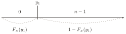
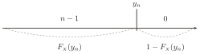
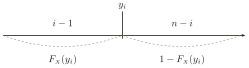
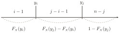
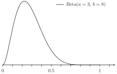

[上一篇](/lecture-notes/order-statistics/)以 [Definition 3.21](/lecture-notes/order-statistics/#def-order-stat) 給出[順序統計量](/lecture-notes/order-statistics/#def-order-stat)，並以三道例題說明在任意的聯合分配之中，求順序統計量的分配必須先把所有可能的大小順序逐一列出、各自轉換再行加總；而在隨機樣本的情況中，同分配的對稱性會使各種情況的結果完全相同，加總因而只剩下一個與階乘有關的倍數。

本篇便由這個對稱性出發，先以 [Theorem 3.24](#thm-order-stat-samp-dist-pdf) 列出隨機樣本之順序統計量的五個 pdf 並證明其中的前兩個，接著以四張圖改由排列組合的觀點重新理解這五個結果，最後再以[標準均勻分配](/lecture-notes/uniform-distribution-integral-transform/#def-uniform-distribution)為例，說明它的各個順序統計量為什麼會服從[貝塔分配](/lecture-notes/beta-function-and-distribution/#def-beta-distribution)。

## 順序統計量的抽樣分配 pdf

Theorem 3.24 (隨機樣本之順序統計量的抽樣分配 pdf, pdf of order statistics)

令 $Y_1$ $\leqslant\cdots\leqslant$ $Y_n$ 為隨機樣本 $X_1,\ldots,X_n$ 之順序統計量，則

<ol class="topic-list-paren topic-list-paren--math">
  <li>
$$
f_{\sssig Y_1}(y_1) = nf_{\sssig X}(y_1)\bigl[1-F_{\sssig X}(y_1)\bigr]^{n-1},\ y_1\in \mathcal{R}_{\sssig X}
$$
  </li>
  <li>
$$
f_{\sssig Y_n}(y_n) = nf_{\sssig X}(y_n)\bigl[F_{\sssig X}(y_n)\bigr]^{n-1},\ y_n\in \mathcal{R}_{\sssig X}
$$
  </li>
  <li>
  

$$
f_{\sssig Y_i}(y_i) = \frac{n!}{(i-1)!(n-i)!}f_{\sssig X}(y_i)\bigl[F_{\sssig X}(y_i)\bigr]^{i-1}\bigl[1-F_{\sssig X}(y_i)\bigr]^{n-i},\ y_i\in \mathcal{R}_{\sssig X}
$$
  

  

$$
\begin{aligned}
f_{\sssig Y_i}(y_i) &= \frac{n!}{(i-1)!(n-i)!}f_{\sssig X}(y_i)\\[0.45em]
&\quad \bigl[F_{\sssig X}(y_i)\bigr]^{i-1}\bigl[1-F_{\sssig X}(y_i)\bigr]^{n-i},\ y_i\in \mathcal{R}_{\sssig X}
\end{aligned}
$$
  

  </li>
  <li>
  

$$
\begin{aligned}
f_{\sssig Y_iY_j}(y_i, y_j) &= \frac{n!}{(i-1)!(j-i-1)!(n-j)!}f_{\sssig X}(y_i)f_{\sssig X}(y_j)\\[0.45em]
&\qquad\times\bigl[F_{\sssig X}(y_i)\bigr]^{i-1}\bigl[F_{\sssig X}(y_j)-F_{\sssig X}(y_i)\bigr]^{j-i-1}\\[0.45em]
&\qquad\times\bigl[1-F_{\sssig X}(y_j)\bigr]^{n-j}, \ y_i, y_j\in \mathcal{R}_{\sssig X} \ \text{且} \ y_i<y_j
\end{aligned}
$$
  

  

$$
\begin{aligned}
f_{\sssig Y_iY_j}(&y_i, y_j) = \frac{n!}{(i-1)!(j-i-1)!(n-j)!}\\[0.45em]
&\qquad\times f_{\sssig X}(y_i)f_{\sssig X}(y_j)\bigl[F_{\sssig X}(y_i)\bigr]^{i-1}\\[0.45em]
&\qquad\times\bigl[F_{\sssig X}(y_j)-F_{\sssig X}(y_i)\bigr]^{j-i-1}\\[0.45em]
&\qquad\times\bigl[1-F_{\sssig X}(y_j)\bigr]^{n-j},\ y_i, y_j\in \mathcal{R}_{\sssig X} \ \text{且} \ y_i<y_j
\end{aligned}
$$
  

  </li>
  <li>
  

$$
f_{\sssig Y_1\cdots Y_n}(y_1, \ldots, y_n) = n!f_{\sssig X}(y_1)\cdots f_{\sssig X}(y_n), \ \ y_1, \ldots, y_n \in\mathcal{R}_{\sssig X} \ \text{且} \ y_1<\cdots<y_n
$$
  

  

$$
\begin{aligned}
f_{\sssig Y_1\cdots Y_n}(y_1, \ldots, y_n) &= n!f_{\sssig X}(y_1)\cdots f_{\sssig X}(y_n),\\[0.45em]
&\quad y_1, \ldots, y_n \in\mathcal{R}_{\sssig X} \ \text{且} \ y_1<\cdots<y_n
\end{aligned}
$$
  

  </li>
</ol>

**Proof.**

我們在此謹證明 (1) 與 (2)，剩下的同理可證，並可以圖示來理解

(1) 由於 $Y_1,\ldots,Y_n$ 為順序統計量，故
{: .topic-paren-item}

$$
\begin{aligned}
F_{\sssig Y_1}(y_1) &= \mathbb{P}(Y_1\leqslant y_1) = 1-\mathbb{P}(Y_1>y_1) = 1-\mathbb{P}(X_1>y_1, \ldots, X_n>y_1)\\[0.45em]
&= 1 - \mathbb{P}(X_1>y_1)\cdots\mathbb{P}(X_n>y_1) = 1-\bigl[1-F_{\sssig X}(y_1)\bigr]^{n}
\end{aligned}
$$

$$
\begin{aligned}
F_{\sssig Y_1}(y_1) &= \mathbb{P}(Y_1\leqslant y_1) = 1-\mathbb{P}(Y_1>y_1)\\[0.45em]
&= 1-\mathbb{P}(X_1>y_1, \ldots, X_n>y_1)\\[0.45em]
&= 1 - \mathbb{P}(X_1>y_1)\cdots\mathbb{P}(X_n>y_1)\\[0.45em]
&= 1-\bigl[1-F_{\sssig X}(y_1)\bigr]^{n}
\end{aligned}
$$

$$
\begin{aligned}
f_{\sssig Y_1}(y_1) &= \frac{\,d\,F_{\sssig Y_1}(y_1)\,}{d\,y_1} = \frac{d\Bigl(1-\bigl[1-F_{\sssig X}(y_1)\bigr]^{n}\Bigr)}{dy_1}\\[0.45em]
&= -n\bigl[1-F_{\sssig X}(y_1)\bigr]^{n-1}\times\bigl[-f_{\sssig X}(y_1)\bigr] = n\,f_{\sssig X}(y_1)\bigl[1-F_{\sssig X}(y_1)\bigr]^{n-1},\ y_1\in \mathcal{R}_{\sssig X}
\end{aligned}
$$

$$
\begin{aligned}
f_{\sssig Y_1}(y_1) &= \frac{\,d\,F_{\sssig Y_1}(y_1)\,}{d\,y_1} = \frac{d\Bigl(1-\bigl[1-F_{\sssig X}(y_1)\bigr]^{n}\Bigr)}{dy_1}\\[0.45em]
&= -n\bigl[1-F_{\sssig X}(y_1)\bigr]^{n-1}\times\bigl[-f_{\sssig X}(y_1)\bigr]\\[0.45em]
&= n\,f_{\sssig X}(y_1)\bigl[1-F_{\sssig X}(y_1)\bigr]^{n-1},\ y_1\in \mathcal{R}_{\sssig X}
\end{aligned}
$$

(2) 與 (1) 同理，可知
{: .topic-paren-item}

$$
\begin{aligned}
F_{\sssig Y_n}(y_n) &= \mathbb{P}(Y_n\leqslant y_n) = \mathbb{P}(X_1\leqslant y_n, \ldots, X_n\leqslant y_n)\\[0.45em]
&= \mathbb{P}(X_1\leqslant y_n)\cdots\mathbb{P}(X_n\leqslant y_n) = \bigl[F_{\sssig X}(y_n)\bigr]^{n}
\end{aligned}
$$

$$
\begin{aligned}
F_{\sssig Y_n}(y_n) &= \mathbb{P}(Y_n\leqslant y_n)\\[0.45em]
&= \mathbb{P}(X_1\leqslant y_n, \ldots, X_n\leqslant y_n)\\[0.45em]
&= \mathbb{P}(X_1\leqslant y_n)\cdots\mathbb{P}(X_n\leqslant y_n)\\[0.45em]
&= \bigl[F_{\sssig X}(y_n)\bigr]^{n}
\end{aligned}
$$

$$
\begin{aligned}
f_{\sssig Y_n}(y_n) &= \frac{\,d\,F_{\sssig Y_n}(y_n)\,}{d\,y_n} = \frac{\,d\bigl[F_{\sssig X}(y_n)\bigr]^{n}\,}{d\,y_n} = n\bigl[F_{\sssig X}(y_n)\bigr]^{n-1}\times f_{\sssig X}(y_n)\\[0.45em]
&= n\,f_{\sssig X}(y_n)\bigl[F_{\sssig X}(y_n)\bigr]^{n-1},\ y_n\in\mathcal{R}_{\sssig X}
\end{aligned}
$$

$$
\begin{aligned}
f_{\sssig Y_n}(y_n) &= \frac{\,d\,F_{\sssig Y_n}(y_n)\,}{d\,y_n} = \frac{\,d\bigl[F_{\sssig X}(y_n)\bigr]^{n}\,}{d\,y_n}\\[0.45em]
&= n\bigl[F_{\sssig X}(y_n)\bigr]^{n-1}\times f_{\sssig X}(y_n)\\[0.45em]
&= n\,f_{\sssig X}(y_n)\bigl[F_{\sssig X}(y_n)\bigr]^{n-1},\ y_n\in\mathcal{R}_{\sssig X}
\end{aligned}
$$

原式得證。 $\square$

## 最小值與最大值的圖解

順序統計量的抽樣分配公式與母體屬於何種連續分配**沒有關係**，皆可統一由原始分配的 pdf 與 cdf 表示，且每個順序統計量的值域 $\mathcal{R}\_{\sssig X}$ 與原始分配完全相同。以下透過數線分段示意圖說明各式的組合結構:

<figure id="fig-order-stat-min" class="topic-figure topic-figure--wide">
  
  <figcaption>Fig. 3.24. 切點 $y_1$ 把數線分成兩段，線上方的數字是落在該段的樣本個數，左段沒有樣本、右段有 $n-1$ 個，線下方的兩條虛線則各標出一個樣本落在該段的機率。</figcaption>
</figure>

如 [Fig. 3.24](#fig-order-stat-min) 所示，一旦固定最小值 $Y_1 = y_1$，其餘 $n-1$ 個樣本皆須落在 $y\_1$ 右側。對單一樣本而言，落在 $y\_1$ 左側的累積機率為 $F_{\sssig X}(y_1)$，落在 $y\_1$ 右側的機率則為 $1-F_{\sssig X}(y_1)$。從餘事件來看，**只要不是全部的 $n$ 個樣本 (包含 $Y\_1$ 自身) 都超過 $y\_1$**，最小值便不超過 $y_1$，故 $Y\_1$ 的 cdf 為 $F\_{\sssig Y\_1}(y\_1)=1-\bigl[1-F\_{\sssig X}(y\_1)\bigr]^{n}$ 這一形式；對 $y\_1$ 微分即得第 (1) 式的 pdf。

同理，第 (2) 式最大值的示意圖如下:

<figure id="fig-order-stat-max" class="topic-figure topic-figure--wide">
  
  <figcaption>Fig. 3.25. 切點 $y_n$ 把數線分成兩段，左段有 $n-1$ 個樣本、右段沒有樣本，線下方的兩條虛線則各標出一個樣本落在該段的機率。</figcaption>
</figure>

由於最大值不超過 $y\_n$ 等價於**全部的 $n$ 個樣本至多都只有 $y\_n$ 這麼大**，故 $Y\_n$ 的 cdf 為 $\bigl[F_{\sssig X}(y_n)\bigr]^{n}$，對 $y\_n$ 微分即得第 (2) 式的 pdf。最小值與最大值之所以能直接由 cdf 導出，是因為兩者分別對應**所有樣本都大於**與**所有樣本都小於等於**的交集事件；對於一般的第 $i$ 個順序統計量，則可由排列組合觀點統一處理。

## 一般的順序統計量與排列組合

對於一般的順序統計量 $Y_i$，一旦固定 $Y_i=y_i$，比 $Y\_i$ 小的樣本有 $i-1$ 個，比 $Y\_i$ 大的樣本則有 $n-i$ 個，如下圖:

<figure id="fig-order-stat-ith" class="topic-figure topic-figure--wide">
  
  <figcaption>Fig. 3.26. 切點 $y_i$ 把數線分成兩段，左段有 $i-1$ 個樣本、右段有 $n-i$ 個，線下方的兩條虛線則各標出一個樣本落在該段的機率。</figcaption>
</figure>

在全部 $n$ 個樣本共有 $n!$ 種可能順序之中，消去 $y\_i$ 左側 $i-1$ 個樣本彼此間的排列數 $(i-1)!$ 以及右側 $n-i$ 個樣本彼此間的排列數 $(n-i)!$，可得區段分配的組合數為 $\frac{n!}{\,(i-1)!(n-i)!\,}$。將此組合數乘上單一樣本落在 $y\_i$ 的密度 $f\_{\sssig X}(y\_i)$ 與左右兩段機率的乘冪 $\bigl[F\_{\sssig X}(y\_i)\bigr]^{i-1}$ 及 $\bigl[1-F_{\sssig X}(y_i)\bigr]^{n-i}$，即得

$$
f_{\sssig Y_i}(y_i) = \frac{n!}{\,(i-1)!(n-i)!\,}f_{\sssig X}(y_i)\bigl[F_{\sssig X}(y_i)\bigr]^{i-1}\bigl[1-F_{\sssig X}(y_i)\bigr]^{n-i},\ y_i\in \mathcal{R}_{\sssig X}
$$

$$
\begin{aligned}
f_{\sssig Y_i}(y_i) &= \frac{n!}{\,(i-1)!(n-i)!\,}f_{\sssig X}(y_i)\\[0.45em]
&\quad \bigl[F_{\sssig X}(y_i)\bigr]^{i-1}\bigl[1-F_{\sssig X}(y_i)\bigr]^{n-i},\ y_i\in \mathcal{R}_{\sssig X}
\end{aligned}
$$

以此觀點重新審視第 (1) 與第 (2) 式，結構完全一致。以第 (1) 式為例，固定最小值 $Y_1 = y_1$ 後，比 $Y\_1$ 大的 $n-1$ 個樣本彼此間的順序須除掉，組合數為 $\frac{n!}{\,(n-1)!\,} = n$，再乘上 $f\_{\sssig X}(y\_1)$ 與 $\bigl[1-F\_{\sssig X}(y\_1)\bigr]^{n-1}$ 即得原式；第 (2) 式的最大值 $Y\_n$ 作法亦同。

依同一邏輯處理第 (4) 式的雙變數聯合 pdf，對應的分段示意圖如下:

<figure id="fig-order-stat-ij" class="topic-figure topic-figure--wide">
  
  <figcaption>Fig. 3.27. 兩個切點 $y_i$ 與 $y_j$ 把數線分成三段，各段的樣本個數依序是 $i-1$、$j-i-1$ 與 $n-j$，線下方的三條虛線則各標出一個樣本落在該段的機率。</figcaption>
</figure>

關鍵仍在於**決定好 $Y\_i$ 與 $Y\_j$ 後，將同一區段內的樣本順序全數除掉**；因此 $n!$ 須除以 $(i-1)!$、$(j-i-1)!$ 與 $(n-j)!$ 的乘積，再乘上兩切點的密度與三段機率的乘冪，即得第 (4) 式。

至於第 (5) 式中整組順序統計量的聯合 pdf 為何恰為 $f\_{\sssig X}(y\_1)\cdots f\_{\sssig X}(y\_n)$ 乘上 $n!$ 倍，亦可由同一原則解釋。整組樣本落在 $y\_1<\cdots<y\_n$ 這 $n$ 個位置上的對應排列共有 $n!$ 種，而各分界點之間的開區段內均已無剩餘樣本，分母除去的皆為 $0!=1$，組合數遂為 $\frac{n!}{\,0!\cdots 0!\,}=n!$。

## 標準均勻分配的順序統計量與貝塔分配

接下來，我們來考慮一個特殊的例子:

令 $X_1, \ldots, X_n$ $\overset{\mathrm{iid}}{\sim}$ $\mathcal{U}(0, 1),$ $Y_1$ $\leqslant\cdots\leqslant$ $Y_n$ 為其順序統計量，則

$$
\begin{gathered}
Y_1 \sim \mathrm{Beta}(1, n)\\[0.45em]
Y_n \sim \mathrm{Beta}(n, 1)\\[0.45em]
Y_i \sim \mathrm{Beta}(i, n-i+1)\\[0.45em]
Y_j - Y_i \sim \mathrm{Beta}(j-i, n+i-j+1),\ \forall\,j>i
\end{gathered}
$$

上述結果源於標準均勻分配 $\mathcal{U}(0, 1)$ 在 $0<x<1$ 上的 cdf 恰為 $F_{\sssig X}(x) = x$，代回 [Theorem 3.24](#thm-order-stat-samp-dist-pdf) 各式並對照貝塔分配的密度函數即可得證。

從順序統計量的性質亦可直觀理解貝塔分配與均勻分配的關聯。順序統計量是在觀測到數值之前即先按大小次序定義的統計量，意指**不論整組隨機樣本實際觀測到什麼數值，恆取其中大小排第 $i$ 的那一個**。雖然仍可能出現所有觀測值皆偏高或皆偏低的極端情形，但發生機率較低，故順序統計量具有較高機率密度的區域會集中在與其排序相對應的位置，如下圖:

<figure id="fig-order-stat-presorted" class="topic-figure topic-figure--wide">
  
  <figcaption>Fig. 3.28. 順序統計量的機率密度集中在它的排序所在的位置，兩端則相對較低。</figcaption>
</figure>

由於標準均勻分配在 $0$ 到 $1$ 之間的機率密度處處相等，抽取 $n$ 個獨立樣本平均而言會將 $[0, 1]$ 等距切成 $n+1$ 等分，其中第 $i$ 個分點恰落在 $\frac{i}{\,n+1\,}$，正好是 $\mathrm{Beta}(i, n-i+1)$ 的[期望值](/lecture-notes/expectation/#def-expectation)所在；對照貝塔分配的圖形可見機率密度在 $\frac{i}{\,n+1\,}$ 附近特別高，往兩端逐漸降低。

## 本篇小結

[Theorem 3.24](#thm-order-stat-samp-dist-pdf) 把隨機樣本的順序統計量所具有的抽樣分配一次列齊。最小的 $Y_1$ 與最大的 $Y_n$ 各有一條含 $n$ 這個倍數的 pdf，第 $i$ 個的 $Y_i$ 多了 $\frac{n!}{\,(i-1)!(n-i)!\,}$ 這個組合數，任意兩個 $Y_i$ 與 $Y_j$ 的聯合 pdf 把值域切成三段、各段各有一個組合數與一個機率的乘冪，整組 $Y_1$ 到 $Y_n$ 的聯合 pdf 則只是原本的 pdf 逐點相乘之後再乘上 $n!$ 這個倍數。五式全部只用原始分配的 pdf 與 cdf 寫成，而且每個順序統計量的值域都與原本的分配相同。

證明只作了前兩式，作法都是先求 cdf 再微分。$Y_1$ 是所有樣本中最小者，故 $Y_1>y_1$ 等於所有樣本都大於 $y_1$，由獨立可得 $\mathbb{P}(Y_1>y_1)$ $=$ $\bigl[1-F_{\sssig X}(y_1)\bigr]^{n}$，取餘事件即為 cdf；$Y_n$ 是所有樣本中最大者，故 $Y_n\leqslant y_n$ 等於所有樣本都小於等於 $y_n$，由獨立可得 cdf 為 $\bigl[F_{\sssig X}(y_n)\bigr]^{n}$。兩式各自對 $y_1$ 與 $y_n$ 微分之後，就得到 (1) 式與 (2) 式的 pdf。

四張示意圖則改由排列組合的觀點重新理解這五式。一旦決定了某個順序統計量的值，落在它左側的樣本個數與落在它右側的樣本個數就被固定下來，而「一個樣本落在其左側」的機率是 $F_{\sssig X}$ 在該點的值、「落在其右側」的機率是 $1-F_{\sssig X}$ 在該點的值，這正是各段機率的乘冪的來源。至於前面的係數，則是把 $n!$ 種可能的順序之中、同一段之內的順序都除掉所剩下的組合數，例如 $Y_i$ 除掉 $(i-1)!$ 與 $(n-i)!$，$Y_1$ 只除掉 $(n-1)!$，剩下 $n$ 這個倍數；而 (5) 式的每一段之內都沒有樣本，除掉的全是 $0!$，因此係數就是 $n!$ 本身。

最後以標準均勻分配為例。它的 cdf 是 $F_{\sssig X}(x)$ $=$ $x$，代回上述各式即可得到 $Y_1$ 為 $\mathrm{Beta}(1, n)$、$Y_n$ 為 $\mathrm{Beta}(n, 1)$、$Y_i$ 為 $\mathrm{Beta}(i, n-i+1)$，以及 $Y_j - Y_i$ 為 $\mathrm{Beta}(j-i, n+i-j+1)$ 這幾個結果。這件事在直觀上也說得通，順序統計量是在觀察到值之前就先排好序的，因此其機率密度會集中在它的排序所在的位置；而標準均勻分配的密度處處相同，$n$ 個樣本粗淺的平均而言會把 $[0, 1]$ 等距切成 $n+1$ 等分，第 $i$ 個等分點落在 $\frac{i}{\,n+1\,}$ 的位置，這恰好就是 $\mathrm{Beta}(i, n-i+1)$ 的期望值所在。

[下一篇](/lecture-notes/order-statistics-examples/)先以一道例題把本篇的五款 pdf 公式在標準均勻分配上實際用過一遍，一併求出全距的分配，並說明順序統計量還可以定義出樣本全距與樣本[中位數](/lecture-notes/median/#def-median)這一類的統計量，接著由指數分配的隨機樣本求最小值與最大值的分配；其後給出順序統計量的抽樣分配 cdf，最後以兩道離散型的例題作結。

## 參考文獻與延伸閱讀

- 黃文璋，2010，《機率論》，二版，華泰文化。
- Sheldon Ross. 2019. *A First Course in Probability*. 10th ed. Pearson.
- Robert V. Hogg, Joseph W. McKean, and Allen T. Craig. 2019. *Introduction to Mathematical Statistics*. 8th ed. Pearson.
- George Casella and Roger L. Berger. 2002. *Statistical Inference*. 2nd ed. Duxbury.
