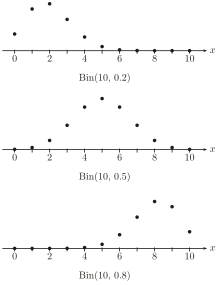

[上一篇](/lecture-notes/bernoulli-trials-and-distribution/)由[伯努利實驗](/lecture-notes/bernoulli-trials-and-distribution/#def-ber-trial)出發，給出[伯努利分配](/lecture-notes/bernoulli-trials-and-distribution/#def-bernoulli)的定義，並在最後留下一個問題，即只有成功與失敗兩種結果的情境下，為什麼要刻意把 $X$ 定義成一次伯努利實驗中的「成功次數」？本篇的二項分配就是這個問題的答案。伯努利實驗的定義本來就包含「每次實驗的成功機率固定」與「實驗與實驗之間彼此獨立」這兩點，因此把同一個伯努利實驗連續重複 $n$ 次是很自然的做法，而此時值得記錄的量，就是這 $n$ 次之中成功的總次數。

本篇先給出二項分配的定義，並完整證明其機率函數為一個合法的機率函數，以及期望值、變異數與動差母函數的公式。接著說明二項分配在 $n=1$ 時就是伯努利分配、成功機率相同且彼此獨立的兩個二項變數相加仍為二項分配，以及機率函數中的組合數所對應的直觀意義。最後看 $p$ 的大小如何改變分配的形狀，並以六道例題練習二項分配的計算。

Definition 4.3 (二項分配, binomial distribution)

**適用範圍**:

令 $X$ 表進行 **$n$ 次**伯努利實驗中，成功實驗的發生次數。

**值域範圍**:

$$
\mathcal{R}_{\sssig X}=\lbrace\,0,1,\ldots,n\,\rbrace
$$

**表示式**:

$$
X\sim\mathrm{Bin}(n,\ p)
$$

**參數與參數範圍**:

$0<p<1$ 為伯努利實驗中，成功類的發生機率。

**機率函數**:

$$
p_{\sssig X}(x)=\binom{n}{x}p^{x}(1-p)^{n-x}=\binom{n}{x}p^{x}q^{n-x},\ x=0,1,\ldots,n
$$

$$
\begin{aligned}
p_{\sssig X}(x)&=\binom{n}{x}p^{x}(1-p)^{n-x}\\[0.45em]
&=\binom{n}{x}p^{x}q^{n-x},\ x=0,1,\ldots,n
\end{aligned}
$$

其中，$q=1-p$ 為失敗類發生的機率。

**期望值、變異數、動差母函數**:

$$
\begin{gathered}
\mathbb{E}(X)=np,\quad \mathrm{Var}(X)=np(1-p)=npq\\[0.45em]
M_{\sssig X}(t)=\bigl[pe^{t}+(1-p)\bigr]^{n}=\bigl(pe^{t}+q\bigr)^{n},\ t\in\mathbb{R}
\end{gathered}
$$

$$
\begin{gathered}
\mathbb{E}(X)=np,\\[0.45em]
\mathrm{Var}(X)=np(1-p)=npq
\end{gathered}
$$

$$
\begin{aligned}
M_{\sssig X}(t)&=\bigl[pe^{t}+(1-p)\bigr]^{n}\\[0.25em]
&=\bigl(pe^{t}+q\bigr)^{n},\ t\in\mathbb{R}
\end{aligned}
$$

二項分配 (binomial distribution) 有一些地方需要注意:

(1) 我們證明其機率函數為一個合法的機率函數與期望值、變異數及動差母函數如下:
{: .topic-paren-item}

**Proof.**

先驗證機率函數的加總為 $1$，即

$$
\sum_{x\in\mathcal{R}_{\sssig X}}p_{\sssig X}(x)=\sum_{x=0}^{n}\binom{n}{x}p^{x}(1-p)^{n-x}=\bigl[p+(1-p)\bigr]^{n}=1
$$

$$
\begin{aligned}
\sum_{x\in\mathcal{R}_{\sssig X}}p_{\sssig X}(x)&=\sum_{x=0}^{n}\binom{n}{x}p^{x}(1-p)^{n-x}\\[0.45em]
&=\bigl[p+(1-p)\bigr]^{n}=1
\end{aligned}
$$

接著求期望值，可得

$$
\begin{aligned}
\mathbb{E}(X)&=\sum_{x=0}^{n}x\binom{n}{x}p^{x}(1-p)^{n-x}=\sum_{x=0}^{n}x\frac{n!}{x!(n-x)!}p^{x}(1-p)^{n-x}\\[0.45em]
&=\sum_{x=1}^{n}\frac{n!}{(x-1)!(n-x)!}p^{x}(1-p)^{n-x}=np\sum_{x=1}^{n}\frac{(n-1)!}{(x-1)!(n-x)!}p^{x-1}(1-p)^{n-x}\\[0.45em]
&=np\bigl[p+(1-p)\bigr]^{n-1}=np\times1^{n-1}=np
\end{aligned}
$$

$$
\begin{aligned}
\mathbb{E}(X)&=\sum_{x=0}^{n}x\binom{n}{x}p^{x}(1-p)^{n-x}\\[0.45em]
&=\sum_{x=0}^{n}x\frac{n!}{x!(n-x)!}p^{x}(1-p)^{n-x}\\[0.45em]
&=\sum_{x=1}^{n}\frac{n!}{(x-1)!(n-x)!}p^{x}(1-p)^{n-x}\\[0.45em]
&=np\sum_{x=1}^{n}\frac{(n-1)!}{(x-1)!(n-x)!}\\[0.25em]
&\qquad\qquad  p^{x-1}(1-p)^{n-x}\\[0.45em]
&=np\bigl[p+(1-p)\bigr]^{n-1}\\[0.25em]
&=np\times1^{n-1}=np
\end{aligned}
$$

又可得

$$
\begin{aligned}
\mathbb{E}\bigl[X(X-1)\bigr]&=\sum_{x=0}^{n}x(x-1)\binom{n}{x}p^{x}(1-p)^{n-x}=\sum_{x=0}^{n}x(x-1)\frac{n!}{x!(n-x)!}p^{x}(1-p)^{n-x}\\[0.45em]
&=n(n-1)p^{2}\sum_{x=2}^{n}\frac{(n-2)!}{(x-2)!(n-x)!}p^{x-2}(1-p)^{n-x}\\[0.45em]
&=n(n-1)p^{2}\bigl[p+(1-p)\bigr]^{n-2}=n(n-1)p^{2}
\end{aligned}
$$

$$
\begin{aligned}
\mathbb{E}\bigl[&X(X-1)\bigr]=\sum_{x=0}^{n}x(x-1)\binom{n}{x}p^{x}(1-p)^{n-x}\\[0.45em]
&=\sum_{x=0}^{n}x(x-1)\frac{n!}{x!(n-x)!}p^{x}(1-p)^{n-x}\\[0.45em]
&=n(n-1)p^{2}\sum_{x=2}^{n}\frac{(n-2)!}{(x-2)!(n-x)!}\\[0.25em]
&\qquad\qquad  p^{x-2}(1-p)^{n-x}\\[0.45em]
&=n(n-1)p^{2}\bigl[p+(1-p)\bigr]^{n-2}\\[0.25em]
&=n(n-1)p^{2}
\end{aligned}
$$

由此可得

$$
\begin{aligned}
\mathbb{E}\bigl(X^{2}\bigr)&=\mathbb{E}\bigl[X(X-1)\bigr]+\mathbb{E}(X)=n(n-1)p^{2}+np\\[0.45em]
&=np\bigl[(n-1)p+1\bigr]=np\bigl[np+(1-p)\bigr]
\end{aligned}
$$

$$
\begin{aligned}
\mathbb{E}\bigl(X^{2}\bigr)&=\mathbb{E}\bigl[X(X-1)\bigr]+\mathbb{E}(X)\\[0.45em]
&=n(n-1)p^{2}+np\\[0.45em]
&=np\bigl[(n-1)p+1\bigr]\\[0.45em]
&=np\bigl[np+(1-p)\bigr]
\end{aligned}
$$

則變異數為

$$
\mathrm{Var}(X)=\mathbb{E}\bigl(X^{2}\bigr)-\bigl[\mathbb{E}(X)\bigr]^{2}=np\bigl[np+(1-p)\bigr]-(np)^{2}=np(1-p)=npq
$$

$$
\begin{aligned}
\mathrm{Var}(X)&=\mathbb{E}\bigl(X^{2}\bigr)-\bigl[\mathbb{E}(X)\bigr]^{2}\\[0.45em]
&=np\bigl[np+(1-p)\bigr]-(np)^{2}\\[0.45em]
&=np(1-p)=npq
\end{aligned}
$$

最後求動差母函數，可得

$$
\begin{aligned}
M_{\sssig X}(t)&=\mathbb{E}\bigl(e^{tX}\bigr)=\sum_{x=0}^{n}e^{tx}\binom{n}{x}p^{x}(1-p)^{n-x}=\sum_{x=0}^{n}\binom{n}{x}\bigl(pe^{t}\bigr)^{x}(1-p)^{n-x}\\[0.45em]
&=\bigl[pe^{t}+(1-p)\bigr]^{n}=\bigl(pe^{t}+q\bigr)^{n},\ t\in\mathbb{R}
\end{aligned}
$$

$$
\begin{aligned}
M_{\sssig X}(t)&=\mathbb{E}\bigl(e^{tX}\bigr)\\[0.45em]
&=\sum_{x=0}^{n}e^{tx}\binom{n}{x}p^{x}(1-p)^{n-x}\\[0.45em]
&=\sum_{x=0}^{n}\binom{n}{x}\bigl(pe^{t}\bigr)^{x}(1-p)^{n-x}\\[0.45em]
&=\bigl[pe^{t}+(1-p)\bigr]^{n}\\[0.25em]
&=\bigl(pe^{t}+q\bigr)^{n},\ t\in\mathbb{R}
\end{aligned}
$$

原式得證。 $\square$

Note

上述推導多次運用 [Theorem 2.18](/lecture-notes/moment-system/#thm-binomial) 的二項式定理 (binomial theorem) 將級數收回二項次方。此外，期望值與變異數除如上透過階乘動差 (factorial moment) 求取外，亦可直接對動差母函數 $M_{\sssig X}(t)$ 微分並代入 $t=0$ 得證。

(2) 二項分配的定義可以得到以下幾個延伸性質:
{: .topic-paren-item}

第一，我們有
{: .topic-paren-cont}

$$
\mathrm{Ber}(p)=\mathrm{Bin}(n=1,\ p)
$$

當實驗次數 $n=1$ 時，二項分配記錄的即是**一次**伯努利實驗中的成功次數，自然退化為伯努利分配。
{: .topic-paren-cont}

第二，若 $X\sim\mathrm{Bin}(n_1,\ p),\ Y\sim\mathrm{Bin}(n_2,\ p)$ 且 $X\indep Y$，則
{: .topic-paren-cont}

$$
W=X+Y\sim\mathrm{Bin}(n_1+n_2,\ p)
$$

**Proof.**

由[獨立隨機變數線性組合的動差母函數之定理](/lecture-notes/mgf-method-transformations/#thm-mgf-two-to-one)可知

$$
M_{\sssig W}(t)=M_{\sssig X}(t)\,M_{\sssig Y}(t)=\bigl[pe^{t}+(1-p)\bigr]^{n_1}\bigl[pe^{t}+(1-p)\bigr]^{n_2}=\bigl[pe^{t}+(1-p)\bigr]^{n_1+n_2}
$$

$$
\begin{aligned}
M_{\sssig W}(t)&=M_{\sssig X}(t)\,M_{\sssig Y}(t)\\[0.45em]
&=\bigl[pe^{t}+(1-p)\bigr]^{n_1}\bigl[pe^{t}+(1-p)\bigr]^{n_2}\\[0.45em]
&=\bigl[pe^{t}+(1-p)\bigr]^{n_1+n_2}
\end{aligned}
$$

則由 [mgf 的唯一性](/lecture-notes/uniqueness-of-the-mgf/#thm-mgf-uniqueness)可知

$$
W=X+Y\sim\mathrm{Bin}(n_1+n_2,\ p)
$$

原式得證。 $\square$

此性質稱為二項分配的**可加性 (additive property)**，或譯**加成性**，前提是 $X$ 與 $Y$ 彼此獨立且**成功機率必須相同**。由此立即可推得，若 $X_1,\ldots,X_n\overset{\mathrm{iid}}{\sim}\mathrm{Ber}(p)$ 成立，則
{: .topic-paren-cont}

$$
W=\sum_{i=1}^{n}X_i\sim\mathrm{Bin}(n,\ p)
$$

Note

一般而言，若同屬某一分配族的隨機變數在指定條件下相加後仍屬於同一分配族 (允許部分常數或參數改變)，即稱該分配具有可加性。由於獨立隨機變數相加後的 mgf 等於個別 mgf 的乘積，因此具有可加性的分配，其相加的常數或參數往往出現在 mgf 的次方位置。

(3) 二項分配的機率函數可直觀解讀為「在 $n$ 次獨立伯努利實驗中選出 $x$ 次為成功、其餘 $n-x$ 次為失敗」。
{: .topic-paren-item}

Note

由於各次實驗彼此獨立且成功機率固定，只要成功總次數同為 $x$，無論成功發生在哪幾次實驗，單一序列的機率皆為 $p^{x}q^{n-x}$；將所有可能位置加總，即須乘上組合數 $\binom{n}{x}$。此外，此處的實驗次數 $n$ 是事前給定的**固定常數而非參數**，亦即先固定進行 $n$ 次成敗實驗，再觀測其中的成功次數。

(4) 二項分配的**偏態**隨成功機率 $p$ 而改變；當 $p$ 大於、等於、小於 $0.5$ 時，分配分別呈左偏、對稱與右偏，如下圖所示。
{: .topic-paren-item}

<figure id="fig-binomial-pmf-shapes" class="topic-figure topic-figure--wide">
  
  <figcaption>Fig. 4.1. 三個面板的成敗實驗次數相同，橫軸是成功的次數，圓點的高度即該次數所對應的機率。由上而下成功機率漸增，機率先偏在左側，再成為左右對稱，最後偏在右側，也就是右偏、對稱與左偏三種形狀。</figcaption>
</figure>

Example 4.2

The moment-generating function of $X$ is $M_{\sssig X}(t)=\bigl(0.25+0.75e^{t}\bigr)^{16}$.

<ol class="topic-list-paren">
  <li>What is the pmf of $X$?</li>
  <li>What are $\mathbb{E}(X)$ and $\mathrm{Var}(X)$?</li>
</ol>

(1) 由 mgf 的唯一性可知
{: .topic-paren-item}

$$
X\sim\mathrm{Bin}(n=16,\ p=0.75)
$$

$$
\Longrightarrow\ p_{\sssig X}(x)=\binom{16}{x}(0.75)^{x}(0.25)^{16-x},\ x=0,1,\ldots,16
$$

$$
\begin{aligned}
&\Longrightarrow\ p_{\sssig X}(x)=\binom{16}{x}(0.75)^{x}(0.25)^{16-x},\\[0.25em]
&\qquad\qquad x=0,1,\ldots,16
\end{aligned}
$$

(2) 由 (1) 已知 $X\sim\mathrm{Bin}(16,\ 0.75)$，則
{: .topic-paren-item}

$$
\mathbb{E}(X)=16\times0.75=12,\quad \mathrm{Var}(X)=16\times0.75\times0.25=3
$$

$$
\begin{gathered}
\mathbb{E}(X)=16\times0.75=12,\\[0.45em]
\mathrm{Var}(X)=16\times0.75\times0.25=3
\end{gathered}
$$

Example 4.3

Research data show that the probability of a defect in a new LED lamp is $3\%$.

<ol class="topic-list-paren">
  <li>If the quality control department randomly selects $8$ lamps, find the probability that at least one lamp is defective.</li>
</ol>

(1) 由題意可令 $X$ 表示 LED 燈的壞掉個數，則
{: .topic-paren-item}

$$
X\sim\mathrm{Bin}(n=8,\ p=0.03)
$$

所求為
{: .topic-paren-cont}

$$
\mathbb{P}(X\geqslant1)=1-\mathbb{P}(X=0)=1-\binom{8}{0}(1-0.03)^{8}=1-(0.97)^{8}\fallingdotseq0.2163
$$

$$
\begin{aligned}
\mathbb{P}(X\geqslant1)&=1-\mathbb{P}(X=0)\\[0.45em]
&=1-\binom{8}{0}(1-0.03)^{8}\\[0.45em]
&=1-(0.97)^{8}\fallingdotseq0.2163
\end{aligned}
$$

Example 4.4

At a certain university, $60\%$ of the students are from southern Taiwan. If $8$ students are randomly selected from this university, what is the probability that at least $7$ of them are from southern Taiwan?

由題意可令 $X$ 表示 $8$ 位同學中來自南部的人數，則

$$
X\sim\mathrm{Bin}(n=8,\ p=0.6)
$$

所求為

$$
\mathbb{P}(X\geqslant7)=\mathbb{P}(X=7)+\mathbb{P}(X=8)=\binom{8}{7}(0.6)^{7}(0.4)^{1}+\binom{8}{8}(0.6)^{8}(0.4)^{0}\fallingdotseq0.1064
$$

$$
\begin{aligned}
\mathbb{P}(X\geqslant7)&=\mathbb{P}(X=7)+\mathbb{P}(X=8)\\[0.45em]
&=\binom{8}{7}(0.6)^{7}(0.4)^{1}\\[0.25em]
&\qquad+\binom{8}{8}(0.6)^{8}(0.4)^{0}\\[0.45em]
&\fallingdotseq0.1064
\end{aligned}
$$

Example 4.5

I have two coins: one fair ($\mathbb{P}(\text{head})=0.5$) and one biased ($\mathbb{P}(\text{head})=0.25$).

<ol class="topic-list-paren">
  <li>I pick one at random and toss it $100$ times. Let $X$ denote the number of heads in $100$ tosses. Calculate $\mathbb{E}(X)$.</li>
</ol>

(1) 由題意可令
{: .topic-paren-item}

$$
Y=\left\lbrace
\begin{array}{c@{\quad}l}
1, & \text{公正硬幣}\\[0.5em]
0, & \text{非公正硬幣}
\end{array}
\right.
$$

表示挑選到的硬幣，則依題意可令 $Y\sim\mathrm{Ber}\bigl(\frac{1}{\,2\,}\bigr)$ 這一分配，且有
{: .topic-paren-cont}

$$
(X\mid Y=1)\sim\mathrm{Bin}(100,\ 0.5),\quad (X\mid Y=0)\sim\mathrm{Bin}(100,\ 0.25)
$$

$$
\begin{gathered}
(X\mid Y=1)\sim\mathrm{Bin}(100,\ 0.5),\\[0.45em]
(X\mid Y=0)\sim\mathrm{Bin}(100,\ 0.25)
\end{gathered}
$$

由[雙重期望值定理](/lecture-notes/double-expectation-theorem/#thm-double-expectation)可知
{: .topic-paren-cont}

$$
\mathbb{E}(X)=\mathbb{E}\bigl[\mathbb{E}(X\mid Y)\bigr]=100\times0.5\times\frac{1}{\,2\,}+100\times0.25\times\frac{1}{\,2\,}=37.5
$$

$$
\begin{aligned}
\mathbb{E}(X)&=\mathbb{E}\bigl[\mathbb{E}(X\mid Y)\bigr]\\[0.45em]
&=100\times0.5\times\frac{1}{\,2\,}\\[0.25em]
&\qquad+100\times0.25\times\frac{1}{\,2\,}\\[0.45em]
&=37.5
\end{aligned}
$$

Example 4.6

Assume that the distribution of $N$ is $\mathrm{Bin}(m,p)$. Given $N=n$, the conditional distribution of $Y$ is $\mathrm{Bin}(n,q)$. What is the unconditional distribution of $Y$?

依題意可以知道 $N\sim\mathrm{Bin}(m,\ p)$ 以及 $(Y\mid N=n)\sim\mathrm{Bin}(n,\ q)$ 成立，則由[全機率定理](/lecture-notes/conditional-law-of-total-probability/#thm-law-of-total-prob-r-v)可知

$$
\begin{aligned}
p_{\sssig Y}(y)&=\mathbb{E}\bigl[p_{\sssig Y\mid N}(y\mid N)\bigr]=\sum_{n=y}^{m}\binom{n}{y}q^{y}(1-q)^{n-y}\times\binom{m}{n}p^{n}(1-p)^{m-n}\\[0.45em]
&=\sum_{n=y}^{m}\frac{n!}{\,y!(n-y)!\,}q^{y}(1-q)^{n-y}\times\frac{m!}{\,n!(m-n)!\,}p^{n}(1-p)^{m-n}\\[0.45em]
&=\frac{m!}{\,(m-y)!\,y!\,}q^{y}(1-q)^{-y}\sum_{n=y}^{m}\frac{(m-y)!}{\,(n-y)!(m-n)!\,}\bigl[p(1-q)\bigr]^{n}(1-p)^{m-n}\\[0.45em]
&=\frac{m!}{\,(m-y)!\,y!\,}q^{y}(1-q)^{-y}\bigl[p(1-q)\bigr]^{y}\\[0.25em]
&\qquad \times\sum_{n=y}^{m}\frac{(m-y)!}{\,(n-y)!(m-n)!\,}\bigl[p(1-q)\bigr]^{n-y}(1-p)^{m-n}\\[0.45em]
&=\frac{m!}{\,(m-y)!\,y!\,}(pq)^{y}\times\bigl[p(1-q)+(1-p)\bigr]^{m-y}\\[0.45em]
&=\binom{m}{y}(pq)^{y}(1-pq)^{m-y},\ y=0,1,2,\ldots,m
\end{aligned}
$$

$$
\begin{aligned}
p_{\sssig Y}(y)&=\mathbb{E}\bigl[p_{\sssig Y\mid N}(y\mid N)\bigr]\\[0.45em]
&=\sum_{n=y}^{m}\binom{n}{y}q^{y}(1-q)^{n-y}\\[0.25em]
&\qquad\qquad \times\binom{m}{n}p^{n}(1-p)^{m-n}\\[0.45em]
&=\sum_{n=y}^{m}\frac{n!}{\,y!(n-y)!\,}q^{y}(1-q)^{n-y}\\[0.25em]
&\qquad\qquad \times\frac{m!}{\,n!(m-n)!\,}p^{n}(1-p)^{m-n}\\[0.45em]
&=\frac{m!}{\,(m-y)!\,y!\,}q^{y}(1-q)^{-y}\\[0.25em]
&\qquad \sum_{n=y}^{m}\frac{(m-y)!}{\,(n-y)!(m-n)!\,}\\[0.25em]
&\qquad\qquad \bigl[p(1-q)\bigr]^{n}(1-p)^{m-n}\\[0.45em]
&=\frac{m!}{\,(m-y)!\,y!\,}q^{y}(1-q)^{-y}\bigl[p(1-q)\bigr]^{y}\\[0.25em]
&\qquad \times\sum_{n=y}^{m}\frac{(m-y)!}{\,(n-y)!(m-n)!\,}\\[0.25em]
&\qquad\qquad \bigl[p(1-q)\bigr]^{n-y}(1-p)^{m-n}\\[0.45em]
&=\frac{m!}{\,(m-y)!\,y!\,}(pq)^{y}\\[0.25em]
&\qquad\qquad \times\bigl[p(1-q)+(1-p)\bigr]^{m-y}\\[0.45em]
&=\binom{m}{y}(pq)^{y}(1-pq)^{m-y},\\[0.25em]
&\qquad\qquad y=0,1,2,\ldots,m
\end{aligned}
$$

此即

$$
Y\sim\mathrm{Bin}(m,\ pq)
$$

Note

本題亦可改由雙重期望值定理計算 $Y$ 的邊際動差母函數 $M_{\sssig Y}(t)=\mathbb{E}\bigl[\mathbb{E}(e^{tY}\mid N)\bigr]$ 這一期望值，再由 mgf 唯一性推得 $Y\sim\mathrm{Bin}(m,\ pq)$ 的結論。

Example 4.7

Suppose that $X_1$ and $X_2$ are independent random variables with moment-generating functions

$$
\Bigl(\frac{1}{\,3\,}+\frac{2}{\,3\,}e^{t}\Bigr)^{4}\quad \text{and}\quad \frac{2}{\,5\,}e^{t}+\frac{1}{\,5\,}e^{2t}+\frac{2}{\,5\,}e^{3t}
$$

$$
\begin{gathered}
\Bigl(\frac{1}{\,3\,}+\frac{2}{\,3\,}e^{t}\Bigr)^{4}\\[0.35em]
\text{and}\quad \frac{2}{\,5\,}e^{t}+\frac{1}{\,5\,}e^{2t}+\frac{2}{\,5\,}e^{3t}
\end{gathered}
$$

respectively. Find

<ol class="topic-list-paren">
  <li>$\mathbb{P}(X_1+X_2=4)$.</li>
  <li>the mgf of $Y=2X_1-3X_2$.</li>
</ol>

(1) 依 mgf 的唯一性可知 $X_1\sim\mathrm{Bin}\bigl(4,\ \frac{2}{\,3\,}\bigr)$ 這項結果，另外隨機變數 $X_2$ 的機率質量函數為
{: .topic-paren-item}

$$
p_{\sssig X_2}(x_2)=\left\lbrace
\begin{array}{c@{\quad}l}
\dfrac{2}{\,5\,}, & x_2=1,3\\[0.7em]
\dfrac{1}{\,5\,}, & x_2=2
\end{array}
\right.
$$

且 $X_1\indep X_2$，故
{: .topic-paren-cont}

$$
\begin{aligned}
\mathbb{P}(X_1+X_2=4)&=p_{\sssig X_1X_2}(1,3)+p_{\sssig X_1X_2}(2,2)+p_{\sssig X_1X_2}(3,1)\\[0.45em]
&=p_{\sssig X_1}(1)\,p_{\sssig X_2}(3)+p_{\sssig X_1}(2)\,p_{\sssig X_2}(2)+p_{\sssig X_1}(3)\,p_{\sssig X_2}(1)\\[0.45em]
&=\binom{4}{1}\Bigl(\frac{2}{\,3\,}\Bigr)^{1}\Bigl(\frac{1}{\,3\,}\Bigr)^{3}\times\frac{2}{\,5\,}+\binom{4}{2}\Bigl(\frac{2}{\,3\,}\Bigr)^{2}\Bigl(\frac{1}{\,3\,}\Bigr)^{2}\times\frac{1}{\,5\,}\\[0.45em]
&\qquad +\binom{4}{3}\Bigl(\frac{2}{\,3\,}\Bigr)^{3}\Bigl(\frac{1}{\,3\,}\Bigr)^{1}\times\frac{2}{\,5\,}\\[0.45em]
&=\frac{104}{\,405\,}
\end{aligned}
$$

$$
\begin{aligned}
\mathbb{P}(X_1+X_2=4)&=p_{\sssig X_1X_2}(1,3)+p_{\sssig X_1X_2}(2,2)\\[0.25em]
&\qquad\qquad +p_{\sssig X_1X_2}(3,1)\\[0.45em]
&=p_{\sssig X_1}(1)\,p_{\sssig X_2}(3)+p_{\sssig X_1}(2)\,p_{\sssig X_2}(2)\\[0.25em]
&\qquad\qquad +p_{\sssig X_1}(3)\,p_{\sssig X_2}(1)\\[0.45em]
&=\binom{4}{1}\Bigl(\frac{2}{\,3\,}\Bigr)^{1}\Bigl(\frac{1}{\,3\,}\Bigr)^{3}\times\frac{2}{\,5\,}\\[0.25em]
&\qquad +\binom{4}{2}\Bigl(\frac{2}{\,3\,}\Bigr)^{2}\Bigl(\frac{1}{\,3\,}\Bigr)^{2}\times\frac{1}{\,5\,}\\[0.25em]
&\qquad +\binom{4}{3}\Bigl(\frac{2}{\,3\,}\Bigr)^{3}\Bigl(\frac{1}{\,3\,}\Bigr)^{1}\times\frac{2}{\,5\,}\\[0.45em]
&=\frac{104}{\,405\,}
\end{aligned}
$$

(2) 由獨立隨機變數線性組合的動差母函數之定理可知
{: .topic-paren-item}

$$
M_{\sssig Y}(t)=M_{\sssig X_1}(2t)\,M_{\sssig X_2}(-3t)=\Bigl(\frac{1}{\,3\,}+\frac{2}{\,3\,}e^{2t}\Bigr)^{4}\times\Bigl(\frac{2}{\,5\,}e^{-3t}+\frac{1}{\,5\,}e^{-6t}+\frac{2}{\,5\,}e^{-9t}\Bigr)
$$

$$
\begin{aligned}
M_{\sssig Y}(t)&=M_{\sssig X_1}(2t)\,M_{\sssig X_2}(-3t)\\[0.45em]
&=\Bigl(\frac{1}{\,3\,}+\frac{2}{\,3\,}e^{2t}\Bigr)^{4}\\[0.25em]
&\qquad\times\Bigl(\frac{2}{\,5\,}e^{-3t}+\frac{1}{\,5\,}e^{-6t}+\frac{2}{\,5\,}e^{-9t}\Bigr)
\end{aligned}
$$

## 本篇小結

[Definition 4.3](#def-binomial) 把伯努利分配推廣到 $n$ 次實驗，其中 $X$ 記錄 $n$ 次伯努利實驗中成功的次數，值域為 $\lbrace\,0,1,\ldots,n\,\rbrace$，機率函數為 $\binom{n}{x}p^{x}q^{n-x}$，其中的組合數對應「哪幾次成功」的選法，而 $n$ 是一個固定的常數，不是參數。證明的四個步驟依序驗證機率函數的加總為 $1$、求得 $\mathbb{E}(X)=np$、再以階乘動差 $\mathbb{E}\bigl[X(X-1)\bigr]=n(n-1)p^{2}$ 得到 $\mathbb{E}\bigl(X^{2}\bigr)$ 進而算出 $\mathrm{Var}(X)=npq$，最後直接由定義求得 $M_{\sssig X}(t)=\bigl(pe^{t}+q\bigr)^{n}$ 這一式。其中機率函數的加總、兩個動差的計算與動差母函數的推導，都用到 [Theorem 2.18](/lecture-notes/moment-system/#thm-binomial) 的二項式定理。

定義之後的幾點說明依序涵蓋 $n=1$ 時二項分配即為伯努利分配、成功機率相同且彼此獨立的兩個二項變數相加仍為二項分配 (可加性)、機率函數中的組合數所對應的直觀意義，以及 $p$ 的大小決定分配的形狀，$p$ 大於、等於、小於 $0.5$ 時分別為左偏、對稱與右偏。可加性的證明只需把兩個 mgf 相乘，指數因而相加，再由 mgf 的唯一性辨識出結果；同一個論證也給出 $n$ 個獨立且同分配的伯努利變數相加後即服從二項分配。

六道例題涵蓋三種常見的用法。[Example 4.2](#ex-binomial-1) 與 [Example 4.7](#ex-binomial-6) 由 mgf 的形狀反推分配，前者辨識出 $\mathrm{Bin}(16,\ 0.75)$，後者則在辨識之後再以獨立性把兩個 mgf 相乘。[Example 4.3](#ex-binomial-2) 與 [Example 4.4](#ex-binomial-3) 是直接的機率計算，前者以餘事件處理「至少一個」，後者則把「至少 $7$ 位」拆成兩項相加。[Example 4.5](#ex-binomial-4) 與 [Example 4.6](#ex-binomial-5) 則把成功機率或實驗次數本身當成隨機的。前者先以伯努利變數表示挑到哪一個硬幣，再用雙重期望值定理求 $\mathbb{E}(X)$；後者以全機率定理把條件二項分配對 $N$ 加總，最後得到 $Y\sim\mathrm{Bin}(m,\ pq)$，仍然是一個二項分配。

[下一篇](/lecture-notes/multinomial-distribution/)把伯努利實驗的兩個類別推廣為 $k$ 個互斥類別，先給出三項式定理，再定義多項實驗與多項分配。

## 參考文獻與延伸閱讀

- 黃文璋，2010，《機率論》，二版，華泰文化。
- Sheldon Ross. 2019. *A First Course in Probability*. 10th ed. Pearson.
- Robert V. Hogg, Joseph W. McKean, and Allen T. Craig. 2019. *Introduction to Mathematical Statistics*. 8th ed. Pearson.
- George Casella and Roger L. Berger. 2002. *Statistical Inference*. 2nd ed. Duxbury.
