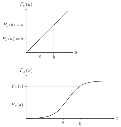

[上一篇](/lecture-notes/weibull-reliability-and-hazard/)以[韋伯分配](/lecture-notes/weibull-reliability-and-hazard/#def-weibull-distribution)、[可靠度函數](/lecture-notes/weibull-reliability-and-hazard/#def-reliability-function)與[風險函數](/lecture-notes/weibull-reliability-and-hazard/#def-hazard-function)作結，卜瓦松過程所衍生的各個機率模型至此全部給出。本篇轉入第三大類的機率模型，也就是與貝塔分配相關的一系列分配，而這一類之中最基本的一個，是值域上每一個點都具有相同機率密度的均勻分配。

均勻分配的 cdf 是一條直線，其中的標準均勻分配更把這條直線變成恆等函數，變數值本身就代表累積機率。本篇先給出均勻分配的定義並完整推導其期望值、變異數與動差母函數，再說明所有的均勻分配都可以由標準均勻分配伸縮平移而得。由於這個轉換所用的函數正是該均勻分配自己的 cdf，同樣的手法可以推廣到任意的連續分配，機率積分轉換與逆機率積分轉換兩個定理就是這樣來的；這兩個定理在第二章的 [Proposition 2.4](/lecture-notes/one-to-one-transformations/#prop-probability-integral-transform) 曾經先行敘述，本篇把它們放回均勻分配的脈絡之中。最後以三道例題作為演練。

## 均勻分配

Definition 4.18 (均勻分配, uniform distribution)

**適用範圍**:

令 $X$ 為一個連續隨機變數，其值域中的所有點皆具有相同機率密度。

**值域範圍**:

$$
\mathcal{R}_{\sssig X}=\lbrace\,x\mid a\leqslant x\leqslant b\,\rbrace
$$

**表示式**:

$$
X\sim\mathcal{U}(a,\ b)
$$

**參數與參數範圍**:

$a,b\in\mathbb{R}$ 為位置參數，同時 $a$ 為值域下界、$b$ 為值域上界，且 $a<b$。

**機率函數**:

$$
f_{\sssig X}(x)=\frac{1}{\,b-a\,},\ a\leqslant x\leqslant b
$$

**期望值、變異數、動差母函數**:

$$
\begin{gathered}
\mathbb{E}(X)=\frac{\,a+b\,}{2},\qquad \mathrm{Var}(X)=\frac{\,(b-a)^{2}\,}{12}\\[0.7em]
M_{\sssig X}(t)=\left\lbrace
\begin{array}{c@{\quad}l}
\dfrac{\,e^{bt}-e^{at}\,}{(b-a)t}, & t\neq0\\[0.9em]
1, & t=0
\end{array}
\right.
\end{gathered}
$$

$$
\begin{gathered}
\mathbb{E}(X)=\frac{\,a+b\,}{2},\\[0.5em]
\mathrm{Var}(X)=\frac{\,(b-a)^{2}\,}{12}\\[0.5em]
M_{\sssig X}(t)=\left\lbrace
\begin{array}{c@{}l}
\dfrac{\,e^{bt}-e^{at}\,}{(b-a)t}, & t\neq0\\[0.9em]
1, & t=0
\end{array}
\right.
\end{gathered}
$$

均勻分配 (uniform distribution) 有一些地方需要注意:

(1) 我們證明其機率函數為一個合法的機率函數與期望值、變異數與動差母函數如下:
{: .topic-paren-item}

**Proof.**

先驗證機率函數在值域上的積分為 $1$，即

$$
\int_{x\in\mathcal{R}_{\sssig X}}f_{\sssig X}(x)\,dx=\int_{a}^{b}\frac{1}{\,b-a\,}dx=\frac{1}{\,b-a\,}\int_{a}^{b}1\,dx=\frac{b-a}{\,b-a\,}=1
$$

$$
\begin{aligned}
\int_{x\in\mathcal{R}_{\sssig X}}f_{\sssig X}(x)\,dx&=\int_{a}^{b}\frac{1}{\,b-a\,}dx=\frac{1}{\,b-a\,}\int_{a}^{b}1\,dx\\[0.45em]
&=\frac{b-a}{\,b-a\,}=1
\end{aligned}
$$

接著求期望值，可得

$$
\mathbb{E}(X)=\int_{x\in\mathcal{R}_{\sssig X}}x\,f_{\sssig X}(x)\,dx=\frac{1}{\,b-a\,}\int_{a}^{b}x\,dx=\left[\frac{x^{2}}{\,2(b-a)\,}\right]^{b}_{a}=\frac{\,a+b\,}{2}
$$

$$
\begin{aligned}
\mathbb{E}(X)&=\int_{x\in\mathcal{R}_{\sssig X}}x\,f_{\sssig X}(x)\,dx\\[0.45em]
&=\frac{1}{\,b-a\,}\int_{a}^{b}x\,dx\\[0.45em]
&=\left[\frac{x^{2}}{\,2(b-a)\,}\right]^{b}_{a}=\frac{\,a+b\,}{2}
\end{aligned}
$$

又可得

$$
\mathbb{E}\bigl(X^{2}\bigr)=\int_{x\in\mathcal{R}_{\sssig X}}x^{2}f_{\sssig X}(x)\,dx=\frac{1}{\,b-a\,}\int_{a}^{b}x^{2}\,dx=\left[\frac{x^{3}}{\,3(b-a)\,}\right]^{b}_{a}=\frac{\,a^{2}+ab+b^{2}\,}{3}
$$

$$
\begin{aligned}
\mathbb{E}\bigl(X^{2}\bigr)&=\int_{x\in\mathcal{R}_{\sssig X}}x^{2}f_{\sssig X}(x)\,dx\\[0.45em]
&=\frac{1}{\,b-a\,}\int_{a}^{b}x^{2}\,dx\\[0.45em]
&=\left[\frac{x^{3}}{\,3(b-a)\,}\right]^{b}_{a}\\[0.45em]
&=\frac{\,a^{2}+ab+b^{2}\,}{3}
\end{aligned}
$$

則變異數為

$$
\mathrm{Var}(X)=\mathbb{E}\bigl(X^{2}\bigr)-\bigl[\mathbb{E}(X)\bigr]^{2}=\frac{\,a^{2}+ab+b^{2}\,}{3}-\left(\frac{\,a+b\,}{2}\right)^{2}=\frac{\,(b-a)^{2}\,}{12}
$$

$$
\begin{aligned}
\mathrm{Var}(X)&=\mathbb{E}\bigl(X^{2}\bigr)-\bigl[\mathbb{E}(X)\bigr]^{2}\\[0.45em]
&=\frac{\,a^{2}+ab+b^{2}\,}{3}-\left(\frac{\,a+b\,}{2}\right)^{2}\\[0.45em]
&=\frac{\,(b-a)^{2}\,}{12}
\end{aligned}
$$

最後求動差母函數，可得

$$
\begin{aligned}
M_{\sssig X}(t)&=\mathbb{E}\bigl(e^{tX}\bigr)=\int_{a}^{b}e^{tx}\frac{1}{\,b-a\,}dx=\frac{1}{\,b-a\,}\int_{a}^{b}e^{tx}\,dx\\[0.45em]
&=\left\lbrace
\begin{array}{c@{\quad}l}
\left[\dfrac{e^{tx}}{\,(b-a)t\,}\right]^{b}_{a}=\dfrac{\,e^{bt}-e^{at}\,}{(b-a)t}, & t\neq0\\[0.9em]
1, & t=0
\end{array}
\right.
\end{aligned}
$$

$$
\begin{aligned}
M_{\sssig X}(t)&=\mathbb{E}\bigl(e^{tX}\bigr)\\[0.45em]
&=\int_{a}^{b}e^{tx}\frac{1}{\,b-a\,}dx=\frac{1}{\,b-a\,}\int_{a}^{b}e^{tx}\,dx\\[0.45em]
&=\left\lbrace
\begin{array}{c@{}l}
\left[\dfrac{e^{tx}}{\,(b-a)t\,}\right]^{b}_{a}, & t\neq0\\[0.8em]
1, & t=0
\end{array}
\right.\\[0.45em]
&=\left\lbrace
\begin{array}{c@{}l}
\dfrac{\,e^{bt}-e^{at}\,}{(b-a)t}, & t\neq0\\[0.8em]
1, & t=0
\end{array}
\right.
\end{aligned}
$$

原式得證。 $\square$

Note

當 $t=0$ 時，分式 $\frac{e^{bt}-e^{at}}{\,(b-a)t\,}$ 呈 $\frac{0}{\,0\,}$ 不定型，但直接由定義有 $M\_{\sssig X}(0)=\mathbb{E}(e^{0})=1$，且與該分式在 $t\to0$ 時的極限一致；如此分段補齊 $t=0$ 處的函數值後，$M\_{\sssig X}(t)$ 在原點鄰域 $-h<t<h$ ($h>0$) 內處處連續且可微分。

(2) 令 $Y\sim\mathcal{U}(a,\ b)$，則 $Y$ 的 cdf 為
{: .topic-paren-item}

$$
F_{\sssig Y}(y)=\left\lbrace
\begin{array}{c@{\quad}l}
0, & y<a\\[0.5em]
\dfrac{\,y-a\,}{b-a}, & a\leqslant y\leqslant b\\[0.7em]
1, & y>b
\end{array}
\right.
$$

這是**唯一的線性 cdf**，而**均勻分配一族是唯一具有線性 cdf 的分配族**。
{: .topic-paren-cont}

(3) 眾多均勻分配之中，有一個特例是**標準均勻分配 (standard uniform distribution)**，有許多和均勻分配有關的特殊性質都是基於這個特例而衍伸出來的，見以下敘述:
{: .topic-paren-item}

**標準均勻分配**是指 $U\sim\mathcal{U}(0,\ 1)$，這種均勻分配相當常用，並且其 cdf 為
{: .topic-paren-cont}

$$
F_{\sssig U}(u)=\left\lbrace
\begin{array}{c@{\quad}l}
0, & u<0\\[0.35em]
u, & 0\leqslant u\leqslant1\\[0.35em]
1, & u>1
\end{array}
\right.
$$

這個 cdf 非常特別，除了線性的特色外，在 $u\in[0,1]$ 時是**恆等函數 (identity function)**，其變數值本身就代表累積機率，這種特色只有標準均勻分配才有。
{: .topic-paren-cont}

Note

所有均勻分配都可以由標準均勻分配，透過線性轉換 (linear transformation) 而得，亦即我們可令

$$
Y=(b-a)U+a
$$

也就是**先伸縮 $b-a$ 倍，再平移 $a$**，我們可以由其 cdf 證明如下:

**Proof.**

由 $U\sim\mathcal{U}(0,\ 1)$ 可知

$$
F_{\sssig U}(u)=\left\lbrace
\begin{array}{c@{\quad}l}
0, & u<0\\[0.35em]
u, & 0\leqslant u\leqslant1\\[0.35em]
1, & u>1
\end{array}
\right.
$$

又令 $Y=(b-a)U+a$，則

$$
\begin{aligned}
F_{\sssig Y}(y)&=\mathbb{P}(Y\leqslant y)=\mathbb{P}\bigl((b-a)U+a\leqslant y\bigr)=\mathbb{P}\left(U\leqslant\frac{\,y-a\,}{b-a}\right)\\[0.45em]
&=\left\lbrace
\begin{array}{c@{\quad}l}
0, & y<a\\[0.5em]
\dfrac{\,y-a\,}{b-a}, & a\leqslant y\leqslant b\\[0.7em]
1, & y>b
\end{array}
\right.
\end{aligned}
$$

$$
\begin{aligned}
F_{\sssig Y}(y)&=\mathbb{P}(Y\leqslant y)\\[0.45em]
&=\mathbb{P}\bigl((b-a)U+a\leqslant y\bigr)\\[0.45em]
&=\mathbb{P}\left(U\leqslant\frac{\,y-a\,}{b-a}\right)\\[0.45em]
&=\left\lbrace
\begin{array}{c@{}l}
0, & y<a\\[0.5em]
\dfrac{\,y-a\,}{b-a}, & a\leqslant y\leqslant b\\[0.7em]
1, & y>b
\end{array}
\right.
\end{aligned}
$$

此即

$$
Y\sim\mathcal{U}(a,\ b)
$$

原式得證。 $\square$

反之，對任意均勻分配變數 $Y\sim\mathcal{U}(a,\ b)$ 作反向的平移與伸縮轉換

$$
U=\frac{\,Y-a\,}{b-a}
$$

同樣可由 cdf 法驗證 $U\sim\mathcal{U}(0,\ 1)$。值得注意的是，上式將 $Y$ 轉為標準均勻分配所使用的函數 $\frac{\,y-a\,}{b-a}$ 恰為 $Y$ 自身的 cdf；此一關係並非均勻分配特有的巧合，對任意連續分配同樣可藉自身的 cdf 與標準均勻分配互相轉換，見[下列定理](#thm-p-i-t)。

## 機率積分轉換

Theorem 4.17 (機率積分轉換, probability integral transform)

令 $X$ 為一連續隨機變數，cdf 為 $F\_{\sssig X}(\cdot)$ 且其反函數 $F^{-1}\_{\sssig X}(\cdot)$ 存在，若令 $U=F\_{\sssig X}(X)$ 為 $X$ 的函數轉換，則可知

$$
U\sim\mathcal{U}(0,\ 1)
$$

**Proof.**

$$
\begin{aligned}
F_{\sssig U}(u)&=\mathbb{P}(U\leqslant u)=\mathbb{P}\bigl(F_{\sssig X}(X)\leqslant u\bigr)=\mathbb{P}\bigl(X\leqslant F^{-1}_{\sssig X}(u)\bigr)\\[0.45em]
&=F_{\sssig X}\Bigl(F^{-1}_{\sssig X}(u)\Bigr)=u,\ 0\leqslant u\leqslant1
\end{aligned}
$$

$$
\begin{aligned}
F_{\sssig U}(u)&=\mathbb{P}(U\leqslant u)\\[0.45em]
&=\mathbb{P}\bigl(F_{\sssig X}(X)\leqslant u\bigr)\\[0.45em]
&=\mathbb{P}\bigl(X\leqslant F^{-1}_{\sssig X}(u)\bigr)\\[0.45em]
&=F_{\sssig X}\Bigl(F^{-1}_{\sssig X}(u)\Bigr)\\[0.45em]
&=u,\ 0\leqslant u\leqslant1
\end{aligned}
$$

此即

$$
U\sim\mathcal{U}(0,\ 1)
$$

原式得證。 $\square$

Note

此定理表明，將連續隨機變數 $X$ 代入其自身的累積分配函數 $F\_{\sssig X}(\cdot)$ 作函數轉換，所得變數 $U=F\_{\sssig X}(X)$ 必服從標準均勻分配。操作時係將 $F\_{\sssig X}(\cdot)$ 視為確定性的實數函數並代入隨機變數 $X$；例如當 $X\sim\mathrm{Exp}(\beta=1)$ 時，其在 $[0,\infty)$ 上的 cdf 為 $F\_{\sssig X}(x)=1-e^{-x}$，故對應的隨機變數轉換即為 $U=F\_{\sssig X}(X)=1-e^{-X}$。上述證明的關鍵在於以下兩點:

(1) 由於 $F\_{\sssig X}(\cdot)$ 本身為非遞減函數，故當其反函數 $F^{-1}\_{\sssig X}(\cdot)$ 存在時，$F^{-1}\_{\sssig X}(\cdot)$ 亦同為非遞減函數。
{: .topic-paren-item}

(2) 標準均勻分配是唯一一個 cdf 在 $[0,1]$ 區間內為恆等函數的分配。
{: .topic-paren-item}

## 逆機率積分轉換

Theorem 4.18 (逆機率積分轉換, inverse probability integral transform)

令 $U\sim\mathcal{U}(0,\ 1)$ 為一標準均勻分配，$g:\mathbb{R}\to(0,1)$ 為一連續且嚴格遞增函數，滿足 $\lim_{x\to-\infty}g(x)=0$ 與 $\lim_{x\to\infty}g(x)=1$，其反函數 $g^{-1}(\cdot)$ 存在。若令 $X=g^{-1}(U)$ 為 $U$ 的函數轉換，則 $g(\cdot)$ 為 $X$ 的 cdf，此即

$$
F_{\sssig X}(x)=g(x)
$$

**Proof.**

$$
\begin{aligned}
F_{\sssig X}(x)&=\mathbb{P}(X\leqslant x)=\mathbb{P}\bigl(g^{-1}(U)\leqslant x\bigr)=\mathbb{P}\bigl(U\leqslant g(x)\bigr)\\[0.45em]
&=F_{\sssig U}\Bigl(g(x)\Bigr)=g(x),\ 0\leqslant g(x)\leqslant1
\end{aligned}
$$

$$
\begin{aligned}
F_{\sssig X}(x)&=\mathbb{P}(X\leqslant x)\\[0.45em]
&=\mathbb{P}\bigl(g^{-1}(U)\leqslant x\bigr)\\[0.45em]
&=\mathbb{P}\bigl(U\leqslant g(x)\bigr)\\[0.45em]
&=F_{\sssig U}\Bigl(g(x)\Bigr)\\[0.45em]
&=g(x),\ 0\leqslant g(x)\leqslant1
\end{aligned}
$$

此即

$$
F_{\sssig X}(x)=g(x)
$$

原式得證。 $\square$

Note

此定理又稱為逆抽樣轉換，為機率積分轉換的反向敘述。對標準均勻隨機變數 $U$ 施以 $g^{-1}(\cdot)$ 轉換，所得變數的 cdf 即為 $g(\cdot)$；換言之，以目標分配 cdf 的反函數轉換標準均勻變數，即可得到該目標分配。此性質在統計模擬中用途極廣，因為運算系統產生的亂數即為 $(0,1)$ 區間上的標準均勻變數，各類連續分配的隨機樣本皆可藉此反函數轉換生成。

機率積分轉換 (probability integral transformation) 與逆機率積分轉換 (inverse probability integral transformation) 實為同一組關係式的雙向表示，即

$$
\boxed{\ U=F_{\sssig X}(X)\qquad\Longleftrightarrow\ X=F^{-1}_{\sssig X}(U)\ }
$$

之所以能以 $X$ 的累積分配函數 $F\_{\sssig X}(\cdot)$ 作為 $\mathcal{U}(0,\ 1)$ 與一般連續分配之間的橋樑，是因為 $F\_{\sssig X}(\cdot)$ 完整刻畫了 $X$ 累積機率的速度，恰提供將曲線拉回恆等函數所需的非線性伸縮資訊，如下圖所示:

<figure id="fig-uniform-cdf-identity" class="topic-figure topic-figure--wide">
  
  <figcaption>Fig. 4.2. 兩個面板各畫一條 cdf。一條在 $0$ 與 $1$ 之間是恆等函數，$a$ 與 $b$ 兩點的 cdf 值 $F_{\sssig U}(a)$ 與 $F_{\sssig U}(b)$ 恰好等於 $a$ 與 $b$ 本身；另一條是一般的 cdf，同樣兩點的 $F_{\sssig X}(a)$ 與 $F_{\sssig X}(b)$ 則由曲線的高度決定。把一般的 cdf 伸縮回恆等函數所需要的訊息，全部記在 $F_{\sssig X}(\cdot)$ 之中。</figcaption>
</figure>

上圖的上面板為標準均勻分配的 cdf $F\_{\sssig U}(u)$，在 $[0,1]$ 上為恆等函數，對任意 $a,b\in[0,1]$ 恆有 $F\_{\sssig U}(a)=a$ 與 $F\_{\sssig U}(b)=b$；下面板則為一般連續分配的曲線型 cdf $F\_{\sssig X}(x)$。若要將隨機變數 $X$ 經適當的非線性拉伸化為標準均勻分配，所需的轉換關係正完整記錄於 $F\_{\sssig X}(x)$ 之中；機率積分轉換與逆機率積分轉換，即是沿此曲線在橫軸與縱軸之間雙向對應的結果。

## 均勻分配與機率積分轉換的例題

Example 4.38

Let $X$ be uniformly distributed on $(0,1)$. Find $\mathbb{E}\left[X\,\middle\vert\,X<\frac{1}{\,4\,}\right]$.

由[截尾分配的定義](/lecture-notes/conditional-distributions-examples/#def-truncated-distribution)可知

$$
\begin{aligned}
f_{\sssig X}\left(x\,\middle\vert\,X<\frac{1}{\,4\,}\right)&=\frac{f_{\sssig X}(x)}{\,\mathbb{P}\left(X<\frac{1}{\,4\,}\right)\,}=\frac{1}{\int_{0}^{1/4}f_{\sssig X}(x)\,dx}\\[0.45em]
&=\frac{1}{\,1/4\,}=4,\ 0<x<\frac{1}{\,4\,}
\end{aligned}
$$

$$
\begin{aligned}
f_{\sssig X}\left(x\,\middle\vert\,X<\frac{1}{\,4\,}\right)&=\frac{f_{\sssig X}(x)}{\,\mathbb{P}\left(X<\frac{1}{\,4\,}\right)\,}\\[0.35em]
&=\frac{1}{\int_{0}^{1/4}f_{\sssig X}(x)\,dx}\\[0.35em]
&=\frac{1}{\,1/4\,}=4,\ 0<x<\frac{1}{\,4\,}
\end{aligned}
$$

所求為

$$
\begin{aligned}
\mathbb{E}\left[X\,\middle\vert\,X<\frac{1}{\,4\,}\right]&=\int_{0}^{1/4}x\,f_{\sssig X}\left(x\,\middle\vert\,X<\frac{1}{\,4\,}\right)\,dx\\[0.45em]
&=\int_{0}^{1/4}4x\,dx=\Bigl[2x^{2}\Bigr]^{\frac{1}{4}}_{0}=\frac{1}{\,8\,}
\end{aligned}
$$

$$
\begin{aligned}
\mathbb{E}\left[X\,\middle\vert\,X<\frac{1}{\,4\,}\right]&=\int_{0}^{1/4}x\,f_{\sssig X}\left(x\,\middle\vert\,X<\frac{1}{\,4\,}\right)\,dx\\[0.35em]
&=\int_{0}^{1/4}4x\,dx=\Bigl[2x^{2}\Bigr]^{\frac{1}{4}}_{0}=\frac{1}{\,8\,}
\end{aligned}
$$

Note

均勻分配經區間截尾後仍為均勻分配。這是因為截尾僅縮限取值範圍並重新標準化常數，並未改變子區間內各點機率密度相等的特性。

Example 4.39

Let the continuous random variable $X$ have cumulative distribution function $F_{\sssig X}(x)$. Find the probability density function (pdf) and variance of the random variable $Y=F_{\sssig X}(X)$.

由 cdf 之定義可知

$$
\begin{aligned}
F_{\sssig Y}(y)&=\mathbb{P}(Y\leqslant y)=\mathbb{P}\bigl(F_{\sssig X}(X)\leqslant y\bigr)=\mathbb{P}\bigl(X\leqslant F^{-1}_{\sssig X}(y)\bigr)\\[0.45em]
&=F_{\sssig X}\Bigl(F^{-1}_{\sssig X}(y)\Bigr)=y,\ 0\leqslant y\leqslant1
\end{aligned}
$$

$$
\begin{aligned}
F_{\sssig Y}(y)&=\mathbb{P}(Y\leqslant y)\\[0.45em]
&=\mathbb{P}\bigl(F_{\sssig X}(X)\leqslant y\bigr)\\[0.45em]
&=\mathbb{P}\bigl(X\leqslant F^{-1}_{\sssig X}(y)\bigr)\\[0.45em]
&=F_{\sssig X}\Bigl(F^{-1}_{\sssig X}(y)\Bigr)\\[0.45em]
&=y,\ 0\leqslant y\leqslant1
\end{aligned}
$$

所求為

$$
Y\sim\mathcal{U}(0,\ 1),\qquad f_{\sssig Y}(y)=\left\lbrace
\begin{array}{c@{\quad}l}
1, & 0<y<1\\[0.35em]
0, & \text{o.w.}
\end{array}
\right.,\qquad \sigma^{2}_{\sssig Y}=\frac{\,(1-0)^{2}\,}{12}=\frac{1}{\,12\,}
$$

$$
\begin{gathered}
Y\sim\mathcal{U}(0,\ 1),\\[0.6em]
f_{\sssig Y}(y)=\left\lbrace
\begin{array}{c@{}l}
1, & 0<y<1\\[0.35em]
0, & \text{o.w.}
\end{array}
\right.,\\[0.6em]
\sigma^{2}_{\sssig Y}=\frac{\,(1-0)^{2}\,}{12}=\frac{1}{\,12\,}
\end{gathered}
$$

Example 4.40

Let $X$ follow an exponential distribution with pdf $f(x)=\frac{1}{\,\lambda\,}e^{-\frac{x}{\lambda}}$ for $x\geqslant0$.

<ol class="topic-list-paren">
  <li>Find a function $g(x)$ such that $Y=g(X)$ is uniformly distributed on $(0,1)$.</li>
  <li>Find a function $h(u)$ such that if $U$ is uniformly distributed on $(0,1)$, then $X=h(U)$ has pdf $f(x)=\frac{1}{\,\lambda\,}e^{-\frac{x}{\lambda}}$ for $x\geqslant0$.</li>
</ol>

(1) 由題意敘述可知，$X$ 之 cdf 為
{: .topic-paren-item}

$$
F_{\sssig X}(x)=\left\lbrace
\begin{array}{c@{\quad}l}
0, & x<0\\[0.5em]
1-e^{-\frac{x}{\lambda}}, & x\geqslant0
\end{array}
\right.
$$

則若令
{: .topic-paren-cont}

$$
g(x)=F_{\sssig X}(x)=1-e^{-\frac{x}{\lambda}},\ x\geqslant0
$$

可由 cdf 之定義知 $Y=g(X)$ 之 cdf 為
{: .topic-paren-cont}

$$
F_{\sssig Y}(y)=\mathbb{P}\bigl(g(X)\leqslant y\bigr)=\mathbb{P}\bigl(X\leqslant g^{-1}(y)\bigr)=F_{\sssig X}\bigl(F^{-1}_{\sssig X}(y)\bigr)=y,\ 0<y<1
$$

$$
\begin{aligned}
F_{\sssig Y}(y)&=\mathbb{P}\bigl(g(X)\leqslant y\bigr)\\[0.45em]
&=\mathbb{P}\bigl(X\leqslant g^{-1}(y)\bigr)\\[0.45em]
&=F_{\sssig X}\bigl(F^{-1}_{\sssig X}(y)\bigr)\\[0.45em]
&=y,\ 0<y<1
\end{aligned}
$$

此即
{: .topic-paren-cont}

$$
Y\sim\mathcal{U}(0,\ 1)
$$

(2) 由上題結果可知，若 $U\sim\mathcal{U}(0,\ 1)$，則可令 $U=F_{\sssig X}(X)$ 為 $X$ 之函數轉換，其中 $X\sim\mathrm{Exp}(\beta=\lambda)$，且 $F_{\sssig X}(x)=1-e^{-\frac{x}{\lambda}},\ x\geqslant0$ 為 $X$ 之 cdf。
{: .topic-paren-item}

則由 $U=F_{\sssig X}(X)=1-e^{-\frac{X}{\lambda}}$ 的關係反解可知
{: .topic-paren-cont}

$$
X=F^{-1}_{\sssig X}(U)=-\lambda\ln(1-U)
$$

且因為 $X\sim\mathrm{Exp}(\beta=\lambda)$，可知所求之函數為
{: .topic-paren-cont}

$$
h(u)=F^{-1}_{\sssig X}(u),\ 0<u<1
$$

Note

運用逆機率積分轉換將 $\mathcal{U}(0,\ 1)$ 轉換為目標分配時，標準流程須先求出目標分配的累積分配函數 $F\_{\sssig X}(x)$，再反解出 $F^{-1}\_{\sssig X}(u)$ 代入。因此本題雖可直接看出目標分配為 $\mathrm{Exp}(\beta=\lambda)$，仍須先積分寫出其 cdf $F\_{\sssig X}(x)=1-e^{-x/\lambda}$ 方能完成反解。

## 本篇小結

[Definition 4.18](#def-uniform-distribution) 的均勻分配由「值域中的所有點皆具有相同機率密度」界定，值域為閉區間 $[a,b]$ (即 $\lbrace\,x\mid a\leqslant x\leqslant b\,\rbrace$)，機率函數因而是常數 $\frac{1}{\,b-a\,}$，兩個參數 $a$ 與 $b$ 都是位置參數，分別是值域的下界與上界。證明的四個步驟依序為直接積分驗證機率函數的積分為 $1$、求得 $\mathbb{E}(X)=\frac{\,a+b\,}{2}$、再由 $\mathbb{E}\bigl(X^{2}\bigr)=\frac{\,a^{2}+ab+b^{2}\,}{3}$ 相減得到變異數 $\frac{\,(b-a)^{2}\,}{12}$，最後由定義求得動差母函數。動差母函數在 $t=0$ 處另行定義為 $1$，是為了讓它在原點鄰域內可微分。

均勻分配的 cdf 在 $a$ 與 $b$ 之間是一次式，這是唯一一個線性的 cdf；其中 $a=0$ 且 $b=1$ 的特例即標準均勻分配，它的 cdf 在 $[0,1]$ 上是恆等函數，變數值本身就是累積機率。由 $Y=(b-a)U+a$ 這個先伸縮再平移的轉換，可以由標準均勻分配得到任何一個均勻分配；反過來走則是 $U=\frac{\,Y-a\,}{b-a}$，而這個反向的函數恰好就是 $Y$ 自己的 cdf。

把上一段最後這件事推廣到任意的連續分配，就是 [Theorem 4.17](#thm-p-i-t) 與 [Theorem 4.18](#thm-i-p-i-t)。前者說明以 $X$ 自己的 cdf 作轉換所得的 $U=F_{\sssig X}(X)$ 服從標準均勻分配，證明只用到 cdf 非遞減、以及標準均勻分配是唯一一個 cdf 在 $[0,1]$ 上為恆等函數的分配這兩點；後者是它的反敘述，以非遞減函數 $g(\cdot)$ 的反函數轉換標準均勻分配，所得變數的 cdf 就是 $g(\cdot)$ 這個函數。兩者其實是同一組關係式的兩個方向，也就是 $U=F\_{\sssig X}(X)$ 與 $X=F^{-1}\_{\sssig X}(U)$ 這兩個寫法；之所以能夠以 cdf 當作橋樑，是因為把一般的 cdf「拉伸」回恆等函數所需要的資訊，本來就完整地記錄在 cdf 之中。逆機率積分轉換在實務上的用途極廣，因為運算系統所能提供的隨機來源只有 $0$ 到 $1$ 之間的亂數，各式分配的隨機變數都要靠它生出來。

三道例題各練一種用法。[Example 4.38](#ex-uniform-1) 先由截尾分配的定義求出條件密度為常數 $4$，再積分得到 $\frac{1}{\,8\,}$；由於限制範圍並不改變密度在該範圍內的形狀，均勻分配的截尾分配必定還是均勻分配。[Example 4.39](#ex-uniform-2) 正是機率積分轉換的直接應用，$Y=F_{\sssig X}(X)$ 服從 $\mathcal{U}(0,\ 1)$，密度在 $(0,1)$ 上恆為 $1$，變異數為 $\frac{1}{\,12\,}$。[Example 4.40](#ex-uniform-3) 則把兩個方向各走一次。先取 $g$ 為[指數分配](/lecture-notes/gamma-function-exponential-distribution/#def-exponential-distribution)自己的 cdf 而得到標準均勻分配，再反解出 $X=-\lambda\ln(1-U)$ 這個式子，由標準均勻分配生回指數分配；操作逆機率積分轉換時，一定要先求出目標分配的 cdf，才知道該用哪一個反函數。

[下一篇](/lecture-notes/beta-function-and-distribution/)介紹貝塔函數與貝塔分配，貝塔分配的值域同樣落在 $0$ 與 $1$ 之間，而標準均勻分配正是它的一個特例。

## 參考文獻與延伸閱讀

- 黃文璋，2010，《機率論》，二版，華泰文化。
- Sheldon Ross. 2019. *A First Course in Probability*. 10th ed. Pearson.
- Robert V. Hogg, Joseph W. McKean, and Allen T. Craig. 2019. *Introduction to Mathematical Statistics*. 8th ed. Pearson.
- George Casella and Roger L. Berger. 2002. *Statistical Inference*. 2nd ed. Duxbury.
