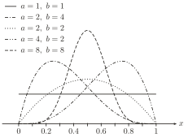

[上一篇](/lecture-notes/uniform-distribution-integral-transform/)以[均勻分配](/lecture-notes/uniform-distribution-integral-transform/#def-uniform-distribution)為主軸，說明它在值域之內每一處的機率密度都相同，並由這個性質給出[機率積分轉換](/lecture-notes/uniform-distribution-integral-transform/#thm-p-i-t)與[逆機率積分轉換](/lecture-notes/uniform-distribution-integral-transform/#thm-i-p-i-t)兩個定理。本篇要看的，同樣是一個取值落在 $0$ 到 $1$ 之間的連續隨機變數，但這一次容許不同位置上的機率密度高低不同，這就是貝塔分配。

推導貝塔分配的期望值與變異數時所要用到的工具是[貝塔函數](#def-beta-function)，而貝塔函數本身又可以寫成一個由[伽瑪函數](/lecture-notes/gamma-function-exponential-distribution/#def-gamma-function)構成的比值。本篇因而先由這個函數談起，列出它的兩項特性，再進入[貝塔分配](#def-beta-distribution)的定義與完整推導，其後說明三項衍伸性質，最後以一張圖比較不同參數之下機率密度聚集的情況。

## 貝塔函數

Definition 4.19 (貝塔函數, beta function)

**貝塔函數 (beta function)** 是下列的函數:

$$
\mathcal{B}(a,b)\equiv\int_{0}^{1}x^{a-1}(1-x)^{b-1}\,dx,\ a,b>0
$$

$$
\begin{aligned}
\mathcal{B}(a,b)&\equiv\int_{0}^{1}x^{a-1}(1-x)^{b-1}\,dx,\\[0.25em]
&a,b>0
\end{aligned}
$$

貝塔函數具有以下的特性:

$$
\begin{gathered}
\mathcal{B}(a,b)=\frac{\,\Gamma(a)\Gamma(b)\,}{\Gamma(a+b)},\ a,b>0\\[0.7em]
\mathcal{B}(a,b)=\mathcal{B}(b,a)
\end{gathered}
$$

## 貝塔分配

Definition 4.20 (貝塔分配, beta distribution)

**適用範圍**:

令 $X$ 為一 $0$ 到 $1$ 之間的連續隨機變數，常用來描述機率 $p$ 的分配。

**值域範圍**:

$$
\mathcal{R}_{\sssig X}=\lbrace\,x\mid 0<x<1\,\rbrace
$$

**表示式**:

$$
X\sim\mathrm{Beta}(a,\ b)
$$

**參數與參數範圍**:

$a,b>0$ 為形狀參數。

**機率函數**:

$$
f_{\sssig X}(x)=\frac{\Gamma(a+b)}{\,\Gamma(a)\Gamma(b)\,}x^{a-1}(1-x)^{b-1}=\frac{1}{\,\mathcal{B}(a,b)\,}x^{a-1}(1-x)^{b-1},\ 0<x<1
$$

$$
\begin{aligned}
f_{\sssig X}(x)&=\frac{\Gamma(a+b)}{\,\Gamma(a)\Gamma(b)\,}x^{a-1}(1-x)^{b-1}\\[0.45em]
&=\frac{1}{\,\mathcal{B}(a,b)\,}x^{a-1}(1-x)^{b-1},\\[0.25em]
&\qquad 0<x<1
\end{aligned}
$$

**期望值、變異數**:

$$
\mathbb{E}(X)=\frac{a}{\,a+b\,},\quad \mathrm{Var}(X)=\frac{a\,b}{\,(a+b)^{2}(a+b+1)\,}
$$

$$
\begin{gathered}
\mathbb{E}(X)=\frac{a}{\,a+b\,},\\[0.45em]
\mathrm{Var}(X)=\frac{a\,b}{\,(a+b)^{2}(a+b+1)\,}
\end{gathered}
$$

貝塔分配 (beta distribution) 有以下幾個地方特別需要注意:

(1) 我們證明其機率函數為一個合法的機率函數與期望值、變異數如下:
{: .topic-paren-item}

**Proof.**

先驗證機率函數在值域上的積分為 $1$，即

$$
\begin{aligned}
\int_{x\in\mathcal{R}_{\sssig X}}f_{\sssig X}(x)\,dx&=\int_{0}^{1}\frac{\Gamma(a+b)}{\,\Gamma(a)\Gamma(b)\,}x^{a-1}(1-x)^{b-1}\,dx\\[0.45em]
&=\frac{\Gamma(a+b)}{\,\Gamma(a)\Gamma(b)\,}\int_{0}^{1}x^{a-1}(1-x)^{b-1}\,dx=\frac{\Gamma(a+b)}{\,\Gamma(a)\Gamma(b)\,}\cdot\frac{\,\Gamma(a)\Gamma(b)\,}{\Gamma(a+b)}=1
\end{aligned}
$$

$$
\begin{aligned}
&\int_{x\in\mathcal{R}_{\sssig X}}f_{\sssig X}(x)\,dx\\[0.45em]
&=\int_{0}^{1}\frac{\Gamma(a+b)}{\,\Gamma(a)\Gamma(b)\,}x^{a-1}(1-x)^{b-1}\,dx\\[0.45em]
&=\frac{\Gamma(a+b)}{\,\Gamma(a)\Gamma(b)\,}\int_{0}^{1}x^{a-1}(1-x)^{b-1}\,dx\\[0.45em]
&=\frac{\Gamma(a+b)}{\,\Gamma(a)\Gamma(b)\,}\cdot\frac{\,\Gamma(a)\Gamma(b)\,}{\Gamma(a+b)}=1
\end{aligned}
$$

接著求期望值，可得

$$
\begin{aligned}
\mathbb{E}(X)&=\int_{x\in\mathcal{R}_{\sssig X}}xf_{\sssig X}(x)\,dx=\frac{\Gamma(a+b)}{\,\Gamma(a)\Gamma(b)\,}\int_{0}^{1}x^{(a+1)-1}(1-x)^{b-1}\,dx\\[0.45em]
&=\frac{\Gamma(a+b)}{\,\Gamma(a)\Gamma(b)\,}\cdot\frac{\,\Gamma(a+1)\Gamma(b)\,}{\Gamma(a+b+1)}=\frac{\Gamma(a+b)}{\,\Gamma(a)\Gamma(b)\,}\cdot\frac{\,a\Gamma(a)\Gamma(b)\,}{\,(a+b)\Gamma(a+b)\,}=\frac{a}{\,a+b\,}
\end{aligned}
$$

$$
\begin{aligned}
\mathbb{E}(X)&=\int_{x\in\mathcal{R}_{\sssig X}}xf_{\sssig X}(x)\,dx\\[0.45em]
&=\frac{\Gamma(a+b)}{\,\Gamma(a)\Gamma(b)\,}\int_{0}^{1}x^{(a+1)-1}(1-x)^{b-1}\,dx\\[0.45em]
&=\frac{\Gamma(a+b)}{\,\Gamma(a)\Gamma(b)\,}\cdot\frac{\,\Gamma(a+1)\Gamma(b)\,}{\Gamma(a+b+1)}\\[0.45em]
&=\frac{\Gamma(a+b)}{\,\Gamma(a)\Gamma(b)\,}\cdot\frac{\,a\Gamma(a)\Gamma(b)\,}{\,(a+b)\Gamma(a+b)\,}\\[0.45em]
&=\frac{a}{\,a+b\,}
\end{aligned}
$$

又可得

$$
\begin{aligned}
\mathbb{E}\bigl(X^{2}\bigr)&=\int_{x\in\mathcal{R}_{\sssig X}}x^{2}f_{\sssig X}(x)\,dx=\frac{\Gamma(a+b)}{\,\Gamma(a)\Gamma(b)\,}\int_{0}^{1}x^{(a+2)-1}(1-x)^{b-1}\,dx\\[0.45em]
&=\frac{\Gamma(a+b)}{\,\Gamma(a)\Gamma(b)\,}\cdot\frac{\,\Gamma(a+2)\Gamma(b)\,}{\Gamma(a+b+2)}=\frac{\Gamma(a+b)}{\,\Gamma(a)\Gamma(b)\,}\cdot\frac{\,(a+1)a\Gamma(a)\Gamma(b)\,}{\,(a+b+1)(a+b)\Gamma(a+b)\,}\\[0.45em]
&=\frac{a(a+1)}{(a+b)(a+b+1)}
\end{aligned}
$$

$$
\begin{aligned}
\mathbb{E}\bigl(X^{2}\bigr)&=\int_{x\in\mathcal{R}_{\sssig X}}x^{2}f_{\sssig X}(x)\,dx\\[0.45em]
&=\frac{\Gamma(a+b)}{\,\Gamma(a)\Gamma(b)\,}\int_{0}^{1}x^{(a+2)-1}(1-x)^{b-1}\,dx\\[0.45em]
&=\frac{\Gamma(a+b)}{\,\Gamma(a)\Gamma(b)\,}\cdot\frac{\,\Gamma(a+2)\Gamma(b)\,}{\Gamma(a+b+2)}\\[0.45em]
&=\frac{\Gamma(a+b)}{\,\Gamma(a)\Gamma(b)\,}\\[0.25em]
&\qquad\cdot\frac{\,(a+1)a\Gamma(a)\Gamma(b)\,}{\,(a+b+1)(a+b)\Gamma(a+b)\,}\\[0.45em]
&=\frac{a(a+1)}{(a+b)(a+b+1)}
\end{aligned}
$$

最後由前兩者求變異數，可得

$$
\begin{aligned}
\mathrm{Var}(X)&=\mathbb{E}\bigl(X^{2}\bigr)-\bigl[\mathbb{E}(X)\bigr]^{2}=\frac{a(a+1)}{(a+b)(a+b+1)}-\Bigl(\frac{a}{a+b}\Bigr)^{2}\\[0.45em]
&=\frac{a\,b}{(a+b)^{2}(a+b+1)}
\end{aligned}
$$

$$
\begin{aligned}
\mathrm{Var}(X)&=\mathbb{E}\bigl(X^{2}\bigr)-\bigl[\mathbb{E}(X)\bigr]^{2}\\[0.45em]
&=\frac{a(a+1)}{(a+b)(a+b+1)}-\Bigl(\frac{a}{a+b}\Bigr)^{2}\\[0.45em]
&=\frac{a\,b}{(a+b)^{2}(a+b+1)}
\end{aligned}
$$

原式得證。 $\square$

Note

上述一、二階原動差的推導可直接推廣至任意正整數 $k$ 階原動差:

**Proof.**

由機率函數可得

$$
\begin{aligned}
\mathbb{E}\bigl(X^{k}\bigr)&=\int_{x\in\mathcal{R}_{\sssig X}}x^{k}f_{\sssig X}(x)\,dx=\frac{\Gamma(a+b)}{\,\Gamma(a)\Gamma(b)\,}\int_{0}^{1}x^{(a+k)-1}(1-x)^{b-1}\,dx\\[0.45em]
&=\frac{\Gamma(a+b)}{\,\Gamma(a)\Gamma(b)\,}\cdot\frac{\,\Gamma(a+k)\Gamma(b)\,}{\Gamma(a+b+k)}=\frac{\,\Gamma(a+b)\Gamma(a+k)\,}{\,\Gamma(a)\Gamma(a+b+k)\,}
\end{aligned}
$$

$$
\begin{aligned}
\mathbb{E}\bigl(X^{k}\bigr)&=\int_{x\in\mathcal{R}_{\sssig X}}x^{k}f_{\sssig X}(x)\,dx\\[0.45em]
&=\frac{\Gamma(a+b)}{\,\Gamma(a)\Gamma(b)\,}\int_{0}^{1}x^{(a+k)-1}(1-x)^{b-1}\,dx\\[0.45em]
&=\frac{\Gamma(a+b)}{\,\Gamma(a)\Gamma(b)\,}\cdot\frac{\,\Gamma(a+k)\Gamma(b)\,}{\Gamma(a+b+k)}\\[0.45em]
&=\frac{\,\Gamma(a+b)\Gamma(a+k)\,}{\,\Gamma(a)\Gamma(a+b+k)\,}
\end{aligned}
$$

原式得證。 $\square$

(2) 由於貝塔分配的值域落在 $(0,1)$ 之間，常被用來描述[伯努利實驗](/lecture-notes/bernoulli-trials-and-distribution/#def-ber-trial)中成功機率 $p$ 的分配；此類設定屬於前文介紹過的[階層模型](/lecture-notes/variance-decomposition-theorem/#note-hierarchical-model) (hierarchical model) 範疇，亦是**貝氏統計學派 (Bayesian statistics)** 的核心建模架構。
{: .topic-paren-item}

Note

在貝氏統計中，貝塔分配常選作伯努利實驗成功機率的**先驗分配 (prior distribution)**，原因在於它是成敗實驗相關分配的**共軛先驗分配 (conjugate prior distribution)**，亦即**先驗分配與後驗分配 (posterior distribution) 同屬一個分配族**。例如當 $P\sim\mathrm{Beta}(a,b)$ 且 $X\mid(P=p)\sim\mathrm{Bin}(n,\ p)$ 時，後驗分配 $P\mid(X=x)$ 仍為貝塔分配。此外，常見的**先驗-後驗**共軛組合尚有**伽瑪-卜瓦松**與**常態-常態**。

(3) 貝塔分配另有以下幾項延伸性質:
{: .topic-paren-item}

第一，若 $U\sim\mathrm{Beta}(a=1,\ b=1)$，則
{: .topic-paren-cont}

$$
U\sim\mathcal{U}(0,1)
$$

**Proof.**

已知 $U\sim\mathrm{Beta}(a=1,\ b=1)$，則

$$
f_{\sssig U}(u)=\frac{\Gamma(2)}{\,\Gamma(1)\Gamma(1)\,}u^{1-1}(1-u)^{1-1}=1,\ 0<u<1
$$

$$
\begin{aligned}
f_{\sssig U}(u)&=\frac{\Gamma(2)}{\,\Gamma(1)\Gamma(1)\,}u^{1-1}(1-u)^{1-1}\\[0.45em]
&=1,\ 0<u<1
\end{aligned}
$$

故可知

$$
U\sim\mathcal{U}(0,1)
$$

原式得證。 $\square$

[標準均勻分配](/lecture-notes/uniform-distribution-integral-transform/#def-uniform-distribution)代表 $(0,1)$ 區間內各點出現的機率密度完全相同，貝塔分配則可刻畫密度在特定區段集中的情形；當取形狀參數 $a=b=1$ 時，貝塔分配即自然退化回上述的標準均勻分配。
{: .topic-paren-cont}

第二，標準均勻分配的[順序統計量](/lecture-notes/order-statistics/#def-order-stat) (order statistics) 服從貝塔分配，一般均勻分配的順序統計量亦可經線性轉換化為貝塔分配。如[前文順序統計量一篇](/lecture-notes/order-statistics-distributions/#標準均勻分配的順序統計量與貝塔分配)所述，排序操作會改變原本均勻的母體密度，使各階順序統計量分別集中在對應的分位位置附近，恰由貝塔分配刻畫。
{: .topic-paren-cont}

第三，$\mathrm{Beta}(a,b)$ 分配在期望值 $\frac{a}{\,a+b\,}$ 附近具有較高的機率密度，而參數 $a,b$ 的大小決定了密度在 $\frac{a}{\,a+b\,}$ 周遭的離散程度 (即變異數的大小)。
{: .topic-paren-cont}

Note

在貝氏統計中，標準均勻分配 $\mathrm{Beta}(1,1)$ 常視為無法提供任何訊息的先驗分配 (non-informative prior)，代表事前對未知機率 $p$ 較可能落在何處沒有特定想法；若改設一般的 $\mathrm{Beta}(a,b)$ 分配，則反映事前對 $p$ 的位置已有預期，且可藉調控 $a$ 與 $b$ 的大小表達先驗想法的強弱。

下圖將不同參數組合的貝塔分配密度繪於同一座標系，以對照其集中趨勢與離散程度。
{: .topic-paren-cont}

<figure id="fig-beta-density-family" class="topic-figure topic-figure--wide">
  
  <figcaption>Fig. 4.3. 五條密度曲線畫在同一組座標上，每一條的機率密度都集中在 $\frac{a}{\,a+b\,}$ 附近。$a$ 與 $b$ 相等時曲線左右對稱，一大一小時則偏向其中一側；兩者同時放大時曲線更高更窄，集中的情況更為明顯。$a=b=1$ 那一條是一整段水平線，機率密度在 $0$ 與 $1$ 之間完全均勻。</figcaption>
</figure>

由上圖可見，當 $a,b>1$ 時，貝塔分配的機率密度集中在期望值 $\frac{a}{\,a+b\,}$ 附近；即便期望值相同，參數 $a$ 與 $b$ 越大，密度在期望值周遭越為集中 (如 $a=b=8$ 相較於 $a=b=2$)。至於 $a=b=1$ 時，密度曲線退化為水平直線，即為標準均勻分配。
{: .topic-paren-cont}

## 本篇小結

[Definition 4.19](#def-beta-function) 的貝塔函數由一個積分界定，也就是 $\int_{0}^{1}x^{a-1}(1-x)^{b-1}\,dx$ 這個式子，它的兩項特性一是可以寫成 $\frac{\Gamma(a)\Gamma(b)}{\Gamma(a+b)}$ 這個由伽瑪函數構成的比值，二是兩個參數對調之後函數值不變。本篇其後的每一步推導，用到的都是第一項特性。

[Definition 4.20](#def-beta-distribution) 的貝塔分配以 $a$ 與 $b$ 兩個形狀參數界定，值域為開區間 $(0,1)$ (即 $0<x<1$)，機率函數的常數項正是貝塔函數的倒數，這使得密度在值域上的積分等於 $1$。期望值與變異數的求法完全相同。把 $x$ 或 $x^{2}$ 併入被積函數，指數上的 $a$ 因而變成 $a+1$ 或 $a+2$，積分之後仍是一個貝塔函數，再以 $\Gamma(a+1)=a\Gamma(a)$ 化簡，得到 $\mathbb{E}(X)=\frac{a}{a+b}$ 與 $\mathrm{Var}(X)=\frac{ab}{(a+b)^{2}(a+b+1)}$ 這兩個公式。同一個作法對任意的 $k$ 都成立，因而可以一次求得 $k$ 階原動差 $\frac{\Gamma(a+b)\Gamma(a+k)}{\Gamma(a)\Gamma(a+b+k)}$ 這個式子。

定義之後的三點說明依序涵蓋貝塔分配的值域使它適合描述一個成功機率，這正是貝氏統計學派中共軛先驗分配的用法，先驗分配取貝塔分配、觀測值取二項分配時，後驗分配仍是貝塔分配；三項衍伸性質則是 $a=b=1$ 時退回標準均勻分配、標準均勻分配的順序統計量服從貝塔分配，以及機率密度在 $\frac{a}{a+b}$ 附近聚集。最後一項也說明了貝塔分配與標準均勻分配的分別。標準均勻分配對值域上的每一處一視同仁，貝塔分配則指出比較容易出現的位置，而 $a$ 與 $b$ 的大小決定了聚集的程度，兩者都大時聚集得比較明顯。

[下一篇](/lecture-notes/gamma-beta-relationship/)給出伽瑪分配與貝塔分配之間的關係。兩個獨立的伽瑪變數，其中一個除以兩者之和會服從貝塔分配，兩者之和則仍是伽瑪分配，而且這兩個新的變數彼此獨立。

## 參考文獻與延伸閱讀

- 黃文璋，2010，《機率論》，二版，華泰文化。
- Sheldon Ross. 2019. *A First Course in Probability*. 10th ed. Pearson.
- Robert V. Hogg, Joseph W. McKean, and Allen T. Craig. 2019. *Introduction to Mathematical Statistics*. 8th ed. Pearson.
- George Casella and Roger L. Berger. 2002. *Statistical Inference*. 2nd ed. Duxbury.
