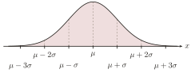
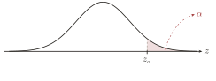

[上一篇](/lecture-notes/gamma-beta-relationship/)談伽瑪分配與貝塔分配之間的關係，至此貝塔相關的機率模型已經全部給出。本篇轉入第四大類的機率模型，也就是常態相關的機率模型。

常態分配相關的機率模型，在統計學中主要作為統計量 (statistic) 的**抽樣分配 (sampling distribution)**；由於統計量本質上是隨機樣本的函數，推導抽樣分配就機率論而言即是求取隨機向量的函數轉換分配。統計分析的核心在於處理資料 (data) 並轉化為有用的資訊 (information)。實務上受限於成本等因素，通常無法普查母體，而須由母體分配 (population distribution) 經抽樣 (sampling) 取得樣本 (sample) 以推論母體參數，並藉由統計量的抽樣分配評估推論的精確度。在數理統計的架構下，下文仍先以機率模型的角度介紹常態相關分配，並著重各分配的建構方式與彼此間的連結。

本篇先給出驗證常態分配的機率函數合法時所需要的高斯積分，再進入常態分配的定義，並依序證明機率函數合法、動差母函數、期望值與變異數。其後談常態分配的幾項延伸性質，包含標準常態分配、標準化、反標準化與線性組合可加性，最後由密度曲線的圖形回顧鐘形分配經驗法則，並給出常態分配常用尾點的定義方式。

## 高斯積分

Theorem 4.20 (高斯積分, the Gaussian integral)

$$
\int_{-\infty}^{\infty}e^{-\frac{1}{2}x^{2}}\,dx=\sqrt{2\pi}
$$

**Proof.**

令

$$
I=\int_{-\infty}^{\infty}e^{-\frac{1}{2}x^{2}}\,dx
$$

則我們有

$$
\begin{aligned}
I^{2}&=\int_{-\infty}^{\infty}e^{-\frac{1}{2}x^{2}}\,dx\int_{-\infty}^{\infty}e^{-\frac{1}{2}x^{2}}\,dx=\int_{-\infty}^{\infty}e^{-\frac{1}{2}x^{2}}\,dx\int_{-\infty}^{\infty}e^{-\frac{1}{2}y^{2}}\,dy\\[0.45em]
&=\int_{-\infty}^{\infty}\int_{-\infty}^{\infty}e^{-\left(\frac{1}{2}x^{2}+\frac{1}{2}y^{2}\right)}\,dx\,dy
\end{aligned}
$$

$$
\begin{aligned}
I^{2}&=\int_{-\infty}^{\infty}e^{-\frac{1}{2}x^{2}}\,dx\int_{-\infty}^{\infty}e^{-\frac{1}{2}x^{2}}\,dx\\[0.45em]
&=\int_{-\infty}^{\infty}e^{-\frac{1}{2}x^{2}}\,dx\int_{-\infty}^{\infty}e^{-\frac{1}{2}y^{2}}\,dy\\[0.45em]
&=\int_{-\infty}^{\infty}\int_{-\infty}^{\infty}e^{-\left(\frac{1}{2}x^{2}+\frac{1}{2}y^{2}\right)}\,dx\,dy
\end{aligned}
$$

則由極座標轉換 (polar-coordinate transformation)，可令

$$
\begin{cases} x=r\cos\theta\\ y=r\sin\theta \end{cases}
$$

$$
\Longrightarrow\ \mathbf{J}=\left\lvert\begin{array}{cc} \dfrac{\partial x}{\partial r} & \dfrac{\partial x}{\partial\theta}\\[0.7em] \dfrac{\partial y}{\partial r} & \dfrac{\partial y}{\partial\theta}\end{array}\right\rvert=r
$$

則

$$
I^{2}=\int_{0}^{2\pi}\int_{0}^{\infty}e^{-\frac{1}{2}r^{2}}\,r\,dr\,d\theta=2\pi
$$

故

$$
I=\sqrt{2\pi}
$$

原式得證。 $\square$

Note

文獻上所稱的高斯積分，通常指高斯函數 (Gaussian function) $e^{-x^{2}}$ 在整條實數線上的定積分

$$
\int_{-\infty}^{\infty}e^{-x^{2}}\,dx=\sqrt{\pi}
$$

為配合常態分配的指數形式，本篇採用變數代換後的等價形式。

## 常態分配

Definition 4.21 (常態分配, normal distribution)

**適用範圍**:

常態分配在自然界中經常被發現，能夠用來描述許多自然界中的現象，諸如智力或身高的分配情形等。

**值域範圍**:

$$
\mathcal{R}_{\sssig X}=\lbrace\,x\mid-\infty<x<\infty\,\rbrace
$$

**表示式**:

$$
X\sim\mathcal{N}\bigl(\mu,\sigma^{2}\bigr)
$$

**參數與參數範圍**:

$\mu$ 為該分配的期望值、$\sigma^{2}>0$ 為該分配的變異數。

**機率函數**:

$$
f_{\sssig X}(x)=\frac{1}{\,\sqrt{2\pi\sigma^{2}}\,}e^{-\frac{(x-\mu)^{2}}{2\sigma^{2}}},\ -\infty<x<\infty
$$

$$
\begin{aligned}
f_{\sssig X}(x)&=\frac{1}{\,\sqrt{2\pi\sigma^{2}}\,}e^{-\frac{(x-\mu)^{2}}{2\sigma^{2}}},\\[0.45em]
&\qquad-\infty<x<\infty
\end{aligned}
$$

**期望值、變異數、動差母函數**:

$$
\mathbb{E}(X)=\mu,\quad \mathrm{Var}(X)=\sigma^{2},\quad M_{\sssig X}(t)=e^{\mu t+\frac{1}{2}\sigma^{2}t^{2}},\ t\in\mathbb{R}
$$

$$
\begin{gathered}
\mathbb{E}(X)=\mu,\quad \mathrm{Var}(X)=\sigma^{2},\\[0.45em]
M_{\sssig X}(t)=e^{\mu t+\frac{1}{2}\sigma^{2}t^{2}},\ t\in\mathbb{R}
\end{gathered}
$$

常態分配有一些地方需要注意:

(1) 以下驗證 $f_{\sssig X}(x)$ 為合法的機率密度函數，並推導動差母函數、期望值與變異數；為免直接積分求動差的繁複計算，此處**先求出動差母函數，再由此計算期望值與變異數**:
{: .topic-paren-item}

**Proof.**

先驗證機率函數的積分為 $1$，即

$$
\begin{aligned}
\int_{x\in\mathcal{R}_{\sssig X}}f_{\sssig X}(x)\,dx&=\int_{-\infty}^{\infty}\frac{1}{\sqrt{2\pi\sigma^{2}}}e^{-\frac{(x-\mu)^{2}}{2\sigma^{2}}}\,dx=\frac{1}{\sqrt{2\pi}}\int_{-\infty}^{\infty}e^{-\frac{1}{2}u^{2}}\,du\\[0.25em]
&\qquad\qquad\qquad\qquad\qquad\qquad\Bigl[\,\text{令}\ u=\frac{x-\mu}{\sigma}\,\Bigr]\\[0.45em]
&=\frac{1}{\sqrt{2\pi}}\times\sqrt{2\pi}=1
\end{aligned}
$$

$$
\begin{aligned}
\int_{x\in\mathcal{R}_{\sssig X}}f_{\sssig X}(x)\,dx&=\int_{-\infty}^{\infty}\frac{1}{\sqrt{2\pi\sigma^{2}}}e^{-\frac{(x-\mu)^{2}}{2\sigma^{2}}}\,dx\\[0.45em]
&=\frac{1}{\sqrt{2\pi}}\int_{-\infty}^{\infty}e^{-\frac{1}{2}u^{2}}\,du\\[0.25em]
&\qquad\qquad \Bigl[\,\text{令}\ u=\frac{x-\mu}{\sigma}\,\Bigr]\\[0.45em]
&=\frac{1}{\sqrt{2\pi}}\times\sqrt{2\pi}=1
\end{aligned}
$$

接著求動差母函數，可得

$$
\begin{aligned}
M_{\sssig X}(t)&=\int_{-\infty}^{\infty}e^{tx}\frac{1}{\sqrt{2\pi\sigma^{2}}}e^{-\frac{(x-\mu)^{2}}{2\sigma^{2}}}\,dx=\int_{-\infty}^{\infty}\frac{1}{\sqrt{2\pi\sigma^{2}}}e^{-\frac{x^{2}-2(\mu+\sigma^{2}t)x+\mu^{2}}{2\sigma^{2}}}\,dx\\[0.45em]
&=e^{\frac{2\mu\sigma^{2}t+(\sigma^{2}t)^{2}}{2\sigma^{2}}}\int_{-\infty}^{\infty}\frac{1}{\sqrt{2\pi\sigma^{2}}}e^{-\frac{\bigl[x-(\mu+\sigma^{2}t)\bigr]^{2}}{2\sigma^{2}}}\,dx=e^{\mu t+\frac{1}{2}\sigma^{2}t^{2}},\ t\in\mathbb{R}
\end{aligned}
$$

$$
\begin{aligned}
M_{\sssig X}(t)&=\int_{-\infty}^{\infty}e^{tx}\frac{1}{\sqrt{2\pi\sigma^{2}}}e^{-\frac{(x-\mu)^{2}}{2\sigma^{2}}}\,dx\\[0.45em]
&=\int_{-\infty}^{\infty}\frac{1}{\sqrt{2\pi\sigma^{2}}}e^{-\frac{x^{2}-2(\mu+\sigma^{2}t)x+\mu^{2}}{2\sigma^{2}}}\,dx\\[0.45em]
&=e^{\frac{2\mu\sigma^{2}t+(\sigma^{2}t)^{2}}{2\sigma^{2}}}\\[0.25em]
&\qquad\int_{-\infty}^{\infty}\frac{1}{\sqrt{2\pi\sigma^{2}}}e^{-\frac{\bigl[x-(\mu+\sigma^{2}t)\bigr]^{2}}{2\sigma^{2}}}\,dx\\[0.45em]
&=e^{\mu t+\frac{1}{2}\sigma^{2}t^{2}},\ t\in\mathbb{R}
\end{aligned}
$$

再由動差母函數的一階與二階導數在 $t=0$ 的值可得

$$
\mathbb{E}(X)=M_{\sssig X}^{\prime}(t)\Big|_{t=0}=\biggl[e^{\mu t+\frac{1}{2}\sigma^{2}t^{2}}\bigl(\mu+\sigma^{2}t\bigr)\biggr]_{t=0}=\mu
$$

$$
\begin{aligned}
\mathbb{E}\bigl(X^{2}\bigr)&=M_{\sssig X}^{\prime\prime}(t)\Big|_{t=0}=\biggl[e^{\mu t+\frac{1}{2}\sigma^{2}t^{2}}\bigl(\mu+\sigma^{2}t\bigr)^{2}+e^{\mu t+\frac{1}{2}\sigma^{2}t^{2}}\bigl(\sigma^{2}\bigr)\biggr]_{t=0}\\[0.25em]
&=\mu^{2}+\sigma^{2}
\end{aligned}
$$

$$
\begin{aligned}
\mathbb{E}(X)&=M_{\sssig X}^{\prime}(t)\Big|_{t=0}\\[0.45em]
&=\biggl[e^{\mu t+\frac{1}{2}\sigma^{2}t^{2}}\bigl(\mu+\sigma^{2}t\bigr)\biggr]_{t=0}\\[0.45em]
&=\mu
\end{aligned}
$$

$$
\begin{aligned}
\mathbb{E}\bigl(X^{2}\bigr)&=M_{\sssig X}^{\prime\prime}(t)\Big|_{t=0}\\[0.45em]
&=\biggl[e^{\mu t+\frac{1}{2}\sigma^{2}t^{2}}\bigl(\mu+\sigma^{2}t\bigr)^{2}\\[0.25em]
&\qquad +e^{\mu t+\frac{1}{2}\sigma^{2}t^{2}}\bigl(\sigma^{2}\bigr)\biggr]_{t=0}\\[0.45em]
&=\mu^{2}+\sigma^{2}
\end{aligned}
$$

最後可得變異數為

$$
\mathrm{Var}(X)=\mathbb{E}\bigl(X^{2}\bigr)-\bigl[\mathbb{E}(X)\bigr]^{2}=\mu^{2}+\sigma^{2}-\mu^{2}=\sigma^{2}
$$

$$
\begin{aligned}
\mathrm{Var}(X)&=\mathbb{E}\bigl(X^{2}\bigr)-\bigl[\mathbb{E}(X)\bigr]^{2}\\[0.45em]
&=\mu^{2}+\sigma^{2}-\mu^{2}=\sigma^{2}
\end{aligned}
$$

原式得證。 $\square$

(2) 常態分配的定義可以得到以下幾個延伸性質:
{: .topic-paren-item}

第一，常態分配的各種參數組合中，若取 $\mu=0$ 且 $\sigma^{2}=1$，即 $Z\sim\mathcal{N}(0,1)$，則稱為**標準常態分配 (standard normal distribution)**，其基本性質分列如下:
{: .topic-paren-cont}

- 表示式: $Z\sim\mathcal{N}(0,1)$
- 機率密度函數: $\phi(z)=\frac{1}{\sqrt{2\pi}}e^{-\frac{1}{2}z^{2}},\ -\infty<z<\infty$
- 累積分配函數: $\Phi(z)=\int_{-\infty}^{z}\phi(t)\,dt,\ z\in\mathbb{R}$
- $\mathbb{E}(Z)=0$
- $\mathrm{Var}(Z)=1$
- $M_{\sssig Z}(t)=e^{\frac{1}{2}t^{2}}$

Note

標準常態分配是建構諸多常態延伸分配的起點，因使用頻繁而訂有專屬的 pdf 記號 $\phi(z)$ 與 cdf 記號 $\Phi(z)$；其中 $\Phi(z)$ 僅能以積分式表示，並不存在解析解。

第二，**標準化 (standardizing)**:
{: .topic-paren-cont}

$$
\text{若}\ X\sim\mathcal{N}(\mu,\sigma^{2})\text{，令}\ Z=\frac{\,X-\mu\,}{\sigma}\text{，則}\ Z\sim\mathcal{N}(0,1)
$$

$$
\begin{gathered}
\text{若}\ X\sim\mathcal{N}(\mu,\sigma^{2})\text{，令}\ Z=\frac{\,X-\mu\,}{\sigma}\text{，}\\[0.45em]
\text{則}\ Z\sim\mathcal{N}(0,1)
\end{gathered}
$$

**Proof.**

由於

$$
Z=\frac{\,X-\mu\,}{\sigma}=\frac{1}{\,\sigma\,}X-\frac{\mu}{\,\sigma\,}
$$

由 [Theorem 2.39](/lecture-notes/one-to-one-transformations/#thm-mgf-linear-transformation) 可知

$$
M_{\sssig Z}(t)=e^{-\frac{\mu}{\sigma}t}M_{\sssig X}\Bigl(\frac{1}{\sigma}t\Bigr)=e^{-\frac{\mu}{\sigma}t}e^{\frac{\mu}{\sigma}t+\frac{1}{2}\sigma^{2}\left(\frac{1}{\sigma}t\right)^{2}}=e^{\frac{1}{2}t^{2}}
$$

$$
\begin{aligned}
M_{\sssig Z}(t)&=e^{-\frac{\mu}{\sigma}t}M_{\sssig X}\Bigl(\frac{1}{\sigma}t\Bigr)\\[0.45em]
&=e^{-\frac{\mu}{\sigma}t}e^{\frac{\mu}{\sigma}t+\frac{1}{2}\sigma^{2}\left(\frac{1}{\sigma}t\right)^{2}}\\[0.45em]
&=e^{\frac{1}{2}t^{2}}
\end{aligned}
$$

由 [mgf 的唯一性](/lecture-notes/uniqueness-of-the-mgf/#thm-mgf-uniqueness)可知

$$
Z\sim\mathcal{N}(0,1)
$$

原式得證。 $\square$

Note

將隨機變數減去期望值 $\mu$ 再除以標準差 $\sigma$ 的轉換 $\frac{\,X-\mu\,}{\sigma}$ 稱為**標準化**。此一運算不限於常態分配；凡期望值有限且變異數為正的隨機變數，經平移與伸縮後皆可化為期望值為 $0$、變異數為 $1$ 的隨機變數。對常態分配而言，標準化進一步將任意 $\mathcal{N}(\mu,\sigma^{2})$ 轉為標準常態分配；反之，亦可將標準常態分配還原為任意期望值與變異數的常態分配，如下列性質所示。

第三，**反標準化 (inverse standardizing)**:
{: .topic-paren-cont}

$$
\text{若}\ Z\sim\mathcal{N}(0,1)\text{，對 }\sigma>0\text{ 令}\ X=\sigma Z+\mu\text{，則}\ X\sim\mathcal{N}(\mu,\sigma^{2})
$$

$$
\begin{gathered}
\text{若}\ Z\sim\mathcal{N}(0,1)\text{，對 }\sigma>0\text{ 令}\ X=\sigma Z+\mu\text{，}\\[0.45em]
\text{則}\ X\sim\mathcal{N}(\mu,\sigma^{2})
\end{gathered}
$$

**Proof.**

由於 $X=\sigma Z+\mu$，由 [Theorem 2.39](/lecture-notes/one-to-one-transformations/#thm-mgf-linear-transformation) 可知

$$
M_{\sssig X}(t)=e^{\mu t}M_{\sssig Z}(\sigma t)=e^{\mu t}e^{\frac{1}{2}(\sigma t)^{2}}=e^{\mu t+\frac{1}{2}\sigma^{2}t^{2}},\ t\in\mathbb{R}
$$

$$
\begin{aligned}
M_{\sssig X}(t)&=e^{\mu t}M_{\sssig Z}(\sigma t)=e^{\mu t}e^{\frac{1}{2}(\sigma t)^{2}}\\[0.45em]
&=e^{\mu t+\frac{1}{2}\sigma^{2}t^{2}},\ t\in\mathbb{R}
\end{aligned}
$$

由 mgf 的唯一性可知

$$
X\sim\mathcal{N}(\mu,\sigma^{2})
$$

原式得證。 $\square$

第四，經標準化或反標準化後仍維持同一分配族的隨機變數並不多，常態分配即為其一。除單一常態變數經非退化線性轉換後仍為常態分配的**線性可轉換 (linear-transformable)** 性質外，獨立常態變數之間更具備**線性組合可加性**，敘述如下:
{: .topic-paren-cont}

$$
\begin{gathered}
\text{若}\ X_1,X_2,\ldots,X_n\overset{\mathrm{ind}}{\sim}\mathcal{N}(\mu_i,\sigma^{2}_i)\text{，對不全為 }0\text{ 之常數 }a_1,\ldots,a_n\text{ 令}\ Y=\sum_{i=1}^{n}a_iX_i+b\\[0.45em]
\text{則}\ Y\sim\mathcal{N}\Bigl(\sum_{i=1}^{n}a_i\mu_i+b,\ \sum_{i=1}^{n}a_i^{2}\sigma_i^{2}\Bigr)
\end{gathered}
$$

$$
\begin{gathered}
\text{若}\ X_1,X_2,\ldots,X_n\overset{\mathrm{ind}}{\sim}\mathcal{N}(\mu_i,\sigma^{2}_i)\text{，}\\[0.35em]
\text{對不全為 }0\text{ 之常數 }a_1,\ldots,a_n\text{ 令}\ Y=\sum_{i=1}^{n}a_iX_i+b\\[0.45em]
\text{則}\ Y\sim\mathcal{N}\Bigl(\sum_{i=1}^{n}a_i\mu_i+b,\ \sum_{i=1}^{n}a_i^{2}\sigma_i^{2}\Bigr)
\end{gathered}
$$

**Proof.**

由於

$$
X_1,X_2,\ldots,X_n\overset{\mathrm{ind}}{\sim}\mathcal{N}(\mu_i,\sigma^{2}_i)
$$

由[獨立隨機變數線性組合的動差母函數之定理](/lecture-notes/mgf-method-transformations/#thm-mgf-two-to-one)與 [Theorem 2.39](/lecture-notes/one-to-one-transformations/#thm-mgf-linear-transformation) 兩者的合併推廣可知

$$
\begin{aligned}
M_{\sssig Y}(t)&=e^{bt}\prod_{i=1}^{n}M_{\sssig X_i}(a_it)=e^{bt}\prod_{i=1}^{n}e^{\mu_ia_it+\frac{1}{2}\sigma^{2}_i(a_it)^{2}}\\[0.45em]
&=e^{\left(\sum_{i=1}^{n}a_i\mu_i+b\right)t+\frac{1}{2}\left(\sum_{i=1}^{n}a_i^{2}\sigma_i^{2}\right)t^{2}},\ t\in\mathbb{R}
\end{aligned}
$$

$$
\begin{aligned}
M_{\sssig Y}(t)&=e^{bt}\prod_{i=1}^{n}M_{\sssig X_i}(a_it)\\[0.45em]
&=e^{bt}\prod_{i=1}^{n}e^{\mu_ia_it+\frac{1}{2}\sigma^{2}_i(a_it)^{2}}\\[0.45em]
&=e^{\left(\sum_{i=1}^{n}a_i\mu_i+b\right)t+\frac{1}{2}\left(\sum_{i=1}^{n}a_i^{2}\sigma_i^{2}\right)t^{2}},\\[0.25em]
&\qquad\qquad t\in\mathbb{R}
\end{aligned}
$$

由 mgf 的唯一性可知

$$
Y\sim\mathcal{N}\Bigl(\sum_{i=1}^{n}a_i\mu_i+b,\ \sum_{i=1}^{n}a_i^{2}\sigma_i^{2}\Bigr)
$$

原式得證。 $\square$

Note

常態分配的線性組合可加性，在樣本平均數 $\overline{X}$ 身上有著重要的意義。對任意分配的一組隨機樣本 $X_1,X_2,\ldots,X_n$ 而言，若其共同的期望值 $\mu$ 與變異數 $\sigma^{2}$ 存在，則樣本平均數 $\overline{X}$ 必定具有

$$
\begin{gathered}
\mathbb{E}(\overline{X})=\mathbb{E}\biggl(\frac{\sum_{i=1}^{n}X_i}{n}\biggr)=\frac{1}{n}\sum_{i=1}^{n}\mathbb{E}(X_i)=\frac{1}{n}\times n\mu=\mu\\[0.55em]
\mathrm{Var}(\overline{X})=\mathrm{Var}\biggl(\frac{\sum_{i=1}^{n}X_i}{n}\biggr)=\frac{1}{n^{2}}\sum_{i=1}^{n}\mathrm{Var}(X_i)=\frac{1}{n^{2}}\times n\sigma^{2}=\frac{\sigma^{2}}{n}
\end{gathered}
$$

$$
\begin{aligned}
\mathbb{E}(\overline{X})&=\mathbb{E}\biggl(\frac{\sum_{i=1}^{n}X_i}{n}\biggr)\\[0.45em]
&=\frac{1}{n}\sum_{i=1}^{n}\mathbb{E}(X_i)\\[0.45em]
&=\frac{1}{n}\times n\mu=\mu
\end{aligned}
$$

$$
\begin{aligned}
\mathrm{Var}(\overline{X})&=\mathrm{Var}\biggl(\frac{\sum_{i=1}^{n}X_i}{n}\biggr)\\[0.45em]
&=\frac{1}{n^{2}}\sum_{i=1}^{n}\mathrm{Var}(X_i)\\[0.45em]
&=\frac{1}{n^{2}}\times n\sigma^{2}=\frac{\sigma^{2}}{n}
\end{aligned}
$$

然而對一般母體而言，即使允許參數改變，取樣本平均這項線性轉換仍未必能使 $\overline{X}$ 維持與母體相同的分配族；反觀常態母體，由上述線性組合可加性立得**常態隨機樣本的樣本平均數仍服從常態分配**，亦即

$$
\boxed{\ \text{若}\ X_1,X_2,\ldots,X_n\overset{\mathrm{iid}}{\sim}\mathcal{N}(\mu,\sigma^{2})\text{，則}\ \overline{X}\sim\mathcal{N}\biggl(\mu,\frac{\sigma^{2}}{n}\biggr)\ }
$$

$$
\boxed{
\begin{gathered}
\text{若}\ X_1,X_2,\ldots,X_n\overset{\mathrm{iid}}{\sim}\mathcal{N}(\mu,\sigma^{2})\text{，}\\[0.45em]
\text{則}\ \overline{X}\sim\mathcal{N}\biggl(\mu,\frac{\sigma^{2}}{n}\biggr)
\end{gathered}
}
$$

此一結果正是後續常態母體統計推論的重要基石。

(3) 常態分配的圖形如下所示:
{: .topic-paren-item}

<figure id="fig-normal-density-empirical" class="topic-figure topic-figure--wide">
  
  <figcaption>Fig. 4.4. 密度曲線左右對稱於 $\mu$，六條虛線的落點依序是 $\mu\pm\sigma$、$\mu\pm2\sigma$ 與 $\mu\pm3\sigma$，由內而外圈出三段對稱的區間，每往外一層所加進來的面積都比前一層少。</figcaption>
</figure>

此圖即對應前文 [Theorem 2.37](/lecture-notes/empirical-rule-bell-shaped-distributions/#thm-empirical-rule) 的鐘形分配經驗法則；該經驗法則本就是由常態分配計算而得，雖適用於一般單峰對稱的鐘形分配，套用於常態分配時則給出精確的區間機率。以標準常態分配表示，可得
{: .topic-paren-cont}

$$
\begin{gathered}
\mathbb{P}\bigl(\lvert Z\rvert<1\bigr)=\mathbb{P}(-1<Z<1)\fallingdotseq0.6827\\[0.45em]
\mathbb{P}\bigl(\lvert Z\rvert<2\bigr)=\mathbb{P}(-2<Z<2)\fallingdotseq0.9545\\[0.45em]
\mathbb{P}\bigl(\lvert Z\rvert<3\bigr)=\mathbb{P}(-3<Z<3)\fallingdotseq0.9973
\end{gathered}
$$

反之，應用統計學中常用的常態尾點，則是**先固定等式右側的尾機率，再反求左側對應的端點**，如下圖所示:
{: .topic-paren-cont}

<figure id="fig-normal-right-tail-point" class="topic-figure topic-figure--wide">
  
  <figcaption>Fig. 4.5. 曲線右端的填色區塊就是右尾機率 $\alpha$，它的左界 $z_{\sssig \alpha}$ 是使右方面積等於 $\alpha$ 的那一個點，即先固定 $\alpha$ 再反求對應端點。</figcaption>
</figure>

上圖標示的範圍稱為**右尾機率 (right-tail probability)**，轉化為數學式即為
{: .topic-paren-cont}

$$
\mathbb{P}(Z>z_{\sssig \alpha})=\alpha
$$

其中 $Z\sim\mathcal{N}(0,1)$；部分教科書則改以**左尾機率 (left-tail probability)** 定義尾點，記為 $\mathbb{P}(Z\leqslant z_{\sssig \alpha})=\Phi(z_{\sssig \alpha})=\alpha$ 這條等式。
{: .topic-paren-cont}

除了上述與圖形及機率有關的性質外，下面再列出一些與圖形相關的性質:
{: .topic-paren-cont}

- $\mu=\eta=m_o$
- 反曲點: $\mu\pm\sigma$
- $\alpha_3=0$
- $\alpha_4=3$

(4) 標準常態分配是許多分配在滿足特定條件下的**極限分配 (limiting distribution)**，這是基於**中央極限定理 (central limit theorem, CLT)** 所衍生的結果，細節與常見的範例將在稍後的章節中談到。
{: .topic-paren-item}

(5) 標準常態分配由於在 $0$ 的左右對稱，故對任意的實數 $z$，我們有 $\mathbb{P}(Z<-z)=\mathbb{P}(Z>z)$ 的關係，亦可以寫成 $\Phi(-z)=1-\Phi(z)$，這個關係式在推導如**常態機率模型 (probit model)** 等較為複雜的模型時具有關鍵的用途。
{: .topic-paren-item}

Note

**常態機率模型**是處理二元反應變數的模型，針對反應變數 $Y$ 僅有成敗兩種結果的情形，利用解釋變數 $X$ 估計或預測成功機率，不應與泛稱的「機率模型 (probability model)」混淆。同類型的二元反應模型尚有**邏輯斯模型 (logistic model)**，亦稱**邏輯斯迴歸式 (logistic regression)**。

(6) 若 $(X,Y)^{\mathrm{T}}$ 服從二元常態分配，其中 $X\sim\mathcal{N}(\mu_1,\sigma^{2}_1)$、$Y\sim\mathcal{N}(\mu_2,\sigma^{2}_2)$ 且相關係數為 $\rho$ ($\lvert\rho\rvert<1$)，則對不全為 $0$ 的常數 $a,b$，我們有
{: .topic-paren-item}

$$
aX+bY\sim\mathcal{N}\bigl(a\mu_1+b\mu_2,\ a^{2}\sigma^{2}_1+b^{2}\sigma^{2}_2+2ab\rho\sigma_1\sigma_2\bigr)
$$

$$
\begin{aligned}
&aX+bY\sim\mathcal{N}\bigl(a\mu_1+b\mu_2,\\[0.25em]
&\qquad\quad a^{2}\sigma^{2}_1+b^{2}\sigma^{2}_2+2ab\rho\sigma_1\sigma_2\bigr)
\end{aligned}
$$

二元常態分配是後文**多元常態分配 (multivariate normal distribution)** 的二維特例，其中零相關 ($\rho=0$) 與獨立等價；故當 $\rho=0$ 時，上式即退化為性質 (2) 中兩獨立常態變數的線性組合可加性。
{: .topic-paren-cont}

## 本篇小結

本篇由 [Theorem 4.20](#thm-gaussian-integral) 的高斯積分開場，這條積分恆等式是後續一切常態分配計算的基礎。把兩個相同的積分相乘化為平面上的重積分，再以極座標轉換算出 $I^{2}=2\pi$，因而得到 $\int_{-\infty}^{\infty}e^{-\frac{1}{2}x^{2}}\,dx=\sqrt{2\pi}$ 這個結果。一般所稱的高斯積分指的是 $e^{-x^{2}}$ 在整個實數域上的定積分，本篇用的是為了計算方便而改寫過的版本。

[Definition 4.21](#def-normal) 的常態分配以 $\mu$ 與 $\sigma^{2}$ 兩個參數界定，值域為整條實數線，機率函數為 $\frac{1}{\sqrt{2\pi\sigma^{2}}}e^{-\frac{(x-\mu)^{2}}{2\sigma^{2}}}$ 這個式子。證明的四個步驟依序為以 $u=\frac{x-\mu}{\sigma}$ 的代換把積分化到標準形，再套高斯積分驗證積分為 $1$；把指數上的兩項併成完全平方，湊出另一個常態密度而得到 $M_{\sssig X}(t)=e^{\mu t+\frac{1}{2}\sigma^{2}t^{2}}$ 這個式子；再由這個動差母函數的一階與二階導數在 $t=0$ 的值得到 $\mathbb{E}(X)$ 與 $\mathbb{E}\bigl(X^{2}\bigr)$；最後相減得到 $\mathrm{Var}(X)=\sigma^{2}$。由於直接積分相當繁複，這裡採用的次序是先求動差母函數，再由它回頭算期望值與變異數。

定義之後的六點說明之中，第二點給出四款延伸性質。取 $\mu=0$ 與 $\sigma^{2}=1$ 得到的標準常態分配另有專屬的記號 $\phi(z)$ 與 $\Phi(z)$，其中 $\Phi(z)$ 只能以積分式存在，沒有解析解。標準化 $Z=\frac{X-\mu}{\sigma}$ 與反標準化 $X=\sigma Z+\mu$ ($\sigma>0$) 是一對互逆的線性轉換，兩者的證明都是把 [Theorem 2.39](/lecture-notes/one-to-one-transformations/#thm-mgf-linear-transformation) 的線性轉換公式套上去，算出來的動差母函數再由 mgf 的唯一性辨識分配。線性組合可加性把這件事推到 $n$ 個彼此獨立的常態變數，對不全為 $0$ 的係數有 $Y=\sum_{i=1}^{n}a_iX_i+b$ 仍為常態分配，期望值與變異數分別是 $\sum_{i=1}^{n}a_i\mu_i+b$ 與變異數和 $\sum_{i=1}^{n}a_i^{2}\sigma_i^{2}$ 這一和式。取 $a_i=\frac{1}{n}$ 與 $b=0$ 即得常態隨機樣本的樣本平均數服從 $\mathcal{N}\bigl(\mu,\frac{\sigma^{2}}{n}\bigr)$ 這個結果，它在後續的統計推論中舉足輕重。

其餘各點回到圖形與尾機率。常態分配的密度曲線正是 [Theorem 2.37](/lecture-notes/empirical-rule-bell-shaped-distributions/#thm-empirical-rule) 鐘形分配經驗法則所描述的形狀，用在標準常態分配上分別給出 $0.6827$、$0.9545$ 與 $0.9973$ 這三個涵蓋比例。把同一件事反過來看，固定右側的機率 $\alpha$ 再反求端點，得到的即為右尾點的定義式 $\mathbb{P}(Z>z_{\sssig \alpha})=\alpha$ 這一關係。此外，常態分配的期望值、中位數與眾數三者相等，反曲點落在 $\mu\pm\sigma$，偏態係數為 $0$ 而峰態係數為 $3$。最後兩點則預告了後文。標準常態分配是許多分配在中央極限定理之下的極限分配，而不獨立的兩個常態變數若出自多元常態，其線性組合的變異數還要再加上 $2ab\rho\sigma_1\sigma_2$ 這一項。

[下一篇](/lecture-notes/normal-probability-computation/)以四道例題演練常態機率的計算，前三道的作法一致，都是先標準化再把所求化為標準常態的機率；最後一道則由 $2\,\phi(z)\Phi(\lambda z)$ 這個函數出發，先驗證它是一個合法的 pdf，再求其平方所服從的分配。

## 參考文獻與延伸閱讀

- 黃文璋，2010，《機率論》，二版，華泰文化。
- Sheldon Ross. 2019. *A First Course in Probability*. 10th ed. Pearson.
- Robert V. Hogg, Joseph W. McKean, and Allen T. Craig. 2019. *Introduction to Mathematical Statistics*. 8th ed. Pearson.
- George Casella and Roger L. Berger. 2002. *Statistical Inference*. 2nd ed. Duxbury.
