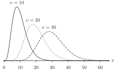

[上一篇](/lecture-notes/standard-normal-moments-stein-lemma/)由標準常態分配的各階原動差談到斯泰因引理，處理的都是[常態分配](/lecture-notes/normal-distribution/#def-normal)本身的動差。本篇轉入由常態分配衍生出來的抽樣分配，其中的第一個就是卡方分配。

卡方分配是[伽瑪分配](/lecture-notes/gamma-distribution/#def-gamma-distribution)把比例參數固定為 $2$、形狀參數寫成 $\frac{\,\nu\,}{2}$ 之後的特例，因此它的性質幾乎都可以由伽瑪分配推得，而能夠變動的參數只剩下一個，我們稱之為自由度。本篇先給出定義與四點說明，其中三點各附一個以[動差母函數](/lecture-notes/moment-generating-functions/#def-mgf)進行的證明，分別驗證任意伽瑪分配乘上 $\frac{2}{\,\beta\,}$ 之後即為卡方分配、彼此獨立的卡方分配相加之後自由度亦相加，以及標準常態分配的平方服從自由度為 $1$ 的卡方分配。

其後的兩道例題比較[指數分配](/lecture-notes/gamma-function-exponential-distribution/#def-exponential-distribution)、卡方分配與伽瑪分配三者的機率函數與其間的關係。最後給出[科克蘭定理](#thm-cochran-theorem)，並以它說明常態母體之下樣本變異數的抽樣分配，以及樣本平均數與樣本變異數彼此獨立這兩件事。

## 卡方分配

Definition 4.22 (卡方分配, chi-squared distribution)

**適用範圍**:

卡方分配 (chi-squared distribution) 是伽瑪分配的一種，然而因其參數設定較特殊，故單獨列為卡方分配的形式，並具有**自由度 (degree of freedom, df)**。

**值域範圍**:

$$
\mathcal{R}_{\sssig X}=\lbrace\,x\mid x\geqslant0\,\rbrace
$$

**表示式**:

$$
X\sim\chi^{2}(\nu)
$$

**自由度**:

$\nu>0$ 為卡方分配的自由度，通常設為正整數，但不限於此。

對應至伽瑪分配之參數，我們有

$$
\alpha=\frac{\,\nu\,}{2},\ \beta=2\ \Bigl(\lambda=\frac{1}{\,2\,}\Bigr)
$$

**機率函數**:

$$
f_{\sssig X}(x)=\frac{\,x^{\frac{\nu}{2}-1}e^{-\frac{x}{2}}\,}{2^{\frac{\nu}{2}}\Gamma\bigl(\frac{\nu}{2}\bigr)},\ x>0
$$

**期望值、變異數、動差母函數**:

$$
\mathbb{E}(X)=\nu,\quad \mathrm{Var}(X)=2\nu,\quad M_{\sssig X}(t)=(1-2t)^{-\frac{\nu}{2}},\ t<\frac{1}{\,2\,}
$$

$$
\begin{gathered}
\mathbb{E}(X)=\nu,\quad \mathrm{Var}(X)=2\nu,\\[0.45em]
M_{\sssig X}(t)=(1-2t)^{-\frac{\nu}{2}},\ t<\frac{1}{\,2\,}
\end{gathered}
$$

卡方分配有一些地方需要注意:

(1) 卡方分配是伽瑪分配的一種，其比例參數 $\beta$ 固定為 $2$ (或頻率參數 $\lambda$ 固定為 $\frac{1}{\,2\,}$)；形狀參數 $\alpha$ 則固定為 $\frac{\,\nu\,}{2}$ 的形式，也就是
{: .topic-paren-item}

$$
\chi^{2}(\nu)\sim\mathrm{Gamma}\Bigl(\alpha=\frac{\,\nu\,}{2},\ \beta=2\Bigr)
$$

因此，能夠影響卡方分配的參數只剩下 $\nu$，我們稱之為**自由度**。
{: .topic-paren-cont}

Note

如前文 [Example 4.47](/lecture-notes/normal-probability-computation/#ex-normal-prob-4) 所述，$\mathrm{Gamma}\bigl(\alpha=\frac{1}{\,2\,},\ \beta=2\bigr)$ 即為 $\chi^{2}(\nu=1)$ 分配。進一步而言，任意伽瑪分配皆可經由比例伸縮轉為卡方分配，此一轉換常用於建構樞紐量與檢定統計量，敘述如下:

若 $X\sim\mathrm{Gamma}(\alpha,\ \beta)$ 成立，令 $Y=\frac{2}{\,\beta\,}X$，則

$$
Y\sim\chi^{2}(2\alpha)
$$

**Proof.**

由動差母函數的定義可得

$$
\begin{aligned}
M_{\sssig Y}(t)&=\mathbb{E}\bigl(e^{tY}\bigr)=\mathbb{E}\bigl(e^{t\frac{2}{\beta}X}\bigr)=M_{\sssig X}\Bigl(\frac{\,2t\,}{\beta}\Bigr)\\[0.45em]
&=\Bigl(1-\beta\frac{2t}{\beta}\Bigr)^{-\frac{2\alpha}{2}},\ \frac{2t}{\beta}<\frac{1}{\,\beta\,}
\end{aligned}
$$

$$
\begin{aligned}
M_{\sssig Y}(t)&=\mathbb{E}\bigl(e^{tY}\bigr)=\mathbb{E}\bigl(e^{t\frac{2}{\beta}X}\bigr)\\[0.45em]
&=M_{\sssig X}\Bigl(\frac{\,2t\,}{\beta}\Bigr)\\[0.45em]
&=\Bigl(1-\beta\frac{2t}{\beta}\Bigr)^{-\frac{2\alpha}{2}},\ \frac{2t}{\beta}<\frac{1}{\,\beta\,}
\end{aligned}
$$

此即

$$
M_{\sssig Y}(t)=(1-2t)^{-\frac{2\alpha}{2}},\ t<\frac{1}{\,2\,}
$$

由 [mgf 的唯一性](/lecture-notes/uniqueness-of-the-mgf/#thm-mgf-uniqueness)可知

$$
Y\sim\chi^{2}(2\alpha)
$$

原式得證。 $\square$

(2) 伽瑪分配的可加性要求各隨機變數彼此獨立且比例參數相同 (見 [Definition 4.14](/lecture-notes/gamma-distribution/#def-gamma-distribution) 之後的第三項性質)；由於卡方分配的比例參數固定為 $2$，彼此獨立的卡方變數必具備可加性。若 $X_1,\ldots,X_n\overset{\mathrm{ind}}{\sim}\chi^{2}(\nu_i)$ 成立，令 $Y=\sum_{i=1}^{n}X_i$，則
{: .topic-paren-item}

$$
Y\sim\chi^{2}\Bigl(\sum_{i=1}^{n}\nu_i\Bigr)
$$

**Proof.**

由動差母函數的定義可得

$$
\begin{aligned}
M_{\sssig Y}(t)&=\mathbb{E}\bigl(e^{tY}\bigr)=\mathbb{E}\bigl(e^{t\sum_{i=1}^{n}X_i}\bigr)=\prod_{i=1}^{n}\mathbb{E}\bigl(e^{tX_i}\bigr)\qquad(\,\because X_i\ \text{間彼此獨立}\,)\\[0.45em]
&=\prod_{i=1}^{n}M_{\sssig X_i}(t)=\prod_{i=1}^{n}(1-2t)^{-\frac{\nu_i}{2}}=(1-2t)^{-\frac{\sum_{i=1}^{n}\nu_i}{2}},\ t<\frac{1}{\,2\,}
\end{aligned}
$$

$$
\begin{aligned}
M_{\sssig Y}(t)&=\mathbb{E}\bigl(e^{tY}\bigr)=\mathbb{E}\bigl(e^{t\sum_{i=1}^{n}X_i}\bigr)\\[0.45em]
&=\prod_{i=1}^{n}\mathbb{E}\bigl(e^{tX_i}\bigr)\\[0.25em]
&\qquad(\,\because X_i\ \text{間彼此獨立}\,)\\[0.45em]
&=\prod_{i=1}^{n}M_{\sssig X_i}(t)=\prod_{i=1}^{n}(1-2t)^{-\frac{\nu_i}{2}}\\[0.45em]
&=(1-2t)^{-\frac{\sum_{i=1}^{n}\nu_i}{2}},\ t<\frac{1}{\,2\,}
\end{aligned}
$$

由 mgf 的唯一性可知

$$
Y=\sum_{i=1}^{n}X_i\sim\chi^{2}\Bigl(\sum_{i=1}^{n}\nu_i\Bigr)
$$

原式得證。 $\square$

(3) 若 $Z\sim\mathcal{N}(0,1)$，令 $Y=Z^{2}$，則
{: .topic-paren-item}

$$
Y\sim\chi^{2}(1)
$$

**Proof.**

由動差母函數的定義可得

$$
\begin{aligned}
M_{\sssig Y}(t)&=\mathbb{E}\bigl(e^{tY}\bigr)=\mathbb{E}\bigl(e^{tZ^{2}}\bigr)=\int_{-\infty}^{\infty}e^{tz^{2}}\frac{1}{\,\sqrt{2\pi}\,}e^{-\frac{1}{2}z^{2}}\,dz\\[0.45em]
&=\frac{1}{\,\sqrt{2\pi}\,}\int_{-\infty}^{\infty}e^{-\frac{1-2t}{2}z^{2}}\,dz=\frac{1}{\,\sqrt{2\pi}\,}\times\frac{\sqrt{2\pi}}{\,\sqrt{1-2t}\,}\\[0.45em]
&=(1-2t)^{-\frac{1}{2}},\ t<\frac{1}{\,2\,}
\end{aligned}
$$

$$
\begin{aligned}
M_{\sssig Y}(t)&=\mathbb{E}\bigl(e^{tY}\bigr)=\mathbb{E}\bigl(e^{tZ^{2}}\bigr)\\[0.45em]
&=\int_{-\infty}^{\infty}e^{tz^{2}}\frac{1}{\,\sqrt{2\pi}\,}e^{-\frac{1}{2}z^{2}}\,dz\\[0.45em]
&=\frac{1}{\,\sqrt{2\pi}\,}\int_{-\infty}^{\infty}e^{-\frac{1-2t}{2}z^{2}}\,dz\\[0.45em]
&=\frac{1}{\,\sqrt{2\pi}\,}\times\frac{\sqrt{2\pi}}{\,\sqrt{1-2t}\,}\\[0.45em]
&=(1-2t)^{-\frac{1}{2}},\ t<\frac{1}{\,2\,}
\end{aligned}
$$

由 mgf 的唯一性可知

$$
Y=Z^{2}\sim\chi^{2}(1)
$$

原式得證。 $\square$

Note

上式正式證明了 [Example 4.47](/lecture-notes/normal-probability-computation/#ex-normal-prob-4) 提及的性質，即標準常態變數的平方服從 $\chi^{2}(\nu=1)$ 分配。結合性質 (2) 的可加性可知，若 $Z_1,\ldots,Z_n\overset{\mathrm{iid}}{\sim}\mathcal{N}(0,1)$ 成立，則

$$
\sum_{i=1}^{n}Z_i^{2}\sim\chi^{2}(n)
$$

(4) 卡方分配在不同自由度的圖形如下所示:
{: .topic-paren-item}

<figure id="fig-chi-square-density-family" class="topic-figure topic-figure--wide">
  
  <figcaption>Fig. 4.6. 三條密度曲線畫在同一組座標軸上，每一條的最高點上方標出它的自由度 $\nu$。$\nu$ 愈大，最高點愈往右移、也愈低，整條曲線隨之愈寬愈平坦。</figcaption>
</figure>

## 指數、卡方與伽瑪三個分配的關係

Example 4.51

<ol class="topic-list-paren">
  <li>What are the density functions of an exponential distribution, a chi-squared distribution, and a gamma distribution?</li>
  <li>What are the relationships among these three distributions?</li>
</ol>

(1) 指數分配: 令 $X\sim\mathrm{Exp}(\beta)$，則
{: .topic-paren-item}

$$
f_{\sssig X}(x)=\frac{1}{\,\beta\,}e^{-\frac{x}{\beta}},\ x\geqslant0
$$

卡方分配: 令 $X\sim\chi^{2}(\nu)$，則
{: .topic-paren-cont}

$$
f_{\sssig X}(x)=\frac{\,x^{\frac{\nu}{2}-1}e^{-\frac{x}{2}}\,}{2^{\frac{\nu}{2}}\Gamma\bigl(\frac{\nu}{2}\bigr)},\ x>0
$$

伽瑪分配: 令 $X\sim\mathrm{Gamma}(\alpha,\ \beta)$ 成立，則
{: .topic-paren-cont}

$$
f_{\sssig X}(x)=\frac{1}{\,\beta^{\alpha}\Gamma(\alpha)\,}x^{\alpha-1}e^{-\frac{x}{\beta}},\ x>0
$$

(2) 若 $X\sim\mathrm{Exp}(\beta)$，則
{: .topic-paren-item}

$$
X\sim\mathrm{Gamma}(\alpha=1,\ \beta)
$$

若 $X\sim\chi^{2}(\nu)$，則
{: .topic-paren-cont}

$$
X\sim\mathrm{Gamma}\Bigl(\alpha=\frac{\,\nu\,}{2},\ \beta=2\Bigr)
$$

若 $X\sim\chi^{2}(\nu=2)$，則
{: .topic-paren-cont}

$$
X\sim\mathrm{Gamma}\Bigl(\alpha=\frac{\,2\,}{2}=1,\ \beta=2\Bigr)\ \text{且}\ X\sim\mathrm{Exp}(\beta=2)
$$

$$
\begin{gathered}
X\sim\mathrm{Gamma}\Bigl(\alpha=\frac{\,2\,}{2}=1,\ \beta=2\Bigr)\\[0.45em]
\text{且}\ X\sim\mathrm{Exp}(\beta=2)
\end{gathered}
$$

Example 4.52

Let $Y$ be a normal random variable with mean $\mu=0$ and variance $\sigma^{2}=10$. Find the variance of $Y^{2}$.

由 $Y\sim\mathcal{N}(0,10)$，令 $Z=\frac{Y}{\,\sqrt{10}\,}$，則

$$
Z\sim\mathcal{N}(0,1)
$$

由此可得

$$
Z^{2}\sim\chi^{2}(1),\ \text{且}\ Z^{2}\sim\mathrm{Gamma}\Bigl(\alpha=\frac{1}{\,2\,},\ \beta=2\Bigr)
$$

$$
\begin{gathered}
Z^{2}\sim\chi^{2}(1),\\[0.45em]
\text{且}\ Z^{2}\sim\mathrm{Gamma}\Bigl(\alpha=\frac{1}{\,2\,},\ \beta=2\Bigr)
\end{gathered}
$$

又

$$
Y^{2}=10\cdot Z^{2}
$$

$$
\begin{aligned}
\Longrightarrow\ Y^{2}&\sim\mathrm{Gamma}\Bigl(\alpha=\frac{1}{\,2\,},\ \beta=20\Bigr)\\[0.25em]
&\quad(\,\text{由伽瑪分配比例伸縮性可知}\,)
\end{aligned}
$$

$$
Y^{2}=10\cdot Z^{2}
$$

$$
\begin{aligned}
\Longrightarrow\ Y^{2}&\sim\mathrm{Gamma}\Bigl(\alpha=\frac{1}{\,2\,},\ \beta=20\Bigr)\\[0.25em]
&\quad(\,\text{由伽瑪分配比例伸縮性可知}\,)
\end{aligned}
$$

因此

$$
\mathrm{Var}\bigl(Y^{2}\bigr)=\frac{1}{\,2\,}\times(20)^{2}=200
$$

## 科克蘭定理

Theorem 4.23 (科克蘭定理, Cochran’s theorem)

設 $\boldsymbol{Z}=\bigl[Z_1,\ldots,Z_n\bigr]^{\mathrm{T}}$ 之各分量滿足 $Z_1,\ldots,Z_n\overset{\mathrm{iid}}{\sim}\mathcal{N}(0,1)$，且其平方和分解為兩個二次型之和

$$
Q=\boldsymbol{Z}^{\mathrm{T}}\boldsymbol{Z}=Q_1+Q_2,\qquad Q_1=\boldsymbol{Z}^{\mathrm{T}}\mathbf{A}_1\boldsymbol{Z},\ \ Q_2=\boldsymbol{Z}^{\mathrm{T}}\mathbf{A}_2\boldsymbol{Z}
$$

$$
\begin{gathered}
Q=\boldsymbol{Z}^{\mathrm{T}}\boldsymbol{Z}=Q_1+Q_2,\\[0.4em]
Q_1=\boldsymbol{Z}^{\mathrm{T}}\mathbf{A}_1\boldsymbol{Z},\quad Q_2=\boldsymbol{Z}^{\mathrm{T}}\mathbf{A}_2\boldsymbol{Z}
\end{gathered}
$$

其中 $\mathbf{A}_1,\mathbf{A}_2$ 為 $n\times n$ 對稱矩陣且滿足 $\mathbf{A}_1+\mathbf{A}_2=\mathbb{I}_n$。若 $Q_1\sim\chi^{2}(\nu_1)$ (其中 $\nu_1<n$) 且 $Q_2\geqslant0$ 恆為非負 (即 $\mathbf{A}_2$ 為半正定矩陣)，則

(1)
{: .topic-paren-item}

$$
Q_2\sim\chi^{2}(n-\nu_1)
$$

(2)
{: .topic-paren-item}

$$
Q_1\indep Q_2
$$

**實務上的應用**: (說明常態母體下，$S^{2}$ 之抽樣分配與證明 $\overline{X}\indep S^{2}$)

**Proof.**

對樣本大小 $n\geqslant2$，令

$$
X_1,\ldots,X_n\overset{\mathrm{iid}}{\sim}\mathcal{N}(\mu,\sigma^{2}),\ \overline{X}=\frac{1}{\,n\,}\sum_{i=1}^{n}X_i,\ S^{2}=\frac{1}{\,n-1\,}\sum_{i=1}^{n}(X_i-\overline{X})^{2}
$$

$$
\begin{gathered}
X_1,\ldots,X_n\overset{\mathrm{iid}}{\sim}\mathcal{N}(\mu,\sigma^{2}),\\[0.45em]
\overline{X}=\frac{1}{\,n\,}\sum_{i=1}^{n}X_i,\\[0.45em]
S^{2}=\frac{1}{\,n-1\,}\sum_{i=1}^{n}(X_i-\overline{X})^{2}
\end{gathered}
$$

由於樣本平均數滿足 $\overline{X}\sim\mathcal{N}\bigl(\mu,\frac{\,\sigma^{2}\,}{n}\bigr)$ 這一分配，故可知

$$
\frac{\,\overline{X}-\mu\,}{\sqrt{\sigma^{2}/n}}\sim\mathcal{N}(0,1)
$$

且

$$
\left(\frac{\,\overline{X}-\mu\,}{\sqrt{\sigma^{2}/n}}\right)^{2}=\frac{\,n(\overline{X}-\mu)^{2}\,}{\sigma^{2}}\sim\chi^{2}(1)
$$

$$
\begin{aligned}
\left(\frac{\,\overline{X}-\mu\,}{\sqrt{\sigma^{2}/n}}\right)^{2}&=\frac{\,n(\overline{X}-\mu)^{2}\,}{\sigma^{2}}\\[0.45em]
&\sim\chi^{2}(1)
\end{aligned}
$$

又由常態分配標準化可知

$$
\frac{\,X_i-\mu\,}{\sigma}\overset{\mathrm{iid}}{\sim}\mathcal{N}(0,1)
$$

我們有

$$
\sum_{i=1}^{n}\left(\frac{\,X_i-\mu\,}{\sigma}\right)^{2}\sim\chi^{2}(n)
$$

經簡單計算可得

$$
\begin{aligned}
\frac{\,\sum_{i=1}^{n}(X_i-\mu)^{2}\,}{\sigma^{2}}&=\frac{\,n(\overline{X}-\mu)^{2}\,}{\sigma^{2}}+\frac{\,\sum_{i=1}^{n}(X_i-\overline{X})^{2}\,}{\sigma^{2}}\\[0.45em]
&=\frac{\,n(\overline{X}-\mu)^{2}\,}{\sigma^{2}}+\frac{\,(n-1)S^{2}\,}{\sigma^{2}}
\end{aligned}
$$

$$
\begin{aligned}
&\frac{\,\sum_{i=1}^{n}(X_i-\mu)^{2}\,}{\sigma^{2}}\\[0.45em]
&=\frac{\,n(\overline{X}-\mu)^{2}\,}{\sigma^{2}}+\frac{\,\sum_{i=1}^{n}(X_i-\overline{X})^{2}\,}{\sigma^{2}}\\[0.45em]
&=\frac{\,n(\overline{X}-\mu)^{2}\,}{\sigma^{2}}+\frac{\,(n-1)S^{2}\,}{\sigma^{2}}
\end{aligned}
$$

令標準化變數為 $Z_i=\frac{\,X_i-\mu\,}{\sigma}$，上式恰為標準常態隨機向量平方和的兩個對稱二次型分解，且 $\sum_{i=1}^{n}(X_i-\overline{X})^{2}\geqslant0$ 恆為非負，故由[科克蘭定理](#thm-cochran-theorem)可知

(1)
{: .topic-paren-item}

$$
\frac{\,(n-1)S^{2}\,}{\sigma^{2}}=\frac{\,\sum_{i=1}^{n}(X_i-\overline{X})^{2}\,}{\sigma^{2}}\sim\chi^{2}(n-1)
$$

$$
\begin{aligned}
\frac{\,(n-1)S^{2}\,}{\sigma^{2}}&=\frac{\,\sum_{i=1}^{n}(X_i-\overline{X})^{2}\,}{\sigma^{2}}\\[0.45em]
&\sim\chi^{2}(n-1)
\end{aligned}
$$

(2)
{: .topic-paren-item}

$$
\frac{\,n(\overline{X}-\mu)^{2}\,}{\sigma^{2}}\indep\frac{(n-1)S^{2}}{\sigma^{2}}=\frac{\,\sum_{i=1}^{n}(X_i-\overline{X})^{2}\,}{\sigma^{2}}
$$

$$
\begin{aligned}
\frac{\,n(\overline{X}-\mu)^{2}\,}{\sigma^{2}}&\indep\frac{(n-1)S^{2}}{\sigma^{2}}\\[0.45em]
&=\frac{\,\sum_{i=1}^{n}(X_i-\overline{X})^{2}\,}{\sigma^{2}}
\end{aligned}
$$

進一步由二次型分解的對稱矩陣正交性 (完整矩陣證明見[多元常態分配下的獨立性與二次形式](/lecture-notes/multivariate-normal-independence/#ex-multivariate-normal-ind-1)) 可推得線性組合 $\overline{X}$ 與二次型 $S^{2}$ 亦獨立，即
{: .topic-paren-cont}

$$
\overline{X}\indep S^{2}
$$

原式得證。 $\square$

Note

科克蘭定理的一般證明涉及正交矩陣對角化，超出本課程範圍，此處略去證明。若將前提改為已知 $Q_1$ 與 $Q_2$ 彼此獨立，則可直接由動差母函數相除證得自由度的拆解關係，見下題。

Example 4.53

Let $X_1$ and $X_2$ be independent random variables. Let $X_1$ and $Y=X_1+X_2$ have chi-squared distributions with $r_1$ and $r$ degrees of freedom, respectively, where $r_1<r$. Show that $X_2$ has a chi-squared distribution with $r-r_1$ degrees of freedom.

令 $X_1$ 與 $X_2$ 之 mgf 分別為 $M_{\sssig X_1}(t)$ 與 $M_{\sssig X_2}(t)$，由 $X_1\indep X_2$，可得

$$
M_{\sssig Y}(t)=M_{\sssig X_1}(t)\,M_{\sssig X_2}(t)
$$

又由 $Y=X_1+X_2\sim\chi^{2}(r)$ 以及 $X_1\sim\chi^{2}(r_1)$，且 $r>r_1$，則

$$
M_{\sssig Y}(t)=(1-2t)^{-\frac{r}{2}},\ t<\frac{1}{\,2\,},\quad M_{\sssig X_1}(t)=(1-2t)^{-\frac{r_1}{2}},\ t<\frac{1}{\,2\,}
$$

$$
\begin{gathered}
M_{\sssig Y}(t)=(1-2t)^{-\frac{r}{2}},\ t<\frac{1}{\,2\,},\\[0.45em]
M_{\sssig X_1}(t)=(1-2t)^{-\frac{r_1}{2}},\ t<\frac{1}{\,2\,}
\end{gathered}
$$

此即

$$
(1-2t)^{-\frac{r}{2}}=(1-2t)^{-\frac{r_1}{2}}\,M_{\sssig X_2}(t)
$$

$$
\Longrightarrow\ M_{\sssig X_2}(t)=\frac{(1-2t)^{-\frac{r}{2}}}{\,(1-2t)^{-\frac{r_1}{2}}\,}=(1-2t)^{-\frac{r-r_1}{2}},\ t<\frac{1}{\,2\,}
$$

$$
(1-2t)^{-\frac{r}{2}}=(1-2t)^{-\frac{r_1}{2}}\,M_{\sssig X_2}(t)
$$

$$
\begin{aligned}
\Longrightarrow\ M_{\sssig X_2}(t)&=\frac{(1-2t)^{-\frac{r}{2}}}{\,(1-2t)^{-\frac{r_1}{2}}\,}\\[0.45em]
&=(1-2t)^{-\frac{r-r_1}{2}},\ t<\frac{1}{\,2\,}
\end{aligned}
$$

由 mgf 唯一性可知

$$
X_2\sim\chi^{2}(r-r_1)
$$

## 本篇小結

[Definition 4.22](#def-chi-distribution) 的卡方分配只有自由度 $\nu$ 一個參數，值域為 $x\geqslant0$，機率函數為 $\frac{x^{\frac{\nu}{2}-1}e^{-\frac{x}{2}}}{2^{\frac{\nu}{2}}\Gamma(\frac{\nu}{2})}$ 這個式子，期望值為 $\nu$、變異數為 $2\nu$，動差母函數則是 $(1-2t)^{-\frac{\nu}{2}}$。這些結果不必另外推導。把伽瑪分配的形狀參數取 $\frac{\nu}{2}$ 且比例參數取 $2$，代入伽瑪分配的對應公式即得。

定義之後的四點說明，前三點各附一個證明，作法一律是求出動差母函數再由 mgf 的唯一性辨識分配。第一點指出任意的 $\mathrm{Gamma}(\alpha,\ \beta)$ 乘上 $\frac{2}{\beta}$ 之後即為 $\chi^{2}(2\alpha)$，這條轉換在樞紐量與檢定統計量的建構中很常用。第二點是可加性。比例參數固定為 $2$ 使卡方分配之間必定滿足伽瑪分配可加性的前提，故彼此獨立的卡方變數相加之後，自由度也跟著相加。第三點指出標準常態分配的平方服從 $\chi^{2}(1)$，與第二點合起來即得 $n$ 個獨立標準常態變數的平方和服從 $\chi^{2}(n)$ 這個結果。第四點則以密度曲線呈現自由度的作用。

[Example 4.51](#ex-chi-square-1) 把指數、卡方與伽瑪三個分配的機率函數並列，再指出三者的關係，即指數分配是 $\alpha=1$ 的伽瑪分配、卡方分配是 $\alpha=\frac{\nu}{2}$ 且 $\beta=2$ 的伽瑪分配，而 $\nu=2$ 時兩者重合。[Example 4.52](#ex-chi-square-2) 則是這幾條關係的一次演練。先把 $Y$ 標準化得到 $Z$，由 $Z^{2}\sim\chi^{2}(1)$ 換成伽瑪分配的寫法，再以比例伸縮性把 $Y^{2}=10Z^{2}$ 的分配寫成伽瑪分配 $\mathrm{Gamma}\bigl(\frac{1}{2},20\bigr)$，變異數因而是 $\frac{1}{2}\times20^{2}=200$ 這個值。

[Theorem 4.23](#thm-cochran-theorem) 的科克蘭定理處理的是卡方分配的二次型分解。若 $n$ 個獨立標準常態變數的平方和拆成兩個對稱二次型之和，其中一項服從 $\chi^{2}(\nu_1)$ 而另一項恆為非負，則後者必為 $\chi^{2}(n-\nu_1)$，而且兩者獨立。它的實務用途是把 $\frac{\sum_{i=1}^{n}(X_i-\mu)^{2}}{\sigma^{2}}$ 拆成 $\frac{n(\overline{X}-\mu)^{2}}{\sigma^{2}}$ 與 $\frac{(n-1)S^{2}}{\sigma^{2}}$ 兩項，前者服從 $\chi^{2}(1)$、整體服從 $\chi^{2}(n)$，由定理立得 $\frac{(n-1)S^{2}}{\sigma^{2}}\sim\chi^{2}(n-1)$ 以及 $\overline{X}\indep S^{2}$ 這兩個結果。科克蘭定理本身的證明遠超大學部的難度，本篇不證；但若把「$Q_2$ 非負」換成「$Q_1$ 與 $Q_2$ 獨立」，證明就只是動差母函數相除而已，[Example 4.53](#ex-chi-square-3) 即為此例。

[下一篇](/lecture-notes/student-t-distribution/)給出[司徒頓 $t$ 分配](/lecture-notes/student-t-distribution/#def-t-distribution)，它由一個標準常態變數除以一個卡方變數開根號之後的比值構成，本篇的 $\overline{X}\indep S^{2}$ 與 $\frac{(n-1)S^{2}}{\sigma^{2}}\sim\chi^{2}(n-1)$ 正是該分配應用於常態母體抽樣分配時的兩個關鍵前提。

## 參考文獻與延伸閱讀

- 黃文璋，2010，《機率論》，二版，華泰文化。
- Sheldon Ross. 2019. *A First Course in Probability*. 10th ed. Pearson.
- Robert V. Hogg, Joseph W. McKean, and Allen T. Craig. 2019. *Introduction to Mathematical Statistics*. 8th ed. Pearson.
- George Casella and Roger L. Berger. 2002. *Statistical Inference*. 2nd ed. Duxbury.
