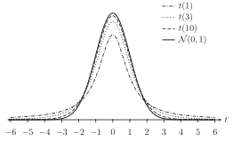
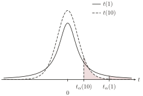

[上一篇](/lecture-notes/chi-squared-distribution/)給出[卡方分配](/lecture-notes/chi-squared-distribution/#def-chi-distribution)的定義，並以[科克蘭定理](/lecture-notes/chi-squared-distribution/#thm-cochran-theorem) (Cochran’s theorem) 處理常態隨機樣本的平方和如何拆解成兩個獨立的卡方變數。本篇接著介紹常用抽樣分配中的第三個，也就是司徒頓 $t$ 分配。

$t$ 分配的建構有賴於一個標準常態變數與一個與之獨立的卡方變數，其自由度即為該卡方變數的自由度。本篇先給出定義與機率函數，再由這個建構式逐階求出各階原動差，並說明自由度不足時各階動差為何發散。接著依序說明 $t$ 分配與[標準常態分配](/lecture-notes/normal-distribution/#def-normal)的關係、自由度為 $1$ 的特例，以及不同自由度之下密度曲線的形狀。

其後以一道例題檢驗這幾項性質，並由圖形比較不同自由度的右尾點。最後轉入常態母體下的抽樣分配，證明 $\sigma^{2}$ 未知時樣本平均數所對應的統計量服從 $t$ 分配，並一併整理常態母體下另外三個常用的抽樣分配結果。

## 司徒頓 $t$ 分配

Definition 4.23 (司徒頓 $t$ 分配, Student’s $t$ distribution)

**適用範圍**:

司徒頓 $t$ 分配 (Student’s $t$ distribution) 也是鐘形的一種，與標準常態分配很類似，但尾部機率較為肥厚。與卡方分配相似的是，司徒頓 $t$ 分配具有**自由度 (degree of freedom, df)**。

**值域範圍**:

$$
\mathcal{R}_{\sssig T}=\lbrace\,t\mid-\infty<t<\infty\,\rbrace
$$

**表示式**:

$$
T\sim t(\nu)
$$

**自由度**:

$\nu>0$ 為司徒頓 $t$ 分配的自由度，通常設為正整數，但不限於此。

**機率函數**:

$$
f_{\sssig T}(t)=\frac{\Gamma\bigl(\frac{\nu+1}{2}\bigr)}{\Gamma\bigl(\frac{\nu}{2}\bigr)\sqrt{\nu\pi}}\biggl(1+\frac{\,t^{2}\,}{\nu}\biggr)^{-\frac{\nu+1}{2}}=\frac{1}{\,\mathcal{B}\bigl(\frac{\nu}{2},\frac{1}{2}\bigr)\sqrt{\nu}\,}\biggl(1+\frac{\,t^{2}\,}{\nu}\biggr)^{-\frac{\nu+1}{2}},\ -\infty<t<\infty
$$

$$
\begin{aligned}
f_{\sssig T}(t)&=\frac{\Gamma\bigl(\frac{\nu+1}{2}\bigr)}{\Gamma\bigl(\frac{\nu}{2}\bigr)\sqrt{\nu\pi}}\biggl(1+\frac{\,t^{2}\,}{\nu}\biggr)^{-\frac{\nu+1}{2}}\\[0.45em]
&=\frac{1}{\,\mathcal{B}\bigl(\frac{\nu}{2},\frac{1}{2}\bigr)\sqrt{\nu}\,}\biggl(1+\frac{\,t^{2}\,}{\nu}\biggr)^{-\frac{\nu+1}{2}},\\[0.25em]
&\qquad-\infty<t<\infty
\end{aligned}
$$

**期望值、變異數**:

$$
\begin{gathered}
\mathbb{E}(T)=0,\ \nu>1\quad(\,\nu\leqslant1\ \text{時期望值發散}\,)\\[0.45em]
\mathrm{Var}(T)=\frac{\nu}{\,\nu-2\,},\ \nu>2\quad(\,\nu\leqslant2\ \text{時變異數發散}\,)
\end{gathered}
$$

$$
\begin{aligned}
\mathbb{E}(T)&=0,\ \nu>1\\[0.25em]
&\qquad(\,\nu\leqslant1\ \text{時期望值發散}\,)
\end{aligned}
$$

$$
\begin{aligned}
\mathrm{Var}(T)&=\frac{\nu}{\,\nu-2\,},\ \nu>2\\[0.25em]
&\qquad(\,\nu\leqslant2\ \text{時變異數發散}\,)
\end{aligned}
$$

司徒頓 $t$ 分配有一些地方需要注意:

(1) $t$ 分配的建構有賴於獨立的標準常態分配與卡方分配，構造如下:
{: .topic-paren-item}

$$
\boxed{\ \text{令 }Z\sim\mathcal{N}(0,1)\indep X\sim\chi^{2}(\nu)\text{，定義 }T=\frac{Z}{\,\sqrt{X/\nu}\,}\text{，則 }T\sim t(\nu)\ }
$$

$$
\boxed{
\begin{gathered}
\text{令 }Z\sim\mathcal{N}(0,1)\indep X\sim\chi^{2}(\nu)\text{，}\\[0.35em]
\text{定義 }T=\frac{Z}{\,\sqrt{X/\nu}\,}\text{，則 }T\sim t(\nu)
\end{gathered}
}
$$

其中，司徒頓 $t$ 分配的自由度 $\nu$，正是卡方分配的自由度 $\nu$。
{: .topic-paren-cont}

(2) 證明司徒頓 $t$ 分配的各階動差時，我們可以借助 $Z\indep X$ 的特性來完成。證明如下:
{: .topic-paren-item}

**Proof.**

先求期望值，可得

$$
\mathbb{E}(T)=\mathbb{E}\biggl(\frac{Z}{\,\sqrt{X/\nu}\,}\biggr)=\mathbb{E}(Z)\,\mathbb{E}\biggl(\frac{1}{\,\sqrt{X/\nu}\,}\biggr)=0\times\nu^{\frac{1}{2}}\times\mathbb{E}\bigl(X^{-\frac{1}{2}}\bigr)=0
$$

$$
\begin{aligned}
\mathbb{E}(T)&=\mathbb{E}\biggl(\frac{Z}{\,\sqrt{X/\nu}\,}\biggr)\\[0.45em]
&=\mathbb{E}(Z)\,\mathbb{E}\biggl(\frac{1}{\,\sqrt{X/\nu}\,}\biggr)\\[0.45em]
&=0\times\nu^{\frac{1}{2}}\times\mathbb{E}\bigl(X^{-\frac{1}{2}}\bigr)=0
\end{aligned}
$$

其中，$\mathbb{E}\bigl(X^{-\frac{1}{2}}\bigr)$ 在 $\nu\leqslant1$ 時並不存在，故 $\mathbb{E}(T)$ 不存在。

接著求二階原動差，可得

$$
\begin{aligned}
\mathbb{E}\bigl(T^{2}\bigr)&=\mathbb{E}\biggl(\frac{Z^{2}}{\,X/\nu\,}\biggr)=\mathbb{E}\bigl(Z^{2}\bigr)\times\nu\times\mathbb{E}\biggl(\frac{1}{\,X\,}\biggr)\\[0.45em]
&=1\times\nu\times\mathbb{E}\bigl(X^{-1}\bigr)=\nu\times\frac{1}{\,\nu-2\,}=\frac{\nu}{\,\nu-2\,}
\end{aligned}
$$

$$
\begin{aligned}
\mathbb{E}\bigl(T^{2}\bigr)&=\mathbb{E}\biggl(\frac{Z^{2}}{\,X/\nu\,}\biggr)\\[0.45em]
&=\mathbb{E}\bigl(Z^{2}\bigr)\times\nu\times\mathbb{E}\biggl(\frac{1}{\,X\,}\biggr)\\[0.45em]
&=1\times\nu\times\mathbb{E}\bigl(X^{-1}\bigr)\\[0.45em]
&=\nu\times\frac{1}{\,\nu-2\,}=\frac{\nu}{\,\nu-2\,}
\end{aligned}
$$

故有

$$
\mathrm{Var}(T)=\frac{\nu}{\,\nu-2\,}
$$

其中，$\mathbb{E}\bigl(X^{-1}\bigr)=\frac{1}{\,\nu-2\,}$ 在 $\nu\leqslant2$ 時並不存在，故 $\mathbb{E}\bigl(T^{2}\bigr)$ 不存在。

再求三階原動差，可得

$$
\mathbb{E}\bigl(T^{3}\bigr)=\mathbb{E}\bigl[Z^{3}(X/\nu)^{-\frac{3}{2}}\bigr]=\mathbb{E}\bigl(Z^{3}\bigr)\,\mathbb{E}\bigl[(X/\nu)^{-\frac{3}{2}}\bigr]=0\times\nu^{\frac{3}{2}}\times\mathbb{E}\bigl(X^{-\frac{3}{2}}\bigr)=0
$$

$$
\begin{aligned}
\mathbb{E}\bigl(T^{3}\bigr)&=\mathbb{E}\bigl[Z^{3}(X/\nu)^{-\frac{3}{2}}\bigr]\\[0.45em]
&=\mathbb{E}\bigl(Z^{3}\bigr)\,\mathbb{E}\bigl[(X/\nu)^{-\frac{3}{2}}\bigr]\\[0.45em]
&=0\times\nu^{\frac{3}{2}}\times\mathbb{E}\bigl(X^{-\frac{3}{2}}\bigr)=0
\end{aligned}
$$

故有

$$
\alpha_{\sssig 3}=0\ \ (\nu>3)
$$

由此可知 $t$ 分配為對稱分配。其中，$\mathbb{E}\bigl(X^{-\frac{3}{2}}\bigr)$ 在 $\nu\leqslant3$ 時並不存在，故 $\mathbb{E}\bigl(T^{3}\bigr)$ 不存在。

最後求四階原動差，可得

$$
\begin{aligned}
\mathbb{E}\bigl(T^{4}\bigr)&=\mathbb{E}\bigl[Z^{4}(X/\nu)^{-2}\bigr]=\mathbb{E}\bigl(Z^{4}\bigr)\,\mathbb{E}\bigl[(X/\nu)^{-2}\bigr]=3\times\nu^{2}\times\mathbb{E}\bigl(X^{-2}\bigr)\\[0.45em]
&=3\times\nu^{2}\times\frac{1}{\,(\nu-2)(\nu-4)\,}=\frac{3\nu^{2}}{\,(\nu-2)(\nu-4)\,}
\end{aligned}
$$

$$
\begin{aligned}
\mathbb{E}\bigl(T^{4}\bigr)&=\mathbb{E}\bigl[Z^{4}(X/\nu)^{-2}\bigr]\\[0.45em]
&=\mathbb{E}\bigl(Z^{4}\bigr)\,\mathbb{E}\bigl[(X/\nu)^{-2}\bigr]\\[0.45em]
&=3\times\nu^{2}\times\mathbb{E}\bigl(X^{-2}\bigr)\\[0.45em]
&=3\times\nu^{2}\times\frac{1}{\,(\nu-2)(\nu-4)\,}\\[0.45em]
&=\frac{3\nu^{2}}{\,(\nu-2)(\nu-4)\,}
\end{aligned}
$$

故有

$$
\alpha_{\sssig 4}=\frac{\,3(\nu-2)\,}{\nu-4}>3\ \ (\nu>4)
$$

由此可知 $t$ 分配為厚尾分配。其中，$\mathbb{E}\bigl(X^{-2}\bigr)=\frac{1}{\,(\nu-2)(\nu-4)\,}$ 在 $\nu\leqslant4$ 時並不存在，故 $\mathbb{E}\bigl(T^{4}\bigr)$ 不存在。

原式得證。 $\square$

Note

上述推導利用卡方分配作為[伽瑪分配](/lecture-notes/gamma-distribution/#def-gamma-distribution)特例的動差公式求算負次方期望值。前文推導伽瑪分配 $k$ 階原動差時將 $k$ 限於非負整數 $k\in\bigl(\lbrace0\rbrace\cup\mathbb{N}\bigr)$，正是由於當 $k$ 取負值而使伽瑪函數自變數滿足 $\alpha+k\leqslant0$ 時，對應的反常積分發散；此即 $t(\nu)$ 分配自第 $\nu$ 階起各階動差皆不存在的原因。

此外，推導偏態與峰態時亦用及標準常態分配的四階原動差 $\mathbb{E}\bigl(Z^{4}\bigr)=3$ (即其[峰態係數](/lecture-notes/measures-of-shape/#def-kurtosis)) 及原動差與主動差的換算關係。

(3) $t$ 分配與標準常態分配非常相似，其中，當自由度 $\nu$ 上升時，變異數 $\mathrm{Var}(T)=\frac{\nu}{\,\nu-2\,}$ 會向下趨近於 $1$；而峰態係數 $\alpha_{\sssig 4}=\frac{\,3(\nu-2)\,}{\nu-4}$ 則向下趨近於 $3$，與標準常態分配越來越接近。進一步而言，我們有
{: .topic-paren-item}

$$
\boxed{\ \text{若 }T\sim t(\nu)\text{，則 }T\xrightarrow[\ \nu\to\infty\ ]{\ \mathrm{d}\ }Z\sim\mathcal{N}(0,1)\ }
$$

$$
\boxed{
\begin{gathered}
\text{若 }T\sim t(\nu)\text{，則}\\[0.35em]
T\xrightarrow[\ \nu\to\infty\ ]{\ \mathrm{d}\ }Z\sim\mathcal{N}(0,1)
\end{gathered}
}
$$

Note

當 $\nu>4$ 時，標準常態分配與 $t(\nu)$ 分配的期望值皆為 $0$，而峰態係數由上方趨近於 $3$ 反映出在遠離中心的相同尾部位置上，$t$ 分配具有較高的機率密度與較大的**尾機率 (tail-probability)**；隨著自由度增大，尾部逐漸收攏而逼近標準常態分配。至於 $T\xrightarrow[\,\nu\to\infty\,]{\mathrm{d}}\mathcal{N}(0,1)$ 的嚴格證明，須先由後文的**弱大數法則 (weak law of large numbers, WLLN)** 證得 $X/\nu\xrightarrow[\,\nu\to\infty\,]{\mathrm{p}}1$，再結合下一章的**連續映射定理 (continuous mapping theorem)** 與**史拉斯基定理 (Slutsky’s theorem)** 完成。

(4) 自由度為 $1$ 的 $t$ 分配 (即 $t(1)$ 分配) 亦稱作**標準柯西分配 (standard Cauchy distribution)**，其機率密度函數為
{: .topic-paren-item}

$$
f_{\sssig X}(x)=\frac{1}{\,\pi(1+x^{2})\,},\ -\infty<x<\infty
$$

由於此分配雙尾衰減過慢、尾部機率過於肥厚，使絕對一階動差 $\mathbb{E}(\lvert X\rvert)$ 發散，依定義其期望值不存在，變異數與更高階動差亦隨之發散。
{: .topic-paren-cont}

(5) 司徒頓 $t$ 分配在不同自由度與標準常態分配的圖形如下所示:
{: .topic-paren-item}

<figure id="fig-student-t-density-family" class="topic-figure topic-figure--wide">
  
  <figcaption>Fig. 4.7. 四條密度曲線畫在同一組座標軸上，都以 $0$ 為中心左右對稱。自由度愈小，中央的高度愈低，兩側的尾部愈厚；自由度愈大，曲線就愈貼近圖例中標為 $\mathcal{N}(0,1)$ 的那一條。</figcaption>
</figure>

由上圖可見，$t$ 分配相較於標準常態分配明顯較為厚尾；隨著自由度 $\nu$ 增大，其密度曲線則逐漸貼近標準常態分配。
{: .topic-paren-cont}

## $t$ 分配的性質與不同自由度的右尾點

Example 4.54

Which one of the following statements regarding the $t$-distribution is **incorrect**?

(A) The mean can be negative.
{: .topic-paren-item}

(B) As the degrees of freedom get larger, the $t$-distribution approaches the standard normal distribution.
{: .topic-paren-item}

(C) The $t$-distribution is symmetric.
{: .topic-paren-item}

(D) For degrees of freedom $\nu_1>\nu_2$, the value of $t_{\alpha}(\nu_1)$ is always smaller than the value of $t_{\alpha}(\nu_2)$ (using right-tail probability $0<\alpha<0.5$).
{: .topic-paren-item}

答案選 (A)，因為若 $t$ 分配的期望值存在，則必定為 $0$。

Note

選項 (D) 的尾點大小關係可見下圖:

<figure id="fig-student-t-tail-comparison" class="topic-figure topic-figure--wide">
  
  <figcaption>Fig. 4.8. 兩條密度曲線各取一塊機率相同的右尾，起點分別為 $t_{\alpha}(10)$ 與 $t_{\alpha}(1)$，可見前者的位置落在後者的左邊。</figcaption>
</figure>

由上圖可見，固定右尾機率 $0<\alpha<\frac{1}{\,2\,}$ 時，自由度較大的 $t$ 分配尾部較薄，故對應的右尾點數值較小，即

$$
t_{\alpha}(\nu_1)>t_{\alpha}(\nu_2),\ \forall\,0<\nu_1<\nu_2,\ 0<\alpha<\frac{1}{\,2\,}
$$

基於同樣的理由，在 $0<\alpha<\frac{1}{\,2\,}$ 之下，我們也有

$$
z_{\sssig \alpha}<t_{\alpha}(\nu),\ \forall\,\nu>0,\ 0<\alpha<\frac{1}{\,2\,}
$$

## 常態母體下的抽樣分配

以下轉入常態母體下統計量的抽樣分配。下列各項結果談的是常態隨機樣本所算出的統計量服從什麼分配，而 $t$ 分配在其中扮演的角色，正是 $\sigma^{2}$ 未知時樣本平均數所對應的分配。

Theorem 4.24 (樣本平均數 $\overline{X}$ 的抽樣分配 ($\sigma^{2}$ 未知), sampling distribution of $\overline{X}$)

若 $X_1,X_2,\ldots,X_n\overset{\mathrm{iid}}{\sim}\mathcal{N}(\mu,\sigma^{2})$ ($n\geqslant2$) 成立，其中 $\mu$ 為待估參數，且 $\sigma^{2}$ 未知，則我們有下列結果

$$
T=\frac{\,\overline{X}-\mu\,}{\frac{S}{\,\sqrt{n}\,}}\sim t(n-1)
$$

其中

$$
S^{2}=\frac{1}{\,n-1\,}\sum_{i=1}^{n}\bigl(X_i-\overline{X}\bigr)^{2}
$$

**Proof.**

由科克蘭定理，我們已知

$$
\frac{\,(n-1)S^{2}\,}{\sigma^{2}}\sim\chi^{2}(n-1)\indep\frac{\,\overline{X}-\mu\,}{\frac{\sigma}{\,\sqrt{n}\,}}\sim\mathcal{N}(0,1)
$$

$$
\begin{gathered}
\frac{\,(n-1)S^{2}\,}{\sigma^{2}}\sim\chi^{2}(n-1)\\[0.35em]
\indep\frac{\,\overline{X}-\mu\,}{\frac{\sigma}{\,\sqrt{n}\,}}\sim\mathcal{N}(0,1)
\end{gathered}
$$

若令

$$
X=\frac{\,(n-1)S^{2}\,}{\sigma^{2}},\quad Z=\frac{\,\overline{X}-\mu\,}{\frac{\sigma}{\,\sqrt{n}\,}},\quad T=\frac{Z}{\,\sqrt{\frac{X}{\,n-1\,}}\,}
$$

$$
\begin{gathered}
X=\frac{\,(n-1)S^{2}\,}{\sigma^{2}},\\[0.45em]
Z=\frac{\,\overline{X}-\mu\,}{\frac{\sigma}{\,\sqrt{n}\,}},\\[0.45em]
T=\frac{Z}{\,\sqrt{\frac{X}{\,n-1\,}}\,}
\end{gathered}
$$

則 $T$ 符合 $t$ 分配的建構式 $T=\frac{Z}{\,\sqrt{X/\nu}\,}$，代入並化簡可得

$$
T=\frac{Z}{\,\sqrt{\frac{X}{\,n-1\,}}\,}=\frac{\frac{\overline{X}-\mu}{\frac{\sigma}{\sqrt{n}}}}{\,\sqrt{\frac{\frac{(n-1)S^{2}}{\sigma^{2}}}{n-1}}\,}=\frac{\,\frac{\overline{X}-\mu}{\frac{\sigma}{\sqrt{n}}}\,}{\frac{\,S\,}{\sigma}}=\frac{\,\overline{X}-\mu\,}{\frac{S}{\,\sqrt{n}\,}}\sim t(n-1)
$$

$$
\begin{aligned}
T&=\frac{Z}{\,\sqrt{\frac{X}{\,n-1\,}}\,}=\frac{\frac{\overline{X}-\mu}{\frac{\sigma}{\sqrt{n}}}}{\,\sqrt{\frac{\frac{(n-1)S^{2}}{\sigma^{2}}}{n-1}}\,}\\[0.45em]
&=\frac{\,\frac{\overline{X}-\mu}{\frac{\sigma}{\sqrt{n}}}\,}{\frac{\,S\,}{\sigma}}=\frac{\,\overline{X}-\mu\,}{\frac{S}{\,\sqrt{n}\,}}\sim t(n-1)
\end{aligned}
$$

原式得證。 $\square$

上述定理及其證明所依據的前提，構成應用統計學中最核心的常態母體抽樣分配結果，以下一併整理:

**樣本平均數 $\overline{X}$ 的抽樣分配 ($\sigma^{2}$ 已知)**:

若 $X_1,X_2,\ldots,X_n\overset{\mathrm{iid}}{\sim}\mathcal{N}(\mu,\sigma^{2})$ 成立，其中 $\mu$ 為待估參數且 $\sigma^{2}$ 已知，則

$$
Z=\frac{\,\overline{X}-\mu\,}{\frac{\sigma}{\,\sqrt{n}\,}}\sim\mathcal{N}(0,1)
$$

**Proof.**

這個結果只要使用[常態分配的線性組合可加性](/lecture-notes/normal-distribution/)就可以很簡單地得到。 $\square$

**樣本變異數 $S^{2}$ 的抽樣分配 ($\mu$ 未知)**:

若 $X_1,X_2,\ldots,X_n\overset{\mathrm{iid}}{\sim}\mathcal{N}(\mu,\sigma^{2})$ 成立，其中 $\sigma^{2}$ 為待估參數且 $\mu$ 未知，則

$$
\frac{\,(n-1)S^{2}\,}{\sigma^{2}}\sim\chi^{2}(n-1)
$$

**Proof.**

這個結果可由科克蘭定理得到。 $\square$

此外，在科克蘭定理的應用中，我們可以一併得到下面這個結果:

$$
\frac{\,\overline{X}-\mu\,}{\frac{\sigma}{\,\sqrt{n}\,}}\indep\frac{\,(n-1)S^{2}\,}{\sigma^{2}}
$$

在建構 $t$ 分配時，這是必不可缺的條件之一。

Note

前文以科克蘭定理推導上述獨立性時，亦用及母體期望值 $\mu$ 已知情況下的樣本變異數抽樣分配形式:

**樣本變異數 $S^{\prime2}$ 的抽樣分配 ($\mu$ 已知)**:

若 $X_1,X_2,\ldots,X_n\overset{\mathrm{iid}}{\sim}\mathcal{N}(\mu,\sigma^{2})$ 成立，其中 $\sigma^{2}$ 為待估參數，且 $\mu$ 已知，則我們有

$$
\frac{\,nS^{\prime2}\,}{\sigma^{2}}=\frac{\,\sum_{i=1}^{n}(X_i-\mu)^{2}\,}{\sigma^{2}}=\sum_{i=1}^{n}\biggl(\frac{\,X_i-\mu\,}{\sigma}\biggr)^{2}\sim\chi^{2}(n)
$$

$$
\begin{aligned}
\frac{\,nS^{\prime2}\,}{\sigma^{2}}&=\frac{\,\sum_{i=1}^{n}(X_i-\mu)^{2}\,}{\sigma^{2}}\\[0.45em]
&=\sum_{i=1}^{n}\biggl(\frac{\,X_i-\mu\,}{\sigma}\biggr)^{2}\sim\chi^{2}(n)
\end{aligned}
$$

其中

$$
S^{\prime2}=\frac{1}{\,n\,}\sum_{i=1}^{n}(X_i-\mu)^{2}
$$

**Proof.**

此結果僅由常態分配的標準化與卡方分配的特性即可得到。 $\square$

然而在實務上，若已知母體期望值 $\mu$，通常意味已掌握完整的母體資料 $X_1,X_2,\ldots,X_N$，自可直接算出母體變異數 $\sigma^{2}$ 而無須另行估計；故「已知 $\mu$ 而估計 $\sigma^{2}$」幾乎不會在實務中出現，上式主要作為理論推導的過渡橋樑。

綜觀上述討論，標準常態分配、卡方分配、司徒頓 $t$ 分配，以及下一篇即將介紹的**[斯內德克 $\mathcal{F}$ 分配](/lecture-notes/snedecor-f-distribution/#def-f-distribution) (Snedecor’s $\mathcal{F}$ distribution)**，合稱為統計學的四大**常用抽樣分配**；學習這類分配時，重點在於掌握其建構方式與對應的統計推論情境，而非視作孤立的機率模型。

## 本篇小結

[Definition 4.23](#def-t-distribution) 的司徒頓 $t$ 分配以一個自由度 $\nu$ 界定，值域為整條實數線，機率函數有兩種等價的寫法，其中以[貝塔函數](/lecture-notes/beta-function-and-distribution/#def-beta-function)表達的那一種把常數項寫成 $\frac{1}{\mathcal{B}(\frac{\nu}{2},\frac{1}{2})\sqrt{\nu}}$ 這一常數。這個分配的期望值在 $\nu>1$ 時為 $0$、變異數在 $\nu>2$ 時為 $\frac{\nu}{\nu-2}$，而定義中未列出動差母函數。

五點說明之中，第一點給出建構式 $T=\frac{Z}{\sqrt{X/\nu}}$，其中 $Z$ 為標準常態變數、$X$ 為與之獨立的卡方變數，$t$ 分配的自由度就是 $X$ 的自由度。第二點的證明正是靠這個建構式與獨立性完成。每一階原動差都拆成 $Z$ 的動差與 $X$ 的負次方動差兩者相乘，奇數階因 $\mathbb{E}(Z)=\mathbb{E}\bigl(Z^{3}\bigr)=0$ 而為 $0$，二階與四階則由 $\mathbb{E}\bigl(X^{-1}\bigr)=\frac{1}{\nu-2}$ 與 $\mathbb{E}\bigl(X^{-2}\bigr)=\frac{1}{(\nu-2)(\nu-4)}$ 得到 $\mathrm{Var}(T)=\frac{\nu}{\nu-2}$ 與峰態係數 $\alpha_{\sssig 4}=\frac{3(\nu-2)}{\nu-4}$ 這兩個結果。各階動差存在與否也由此得知，$\mathbb{E}\bigl(X^{-\frac{k}{2}}\bigr)$ 要在 $\nu>k$ 時才存在，因此自由度不夠大時，該階以上的動差全部發散。

第三點到第五點把 $t$ 分配放回標準常態分配旁邊比較。$\nu$ 上升時變異數向下趨近 $1$ 而峰態係數向下趨近 $3$，極限即為標準常態分配；$\nu=1$ 時則為標準柯西分配，期望值與變異數皆發散。[Example 4.54](#ex-student-t-1) 逐項檢驗這幾件事，錯誤的是期望值那一項，因為 $t$ 分配的期望值只要存在就必定為 $0$。其後那則註記由圖形說明另一項。相同的右尾機率 $0<\alpha<\frac{1}{\,2\,}$ 之下，自由度較大者的右尾點較小，也就是 $t_{\alpha}(\nu_1)>t_{\alpha}(\nu_2)$ 對一切 $0<\nu_1<\nu_2$ 成立，並因此有 $z_{\sssig \alpha}<t_{\alpha}(\nu)$ 這條不等式。

最後一節轉入常態母體下的抽樣分配。[Theorem 4.24](#thm-xbar-samp-dist) 把 $\sigma$ 換成樣本標準差 $S$ 之後，$\frac{\overline{X}-\mu}{S/\sqrt{n}}$ 服從 $t(n-1)$ 分配，證明的作法是指出它正好符合建構式。分子是標準化過的樣本平均數，分母是 $\frac{(n-1)S^{2}}{\sigma^{2}}$ 除以自由度之後開根號，而兩者的獨立性由科克蘭定理保證。同一節另外整理了三個結果，分別是$\sigma^{2}$ 已知時 $\frac{\overline{X}-\mu}{\sigma/\sqrt{n}}$ 為標準常態分配、$\mu$ 未知時 $\frac{(n-1)S^{2}}{\sigma^{2}}$ 服從 $\chi^{2}(n-1)$ 分配，以及 $\mu$ 已知時 $\frac{nS^{\prime2}}{\sigma^{2}}$ 服從 $\chi^{2}(n)$ 分配，最後這一個只作為推導的橋樑，實務上用不到。

[下一篇](/lecture-notes/snedecor-f-distribution/)介紹斯內德克 $\mathcal{F}$ 分配，它由兩個獨立卡方變數各自除以自由度之後的比值構成，正是兩獨立樣本變異數比值所服從的抽樣分配；該篇並給出 $\mathcal{F}$ 分配與貝塔分配的關係。

## 參考文獻與延伸閱讀

- 黃文璋，2010，《機率論》，二版，華泰文化。
- Sheldon Ross. 2019. *A First Course in Probability*. 10th ed. Pearson.
- Robert V. Hogg, Joseph W. McKean, and Allen T. Craig. 2019. *Introduction to Mathematical Statistics*. 8th ed. Pearson.
- George Casella and Roger L. Berger. 2002. *Statistical Inference*. 2nd ed. Duxbury.
