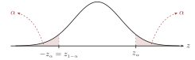

[上一篇](/lecture-notes/snedecor-f-distribution/)給出[斯內德克 $\mathcal{F}$ 分配](/lecture-notes/snedecor-f-distribution/#def-f-distribution)的定義，並以它處理兩個獨立樣本變異數比值的抽樣分配。到這裡為止，[常態分配](/lecture-notes/normal-distribution/#def-normal)、[卡方分配](/lecture-notes/chi-squared-distribution/#def-chi-distribution)、[司徒頓 $t$ 分配](/lecture-notes/student-t-distribution/#def-t-distribution)與斯內德克 $\mathcal{F}$ 分配這四個常用的抽樣分配都已經給出，本篇處理的是它們彼此之間的關係。

本篇分成兩個部分。前半把四個分配之間的數學關係整理成一條定理並逐項證明，證明的作法一致，都是把 $\mathcal{F}$ 變數寫回兩個獨立卡方變數各除以自身自由度之後的比值，再由定義認出所得的分配。後半轉入尾點的記法。以標準常態分配的圖形說明右尾點的意義，並交代同一個分界點在右尾表示法與左尾表示法之下的兩種等價寫法。

## 常用抽樣分配間的關係

前面的四個常用的抽樣分配彼此之間，具有一些數學上的關係，這些關係是「分配與分配」的關係，是前述的[隨機變數轉換](/lecture-notes/one-to-one-transformations/)的範疇。

Theorem 4.27 (常用抽樣分配的分配關係, relations among sampling distributions)

(1)
{: .topic-paren-item}

$$
T\sim t(\nu)\qquad\Longrightarrow\ T^{2}\sim\mathcal{F}(1,\nu)
$$

(2)
{: .topic-paren-item}

$$
Z\sim\mathcal{N}(0,1)\qquad\Longrightarrow\ Z^{2}\sim\chi^{2}(1)\ \text{且}\ Z^{2}\sim\mathcal{F}(1,\infty)
$$

$$
\begin{aligned}
Z&\sim\mathcal{N}(0,1)\\[0.45em]
&\qquad\Longrightarrow\ Z^{2}\sim\chi^{2}(1)\\[0.45em]
&\qquad\text{且}\ Z^{2}\sim\mathcal{F}(1,\infty)
\end{aligned}
$$

(3)
{: .topic-paren-item}

$$
F\sim\mathcal{F}(\nu_1,\nu_2)\qquad\Longrightarrow\ \frac{1}{\,F\,}\sim\mathcal{F}(\nu_2,\nu_1)
$$

(4)
{: .topic-paren-item}

$$
F\sim\mathcal{F}(\nu_1,\infty)\qquad\Longrightarrow\ \nu_1F\sim\chi^{2}(\nu_1)
$$

(5)
{: .topic-paren-item}

$$
F\sim\mathcal{F}(\nu_1,\nu_2)\qquad\Longrightarrow\ F\xrightarrow[\nu_1\to\infty,\ \nu_2\to\infty]{\mathrm{p}}\frac{\,1\,}{1}=1
$$

$$
\begin{aligned}
F&\sim\mathcal{F}(\nu_1,\nu_2)\\[0.4em]
&\qquad\Longrightarrow\ F\xrightarrow[\nu_1\to\infty,\ \nu_2\to\infty]{\mathrm{p}}\frac{\,1\,}{1}=1
\end{aligned}
$$

**Proof.**

(1) 令 $Z\sim\mathcal{N}(0,1)\indep X\sim\chi^{2}(\nu)$ 成立，則
{: .topic-paren-item}

$$
T=\frac{Z}{\,\sqrt{X/\nu}\,}\sim t(\nu)
$$

由此可得
{: .topic-paren-cont}

$$
T^{2}=\frac{Z^{2}}{\,X/\nu\,}
$$

又 $Z^{2}\sim\chi^{2}(1)\indep X$ 成立，故
{: .topic-paren-cont}

$$
T^{2}=\frac{\,Z^{2}/1\,}{X/\nu}\sim\mathcal{F}(1,\nu)
$$

(2) 令 $Z\sim t(\infty)$ 成立，則由 (1) 之結果可知
{: .topic-paren-item}

$$
Z^{2}\sim\mathcal{F}(1,\infty)
$$

又由 $Z\sim t(\infty)$ 可知 $Z\sim\mathcal{N}(0,1)$ 這件事情，故
{: .topic-paren-cont}

$$
Z^{2}\sim\chi^{2}(1)
$$

(3) 令 $X_1\sim\chi^{2}(\nu_1)\indep X_2\sim\chi^{2}(\nu_2)$ 成立，則我們有
{: .topic-paren-item}

$$
F=\frac{\,X_1/\nu_1\,}{X_2/\nu_2}\sim\mathcal{F}(\nu_1,\nu_2)
$$

由此可得
{: .topic-paren-cont}

$$
\frac{1}{\,F\,}=\frac{\,X_2/\nu_2\,}{X_1/\nu_1}\sim\mathcal{F}(\nu_2,\nu_1)
$$

(4) 令 $X_1\sim\chi^{2}(\nu_1)\indep X_2\sim\chi^{2}(\nu_2)$ 成立，則我們有
{: .topic-paren-item}

$$
F=\frac{\,X_1/\nu_1\,}{X_2/\nu_2}\sim\mathcal{F}(\nu_1,\nu_2)
$$

其中由後文的[弱大數法則](/lecture-notes/weak-law-and-central-limit-theorem/#thm-weak-law-of-large-numbers) (WLLN) 可得
{: .topic-paren-cont}

$$
\mathop{\mathrm{plim}}\limits_{\nu_2\to\infty}\frac{X_2}{\,\nu_2\,}=1
$$

故當 $\nu_2\to\infty$ 時，有
{: .topic-paren-cont}

$$
F=\frac{X_1}{\,\nu_1\,}\sim\mathcal{F}(\nu_1,\infty)
$$

由此可得
{: .topic-paren-cont}

$$
\nu_1F=X_1\sim\chi^{2}(\nu_1)
$$

(5) 令 $X_1\sim\chi^{2}(\nu_1)\indep X_2\sim\chi^{2}(\nu_2)$ 成立，則我們有
{: .topic-paren-item}

$$
F=\frac{\,X_1/\nu_1\,}{X_2/\nu_2}\sim\mathcal{F}(\nu_1,\nu_2)
$$

由 (4) 的過程可知
{: .topic-paren-cont}

$$
\mathop{\mathrm{plim}}\limits_{\nu_1\to\infty}\frac{X_1}{\,\nu_1\,}=1\quad\text{且}\quad\mathop{\mathrm{plim}}\limits_{\nu_2\to\infty}\frac{X_2}{\,\nu_2\,}=1
$$

$$
\begin{gathered}
\mathop{\mathrm{plim}}\limits_{\nu_1\to\infty}\frac{X_1}{\,\nu_1\,}=1\\[0.45em]
\text{且}\ \mathop{\mathrm{plim}}\limits_{\nu_2\to\infty}\frac{X_2}{\,\nu_2\,}=1
\end{gathered}
$$

由此可得
{: .topic-paren-cont}

$$
F=\frac{\,X_1/\nu_1\,}{X_2/\nu_2}\xrightarrow[\nu_1\to\infty,\ \nu_2\to\infty]{\mathrm{p}}\frac{1}{\,1\,}=1
$$

$$
\begin{aligned}
F=\frac{\,X_1/\nu_1\,}{X_2/\nu_2}&\xrightarrow[\nu_1\to\infty,\ \nu_2\to\infty]{\mathrm{p}}\frac{1}{\,1\,}=1
\end{aligned}
$$

原式得證。 $\square$

上述定理刻畫的是分配與分配之間的轉換關係；由此可進一步推得各分配之間的**尾點關係**，在假說檢定中相當實用。

## 右尾機率與右尾點

如前文[常態分配那一篇](/lecture-notes/normal-distribution/#fig-normal-right-tail-point)所述，密度曲線右側尾部所佔的機率稱為**右尾機率 (right-tail probability)**，對應的分界點即為**右尾點**。在推導各抽樣分配尾點的恆等關係之前，我們先藉由標準常態分配的對稱圖形說明**右尾點**的記號與不同表示法的對應。

<figure id="fig-right-tail-notation" class="topic-figure topic-figure--wide">
  
  <figcaption>Fig. 4.10. 曲線兩端各有一塊填色區域，面積同為 $\alpha$，右界 $z_{\sssig \alpha}$ 的右方有 $\alpha$ 的機率，左界 $-z_{\sssig \alpha}$ 的左方也有 $\alpha$ 的機率，曲線既然左右對稱，$-z_{\sssig \alpha}$ 與右尾寫法的 $z_{\sssig 1-\alpha}$ 就是同一個點。</figcaption>
</figure>

上圖中的右尾點 $z_{\sssig \alpha}$ 是指**右側尾機率為 $\alpha$ 的分界點**；由於標準常態分配對稱於 $0$，故 $z_{\sssig 1-\alpha}$ 與 $-z_{\sssig \alpha}$ 為同一個點。

Note

在右尾表示法下，$z_{\sssig 1-\alpha}$ 代表右尾機率為 $1-\alpha$ 的分界點，亦即左側累積機率為 $\alpha$ 的點；故恰對應左尾表示法下的 $z_{\sssig \alpha}$。

實務上 $\alpha$ 通常取 $0.05$ 或 $0.1$ 等較小的數值，此時右尾點 $z_{\sssig \alpha}$ 落在正半軸，而 $z_{\sssig 1-\alpha}$ 則落在負半軸；由於標準常態分配與 $t$ 分配皆對稱於 $0$，此二分配的左半部尾點常直接以負號改寫為 $-z_{\sssig \alpha}$ (或 $-t_{\alpha}(\nu)$) 的形式。

[下一篇](/lecture-notes/sampling-distribution-tail-points/)將依據上述分配間的轉換定理，逐一推導四大常用抽樣分配的尾點恆等關係，讀者可將兩組定理相互對照。

## 本篇小結

[Theorem 4.27](#thm-sampling-distribution-relations) 把四個常用抽樣分配之間的數學關係整理成五項。第 (1) 項說 $t$ 變數的平方服從 $\mathcal{F}(1,\nu)$；第 (2) 項說標準常態變數的平方同時服從 $\chi^{2}(1)$ 與 $\mathcal{F}(1,\infty)$；第 (3) 項說 $\mathcal{F}$ 變數取倒數之後，兩個自由度互換位置；第 (4) 項說分母自由度為無窮時，$\nu_1F$ 服從 $\chi^{2}(\nu_1)$；第 (5) 項說兩個自由度同時趨於無窮時，$F$ 機率收斂到 $1$ 這個值。

五項的證明作法一致。先把 $\mathcal{F}$ 變數還原成兩個獨立卡方變數各除以自身自由度之後的比值，再依定義認出所得的分配。第 (1) 項把 $T=\frac{Z}{\sqrt{X/\nu}}$ 平方，分子的 $Z^{2}$ 本身就是自由度為 $1$ 的卡方變數，因而湊成 $\mathcal{F}$ 分配的形式；第 (2) 項由 $t(\infty)$ 即為標準常態分配這件事情，接上第 (1) 項的結果；第 (3) 項把比值上下顛倒；第 (4) 項與第 (5) 項則用到 $\frac{X_i}{\nu_i}$ 在自由度趨於無窮時的機率極限為 $1$ 這個結果，該結果來自後面才會談到的弱大數法則。

本篇後半轉入尾點的記法。右尾點 $z_{\sssig \alpha}$ 指的是右邊剩下 $\alpha$ 的機率的那一個點；由於標準常態分配對稱於 $0$，$z_{\sssig 1-\alpha}$ 與 $-z_{\sssig \alpha}$ 是同一個點。這裡有兩點需要留意。其一，右尾表示法的 $z_{\sssig 1-\alpha}$ 與左尾表示法的 $z_{\sssig \alpha}$ 指的是同一個點，兩種表示法所固定的是分界點哪一側的機率；其二，$\alpha$ 通常取 $0.05$ 或 $0.1$ 一類的小數字，因此 $z_{\sssig \alpha}$ 落在分配的右半部，而 $z_{\sssig 1-\alpha}$ 落在分配的左半部並且是一個負數。

[下一篇](/lecture-notes/sampling-distribution-tail-points/)把這些分配關係轉換成各分配尾點之間的恆等關係，並逐條以圖形說明兩塊尾機率如何互相對應。

## 參考文獻與延伸閱讀

- 黃文璋，2010，《機率論》，二版，華泰文化。
- Sheldon Ross. 2019. *A First Course in Probability*. 10th ed. Pearson.
- Robert V. Hogg, Joseph W. McKean, and Allen T. Craig. 2019. *Introduction to Mathematical Statistics*. 8th ed. Pearson.
- George Casella and Roger L. Berger. 2002. *Statistical Inference*. 2nd ed. Duxbury.
